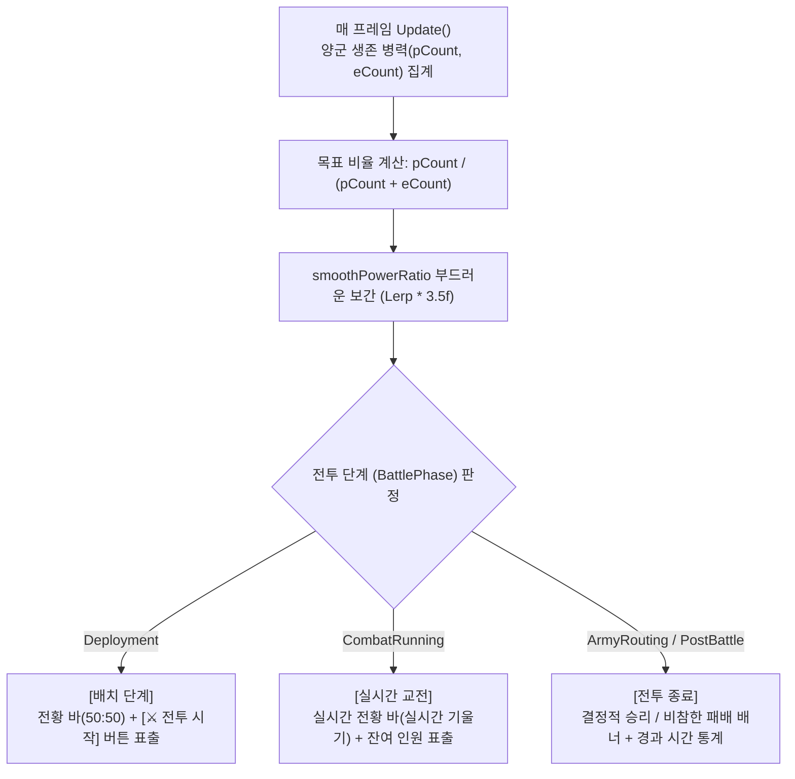

# ⚖️ [BalanceOfPowerUI.cs] 상단 전황 바 & 전투 시작 UI 아키텍처 가이드

> **원본 소스 파일**: [BalanceOfPowerUI.cs](file:///c:/unityProject/MiniTotalWar2D/Assets/Scripts/BalanceOfPowerUI.cs)

---

## 💡 1. 핵심 요약 & 역할 (Summary & Role)

`BalanceOfPowerUI.cs`는 화면 상단에 **실시간 양군 전력비(아군 생존 병력 vs 적군 생존 병력)를 표시하는 전황 게이지(Balance of Power Bar)**와, 배치 단계 동안 상단 중앙에 표출되는 **[⚔️ 전투 시작 (START)] 버튼**, 그리고 전투 종료 시 **[🏆 결정적 승리] / [💀 비참한 패배] 결과 배너**를 통합 렌더링하는 UI 매니저입니다.

유니티 순수 `OnGUI` 기반으로 제작되어 별도의 Canvas 프리팹 누락 문제 없이 **100% 독립적이고 안전하게 즉시 화면에 표출**됩니다.

---

## 🌳 2. 아키텍처 트리 맵 (Architecture Tree Map)

- 📁 **1. 초기화 및 수치 집계 (`Awake`, `Start`, `Update`)**
  - 싱글톤 보장, `BattleManager`의 전체 부대 생존 인원수 실시간 카운팅
  - 목표 전력비 계산 및 `Mathf.Lerp` 기반 부드러운 전황 바 애니메이션 보간
- 📁 **2. GUI 렌더링 파이프라인 (`OnGUI`, `InitTextures`)**
  - 동적 단색 텍스처(Texture2D) 생성 및 GUIStyle 캐싱
  - **상단 전황 바 (Balance of Power Bar)**: 380px 가로 바에 양군 비율 분할 렌더링 및 중앙 골드 분할선
  - **[전투 시작] 버튼**: `IsInDeployment == true`일 때 상단 중앙에 표출. 모든 아군 유닛이 하늘색 배치 구역 내부에 있을 때만 황금색 버튼이 활성화되어 누를 수 있으며, 1명이라도 바깥에 있으면 어두운 붉은색 비활성화 박스(`⚠️ 배치 구역 밖 유닛 있음 (N명)`)로 전환되고 클릭이 완벽 차단됨
  - **결과 배너**: `ArmyRouting` 또는 `PostBattle` 단계 진입 시 승패 텍스트 및 통계 표출

---

## 🗂️ 3. 해시 테이블 메서드/구조체 색인표 (Hash Table Index)

| Key (메서드 / 변수) | Value (역할, 의존성, 소스 줄 번호 링크) |
| :--- | :--- |
| `smoothPowerRatio` | 아군과 적군의 생존 병력 비율을 부드럽게 보간하는 내부 변수 (0.0=적군 100%, 1.0=아군 100%) [BalanceOfPowerUI.cs:L24](file:///c:/unityProject/MiniTotalWar2D/Assets/Scripts/BalanceOfPowerUI.cs#L24) |
| `InitTextures()` | 런타임에 필요한 단색 텍스처와 GUIStyle 폰트 크기/색상을 초기화 [BalanceOfPowerUI.cs:L81](file:///c:/unityProject/MiniTotalWar2D/Assets/Scripts/BalanceOfPowerUI.cs#L81) |
| `OnGUI()` | 매 프레임 화면 상단 전황 바, 전투 시작 버튼, 승패 배너를 직접 렌더링 [BalanceOfPowerUI.cs:L157](file:///c:/unityProject/MiniTotalWar2D/Assets/Scripts/BalanceOfPowerUI.cs#L157) |

---

## 🔀 4. 유향 그래프 흐름도 (Directed Graph - Mermaid)

---

## ⚙️ 5. 주요 상태 변수 & 인스펙터 필드 (State & Inspector Fields)

* `showUI` (bool): UI 활성화 여부 (기본: `true`)
* `playerPowerColor` (Color): 전황 바의 아군 측 색상 (청록색)
* `enemyPowerColor` (Color): 전황 바의 적군 측 색상 (붉은색)
* `frameColor` (Color): 전황 바의 외곽 다크 프레임 색상
* `playerTotalAlive` (int): 현재 아군 총 생존 병력 수
* `enemyTotalAlive` (int): 현재 적군 총 생존 병력 수

---

## 🛠️ 6. 핵심 알고리즘 및 렌더링 규칙 (Algorithms & GUI)

### 1) 실시간 전황 바 분할 렌더링
* 가로 폭 $W = 380px$인 전황 바에서:
  * 아군 폭: $W_{player} = W \times \text{clamp01}(Ratio_{smooth})$
  * 적군 폭: $W_{enemy} = W - W_{player}$
  * 중앙 분할선(White Divider)을 기준점으로 하여 양쪽으로 실시간 전력 우위가 시각적으로 역동적으로 기울어집니다.

### 2) [전투 시작] 버튼 원클릭 연동
* 버튼 폭 $240px$, 높이 $46px$의 골드 버튼을 누르면:
  `BattlePhaseManager.Instance.StartBattle()`이 즉각 호출되며, 버튼은 그 자리에서 페이드아웃되어 전투 화면을 가리지 않습니다.

---

## 🔗 7. 다른 스크립트와의 연동 관계 (Dependencies & Pipeline)

1. **`BattlePhaseManager.cs`**:
   * 현재 페이즈(`IsInDeployment`, `CurrentPhase`)를 읽어 전투 시작 버튼과 결과 배너의 표출 시점을 제어합니다.
2. **`BattleManager.cs`**:
   * `GetAllSquads()`를 통해 전장에 존재하는 모든 부대의 `MemberCount`를 가져와 전력비를 계산합니다.
