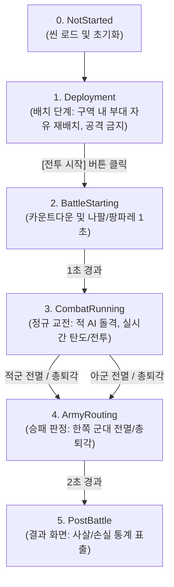

# 🏛️ [BattlePhaseManager.cs] 토탈워식 전투 수명주기 상태 머신 아키텍처 가이드

> **원본 소스 파일**: [BattlePhaseManager.cs](file:///c:/unityProject/MiniTotalWar2D/Assets/Scripts/BattlePhaseManager.cs)

---

## 💡 1. 핵심 요약 & 역할 (Summary & Role)

`BattlePhaseManager.cs`는 토탈워 전투 엔진의 **전체 수명주기(배치 -> 카운트다운/나팔 연출 -> 실시간 교전 -> 군대 손실/총퇴각 -> 사후 통계 결과)**를 엄격하게 제어하는 핵심 상태 머신(FSM) 매니저입니다.

플레이어의 [전투 시작] 버튼 입력을 받아 정규 교전으로 전이시키고, 양군의 생존 병력 및 사기 상태를 실시간 감시하여 승리/패배 판정 및 결과 화면 전환을 총괄합니다.

---

## 🌳 2. 아키텍처 트리 맵 (Architecture Tree Map)

- 📁 **1. 라이프사이클 및 싱글톤 (`Awake`, `Start`, `Update`)**
  - 인스턴스 싱글톤 보장, 씬 시작 시 `Deployment` 단계 자동 진입
  - 실시간 교전 중 경과 시간(`battleElapsedTime`) 누적 및 승패 조건 주기적 검사
- 📁 **2. 상태 머신 전이 파이프라인 (`SetPhase`, `StartBattle`)**
  - `SetPhase(BattlePhase newPhase)`: 상태 변경 및 `OnPhaseChanged` 이벤트 브로드캐스트
  - `StartBattle()`: [전투 시작] 버튼 트리거, 카운트다운 시퀀스 가동
  - `BattleStartingSequence()`: 1초 대기 후 `CombatRunning` 전이 및 적군 AI 공격 개시
- 📁 **3. 승패 및 군대 손실(Army Losses) 판정 (`CheckBattleEndConditions`, `EndBattle`)**
  - 양군 생존 병력/부대 수 실시간 집계
  - 전멸 또는 총패주 감지 시 `EndBattle(isPlayerVictory)` 트리거
  - `PostBattleSequence()`: 결과 배너 표출 후 사후 결과 단계로 전환

---

## 🗂️ 3. 해시 테이블 메서드/구조체 색인표 (Hash Table Index)

| Key (메서드 / 프로퍼티) | Value (역할, 의존성, 소스 줄 번호 링크) |
| :--- | :--- |
| `CurrentPhase` | 현재 전투 수명주기 상태를 반환하는 읽기 전용 프로퍼티 [BattlePhaseManager.cs:L36](file:///c:/unityProject/MiniTotalWar2D/Assets/Scripts/BattlePhaseManager.cs#L36) |
| `IsInDeployment` | 현재 배치 단계인지 여부 (이동 클램핑 및 공격 차단 판정) [BattlePhaseManager.cs:L37](file:///c:/unityProject/MiniTotalWar2D/Assets/Scripts/BattlePhaseManager.cs#L37) |
| `SetPhase()` | 상태 머신 상태를 전이하고 관련 매니저들에게 이벤트를 전파 [BattlePhaseManager.cs:L68](file:///c:/unityProject/MiniTotalWar2D/Assets/Scripts/BattlePhaseManager.cs#L68) |
| `StartBattle()` | 플레이어가 [전투 시작] 버튼 클릭 시 실시간 전투로 전환 (단, 아군 유닛이 배치 구역 바깥에 1명이라도 존재할 경우 전환 차단) [BattlePhaseManager.cs](file:///c:/unityProject/MiniTotalWar2D/Assets/Scripts/BattlePhaseManager.cs) |
| `CheckBattleEndConditions()` | 매 프레임 양군의 잔여 병력을 검사하여 승리/패배 판정 [BattlePhaseManager.cs:L129](file:///c:/unityProject/MiniTotalWar2D/Assets/Scripts/BattlePhaseManager.cs#L129) |
| `EndBattle()` | 승패 결과를 확정하고 결과 화면 시퀀스 가동 [BattlePhaseManager.cs:L174](file:///c:/unityProject/MiniTotalWar2D/Assets/Scripts/BattlePhaseManager.cs#L174) |

---

## 🔀 4. 유향 그래프 흐름도 (Directed Graph - Mermaid)

---

## ⚙️ 5. 주요 상태 변수 & 인스펙터 필드 (State & Inspector Fields)

* `currentPhase` (BattlePhase): 현재 전투 단계 (`NotStarted`, `Deployment`, `BattleStarting`, `CombatRunning`, `ArmyRouting`, `PostBattle`)
* `battleStartCountdown` (float): 전투 시작 버튼 누른 후 나팔/카운트다운 연출 대기 시간 (기본: 1.0초)
* `maxBattleDuration` (float): 전투 제한 시간 (기본: 0 = 무제한)
* `battleElapsedTime` (float): 실시간 전투 경과 시간 (초)

---

## 🛠️ 6. 핵심 알고리즘 및 규칙 (Algorithms & Rules)

### 1) 배치 단계 안전장치 (Deployment Safety Guards)
* `IsInDeployment == true`일 때:
  * 플레이어가 우클릭으로 부대를 이동하거나 회전/재배치할 때, 목표 좌표가 `DeploymentZoneManager`의 아군 배치 구역 밖으로 이탈하지 못하도록 좌표를 강제 클램핑합니다.
  * 플레이어가 적 유닛을 타겟팅하여 어택땅 또는 우클릭 돌격을 시도할 경우, 경고 메시지와 함께 명령이 차단되어 전투 개시 전 불필요한 난전을 방지합니다.

### 2) 실시간 승패 판정 알고리즘
* `BattleManager.GetAllSquads()`를 순회하며 `MemberCount > 0`인 부대의 진영(`isPlayer`)을 집계합니다.
* 적군 잔존 부대 수가 0이 되는 즉시 `EndBattle(true)`를 호출하여 불필요한 지연 없이 결정적 승리(Decisive Victory)를 선포합니다.

---

## 🔗 7. 다른 스크립트와의 연동 관계 (Dependencies & Pipeline)

1. **`BattleManager.cs`**:
   * 씬 시작 시 `BattlePhaseManager`를 자동 생성하고, `CombatRunning` 단계 전이 시 `StartCombatEngagement()`를 호출하여 적 AI 돌격을 개시합니다.
2. **`DeploymentZoneManager.cs`**:
   * `OnPhaseChanged` 이벤트를 수신하여 배치 단계 종료 시 지면의 배치 경계선 렌더러를 자동으로 숨김 처리합니다.
3. **`BalanceOfPowerUI.cs`**:
   * 배치 단계일 때 상단 중앙에 [전투 시작] 버튼을 표출하고, 승패 판정 시 결과 배너를 렌더링합니다.
4. **`PlayerController.cs`**:
   * `IsInDeployment` 상태를 참조하여 배치 구역 클램핑 및 조기 공격 차단을 수행합니다.
