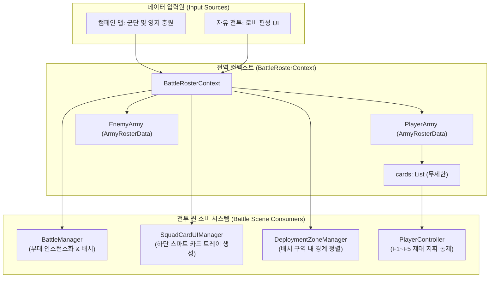

# 🎴 [BattleRosterContext.cs] 군단 로스터 데이터 파이프라인 아키텍처 가이드

> **원본 소스 파일**: [BattleRosterContext.cs](file:///c:/unityProject/MiniTotalWar2D/Assets/Scripts/BattleRosterContext.cs)

---

## 💡 1. 핵심 요약 & 역할 (Summary & Role)

`BattleRosterContext.cs`는 캠페인 모드와 자유 전투(커스텀 배틀) 모드에서 구성된 **플레이어 및 적군 군단의 유닛 카드 데이터(UnitCardData, ArmyRosterData)를 보관하고, 전투 씬(Battle Scene)의 배치 단계(Deployment Phase)로 무손실 전달하는 전역 데이터 전송 객체(DTO) 및 정적 컨텍스트 클래스**입니다.

삼국지 토탈워의 21장 제한을 극복하여 **부대 카드의 최대 수량을 무제한으로 지원**하며, 각 카드의 병종 ID, 실시간 생존 병력 수, 탄약 잔량, 숙련도 랭크, 소속 상위 제대(Echelon: F1~F5) 정보를 완벽하게 보존합니다.

---

## 🌳 2. 아키텍처 트리 맵 (Architecture Tree Map)

- 📁 **1. 개별 부대 카드 데이터 DTO (`UnitCardData`)**
  - 병종 식별자 (`unitTypeId`), 커스텀 부대명 (`customSquadName`)
  - 실시간 생존 병력 수 (`currentUnitCount`), 완편 기준 병력 수 (`maxUnitCount`)
  - 완편율 계산 프로퍼티 (`StrengthRatio`)
  - 가로 열(Columns) 수 (`columns`), 초기 진형 형태 (`formationType`)
  - 시작 탄약 잔량 비율 (`startingAmmoRatio`), 숙련도 랭크 (`veteranRank`)
  - 지휘관 부대 여부 (`isCommander`), 소속 상위 제대 (`assignedEchelon`)
  - 딥 카피 복제 메서드 (`Clone()`)
- 📁 **2. 군단 전체 로스터 DTO (`ArmyRosterData`)**
  - 진영 식별자 (`factionId`), 사령관 명칭 (`commanderName`)
  - 무제한 부대 카드 목록 (`cards`)
  - 특정 제대(F1~F5) 소속 카드 필터링 메서드 (`GetCardsByEchelon()`)
  - 군단 데이터 딥 카피 복제 메서드 (`Clone()`)
- 📁 **3. 전역 정적 컨텍스트 (`BattleRosterContext`)**
  - 플레이어 군단 로스터 (`PlayerArmy`), 적군 군단 로스터 (`EnemyArmy`)
  - 선택된 전장 맵 식별자 (`SelectedMapId`), 자유 전투 여부 플래그 (`IsCustomBattle`)
  - 에디터 단독 실행 방어용 기본 군단 자동 생성 (`EnsureDefaultFallback()`)
  - 컨텍스트 데이터 초기화 (`Clear()`)

---

## 🗂️ 3. 해시 테이블 메서드/구조체 색인표 (Hash Table Index)

| Key (메서드 / 구조체) | Value (역할, 의존성, 소스 줄 번호 링크) |
| :--- | :--- |
| `UnitCardData` | 개별 부대 카드의 편성 및 생명주기 상태 데이터를 직렬화하는 DTO 클래스 [BattleRosterContext.cs:L12](file:///c:/unityProject/MiniTotalWar2D/Assets/Scripts/BattleRosterContext.cs#L12) |
| `UnitCardData.StrengthRatio` | 완편 병력 대비 현재 생존 비율(0.0~1.0)을 반환하는 안전한 읽기 전용 프로퍼티 [BattleRosterContext.cs:L48](file:///c:/unityProject/MiniTotalWar2D/Assets/Scripts/BattleRosterContext.cs#L48) |
| `UnitCardData.Clone()` | 인게임 데이터 변조를 방지하는 부대 카드 딥 카피 메서드 [BattleRosterContext.cs:L50](file:///c:/unityProject/MiniTotalWar2D/Assets/Scripts/BattleRosterContext.cs#L50) |
| `ArmyRosterData` | 진영 및 무제한 부대 카드 목록을 담는 군단 단위 DTO 클래스 [BattleRosterContext.cs:L72](file:///c:/unityProject/MiniTotalWar2D/Assets/Scripts/BattleRosterContext.cs#L72) |
| `ArmyRosterData.GetCardsByEchelon()` | 특정 제대(F1~F5)에 소속된 부대 카드만 빠르게 필터링하여 반환 [BattleRosterContext.cs:L86](file:///c:/unityProject/MiniTotalWar2D/Assets/Scripts/BattleRosterContext.cs#L86) |
| `BattleRosterContext.EnsureDefaultFallback()` | 컨텍스트가 비어 있을 때 기본 5개 부대(보병/총병/궁병) 테스트 군단을 자동 세팅 [BattleRosterContext.cs:L124](file:///c:/unityProject/MiniTotalWar2D/Assets/Scripts/BattleRosterContext.cs#L124) |
| `BattleRosterContext.Clear()` | 전투 종료 후 메모리 누수를 방지하기 위해 정적 컨텍스트를 클리어 [BattleRosterContext.cs:L160](file:///c:/unityProject/MiniTotalWar2D/Assets/Scripts/BattleRosterContext.cs#L160) |

---

## 🔀 4. 유향 그래프 흐름도 (Directed Graph - Mermaid)

---

## ⚙️ 5. 주요 데이터 구조체 & 인스펙터 필드 (State, Structs & Fields)

### `UnitCardData` 필드 규격
* `unitTypeId` (string): 병종 식별자 (예: `"CHN_Infantry"`, `"CHN_Gunner"`, `"JPN_Tank_HaGo"`)
* `customSquadName` (string): UI 및 로그에 표출될 부대 고유 명칭 (예: `"제1연대 1대대"`)
* `currentUnitCount` (int): 전투 시작 시 생존 병력 수 (기본: 60)
* `maxUnitCount` (int): 완편 기준 최대 병력 수 (기본: 60)
* `columns` (int): 부대 가로 대형 열 수 (기본: 15)
* `formationType` (SquadFormationType): 초기 진형 (`Normal`, `Wedge`, `Square`, `Circle`, `Diamond`)
* `startingAmmoRatio` (float): 잔여 탄약 비율 (0.0~1.0, 기본: 1.0)
* `veteranRank` (int): 부대 숙련도 (0~9단계)
* `isCommander` (bool): 35m 사기 오라 발산 지휘관 부대 여부
* `assignedEchelon` (int): 소속 상위 제대 번호 (`1`=F1, `2`=F2, `3`=F3, `4`=F4, `5`=F5, `0`=미지정)

---

## 🛠️ 6. 핵심 알고리즘 및 동작 파이프라인 (Algorithms & Controls)

### 1) 무제한 카드 수용 및 제대 분할 조회 알고리즘
* `ArmyRosterData.GetCardsByEchelon(int echelonIndex)`를 통해 전체 수십~수백 개의 카드 중 현재 선택된 제대(`activeEchelon`)에 소속된 카드만 가비지 컬렉션(GC) 부하를 최소화하며 필터링합니다.

### 2) 에디터 단독 실행 방어 (Fallback Pipeline)
* 메인 메뉴나 로비 씬을 거치지 않고 유니티 에디터에서 배틀 씬을 직접 실행할 경우:
  `BattleRosterContext.EnsureDefaultFallback()`이 호출되어 플레이어 5개 부대(제1연대 3부대 + 제2연대 2부대)와 적군 3개 부대를 즉시 합성하여 널 참조 에러(NullReferenceException)를 100% 차단합니다.

---

## 🔗 7. 다른 스크립트와의 연동 관계 (Dependencies & Pipeline)

1. **`BattleManager.cs`**:
   * 씬 시작 시 `BattleRosterContext.EnsureDefaultFallback()`을 호출하고, `PlayerArmy.cards`를 순회하며 배치 구역에 부대를 동적 스폰합니다.
2. **`SquadCardUIManager.cs`**:
   * 로스터 컨텍스트의 카드 목록을 기반으로 하단 UI에 `SquadCardUI` 프리팹을 동적으로 인스턴스화하고, 상위 제대 탭(`[F1: 1연대]`, `[F2: 2연대]`)을 구성합니다.
3. **`PlayerController.cs`**:
   * 카드의 `assignedEchelon` 값을 읽어 `F1~F5` 상위 제대 단축키 시스템과 양방향으로 연동합니다.
