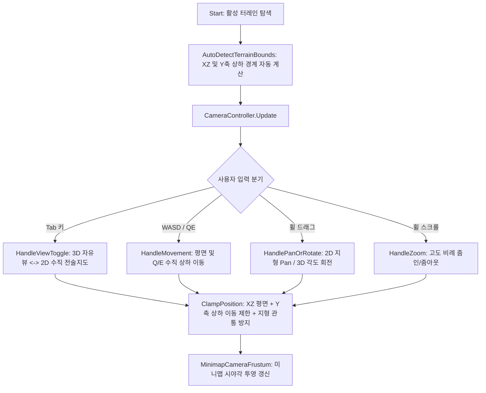

# 🎥 [CameraController.cs] 전장 전술 RTS 카메라 컨트롤러 가이드

> **원본 소스 파일**: [CameraController.cs](file:///c:/unityProject/MiniTotalWar2D/Assets/Scripts/CameraController.cs) (총 줄 수: 400줄)

---

## 💡 1. 핵심 요약 & 역할
토탈워 스타일의 전장 카메라 제어 시스템으로, **WASD 평면 이동, Q/E 수직 고도 조절, Tab키 3D 시점 ↔ 2D 탑다운 전술지도 전환, 마우스 휠 줌, 휠 클릭 궤도 회전/팬, 부대 더블클릭 화면 포커싱 및 3D 맵 경계 제한(XZ 평면 및 Y축 상하 고도 Clamping, 터레인 크기 자동 감지 Auto Bounds)**을 담당합니다.

---

## 🌳 2. 아키텍처 트리 맵 (Architecture Tree Map)

- 📁 **1. 생명주기 및 초기화 (Initialization)**
  - `Start()`: 메인 카메라 캐싱, 터레인 크기 자동 감지(`AutoDetectTerrainBounds`), 초기 3D/2D 높이 및 각도 백업
  - `Update()`: 시점 전환, 이동, 회전, 줌, 3D 경계 제한 일괄 호출
- 📁 **2. 시점 모드 전환 (`HandleViewToggle`)**
  - `Tab 키`: **3D 자유 쿼터뷰** (기본 고도 5~150m+, 피치 -45~88도로 언덕 위/하늘 상향 시야 완전 개방) ↔ **2D 전술지도 탑다운 뷰** (90도 완전 수직, 고도 20~350m+) 전환
- 📁 **3. 조작 및 내비게이션 서브시스템 (Navigation Subsystems)**
  - `HandleMovement()`: `WASD` 평면 이동 + `Q/E` 수직 Y축 상승/하강 + `LeftShift` 2배 가속
  - `HandlePanOrRotate()`: 마우스 휠 클릭 드래그 시 (2D 모드: 화면 팬 Pan / 3D 모드: 360도 궤도 회전, -45도 상향 올려다보기 지원)
  - `HandleZoom()`: 마우스 휠 스크롤 시 고도 비례 부드러운 줌인/줌아웃
  - `ClampPosition()`: XZ 평면 경계(`minXZ`, `maxXZ`) + **수직 Y축 상하 고도 경계(`minY`, `maxY`)** + 언덕 지형 관통 방지 최소 고도(`terrainH + 1.5f`) 삼중 보장
- 📁 **4. 원격 포커싱, 미니맵 및 터레인 연동 (Focus, Minimap & Auto Bounds)**
  - `FocusOnPosition(targetPos, dist, smooth)`: 부대 더블클릭 시 0.25초 부드러운 포커싱 코루틴 (`Co_FocusOn`)
  - `PanToWorldXZ(targetXZ, smooth)`: 미니맵 클릭 시 해당 지형 XZ 좌표로 카메라 지면 중심 이동
  - `AutoDetectTerrainBounds()`: 활성 터레인(Terrain)의 크기와 고도를 자동 감지하여 `minXZ`, `maxXZ`, `minY`, `maxY` 및 최대 시야각 1초 동기화

---

## 🗂️ 3. 해시 테이블 메서드 색인표 (Method Fast-Index Table)

| 메서드 (Key) | 반환형 / 파라미터 | 핵심 역할 & 기능 요약 (Value) | 호출자 (Callers) | 소스 줄 번호 (Line Range) |
| :--- | :--- | :--- | :--- | :--- |
| `AutoDetectTerrainBounds` | `void ()` | 활성 터레인 크기와 위치를 자동 감지하여 XZ/Y 이동 경계 1:1 동기화 | `Start`, 인스펙터 우클릭 컨텍스트 메뉴 | [CameraController.cs#L373-L400](file:///c:/unityProject/MiniTotalWar2D/Assets/Scripts/CameraController.cs#L373-L400) |
| `FocusOnPosition` | `void (targetPos, dist, smooth)` | 특정 3D 좌표로 시점 0.25초 부드러운 확대 이동 (상하 Y축 경계 적용) | `PlayerController` | [CameraController.cs#L109-L136](file:///c:/unityProject/MiniTotalWar2D/Assets/Scripts/CameraController.cs#L109-L136) |
| `PanToWorldXZ` | `void (targetXZ, smooth)` | 미니맵 클릭 시 지형 중심 XZ 좌표로 카메라 이동 (상하 Y축 경계 적용) | `MinimapManager` | [CameraController.cs#L146-L175](file:///c:/unityProject/MiniTotalWar2D/Assets/Scripts/CameraController.cs#L146-L175) |
| `HandleViewToggle` | `void ()` | `Tab` 키로 3D 뷰 ↔ 2D 탑다운 전술지도 뷰 전환 | `Update` | [CameraController.cs#L206-L237](file:///c:/unityProject/MiniTotalWar2D/Assets/Scripts/CameraController.cs#L206-L237) |
| `HandleMovement` | `void ()` | `WASD` 평면 이동 + `Q/E` 수직 이동 + `Shift` 가속 | `Update` | [CameraController.cs#L242-L286](file:///c:/unityProject/MiniTotalWar2D/Assets/Scripts/CameraController.cs#L242-L286) |
| `HandlePanOrRotate` | `void ()` | 휠 클릭 드래그 시 2D 화면 팬 / 3D 궤도 회전 | `Update` | [CameraController.cs#L291-L329](file:///c:/unityProject/MiniTotalWar2D/Assets/Scripts/CameraController.cs#L291-L329) |
| `HandleZoom` | `void ()` | 마우스 휠 스크롤 고도 비례 줌인/줌아웃 | `Update` | [CameraController.cs#L331-L343](file:///c:/unityProject/MiniTotalWar2D/Assets/Scripts/CameraController.cs#L331-L343) |
| `ClampPosition` | `void ()` | 맵 XZ 경계, Y축 상하 고도 경계, 지형 최소 고도 클램프 | `Update` | [CameraController.cs#L345-L371](file:///c:/unityProject/MiniTotalWar2D/Assets/Scripts/CameraController.cs#L345-L371) |

---

## 🔀 4. 유향 그래프 흐름도 (Data & Call Flow Graph)

---

## ⚙️ 5. 주요 상태 변수, 데이터 구조체 & 인스펙터 옵션

| 변수명 (Field) | 타입 | 기본값 | 상세 역할 및 인스펙터 튜닝 가이드 |
| :--- | :--- | :--- | :--- |
| `useBounds` | `bool` | `true` | 평면 XZ 및 수직 상하 Y축 이동 제한 활성화 여부 |
| `useHeightBounds` | `bool` | `true` | **수직 상하(Y축 고도) 이동 제한 활성화 여부** |
| `minY` | `float` | `5f` | **수직 상하 이동 최소 높이** (바닥 지면 최저 고도) |
| `maxY` | `float` | `300f` | **수직 상하 이동 최대 높이** (상공 최고 고도, 대규모 전장 뷰) |
| `minXZ` | `Vector2` | `(-450, -450)` | 평면 서쪽(X)/남쪽(Z, 화면 아래) 최소 이동 경계 |
| `maxXZ` | `Vector2` | `(450, 450)` | 평면 동쪽(X)/북쪽(Z, 화면 위) 최대 이동 경계 |
| `autoDetectBoundsOnStart` | `bool` | `true` | **게임 시작 시 활성 터레인 크기를 감지하여 경계 자동 동기화** |
| `minPitch` | `float` | `-45f` | 3D 시점 최소 상향 각도 (음수로 언덕 및 하늘 시원하게 관측) |
| `maxPitch` | `float` | `88f` | 3D 시점 최대 하향 각도 (지면 내려다보기) |

---

## 🛠️ 6. 핵심 알고리즘, 물리/전투 수학 공식 & 조작법

### 1) 3D 공간 경계 클램핑 (Spatial Clamping Formula)
카메라 위치 P = (x, y, z)에 대해:
- Y축 상하 고도: y = Clamp(y, Max(H_min, minY), Min(H_max, maxY))
- 지형 충돌 방지: y = Max(y, SampleHeight(x, z) + 1.5m)
- XZ 평면 경계: realMinX = Min(minXZ.x, maxXZ.x), realMaxX = Max(minXZ.x, maxXZ.x) 계산 후 안전 클램핑 (최소 20m 이상 여유 영역일 때만 제한 적용하여 카메라 고정 버그 원천 차단)

### 2) 카메라 조작 일람표
| 조작 키 / 마우스 | 기능 명칭 | 실제 동작 및 파라미터 |
| :--- | :--- | :--- |
| `W / A / S / D` | 전장 평면 이동 | 전/후/좌/우 카메라 수평 이동 (Time.unscaledDeltaTime 기반으로 일시정지 중에도 이동 가능) |
| `화면 모서리 마우스` | **화면 모서리 스크롤 (Edge Pan)** | 마우스 커서를 화면 가장자리 15px 이내로 가져갈 때 자동 카메라 스크롤 |
| `Q / E` | **수직 상하 고도 조절** | `Q`: 카메라 상승(+1), `E`: 카메라 하강(-1) (Y축 이동) |
| `LeftShift + 이동` | 고속 카메라 이동 | 이동 속도 가속 (`fastMoveMultiplier = 3f`) |
| `Tab 키` | 2D/3D 시점 토글 | 3D 자유 쿼터뷰 <-> 2D 전술지도 탑다운(90도 수직) 전환 |
| `마우스 휠 클릭 드래그` | 3D 회전 / 2D 팬 | 3D 모드: 360도 궤도 회전 / 2D 모드: 바닥 지형 드래그 팬 |
| `마우스 휠 스크롤` | **카메라 줌 (상하 고도)** | 고도(Y)에 비례한 부드러운 줌인/줌아웃 (`zoomSpeed = 5f`) |
| `부대 더블클릭` | 부대 시점 포커스 | 0.25초 부드러운 포커싱 확대 (`FocusOnPosition`) |

---

## 🔗 7. 다른 스크립트와의 연동 관계 (Dependencies)

- **[PlayerController.cs](file:///c:/unityProject/MiniTotalWar2D/Docs/PlayerController.md)**: 부대 더블클릭 시 `FocusOnPosition` 호출
- **[MinimapManager.cs](file:///c:/unityProject/MiniTotalWar2D/Docs/Minimap.md)**: 미니맵 클릭 시 `PanToWorldXZ` 호출, `MinXZ` / `MaxXZ` 경계 참조
- **[TerrainHeightManager.cs](file:///c:/unityProject/MiniTotalWar2D/Assets/Scripts/TerrainHeightManager.cs)**: 언덕 지형 충돌 방지를 위해 `SampleHeightFast` 호출
- **[MinimapCameraFrustum.cs](file:///c:/unityProject/MiniTotalWar2D/Assets/Scripts/MinimapCameraFrustum.cs)**: 메인 카메라 변환 좌표를 참조하여 미니맵 시야각 절두체 투영
