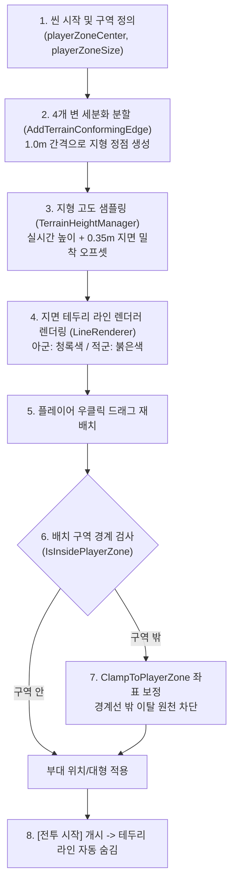

# 🗺️ [DeploymentZoneManager.cs] 토탈워식 부대 배치 구역 아키텍처 가이드

> **원본 소스 파일**: [DeploymentZoneManager.cs](file:///c:/unityProject/MiniTotalWar2D/Assets/Scripts/DeploymentZoneManager.cs)

---

## 💡 1. 핵심 요약 & 역할 (Summary & Role)

`DeploymentZoneManager.cs`는 토탈워 전투 시작 전 **아군 및 적군 군단의 합법적인 배치 사각 영역(Deployment Bounds)을 정의하고, 지형 높낮이에 밀착된 지면 테두리 선(LineRenderer)을 시각화하며, 플레이어의 부대 재배치 좌표를 구역 내부로 안전하게 클램핑하는 전술 공간 관리자**입니다.

배치 단계(`BattlePhase.Deployment`) 동안 활성화되며, [전투 시작] 버튼을 눌러 정규 교전으로 돌입하면 지면 테두리를 자동으로 숨겨 전장의 몰입감을 극대화합니다.

---

## 🌳 2. 아키텍처 트리 맵 (Architecture Tree Map)

- 📁 **1. 라이프사이클 및 라인 렌더러 생성 (`Awake`, `Start`, `OnDestroy`)**
  - 싱글톤 보장, 아군/적군 전용 `LineRenderer` 오브젝트 동적 생성
  - `BattlePhaseManager.OnPhaseChanged` 이벤트 구독 및 해제
  - 지형 데이터 비동기 안착 시 2차 자동 갱신 코루틴 (`DelayedVisualsRefresh`)
- 📁 **2. 지면 굴곡 밀착 시각화 렌더링 (`UpdateZoneVisuals`, `AddTerrainConformingEdge`)**
  - 사각 경계선의 4개 변을 `segmentStep`(기본 1.0m) 단위로 세분화 균등 분할
  - `TerrainHeightManager.SampleHeightFast` 지형 높이 실시간 샘플링 및 지면 위 `heightOffset`(+0.35m) 밀착
  - 산악 지형, 능선, 골짜기를 부드럽게 타넘는 지형 밀착 폐곡선 라인 렌더링
- 📁 **3. 기하학적 경계 검사 및 클램핑 (`IsInsidePlayerZone`, `ClampToPlayerZone`)**
  - AABB 사각 범위 기반 내/외부 판정
  - 경계 이탈 좌표에 대한 `Mathf.Clamp` 및 지형 고도 동기화

---

## 🗂️ 3. 해시 테이블 메서드/구조체 색인표 (Hash Table Index)

| Key (메서드 / 프로퍼티) | Value (역할, 의존성, 소스 줄 번호 링크) |
| :--- | :--- |
| `UpdateZoneVisuals()` | 아군 및 적군 사각 구역의 4개 변을 1m 단위로 샘플링하여 라인 렌더러를 갱신 [DeploymentZoneManager.cs](file:///c:/unityProject/MiniTotalWar2D/Assets/Scripts/DeploymentZoneManager.cs) |
| `AddTerrainConformingEdge()` | 모서리 두 점 사이를 지정 간격으로 분할하고 지형 높이를 샘플링하여 정점 추가 [DeploymentZoneManager.cs](file:///c:/unityProject/MiniTotalWar2D/Assets/Scripts/DeploymentZoneManager.cs) |
| `IsInsidePlayerZone()` | 특정 월드 X-Z 좌표가 아군 배치 구역 내부인지 O(1)로 검사 [DeploymentZoneManager.cs](file:///c:/unityProject/MiniTotalWar2D/Assets/Scripts/DeploymentZoneManager.cs) |
| `AreAllPlayerUnitsInsideZone()` | 모든 아군 유닛(Pure ECS 엔티티 및 GameObject 유닛)이 아군 배치 구역 내부에 완전히 존재하는지 전수 검사하고 바깥 유닛 수를 반환 [DeploymentZoneManager.cs](file:///c:/unityProject/MiniTotalWar2D/Assets/Scripts/DeploymentZoneManager.cs) |
| `ClampToPlayerZone()` | 이탈한 목표 좌표를 아군 배치 구역 사각 경계 내부로 클램핑하여 반환 [DeploymentZoneManager.cs](file:///c:/unityProject/MiniTotalWar2D/Assets/Scripts/DeploymentZoneManager.cs) |
| `IsInsideEnemyZone()` | 특정 월드 X-Z 좌표가 적군 배치 구역 내부인지 검사 [DeploymentZoneManager.cs](file:///c:/unityProject/MiniTotalWar2D/Assets/Scripts/DeploymentZoneManager.cs) |

---

## 🔀 4. 유향 그래프 흐름도 (Directed Graph - Mermaid)

---

## ⚙️ 5. 주요 상태 변수 & 인스펙터 필드 (State & Inspector Fields)

* `playerZoneCenter` (Vector3): 아군 군단 배치 구역의 중심점 (기본: `(0, 0, -60)`)
* `playerZoneSize` (Vector2): 아군 배치 구역의 가로 폭(X)과 깊이(Z) (기본: `160m x 40m`)
* `enemyZoneCenter` (Vector3): 적군 군단 배치 구역의 중심점 (기본: `(0, 0, 60)`)
* `enemyZoneSize` (Vector2): 적군 배치 구역의 가로 폭(X)과 깊이(Z) (기본: `160m x 40m`)
* `playerBorderColor` (Color): 지면에 표시되는 아군 경계선 색상 (청록색)
* `enemyBorderColor` (Color): 지면에 표시되는 적군 경계선 색상 (붉은색)
* `lineWidth` (float): 경계선 두께 (기본: `0.6m`)
* `segmentStep` (float): 지형 굴곡을 따라 경계선을 그릴 때 샘플링할 거리 간격 (단위: m, 기본: `1.0m`)
* `heightOffset` (float): 경계선이 지형에 묻히지 않도록 지면 위로 띄울 높이 (단위: m, 기본: `0.35m`)

---

## 🛠️ 6. 핵심 알고리즘 및 수학 공식 (Algorithms & Math)

### 1) 지형 굴곡 밀착 세분화 샘플링 알고리즘 (Terrain Conforming Sub-Division)
단순 4개 꼭짓점만 연결할 경우 언덕 지형에 라인이 파묻히거나 공중에 뜨는 결함을 해결하기 위해,
사각형의 각 변(Edge) 길이 `dist`를 `segmentStep`(1.0m) 단위로 분할하여 정점 목록을 생성합니다:
* 분할 수: `count = Max(1, Ceil(dist / segmentStep))`
* 단위 스텝 벡터: `stepVec = (end - start) / count`
* i번째 보간 정점: `P_i = start + (stepVec * i)`
* 지형 높이 실시간 반영: `P_i.y = TerrainHeightManager.SampleHeightFast(P_i.x, P_i.z) + heightOffset`

이를 통해 구역 크기가 160m이든 1,000m이든 상관없이, 지형의 모든 굴곡을 따라 완벽하게 흐르는 테두리가 생성됩니다.

### 2) 사각 경계 클램핑 공식
월드 좌표 P(x, z)에 대해 구역 중심 C(x, z)와 크기 S(w, d)가 주어질 때:
* X_clamped = Max(C.x - w/2, Min(P.x, C.x + w/2))
* Z_clamped = Max(C.z - d/2, Min(P.z, C.z + d/2))
* Y = TerrainHeight(X_clamped, Z_clamped)

---

## 🔗 7. 다른 스크립트와의 연동 관계 (Dependencies & Pipeline)

1. **`PlayerController.cs`**:
   * 배치 단계 중 플레이어가 부대를 단독 이동하거나 다중 부대 횡대 전열 배치(`CalculateMultiSquadLineDeployment`)를 할 때, `ClampToPlayerZone`을 호출하여 모든 부대 목적지가 구역 내에 안착하도록 보정합니다.
2. **`BattlePhaseManager.cs`**:
   * `OnPhaseChanged` 이벤트를 수신하여 전투 시작 시 테두리 선을 끄고, 재배치 단계일 때 다시 켭니다.
3. **`TerrainHeightManager.cs`**:
   * 지면 굴곡 높이를 샘플링하여 3D 산악 지형에서도 테두리 선이 지면에 완벽히 밀착되도록 합니다.
