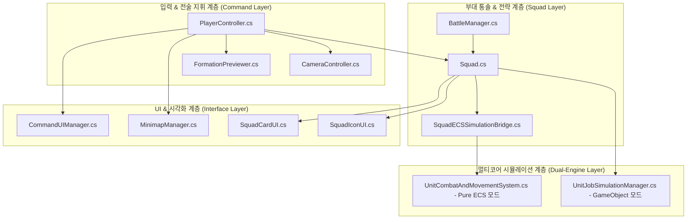

# 📚 MiniTotalWar2D 전체 시스템 아키텍처 & 문서 색인서 (README)

본 문서는 **MiniTotalWar2D** 프로젝트의 전체 C# 스크립트 및 시스템 아키텍처에 대한 종합 개요와 **3대 자료구조(Tree, Hash Table, Directed Graph)** 기반 가이드 문서 색인 맵을 제공합니다.

---

## 🌳 1. 전체 프로젝트 아키텍처 트리 맵 (Global Architecture Tree)

---

## 🗂️ 2. 스크립트 가이드 문서 해시 색인표 (Document Index Table)

> ⚡ 아래 표의 링크를 클릭하면 **아키텍처 트리, 메서드 색인표(줄 번호 링크), 호출 흐름도, 상세 수식/알고리즘**이 완비된 완전체 가이드 문서를 열람할 수 있습니다.

| 문서명 (Key) | 대응 C# 소스 파일 | 핵심 역할 & 기능 요약 (Value) |
| :--- | :--- | :--- |
| ⚔️ **[Squad.md](file:///c:/unityProject/MiniTotalWar2D/Docs/Squad.md)** | `Squad.cs` (2,827줄) | 부대 대형, 공간 정렬($O(N^2)$), 파동형 순차 출발, U자형 포위망, AI |
| 🎮 **[PlayerController.md](file:///c:/unityProject/MiniTotalWar2D/Docs/PlayerController.md)** | `PlayerController.cs` (3,430줄) | 13개 전술 단축키, 마우스 드래그 대형 변형(Alt/Ctrl), 그룹 잠금 |
| ⚡ **[UnitJobSimulationManager.md](file:///c:/unityProject/MiniTotalWar2D/Docs/UnitJobSimulationManager.md)** | `UnitJobSimulationManager.cs` (946줄) | 멀티코어 3대 Job(척력, 1.45m 자율 반격, 슬라이딩 굴절, 넉백/전투) |
| ⚡ **[UnitCombatAndMovementSystem.md](file:///c:/unityProject/MiniTotalWar2D/Docs/UnitCombatAndMovementSystem.md)** | `UnitCombatAndMovementSystem.cs` (594줄) | Pure ECS 공간 해시 그리드 타겟팅, 병렬 데미지 큐 및 넉백 시스템 |
| 💂 **[Unit.md](file:///c:/unityProject/MiniTotalWar2D/Docs/Unit.md)** | `Unit.cs` (648줄) | 개별 3D 유닛 라이프사이클, 슬롯 매핑, 피격/사망 및 네비메시 연동 |
| 🚩 **[BattleManager.md](file:///c:/unityProject/MiniTotalWar2D/Docs/BattleManager.md)** | `BattleManager.cs` (480줄) | 전장 시나리오 스폰, GameObject ⇄ Pure ECS 듀얼 모드 글로벌 관리 |
| 🗺️ **[Minimap.md](file:///c:/unityProject/MiniTotalWar2D/Docs/Minimap.md)** | `MinimapManager.cs` (395줄) | 3D ↔ 2D 좌표 변환 수학, 부대 마커, 카메라 시야각 사각틀 투영 |
| 🎥 **[CameraController.md](file:///c:/unityProject/MiniTotalWar2D/Docs/CameraController.md)** | `CameraController.cs` (318줄) | WASD 평면 + QE 고도 조절, Tab키 3D ↔ 2D 전술지도 전환, 부대 포커싱 |
| 👻 **[FormationPreviewer.md](file:///c:/unityProject/MiniTotalWar2D/Docs/FormationPreviewer.md)** | `FormationPreviewer.cs` (275줄) | 드래그 조작 시 지형 위 슬롯 도트 오브젝트 풀링 실시간 렌더링 |
| 🏷️ **[SquadIconUI.md](file:///c:/unityProject/MiniTotalWar2D/Docs/SquadIconUI.md)** | `SquadIconUI.cs` (286줄) | 3D 월드 부대 머리 위 깃발 아이콘, 조직력 게이지, 클릭 선택/돌격 |
| 🃏 **[SquadCardUI.md](file:///c:/unityProject/MiniTotalWar2D/Docs/SquadCardUI.md)** | `SquadCardUI.cs` (152줄) | 화면 하단 부대 카드 패널, `[G]` 잠금 뱃지, Shift/Ctrl 다중 선택 |
| 🎛️ **[CommandUI.md](file:///c:/unityProject/MiniTotalWar2D/Docs/CommandUI.md)** | `CommandUIManager.cs` (125줄) | 우하단 전술 명령 버튼 패널 동적 생성 및 핫키 표시 |
| 📜 **[CommandTypes.md](file:///c:/unityProject/MiniTotalWar2D/Docs/CommandTypes.md)** | `CommandTypes.cs` (38줄) | `UnitCommandState`, `SquadFormationType`, `UnitStance` 열거형 사전 |
| 🎴 **[BattleRosterContext.md](file:///c:/unityProject/MiniTotalWar2D/Docs/BattleRosterContext.md)** | `BattleRosterContext.cs` (166줄) | 군단 로스터 DTO, 유닛 카드 무제한 수용 및 캠페인/자유전투 전역 데이터 컨텍스트 |
| 🏛️ **[BattlePhaseManager.md](file:///c:/unityProject/MiniTotalWar2D/Docs/BattlePhaseManager.md)** | `BattlePhaseManager.cs` (190줄) | 토탈워식 6단계 전투 수명주기(배치->카운트다운->실시간교전->승패/총퇴각->사후통계) FSM |
| 🗺️ **[DeploymentZoneManager.md](file:///c:/unityProject/MiniTotalWar2D/Docs/DeploymentZoneManager.md)** | `DeploymentZoneManager.cs` (200줄) | 아군/적군 배치 사각 구역 정의, 지면 밀착 테두리 LineRenderer 렌더링 및 좌표 클램핑 |
| ⚖️ **[BalanceOfPowerUI.md](file:///c:/unityProject/MiniTotalWar2D/Docs/BalanceOfPowerUI.md)** | `BalanceOfPowerUI.cs` (220줄) | 상단 실시간 양군 전황 게이지 바, [전투 시작] 버튼 및 승리/패배 결과 배너 표출 |
| 📝 **[업데이트_내용.md](file:///c:/unityProject/MiniTotalWar2D/Docs/업데이트_내용.md)** | 전체 시스템 히스토리 | 프로젝트 전체 개발 일지 및 사용자 요구사항 기반 업데이트 기록부 |

---

## 📋 3. 시스템 기획서 & 기술 설계서 색인표 (Docs/기획서/)

> 💡 여러 스크립트에 걸친 크로스 시스템, 장기 마일스톤 및 대형 아키텍처 사전 검토 기획서 모음입니다.

| 기획서 문서명 (Key) | 연동 / 영향 스크립트 | 주요 기획 및 아키텍처 내용 (Value) |
| :--- | :--- | :--- |
| 👁️ **[전장의_안개_시스템_기획서.md](file:///c:/unityProject/MiniTotalWar2D/Docs/%EA%B8%B0%ED%9A%8D%EC%84%9C/%EC%A0%84%EC%9E%A5%EC%9D%98_%EC%95%88%EA%B0%9C_%EC%8B%9C%EC%8A%A4%ED%85%9C_%EA%B8%B0%ED%9A%8D%EC%84%9C.md)** | `VisionDetectionManager`, `Squad`, `PureECSRenderer`, `SquadIconUI`, `Minimap` | 삼국지 토탈워식 시야/발각, 지형 차폐 시 곡사 금지, F3 디버그 시야 및 경로선 은폐 |
| 🏹 **[토탈워식_원거리_사격호_사거리_시각화_기획서.md](file:///c:/unityProject/MiniTotalWar2D/Docs/%EA%B8%B0%ED%9A%8D%EC%84%9C/%ED%86%A0%ED%83%88%EC%9B%8C%EC%8B%9D_%EC%9B%90%EA%B1%B0%EB%A6%AC_%EC%82%AC%EA%B2%A9%ED%98%B8_%EC%82%AC%EA%B1%B0%EB%A6%AC_%EC%8B%9C%EA%B0%81%ED%99%94_%EA%B8%B0%ED%9A%8D%EC%84%9C.md)** | `RangeVisualizationManager`, `TargetTrajectoryPredictor`, `Squad` | 원거리 부대 사거리 부채꼴 호 메쉬 시각화, 지형 높낮이 투영, 3D 포물선 탄도 궤적선 |
| 🏔️ **[고지대_직사_화망_분산_사격_기획서.md](file:///c:/unityProject/MiniTotalWar2D/Docs/%EA%B8%B0%ED%9A%8D%EC%84%9C/%EA%B3%A0%EC%A7%80%EB%8C%80_%EC%87%BD%EC%82%AC_%ED%99%94%EB%A7%9D_%EB%B6%84%EC%82%B0_%EC%82%AC%EA%B2%A9_%EA%B8%B0%ED%9A%8D%EC%84%9C.md)** | `UnitCombatAndMovementSystem`, `UnitJobSimulationManager`, `Squad` | 고지대 사격 보너스, 직사 화망 분산(Plunging Fire), 아군 오사 방지 및 사각 계산 |
| 🎯 **[화살_시뮬레이션_시스템.md](file:///c:/unityProject/MiniTotalWar2D/Docs/%EA%B8%B0%ED%9A%8D%EC%84%9C/%ED%99%94%EC%82%B4_%EC%8B%9C%EB%87%B4%EB%A0%88%EC%9D%B4%EC%85%98_%EC%8B%9C%EC%8A%A4%ED%85%9C.md)** | `UnitCombatAndMovementSystem`, `Arrow`, `SpatialHashGridSystem` | 3D 탄도학 물리, 공기 저항, 지형 충돌 및 Pure ECS 기반 수천 발 화살 병렬 시뮬레이션 |
| 🌐 **[멀티플레이_전환_기획서.md](file:///c:/unityProject/MiniTotalWar2D/Docs/%EA%B8%B0%ED%9A%8D%EC%84%9C/%EB%A9%80%ED%8B%B0%ED%94%8C%EB%A0%88%EC%9D%B4_%EC%A0%84%ED%99%98_%EA%B8%B0%ED%9A%8D%EC%84%9C.md)** | `BattleCommandQueue`, `NetworkManager` (예정) | 락스텝(Lockstep) / 결정론적 롤백 네트워킹 사전 분석 및 멀티플레이 전환 로드맵 |
| 👑 **[삼국지_토탈워_비교_및_미구현_시스템_기획서.md](file:///c:/unityProject/MiniTotalWar2D/Docs/%EA%B8%B0%ED%9A%8D%EC%84%9C/%EC%82%BC%EA%B5%AD%EC%A7%80_%ED%86%A0%ED%83%88%EC%9B%8C_%EB%B9%84%EA%B5%90_%EB%B0%8F_%EB%AF%B8%EA%B5%AC%ED%98%84_%EC%8B%9C%EC%8A%A4%ED%85%9C_%EA%B8%B0%ED%9A%8D%EC%84%9C.md)** | 프로젝트 전체 아키텍처 및 로드맵 | 토탈워 코어 엔진 역공학: 6단계 상태 머신, 배치 구역 클램핑, 군대 손실 공식, 피습각 기하학, 버티기(Bracing) 및 전장 지휘관 C# 구현 규격 |

---

## 🔄 문서 유지 관리 규칙 (Documentation Rules)

1. **사용자 요구 사항(User Request) 최상단 기록**: `Docs/업데이트_내용.md`에 새로운 항목을 추가할 때 사용자의 요청 원문을 가장 먼저 명시합니다.
2. **3대 자료구조 표준 템플릿 준수**: 개별 스크립트 문서는 **1) 트리 맵, 2) 해시 색인표(줄 번호 링크), 3) 유향 그래프** 3대 자료구조 형식을 유지합니다.
3. **기획서 / 계획서 전용 폴더 분리 (`Docs/기획서/`)**: 다중 스크립트에 걸친 크로스 시스템 기획 및 아키텍처 사전 검토 문서는 `Docs/기획서/` 디렉터리에 모아 체계적으로 관리합니다.
4. **소스 코드 100% 팩트 매핑**: 추측성 코딩 및 문서를 금지하며, 실제 C# 코드의 변수/함수/단축키와 1:1로 일치시킵니다.
