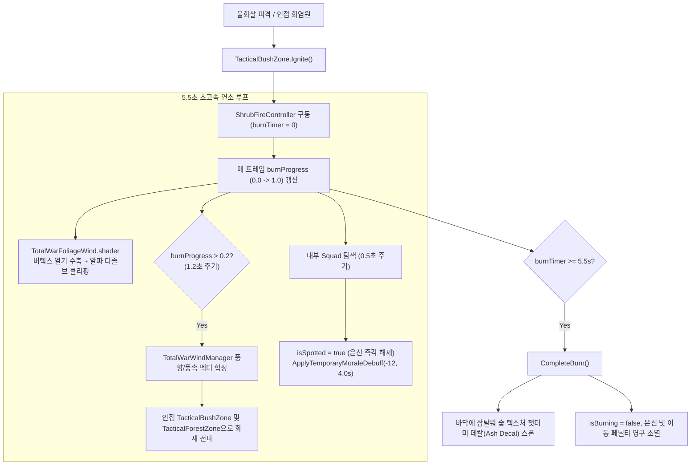

# 🌾 TacticalBushZone.cs & ShrubFireController.cs

## 💡 핵심 요약 & 역할 (Summary & Role)
- **핵심 역할**: 삼국지 토탈워(Total War: Three Kingdoms) 원작의 하층 식생(Understory: 관목, 들풀, 농경지 작물, 자연 장애물 등 118종)을 전장에 절차적/수동으로 배치하고, TacticalForestZone의 형태/사계절/적설/바람 규격을 100% 계승하여 관리하는 전술 컴포넌트입니다.
- **전술 기능**: 보병 완전 은신(Stealth - 적 15m 접근 시 발각), 통과 시 기병 돌격 보너스 40% 상쇄 및 이동 감쇄, 저각 직사 사격 탄도 차폐(Cover)를 수행합니다.
- **화재 고속도로**: 불화살 접촉 즉시 1초 착화(Flashover), 5초 내 급속 전소 및 열기 수축/알파 디졸브 소멸, 실시간 풍향(TotalWarWindManager)과 결합하여 인접 관목 및 숲(TacticalForestZone)으로 불길을 전달하는 전장 도화선 역할을 수행하며, 전소 시 바닥에 검은 잿더미 데칼(Ash Decal)을 남깁니다.

---

## 🌳 1. 아키텍처 트리 맵 (Tree Map)

```
TacticalBushZone 전술 생태계 시스템
 ├── 1. 구역 지오메트리 & 테마 (Zone Geometry & Theme)
 │    ├── 구역 형태 : 원형(Circle) / 직사각형(Box) 브러시
 │    ├── 테마 프리셋 (BushTheme)
 │    │    ├── 🔥 초고속 인화 마른 풀 들판 (FlammablePrairie) [기본값 - 순수 마른 들풀/갈대]
 │    │    ├── 🌾 야생 들풀·갈대 지대 (WildGrasslands) : 바람에 넘실거리는 긴 억새풀
 │    │    ├── 🌾 중원 농경지 벼·기장 밭 (CentralFarmCrops) : 황금 벼 A~E, 기장 A~D
 │    │    ├── 🌿 남만 코끼리풀 밀림 (NanmanElephantGrass) : 코끼리풀 A~D, 검고사리
 │    │    ├── 🪷 강남 수변 연꽃·갈대 습지 (JiangnanWetland) : 연꽃 A~C, 물갈대
 │    │    ├── 🌸 고산 철쭉·화초 지대 (AlpineRhododendron) : 철쭉 A~E, 차나무 덤불
 │    │    └── 🪵 대나무 밑동 격전지 (BambooStumpRuins) : 대나무 밑동 8종 (선택용)
 │    └── 🌾 6대 카테고리 18종 개별 식생 토글 (포레스트 존 스타일 On/Off 지원)
 │         ├── 1. 야생 들풀군 : spawnTallGrass, spawnDryGrass, spawnThickGrass, spawnWildHerbs
 │         ├── 2. 농경지 작물 : spawnRiceCrops, spawnMilletCrops, spawnFlatHerbs
 │         ├── 3. 남만 밀림 초본 : spawnElephantGrass, spawnSwordFern, spawnRoyalFern, spawnTropicalBigleaf
 │         ├── 4. 수변 습지 식물 : spawnLotus, spawnReedSeedheads
 │         ├── 5. 야생화 & 꽃 관목 : spawnWildFlowers, spawnRhododendron, spawnTeaBush
 │         └── 6. 자연 장애물 (기본 OFF) : spawnBambooStump, spawnWoodStump
 ├── 2. 사계절 및 적설 동기화 (Seasons & Snow)
 │    ├── TacticalForestZone.Season (Summer, Spring, Autumn, Winter) 100% 동기화
 │    ├── snowAmount 슬라이더 : 수풀 상단 소복한 적설(0.0~1.0)
 │    └── autumnTint : 수확기 황금빛 벼/마른 풀 틴트
 ├── 3. 초고속 화재 시뮬레이터 (ShrubFireController)
 │    ├── 0.8초 즉각 발화 (Flashover)
 │    ├── 5.5초 급속 전소 및 버텍스 열기 수축(Shrinking)
 │    ├── 풍향 연동 4~8m 화재 고속도로 전파 (Wildfire Highway)
 │    ├── 지면 잿더미 데칼(Ash Decal) 프로젝션
 │    └── 내부 유닛 화염 틱 피해 + [들불 패닉: 사기 -12] 디버프
 └── 4. 전술 전투 및 물리 인터랙션 (Tactical & Physics)
      ├── 보병 부대 완전 은신 (적 15m 접근 시 발각)
      ├── 기병 돌격 보너스 -40% 강제 차감
      ├── 부대 진군 시 풀 눕힘(Trample) 연출
      └── 초기 1.2초 내 대규모 부대 돌격 통과 시 불길 짓밟아 진화(Smothering)
```

---

## 🗂️ 2. 해시 테이블 메서드/구조체 색인표 (Hash Table Index)

| Key (메서드 / 구조체) | Value (역할, 의존성, 소스 링크) |
| :--- | :--- |
| `BushTheme` | 관목 테마 프리셋 열거형 (남만 밀림, 중원 농경지, 수변 습지 등) - [TacticalBushZone.cs:L24-L40](file:///c:/unityProject/MiniTotalWar2D/Assets/Scripts/TacticalBushZone.cs#L24-L40) |
| `IsPositionInside(Vector3)` | 월드 좌표가 원형/박스 관목 구역 내부에 위치하는지 O(1) 검사 - [TacticalBushZone.cs:L129-L141](file:///c:/unityProject/MiniTotalWar2D/Assets/Scripts/TacticalBushZone.cs#L129-L141) |
| `Ignite(Vector3)` | 불화살 명중 또는 인접 화재 전파 시 착화 개시 트리거 - [TacticalBushZone.cs:L146-L152](file:///c:/unityProject/MiniTotalWar2D/Assets/Scripts/TacticalBushZone.cs#L146-L152) |
| `UpdateShaderBurnProgress()` | MaterialPropertyBlock을 통해 `_BurnProgress`, `_SnowAmount` 실시간 셰이더 전달 - [TacticalBushZone.cs:L157-L174](file:///c:/unityProject/MiniTotalWar2D/Assets/Scripts/TacticalBushZone.cs#L157-L174) |
| `ApplyShrubMaterials(GameObject, string)` | 118종 관목 모델별 알베도, 노멀, 사계절 텍스처 및 FoliageWind 셰이더 자동 바인딩 - [TacticalBushZone.cs:L340](file:///c:/unityProject/MiniTotalWar2D/Assets/Scripts/TacticalBushZone.cs#L340) |
| `GetOrCreateMaterialExact(...)` | FoliageWind 기반 알파 컷아웃(양면 렌더링), 적설, 틴트 머티리얼 캐싱 및 생성 - [TacticalBushZone.cs:L480](file:///c:/unityProject/MiniTotalWar2D/Assets/Scripts/TacticalBushZone.cs#L480) |
| `RefreshBushMaterials()` | 사계절 변경 시 텍스처 교체 및 `_IsShrubGrass=1.0`, 적설/단풍 일괄 갱신 - [TacticalBushZone.cs:L330](file:///c:/unityProject/MiniTotalWar2D/Assets/Scripts/TacticalBushZone.cs#L330) |
| `ShrubFireController.SpreadFireToNeighbors()` | 풍향 벡터를 타고 인접 관목 및 숲(TacticalForestZone)으로 화재 고속도로 전파 - [ShrubFireController.cs:L106-L159](file:///c:/unityProject/MiniTotalWar2D/Assets/Scripts/ShrubFireController.cs#L106-L159) |
| `ShrubFireController.ApplyWildfireDebuffs()` | 불타는 수풀 내부 부대 은신 강제 해제 및 [사기 -12 패닉] 부여 - [ShrubFireController.cs:L164-L185](file:///c:/unityProject/MiniTotalWar2D/Assets/Scripts/ShrubFireController.cs#L164-L185) |
| `ShrubFireController.CompleteBurn()` | 5.5초 전소 완료 시 3D 메시 소멸 및 지면 잿더미 데칼(Ash Decal) 생성 - [ShrubFireController.cs:L190-L228](file:///c:/unityProject/MiniTotalWar2D/Assets/Scripts/ShrubFireController.cs#L190-L228) |

---

## 🔀 3. 유향 그래프 흐름도 (Directed Graph - Mermaid)



---

## ⚙️ 4. 주요 상태 변수 & 인스펙터 옵션 (State & Inspector Fields)

| 변수명 | 타입 | 기본값 | 역할 및 튜닝 가이드 |
| :--- | :--- | :--- | :--- |
| `shape` | `ZoneShape` | `Circle` | 구역 형태 (원형 Circle 또는 직사각형 Box) |
| `theme` | `BushTheme` | `FlammablePrairie` | 테마 프리셋 (`AllInclusive126` [126종 전수], `ChangshaBroadleafHerbs`, `FlammablePrairie` 등) |
| `currentSeason` | `Season` | `Summer` | 사계절 모드 (여름 녹음, 가을 황금/마른풀, 겨울 설초) |
| `radius` | `float` | `20f` | 원형 구역 유효 반경 (m) |
| `boxSize` | `Vector2` | `(30, 20)` | 직사각형 가로/세로 크기 (m) |
| `bushCount` | `int` | `25` | 구역 내 배치할 관목 수량 |
| `snowAmount` | `float` | `0.0f` | 눈 덮임 비율 (0.0: 완전 녹색 -> 1.0: 100% 설초) |
| `providesStealth` | `bool` | `true` | 보병 완전 은신 제공 여부 (적 15m 접근 시 발각) |
| `cavalrySpeedPenalty` | `float` | `0.30f` | 기병 이동 속도 저하 비율 (30% 감소) |
| `chargeBonusReduction` | `float` | `0.40f` | 기병 돌격 보너스 상쇄 비율 (40% 차감) |
| `totalBurnDuration` | `float` | `5.5f` | 완전 전소 시간 (풀은 5.5초 내 전소) |
| `baseSpreadRadius` | `float` | `4.5f` | 기본 화재 전파 거리 (순풍 시 최대 12m) |
| **식생 토글 (22종)** | `bool` | 프리셋 연동 | 삼탈워 126종 관목·초본 모델 전수를 7대 카테고리 22종 토글로 자유롭게 On/Off 스폰 조합 |

---

## 🛠️ 5. 핵심 알고리즘, 물리/전투 수학 공식 & 조작법

### 5.1 풍향 연동 화재 고속도로 (Wildfire Highway) 전파 공식
```
전파 유효 거리 = 기본 4.5m + 구역 반경 + max(0, dot(이웃방향, 바람벡터)) * 4.0m * 바람속도
```
- 순풍 시 초당 8~12m 속도로 들판을 질주하여, 멀리 떨어진 숲(`TacticalForestZone`)까지 단 몇 초 만에 불길을 연결합니다.

### 5.2 버텍스 열기 오그라듦(Vertex Shrinking) 셰이더 공식
```hlsl
float shrink = saturate(burnVal * 1.25);
totalDisp.y -= shrink * 0.45;           // 지면으로 주저앉음
totalDisp.xz *= (1.0 - shrink * 0.55);   // 수평 수축
```

---

## 🔗 6. 다른 스크립트와의 연동 관계 (Dependencies & Pipeline)

1. **[TacticalForestZone](file:///c:/unityProject/MiniTotalWar2D/Docs/TacticalForestZone.md)**:
   - 형태, 사계절, 적설, 바람 규격을 상속받으며, 들판의 관목 화재가 숲으로 번져 들어가는 체인 리액션 파이프라인 형성.
2. **[TotalWarWindManager](file:///c:/unityProject/MiniTotalWar2D/Docs/TotalWarWindManager.md)**:
   - 실시간 풍향/풍속 벡터(`CurrentWindVector`)를 수신하여 풀잎 흔들림 및 화재 전파 방향 결정.
3. **[Squad](file:///c:/unityProject/MiniTotalWar2D/Docs/Squad.md) & [Unit](file:///c:/unityProject/MiniTotalWar2D/Docs/Unit.md)**:
   - 보병 은신(`isSpotted = false`), 기병 이동/돌격 페널티, 화재 발생 시 은신 강제 해제 및 `ApplyTemporaryMoraleDebuff(-12, 4.0f)` 부여.
