# 🌲 [TacticalForestZone.cs] 전술 숲 & 삼국지 토탈워 3D 초목 시스템 아키텍처 가이드

> **원본 소스 파일**: [TacticalForestZone.cs](file:///c:/unityProject/MiniTotalWar2D/Assets/Scripts/TacticalForestZone.cs)  
> **시스템 역할**: 스팀에 설치된 실제 삼국지 토탈워(Total War: Three Kingdoms) 본편에서 추출/변환한 3D 모델(황산소나무, 대나무, 활엽수, 관목)과 텍스처를 지형 굴곡을 따라 자연스럽게 자동 배치하고, 부대/유닛이 진입했을 때 토탈워 고유의 시야 은폐(매복) 및 사선(Line of Sight) 차폐를 실시간 수행합니다.

---

## 💡 핵심 요약 & 역할 (Summary & Role)

- **핵심 역할**: 삼국지 토탈워 본편의 실제 에셋을 기반으로 전장에 **숲 매복(Ambush) 및 시야 은폐/사선 차폐 메커니즘**을 구현하고, 중국 전역의 다양한 생태계(화북 소나무림, 강남 수변림, 중원 평야림, **남만 원시 밀림**, 격전지 고목림 등)와 사계절(봄/여름/가을/겨울)에 대응하는 인스펙터 토글 시스템을 제공합니다.
- **실제 삼국지 토탈워 3D 초목 모델 연동 (Total War Extracted 3D Assets)**:
  - 스팀 본편 `vegetation.pack` 리버스 엔지니어링(REA) 파이프라인으로 추출된 순수 토탈워 17대 거목 3D 모델(`.obj`)과 사계절 원본 텍스처(`.dds`)를 URP FoliageWind 및 Lit 셰이더로 렌더링합니다.
  - 저장 위치: `Assets/TotalWar_ThreeKingdoms_Extracted/Vegetation/`
    - `Trees/`: 총 46개 3D 거목/고사목 모델
      - **1. 🌲 온대/한대 상록수**: `Huangshan_Pine_A/B` (황산 소나무), `Pine_A` (직립 소나무), `Bamboo_A/C` (대나무), `Castanopsis_A` (구실잣밤나무), `Camphor_A` (녹나무)
      - **2. 🌴 열대/남만 상록 식생**: `Ficus_C/D` (남만 반얀트리), `Palm_Banana_A/B` (바나나 야자), `Palm_Coconut_A/C` (코코넛 야자), `Castanopsis_Jungle_A/B` (정글 구실잣밤), `Palm_Windmill_A` (종려야자)
      - **3. 🍂 낙엽수 & 꽃나무**: `Magnolia_A/B` (목련나무 거목), `Plum_A` (매화나무), `Ginkgo_A/B` (은행나무), `Maple_A/B` (단풍나무), `Willow_A/B` (수양버들), `Scholar_A/B` (회화나무/선비나무)
      - **6. 🪵 전장 고목 & 고사목 (총 19종)**:
        - `Pine_Dead_M/O/S` (앙상한 소나무 고사목 3종, 잎 0개 순수 뼈대)
        - `Pine_Broken_H/K/L/N` (부러진 소나무 4종, 줄기+잔여 솔잎)
        - `Scholar_Broken_A/B/C/D` (부러진 회화나무 4종, 꺾인 중원 고목 뼈대)
        - `Castanopsis_Dead_A/B/C/D/E` (활엽 고사목 5종, 마른 거목 뼈대)
        - `Castanopsis_Jungle_Dead_A/B/C` (남만 정글 고사목 3종, 덩굴 뒤엉킨 밀림 고목)
    - `Shrubs/`: 총 29개 관목/초본/밑동/나뭇가지 모델
      - **1. 온대 관목**: `Shrub_Tea_A` (차나무 상록 관목)
      - **2. 열대 관목**: `Shrub_ElephantGrass_A` (남만 코끼리풀), `Shrub_Fern_Sword_A` (열대 검고사리)
      - **3. 꽃덤불**: `Shrub_Magnolia_A` (목련 관목), `Shrub_Rhododendron_A` (진달래/철쭉 꽃덤불)
      - **4. 수변 & 농경지**: `Shrub_Lotus_A` (연꽃 수생 식생), `Shrub_Rice_A` (벼 논작물), `Shrub_Millet_A` (기장 밭작물)
      - **5. 지표 하층 관목**: `Pine_Shrub_Q` (솔관목), `Fern_Royal_A` (왕고사리), `Scholar_Bush_K` (선비덤불), `Convallaria_Shrub_A` (은방울꽃)
      - **6. 밑동, 그루터기 & 나뭇가지 잔해 (총 17종)**:
        - `Bamboo_Stump_A/B/C/D` (단일 대나무 밑동 4종)
        - `Bamboo_Stump_Group_A/B/C/D` (대나무 밑동 군락 4종)
        - `Stump_A/B/D` (거목 순수 밑동 3종 - 대형/중형/소형 밑동, 삼탈워 원본 나이테 단면 및 수피 1:1 정합)
        - `Stump_C` (싹튼 밑동 1종 - 원작 0.35배 스케일, 새순 잎사귀 Cutout 및 사계절 잎 색상 대응)
        - `BrokenBranch_A/B/C/D` (부러진 나뭇가지 잔해 더미 4종)
        - `Stump_E` (지표 잔가지 파편 1종 - 원작 0.22배 스케일, 지표면 밀착 투명 컷아웃 Clutter)
    - `Textures/`: 고해상도 수피, 잎사귀, 사계절 텍스처 DDS 860여 종 완벽 연동.
- **⛰️ 지형 적응 및 뿌리 고정 (Terrain Anchoring) 물리 알고리즘 탑재**:
  - `SampleTerrainNormal()` 지형 법선 계산을 통해 가파른 산비탈에서도 거목의 뿌리를 땅속으로 최대 0.85m 파묻는 동적 매립(`sinkDepth`)을 수행하여 **경사지 공중 부양을 원천 방지**합니다.
  - 지형 경사면에 맞춘 자연스러운 기울임 블렌딩(`slopeAlignmentWeight`)과 40도 초과 가파른 절벽 스폰 제한 필터링 완비.
- **🛠️ `TacticalForestZoneEditor.cs` 100% 완전 한글화 전용 커스텀 인스펙터**:
  - 인스펙터 상단에 **[🌲 초목 즉시 재생성]**, **[🌸 봄 / ☀️ 여름 / 🍁 가을 / ❄️ 겨울]**, **[🔥 화재 점화 / 🧯 화재 진압 / 🧹 전체 제거]** 원클릭 컨트롤 버튼 바 제공.
  - 12대 세부 카테고리 접이식 폴드아웃(Foldout) 및 60여 개 전체 프로퍼티에 **친절한 한국어 라벨과 상세 툴팁** 완비:
    1. 🌐 숲 구역 형태 및 크기 (`ZoneShape` 원형/직사각형, 반경, 가로세로 크기)
    2. 🍂 생태계 테마 및 사계절 설정 (`ForestTheme`, `Season`, 겨울 적설 토글, 전체 눈 강도 및 **나뭇잎 눈 덮임 비율 `0.0~1.0`**)
    3. 🌲 온대/한대 상록수 토글 (황산소나무, 직립소나무, 대나무, 구실잣밤, 녹나무, 차나무)
    4. 🌴 열대/남만 상록 식생 토글 (반얀트리, 바나나/코코넛 야자, 정글구실잣밤, 종려야자, 코끼리풀, 검고사리)
    5. 🍂 낙엽수 및 꽃나무 토글 (목련나무, 매화나무, 은행나무, 단풍나무, 수양버들, 회화나무, 꽃덤불)
    6. 🌾 수변 및 농경지 작물 (연꽃 수생식생, 벼 논작물, 기장 밭작물)
    7. 🌿 지표 하층 관목 및 초본 (솔관목, 왕고사리, 선비덤불, 은방울꽃)
    8. 🪵 전장 고목 및 그루터기 잔해 (고사목, 부러진 소나무/회화나무, 대나무 밑동, 그루터기, 잔가지)
    9. 🌿 초목 스폰 밀도 및 크기 (자동 생성, 나무 개수, 수풀 개수, 크기 배율, 무작위 시드)
    10. ⛰️ 지형 적응 및 물리 매립 (기본 매립 깊이, 경사면 정렬 가중치, 최대 경사각)
    11. 👁️ 전술 은폐 및 시야 차폐 (기본 피탐지 거리, 질주 발각 거리, 사선 차폐)
    12. 🔥 삼탈워 전장 화재 & 연기 시뮬레이션 (화재 활성화, 연기 시각 유형, **연기 진하기/농도 슬라이더 `0.1~1.0`**, 착화 수, 화염 배율, 풍향 연쇄 전파)
- **인스펙터 토글 및 테마별 숲·사계절 선택 (Inspector Toggles & Themes)**:
  - **상록수 vs 낙엽수 카테고리 분리 인스펙터 토글**: 계절 변화에도 변하지 않는 상록수(10종)와 계절에 반응하는 낙엽수(5종), 지표 관목(6종)을 명확한 헤더와 한글 툴팁으로 분리 제공.
  - **지역별 숲 테마 프리셋**:
    - `NanmanJungle` (**남만 밀림**: 반얀트리 + 바나나 야자 + 코코넛 야자 + 남만 정글 구실잣밤 + 종려야자 + 코끼리풀 + 검고사리)
    - `JiangnanRiverside` (강남 수변림: 수양버들 + 대나무 + 단풍나무)
    - `CentralPlains` (중원 평야림: 은행나무 + 회화나무 + 매화나무)
    - `HuangshanPine` (황산 소나무림: 황산소나무 + 일반소나무)
    - `BambooGrove` (대나무 군락지: 삼탈워 순수 대나무숲)
    - `Mixed` (혼합림: 전 수종 전체 선택)
    - `CustomSelection` (사용자 지정: 체크박스로 자유 조합)
  - **사계절 환경 모드 (`currentSeason`)**: `Summer` (여름 녹음), `Spring` (봄 매화/새싹), `Autumn` (가을 황금 은행/선홍 단풍), `Winter` (겨울 설화/창백 잎)
- **토탈워 전술 시야 규칙 연동**:
  1. **숲 내부 은폐 (Forest Stealth)**: 숲 속에 들어간 부대(`isHiddenInForest = true`)는 **25m 이내로 초근접하지 않으면 아군 시야에서 완전히 사라집니다.** (단, 전력질주/구보 시에는 45m로 확장)
  2. **숲 관통 사선 차폐 (Line of Sight Block)**: 울창한 숲 지대를 가로지르는 사선은 차단되어, 숲 너머의 적 부대는 보이지 않습니다.

---

## 🌳 1. 아키텍처 트리 맵 (Tree Map)

- 📁 **1. 생명주기 및 정적 레지스트리 (Lifecycle & Static Registry)**
  - `activeZones`: 전장의 모든 활성 숲 영역 정적 목록 관리
  - `OnEnable()`, `OnDisable()`: 활성 레지스트리 등록/해제
  - `Awake()`, `Update()`: 지형 고도 자동 스냅 (`SnapToTerrain`)
- 📁 **2. 삼국지 토탈워 초목 생성 엔진 (Total War Vegetation Spawner)**
  - `GenerateVegetation()`: 지정 형상 및 테마에 맞춰 3D 나무 및 수풀 스폰
  - `InitTotalWarMaterials()`: 3중 방어형(Resources.Load -> AssetDatabase -> 런타임 프로그래매틱 머티리얼) 안전 로더를 통해 화염, 훈연 연기, 불티 머티리얼의 null 참조를 100% 원천 차단하고 마젠타(핑크색) 깨짐 방지
  - `LoadTreeModels()`: 선택된 테마에 해당하는 토탈워 3D 나무 OBJ 프리팹 로드
  - `LoadShrubModels()`: 지표 관목/고사리/덤불 3D OBJ 프리팹 로드
  - `ApplyTreeMaterials()`: `GetComponentsInChildren<MeshRenderer>(true)`로 모든 자식 렌더러를 탐색하여 `Trunk`(줄기)와 `Leaves`(나뭇잎) 자식 오브젝트에 각각 1:1로 정확한 전용 머티리얼을 단독 바인딩
  - `ApplyShrubMaterials()`: `GetComponentsInChildren<MeshRenderer>(true)`로 관목/초본/작물 자식 렌더러에 1:1 전용 머티리얼 바인딩
  - `RefreshVegetationMaterials()`: `vegetationRoot`의 모든 식생 인스턴스를 순회하며 계층형 자식 렌더러 머티리얼 일괄 재바인딩
- 📁 **3. 화재 전파 및 나뭇잎 서브메시 표면 화재 시스템 (Wildfire Simulation & Leaves Surface Fire VFX)**
  - `CalculateTreeLeavesCenterAndRadius()`: 나무 밑동(지면)을 배제하고 Submesh 1(Leaves)의 월드 3D 중심점 및 수관 반경 정밀 산출
  - `CreateTreeFireInstance()`: 전용 복합 화염 셰이더(`TotalWar/VFX/CompositeFlames`)와 머티리얼(`M_TotalWar_CompositeFlames`)을 바인딩하여, 단일 파티클(불 하나)에 삼탈워 3종 화염(A 코어, B 너울, H 팁)이 1:1로 정확하게 포개어져 타오르는 일체형 복합 화염(`Flames_Composite_TotalWar`), 2200K 화재 포인트 라이트 및 삼탈워 정품 볼륨 잿빛/황갈색 연기(`wispy_smoke_diffuse`) 스폰
  - `SetupFlamesPS()`: 삼탈워 본편 1:1 일치 규격으로 불꽃 크기를 0.32~0.68m로 아담하고 날렵하게 조정하고, 방출량(72f/s, 최대 180개 파티클)을 약 3배로 대폭 늘려 나뭇가지 사이사이에서 춤추는 촘촘하고 풍성한 화염 군집망 복원
  - `TotalWarFoliageWind.shader`: 착화 전(`burnProg <= 0.001`)에는 연소 로직을 바이패스하여 100% 정상 녹색 잎 보존(단풍 버그 원천 차단), 착화 시 가중치 오프셋 적용, 3D 공간 가지 클러스터링(`branchClump`) 기반 입체 시차 연소, 삼탈워 원본 숯 텍스처 결 및 고주파 엽맥 결 기반 숯 결 구멍 침식 디졸브(Perforated Ash Dissolve) 및 양면 반투명 햇살 투광(Subsurface Translucency)으로 역광 암부 뭉개짐 방지
  - `SetupSmokePS()`: 삼탈워 규격 볼륨 크기(1.4~3.4m), 수관 체적 구형(`Sphere`) 에미터, 초저속(`0.12~0.38m/s`), 짙은 웜 차콜 알파(0.75)로 화염 뒤편을 은은하고 자욱하게 감싸주는 자연스러운 대기 훈연(Soft Atmospheric Smoke) 연출
  - `TotalWarFireVFXController.cs`: 박진감 넘치는 삼탈워 공식 5단계 화재 수명주기(① 0.0~0.04 착화 전 훈연 선행 불꽃 0개 -> ② 0.04~0.10 첫 불씨 발화 -> ③ 0.10~0.35 불길 급격 증식 수관 불바다 -> ④ 0.35~0.65 절정 연소 및 나뭇잎 전소 -> ⑤ 0.65 화염 즉시 0 차단 및 0.90 연기 완전 종료) 및 풍향/풍속 월드 동역학 시뮬레이션 제어
  - `IgniteTreeNode()`: 단일 나무 노드 수관에 화재 착화
  - `UpdateWildfireSimulation()`: 전장 바람(풍향/풍속) 연동 이웃 나무 연쇄 착화 및 숲 은폐 해제 판정
- 📁 **4. 공간 쿼리 및 시야 판정 파이프라인 (Spatial Queries & LoS Engine)**
  - `ContainsPosition()`: 특정 좌표가 해당 숲 영역 내부인지 O(1) 원형/박스 판정
  - `IsPositionInForest()`: 전장의 모든 숲을 순회하여 유닛의 숲 진입 여부 판정
  - `IsLineBlockedByForest()`: 두 지점(아군-적군) 사이의 시선이 숲을 관통하는지 사선 교차 판정
- 📁 **5. 자동 초기화 및 에디터 시각화 (Auto Setup & Gizmos)**
  - `AutoCreateDefaultForests()`: 씬 로드 시 전장 양측 요충지에 소나무림 및 대나무숲 2개소 자동 배치
  - `OnDrawGizmos()`: 지형 굴곡을 따라 에메랄드 그린 와이어 원형/박스 기즈모 렌더링

---

## 🗂️ 2. 해시 테이블 메서드/구조체 색인표 (Hash Table Index)

| Key (메서드 / 구조체) | Value (역할 및 의존성) | 소스 줄 번호 링크 |
| :--- | :--- | :--- |
| `ForestTheme` (enum) | 숲의 수종 테마 (`Mixed`, `HuangshanPine`, `BambooGrove`, `CastanopsisWood`) 정의 | [TacticalForestZone.cs#L27-L33](file:///c:/unityProject/MiniTotalWar2D/Assets/Scripts/TacticalForestZone.cs#L27-L33) |
| `CalculateTreeLeavesCenterAndRadius` | 나뭇잎 서브메시(Leaves) 바운즈를 변환하여 수관 3D 중심점/반경/높이 산출 | [TacticalForestZone.cs#L573-L612](file:///c:/unityProject/MiniTotalWar2D/Assets/Scripts/TacticalForestZone.cs#L573-L612) |
| `CreateTreeFireInstance` | 나뭇잎 서브메시(Submesh 1) 표면에 플립북 화염 에미터 생성 및 컨트롤러 바인딩 | [TacticalForestZone.cs#L614-L695](file:///c:/unityProject/MiniTotalWar2D/Assets/Scripts/TacticalForestZone.cs#L614-L695) |
| `SetupFlamesPS` | 나뭇잎 표면 삼각형 방출, 플립북 블렌딩, 3D 난류 노이즈 및 아담한 불꽃 크기(0.35m~0.65m) 세팅 | [TacticalForestZone.cs#L740-L840](file:///c:/unityProject/MiniTotalWar2D/Assets/Scripts/TacticalForestZone.cs#L740-L840) |
| `GenerateVegetation` | 토탈워 3D 모델 및 텍스처 머티리얼을 지형 높이에 맞춰 스폰 및 배치 | [TacticalForestZone.cs#L199-L271](file:///c:/unityProject/MiniTotalWar2D/Assets/Scripts/TacticalForestZone.cs#L199-L271) |
| `InitTotalWarMaterials` | 토탈워 원본 베이스 컬러 및 노멀맵 DDS 텍스처(수피, 나뭇잎)를 탑재한 URP Lit 머티리얼 구성 | [TacticalForestZone.cs#L1024-L1067](file:///c:/unityProject/MiniTotalWar2D/Assets/Scripts/TacticalForestZone.cs#L1024-L1067) |
| `ApplyTreeMaterials` | 모델의 Trunk/Leaves에 수종별 머티리얼 매핑 및 실시간 그림자(Cast/Receive Shadows) 강제 활성화 | [TacticalForestZone.cs#L1155-L1184](file:///c:/unityProject/MiniTotalWar2D/Assets/Scripts/TacticalForestZone.cs#L1155-L1184) |
| `ContainsPosition` | 원형(Radius) 또는 박스(BoxSize) 범위 내 좌표 포함 여부 O(1) 투영 연산 | [TacticalForestZone.cs#L1216-L1237](file:///c:/unityProject/MiniTotalWar2D/Assets/Scripts/TacticalForestZone.cs#L1216-L1237) |
| `IsPositionInForest` | 특정 월드 좌표가 전장의 활성 숲 영역에 포함되어 있는지 초고속 판정 | [TacticalForestZone.cs#L1242-L1260](file:///c:/unityProject/MiniTotalWar2D/Assets/Scripts/TacticalForestZone.cs#L1242-L1260) |
| `IsLineBlockedByForest` | 아군-적군 간 사선이 숲의 75% 이상 깊이를 통과하는지 검사하여 시야 차폐 확정 | [TacticalForestZone.cs#L1265-L1310](file:///c:/unityProject/MiniTotalWar2D/Assets/Scripts/TacticalForestZone.cs#L1265-L1310) |
| `AutoCreateDefaultForests` | 씬 시작 시 서쪽(황산 소나무림) 및 동쪽(대나무숲)에 숲 2개소 자동 생성 | [TacticalForestZone.cs#L1315-L1350](file:///c:/unityProject/MiniTotalWar2D/Assets/Scripts/TacticalForestZone.cs#L1315-L1350) |

---

## 🔀 3. 유향 그래프 흐름도 (Directed Graph - Mermaid)

```mermaid
flowchart TD
    subgraph Spawning [삼국지 토탈워 초목 생성 파이프라인]
        A[씬 시작 또는 에디터 메뉴 클릭] --> B[TacticalForestZone.GenerateVegetation]
        B --> C[InitTotalWarMaterials: 토탈워 DDS 텍스처 URP Lit 머티리얼 구성]
        C --> D[LoadTreeModels & LoadShrubModels: 토탈워 OBJ 로드]
        D --> E[지형 고도 추출 TerrainHeightManager.SampleHeightFast]
        E --> F[미세 기울기 및 무작위 회전 적용 스폰]
        F --> G[ApplyTreeMaterials: Trunk/Leaves 서브메시 텍스처 자동 할당]
    end

    subgraph FirePipeline [5대 나뭇가지 플립북 화재 파이프라인]
        FA[IgniteTreeNode 호출] --> FB[CalculateTreeLeavesClusters: 5대 가지 끝 잎사귀 뭉치 좌표 산출]
        FB --> FC[5개 가지에 각각 Flames_Branch_k 인스턴스화]
        FC --> FD[SetupFlamesPS: 4x4 16프레임 플립북 애니메이션 활성화]
        FD --> FE[코어 제자리 고정: startSpeed 0.15~0.35m/s 및 볼륨 크기 1.6~2.2m]
        FE --> FF[TotalWarFireVFXController: 연소 진행도에 따른 수명주기 일괄 제어]
    end

    subgraph VisionPipeline [토탈워 전술 시야 & 사선 차폐 파이프라인]
        H[VisionDetectionManager.Update] --> I{IsPositionInForest?}
        I -- 숲 내부 진입 --> J[스텔스 모드 활성화: 피탐지 거리 25m 제한]
        I -- 숲 외부 --> K{IsLineBlockedByForest?}
        K -- 숲 관통 차폐 --> L[사선 차단: 적 부대 은폐 처리]
        K -- 시선 확보 --> M[정상 시야 관측]
    end
```

---

## ⚙️ 4. 주요 상태 변수, 데이터 구조체 & 인스펙터 옵션 (State, Structs & Inspector Fields)

| 필드명 | 타입 | 기본값 | 역할 및 튜닝 가이드 |
| :--- | :--- | :--- | :--- |
| `shape` | `ZoneShape` | `Circle` | 숲 구역 형태 (`Circle`: 원형 숲, `Box`: 직사각형 숲) |
| `theme` | `ForestTheme` | `CustomSelection` | 숲 테마 프리셋 (`NanmanJungle`, `JiangnanRiverside`, `CentralPlains`, `HuangshanPine`, `BambooGrove`, `CastanopsisWood`, `Mixed`, `CustomSelection`) |
| `currentSeason` | `Season` | `Summer` | 사계절 환경 모드 (`Summer`: 여름 녹음, `Spring`: 봄 매화/새싹, `Autumn`: 가을 황금 은행/선홍 단풍, `Winter`: 겨울 설화) |
| `radius` | `float` | `30.0f` | 원형 숲의 유효 반경 (단위: m) |
| `boxSize` | `Vector2` | `(50, 35)` | 직사각형 숲의 가로(X), 세로(Z) 크기 (단위: m) |
| 필드명 | 타입 | 기본값 | 역할 및 튜닝 가이드 |
| :--- | :--- | :--- | :--- |
| `shape` | `ZoneShape` | `Circle` | 숲 구역 형태 (`Circle`: 원형 숲, `Box`: 직사각형 숲) |
| `theme` | `ForestTheme` | `CustomSelection` | 숲 테마 프리셋 (`NanmanJungle`, `JiangnanRiverside`, `CentralPlains`, `HuangshanPine`, `BambooGrove`, `CastanopsisWood`, `BattlefieldRuins`, `Mixed`, `CustomSelection`) |
| `currentSeason` | `Season` | `Summer` | 사계절 환경 모드 (`Summer`: 여름 녹음, `Spring`: 봄 매화/목련 개화, `Autumn`: 가을 황금 은행/선홍 단풍, `Winter`: 겨울 설화) |
| `radius` | `float` | `30.0f` | 원형 숲의 유효 반경 (단위: m) |
| `boxSize` | `Vector2` | `(50, 35)` | 직사각형 숲의 가로(X), 세로(Z) 크기 (단위: m) |
| `enableWinterSnow` | `bool` | `true` | 겨울 적설 연출 활성화 여부 |
| `winterSnowAmount` | `float` | `0.85f` | 겨울철 전체 눈 쌓임 강도 (0 = 눈 없음, 1 = 폭설) |
| `leafSnowRatio` | `float` | `0.55f` | **나뭇잎 눈 덮임 비율 슬라이더 (0.0 ~ 1.0)** - 0.0(나뭇잎 눈 없음) ~ 0.55(수관 상단 윗면에만 소복이 안착) ~ 1.0(전체 잎사귀 적설) |
| **🌲 1. [온대/한대 상록수]** | | | **사계절 내내 푸른 잎사귀 유지 (소나무는 겨울에만 은백색 설화 적설)** |
| `spawnHuangshanPine` | `bool` | `true` | **황산 소나무** - 굽이치는 가지와 넓은 솔잎 수관 (겨울 설화) |
| `spawnPine` | `bool` | `true` | **직립 소나무** - 하늘로 곧게 뻗은 일반 소나무 (겨울 설화) |
| `spawnBamboo` | `bool` | `true` | **대나무** - 사철 푸른 빽빽한 줄기의 청록색 대나무림 (빠른 전소) |
| `spawnCastanopsis` | `bool` | `true` | **구실잣밤나무** - 온대/난대 남방의 짙푸른 상록 참나무과 거목 |
| `spawnCamphor` | `bool` | `true` | **녹나무** - 거대한 상록 활엽 거목 (장뇌유 성분으로 화염 폭발 연소) |
| `spawnShrubTea` | `bool` | `true` | **차나무** - 중국 남방 명차 밭의 둥글고 푸른 상록 관목/소교목 |
| **🌴 2. [열대/남만 상록 식생]** | | | **사계절 짙고 울창한 원시 정글 녹음 (사계절 불변)** |
| `spawnFicus` | `bool` | `true` | **남만 반얀트리 / 피쿠스 거목** - 기근과 덩굴이 얽힌 남만 원시 거목 |
| `spawnBananaPalm` | `bool` | `true` | **남만 바나나 야자** - 넓은 타원형 잎사귀의 열대 야자수 |
| `spawnCoconutPalm` | `bool` | `true` | **남만 코코넛 야자** - 원시 밀림 높게 뻗은 열대 코코넛 야자수 |
| `spawnJungleCastanopsis`| `bool`| `true` | **남만 정글 구실잣밤** - 이끼와 덩굴이 얽힌 짙은 정글 활엽수 |
| `spawnPalm` | `bool` | `true` | **종려 야자** - 남만 밀림 및 남방 전장의 열대 부채꼴 야자 |
| `spawnShrubElephantGrass`| `bool`| `true` | **열대 코끼리풀** - 열대 정글 바닥을 무성하게 뒤덮는 키 큰 거대 초본 |
| `spawnShrubSwordFern` | `bool` | `true` | **열대 검고사리** - 남만 밀림 숲속의 날렵한 열대 양치식물 |
| **🍂 3. [낙엽수 & 꽃나무]** | | | **계절 반응 (봄 개화/새싹, 가을 단풍, 겨울 설화)** |
| `spawnMagnolia` | `bool` | `true` | **목련나무 거목** - 봄철 크고 화사한 백목련 꽃이 만개하는 중국 고유 거목 |
| `spawnPlum` | `bool` | `true` | **매화나무** - 고즈넉한 봄철 화사한 분홍/백매화 꽃 만개 |
| `spawnGinkgo` | `bool` | `true` | **은행나무** - 중원 평야의 장엄한 고목 (가을철 찬란한 황금빛 단풍) |
| `spawnMaple` | `bool` | `true` | **단풍나무** - 가을철 선홍빛 붉은 단풍잎으로 전장을 물들이는 활엽수 |
| `spawnWillow` | `bool` | `true` | **수양버들** - 축 늘어진 가지를 드리운 강남 수변목 (봄 새싹, 가을 황록색) |
| `spawnScholar` | `bool` | `true` | **회화나무 / 선비나무** - 중원 평야의 기품 있는 고목 (봄 새싹, 가을 갈색) |
| `spawnShrubMagnolia` | `bool` | `true` | **목련 관목** - 숲 가장자리와 정원을 수놓는 목련 덤불 |
| `spawnShrubRhododendron`| `bool`| `true` | **진달래 / 철쭉** - 봄철 분홍빛 꽃잎이 화사하게 만개하는 꽃덤불 |
| **🌾 4. [수변 & 농경지 식생]** | | | **강변 습지 및 평야 논밭** |
| `spawnShrubLotus` | `bool` | `true` | **연꽃 / 수생 식생** - 강남 수변, 연못, 습지대의 둥근 연잎과 연꽃 |
| `spawnShrubRice` | `bool` | `true` | **벼 / 논 농경지 작물** - 중원 및 강남 평야의 비옥한 논밭 벼 이삭 |
| `spawnShrubMillet` | `bool` | `true` | **기장 / 조 밭작물** - 북방 및 건조 평야의 거친 밭작물 |
| **🌿 5. [지표 하층 관목 및 양치식물]** | | | **숲 바닥을 덮는 다양한 덤불 및 초본 식생** |
| `spawnShrubPine` | `bool` | `true` | **솔관목** - 소나무 숲 바닥 침엽 관목 |
| `spawnShrubFern` | `bool` | `true` | **왕고사리** - 온대 숲 바닥 양치식물 덤불 |
| `spawnShrubScholar` | `bool` | `true` | **선비덤불** - 숲 가장자리 녹색 덤불 |
| `spawnShrubConvallaria` | `bool`| `true` | **은방울꽃** - 지표 야생 야초 |
| **🪵 6. [전장 고목 & 그루터기]** | | | **격전지의 비장한 흔적 (향후 전투 파괴 연출 핵심 에셋)** |
| `spawnPineDead` | `bool` | `true` | **소나무 고사목** - 잎사귀 없이 앙상한 줄기와 가지만 남은 마른 뼈대 (Pine_Dead_M/O/S 3종) |
| `spawnBrokenPine` | `bool` | `true` | **부러진 소나무** - 격전으로 꺾인 전장의 부러진 나무 (Pine_Broken_H/K/L/N 4종, 줄기+잔여 솔잎) |
| `spawnBrokenScholar` | `bool` | `true` | **부러진 회화나무** - 전장에서 부러진 회화/선비나무 고목 (Scholar_Broken_A~D 4종) |
| `spawnDeadCastanopsis` | `bool` | `true` | **앙상한 활엽 고사목** - 잎이 모두 떨어지고 마른 활엽 고목 뼈대 (Castanopsis_Dead_A~E 5종) |
| `spawnJungleDead` | `bool` | `true` | **남만 정글 고사목** - 열대 덩굴과 이끼가 얽힌 밀림의 마른 고목 (Castanopsis_Jungle_Dead_A~C 3종) |
| `spawnBambooStump` | `bool` | `true` | **대나무 밑동/군락** - 잘려나간 대나무 밑동 및 그루터기 군락 (Bamboo_Stump_A~D, Group_A~D 8종) |
| `spawnStump` | `bool` | `true` | **거목 그루터기 & 싹튼 밑동** - 벌목/포격으로 잘려나간 거목 밑동 3종(Stump_A, B, D) 및 새순이 돋은 싹튼 밑동 1종(Stump_C) |
| `spawnBrokenBranches` | `bool` | `true` | **부러진 나뭇가지 더미 & 잔가지** - 지표면에 나뒹구는 나뭇가지 잔해 4종(BrokenBranch_A~D) 및 지표 잔가지 파편 1종(Stump_E) |
| `treeCount` | `int` | `27` | 스폰할 삼국지 토탈워 3D 나무 개수 |
| `bushCount` | `int` | `48` | 스폰할 삼국지 토탈워 3D 관목/수풀 개수 |
| `treeScaleMultiplier`| `float` | `0.28f` | 나무 스케일 (원본 35~45m -> 게임 내 약 10~13m 실전 크기) |
| `bushScaleMultiplier`| `float` | `0.32f` | 관목 스케일 (원본 4m -> 게임 내 약 1.3m 관목 크기) |
| `stealthDetectionRange`| `float`| `25.0f` | 숲 내부 매복 유닛의 기본 피탐지 거리 (단위: m) |
| `runningDetectionRange`| `float`| `45.0f` | 숲 내부 유닛이 구보(전력질주) 시 발각되는 거리 (단위: m) |
| `blockLineOfSight` | `bool` | `true` | 숲을 통과하는 사선 차폐(LoS Block) 활성화 여부 |
| `enableFireVFX` | `bool` | `false` | 숲의 화재 시뮬레이션 활성화 (화염, 연기, 불티 점화) |
| `enableWildfirePropagation` | `bool` | `true` | 이웃 나무로의 바람 연동 화재 전파 활성화 |
| `basePropagationRadius` | `float` | `9.0f` | 기본 화재 전파 유효 반경 (단위: m, 삼탈워 공식 실측치) |
| `windSpreadMultiplier` | `float` | `2.5f` | 바람 방향 화재 전파 가속 배율 (순풍 최대 16m) |
| `isForestRevealedByFire`| `bool` | `false` | 화재로 인한 숲 은폐(매복) 해제 여부 (연소율 40% 이상 시 자동 활성화) |
| `burningTreesCount` | `int` | `8` | 숲 내에서 동시에 불타는 나무 수 (1 ~ 20그루) |
| `flameScaleMultiplier` | `float` | `0.45f` | 개별 화염 파티클 크기 배율 (0.15 ~ 1.5, 나뭇가지/잎사귀 크기 0.5~1.3m에 최적화) |
| `smokeScaleMultiplier` | `float` | `1.0f` | **개별 연기 크기 / 볼륨 배율 슬라이더 (0.2 ~ 3.0)** - 연기 구름의 전체 크기 및 방출량을 실시간 조절 |
| `smokeVisualType` | `SmokeVisualType` | `TotalWarWarmCharcoal` | **연기 시각 유형 프리셋** (삼탈워 웜 차콜 훈연 / 토탈워 잿빛 훈연 / 삼탈워 흑갈색 / 수종별 자동 전환 / 사용자 지정 색상) |
| `smokeDensity` | `float` | `0.75f` | **연기 진하기 / 농도 슬라이더 (0.1 ~ 1.0)** - 불투명도(Alpha) 및 입자 방출 밀도를 실시간 조절 |
| `smokeStartColor` | `Color` | `(0.62, 0.56, 0.50)` | **연기 시작 색상 컬러 피커** (나뭇잎 표면 발화 지점 훈연 색상, 삼탈워 공식 회갈색 기본값 및 씬 영구 저장) |
| `smokeEndColor` | `Color` | `(0.75, 0.70, 0.65)` | **연기 상공 색상 컬러 피커** (하늘로 피어오르며 흩어지는 상단 훈연 색상, 삼탈워 공식 잿빛 기본값 및 씬 영구 저장) |

---

## 🛠️ 5. 핵심 알고리즘, 물리/전투 수학 공식 & 조작법 (Algorithms, Math & Controls)

### 1. 토탈워 본편 REA 역공학 일치화 단일 화염 덩어리(Unified Fire Mass) 연출 (Visual Specification)
- **꾸물거림/흔들림 완전 제거 (SkipParticlePositionUpdate = true)**:
  - 삼탈워 실제 팩 파일(`data.pack` 내 `vfx/3k_dlc04_lib_burning_entity.xml`)의 원본 명세에 따라 파티클의 이동 속도 및 난류를 원천 차단(`startSpeed = 0`, `noise.enabled = false`, `gravityModifier = 0`).
  - 파티클이 위로 날아가거나 이리저리 꿈틀대지 않고 방출 위치에 완벽하게 고정되어 제자리에서 연소.
- **불이 부풀어 커지는 현상 완전 제거 (Constant Size & Pure Texture Motion)**:
  - `sizeOverLifetime.enabled = false`로 파티클이 시간에 따라 풍선처럼 부풀어 오르는 현상을 100% 제거.
  - 화염의 일렁임과 펄럭임 모션은 64프레임 플립북 텍스처 자체의 유체 애니메이션이 온전히 담당.
- **나뭇잎 뭉치별 독립 화염 애니메이션 안착 (Individual Branch Flame Animations)**:
  - 개별 파티클 크기를 나뭇잎 뭉치 하나에 알맞게 안착하는 `0.75m ~ 1.15m` 최적 비율로 설정하여 나뭇가지 실루엣을 뭉개지 않고 또렷하게 보존.
  - 파티클들이 거대한 덩어리로 떡지지 않고, 나뭇가지 끝 주요 잎사귀 위치마다 10~15개의 선명한 불꽃 개체들이 독립된 64프레임 유체 화염 애니메이션을 각각 루프 재생.
- **삼국지 토탈워 100% 정품 8x8 (64프레임) 플립북 애니메이션 완전 구동**:
  - 삼탈워 원본 BC7 DDS 텍스처(`3k_anim_fire_a_diffuse.dds`)를 1024x1024 무손실 텍스처로 추출 및 바인딩.
  - `frameOverTime`에 0부터 63까지 전구간 선형 순회 커브(`0f -> 63f`)를 바인딩하여 64개 프레임이 초당 약 30fps로 부드럽게 펄럭이며 회전.
  - `ParticleSystemRenderer`에 `UV`, `UV2`, `AnimBlend` 커스텀 버텍스 스트림을 주입하여 URP 크로스페이드 블렌딩(`_FLIPBOOKBLENDING_ON`) 완벽 구동.
- **나뭇잎 3D 가지 클러스터링 & 숯 결 구멍 침식 디졸브 (Perforated Ash Dissolve)**:
  - **선형 스캔라인 완전 차단**: Varyings에 `nointerpolation`을 부여하여 나뭇잎 카드 내부의 보간 띠를 원천 차단하고, Y축 선형 스캔(`heightGradient`)을 제거.
  - **3차원 공간 가지 클러스터링(`branchClump`)**: 3D 공간 난류 노이즈를 통해 외곽 가지 뭉치, 중심 뭉치 등 가지 덩어리별로 입체적이고 불규칙하게 시차 연소.
  - **숯 결 구멍 뚫림 침식(Perforated Ash Dissolve)**: 삼탈워 원본 숯 텍스처(`_CharredMap`)의 크랙 결(`crackNoise`)과 엽맥 고주파 노이즈(`pinholeNoise`)를 결합하여 잎사귀 표면에 불씨 구멍들이 숭숭 뚫리고 찢어지며 바스러지듯 소멸.
  - **화염 덩어리 볼륨 & 자욱한 연기 구름**: 불꽃 크기를 2배 확대(0.85~1.75m)하여 점 분산감을 없애고 수관 전체를 감싸는 화염 덩어리를 구축하고, 연기 크기(2.0~4.8m)와 팽창률(2.2배) 및 농도를 강화하여 짙은 전쟁터 훈연 대기 완성.
  - **시네마틱 카메라 후처리 연동**: 메인 카메라의 URP Post Processing과 SMAA를 켜고, ACES Tonemapping(형광 쨍함 억제), Soft Bloom(대기 산란), Color Adjustments를 적용하여 삼탈워 인게임 영상의 차분하고 현실적인 화염 비주얼 완성.
- **줄기 및 가지 점진적 숯 탄화 시스템 (Trunk & Branch Charcoal Carbonization System)**:
  - **셰이더 일원화 및 지면 고정**: 줄기(Trunk) 머티리얼에도 `Universal Render Pipeline/TotalWarFoliageWind` 셰이더를 100% 일원화 바인딩하되, 기둥은 지면에 단단히 고정되도록 바람 배율(`_WindMultiplier = 0.04`, `_LeafFlutter = 0.0`)을 적용하여 펄럭임을 방지.
  - **삼탈워 원본 숯 텍스처(`_CharredMap`) 결합**: 스팀 본편에서 추출한 숯/잿가루 텍스처(`3k_cityprop_mines_wood_ashes_base_colour.png`)를 줄기 머티리얼에 1:1 매핑.
  - **착화기 고온 열기 화선 (`burnProg` 0.04 ~ 0.35)**: 화염이 붙어오르는 동안 줄기 수피 표면이 주황/붉은 앰버 열기(`stemHeatColor`)로 달아오름.
  - **맹렬 연소기 칠흑 숯 탄화 (`burnProg` 0.10 ~ 0.65)**: 불길이 휩쓸고 지나가며 거친 흑색 숯 톤(`charredAlbedo`)으로 급격히 전환.
  - **전소 완료 잿더미 골격 (`burnProg` 0.70 ~ 1.0)**: 나뭇잎은 100% 디졸브 소멸되고, 줄기와 가지만 남아 칠흑 같은 숯과 회백색 잿가루 균열(Ash Cracks)이 선명한 삼탈워 특유의 앙상한 전소 흑목 완성.

- **❄️ 삼국지 토탈워 본편 역공학(REA) 기반 겨울 설경 적설 및 화재 눈 융해(Melting) 파이프라인**:
  - **삼탈워 본편 텍스처 구조 1:1 정합 및 바람받이 기둥 적설**:
    - 스팀 본편 `vegetation.pack` 리버스 엔지니어링 결과, 기둥 텍스처는 여름과 겨울이 100% 동일한 짙은 갈색/흑갈색 수피(`pine_trunk_base_colour.dds`)를 공유하며 겨울 기둥 텍스처는 존재하지 않음.
    - **수평 가지 상단 눈**: 완만한 수평 나뭇가지 상단 윗면에만 얇은 눈선 안착 (`branchTopSnow = saturate((geomUp - 0.65) / 0.30)^2 * 0.65`).
    - **🌬️ 바람받이 면(Windward Side) 세로 서리 눈선 (삼탈워 1:1 재현)**:
      - 눈보라/바람이 불어오는 방향(`-windDir`)을 정면으로 마주하는 기둥 표면(`dot(normalWS.xz, -normWind) > 0.10`)에 세로 나무껍질 결 노이즈와 바람 세기를 결합한 세로 서리 눈선 안착 (`windSnowStreak = saturate((windFacing - 0.10) / 0.70)^2 * 0.45 * barkNoise * windStrength`).
      - 바람 그늘(배면) 및 수직 측면은 짙은 흑갈색 수피를 100% 보존.
  - **❄️ 나뭇잎 수종별 이원화(Dual-Pipeline) 적설 시스템 (`_IsBamboo`)**:
    - **🌲 일반 나무 (소나무·황산소나무·활엽수 등, `_IsBamboo <= 0.5`) - 이전의 순백 설화 100% 원상 복원**:
      - 이전의 풍성하고 소복하며 새하얗게 덮이던 설화 알고리즘을 온전히 보존하여, 서리 느낌 없이 맑고 눈부신 삼탈워 설경 완성:
        `ratioDelta = _LeafSnowRatio - leafSeed`
        `ratioMask = saturate(ratioDelta / 0.18 + 0.50)`
        `leafTopFactor = saturate(normalWS.y * 1.2 + 0.35)`
        `snowCoverage = ratioMask * leafSnowWeight * effectiveSnow`
        `finalSnow = _SnowColor.rgb + snowSparkle`
    - **🎋 대나무 (`_IsBamboo > 0.5`) - 삼각형 절단선 없는 3D 연속 파동 설죽**:
      - 폴리곤 삼각형(메시 쿼드) 내부에서 눈이 찢어지거나 각지게 잘리는 현상을 배제하기 위해 3차원 연속 파동 노이즈(`wave1 + wave2`) 적용.
      - 대나무 가지 잎사귀 다발을 따라 부드러운 뭉게구름 형태로 유기적인 적설 덩어리 형성.
  - **화염 열기 기반 눈 융해(Snow Melt) 공식**:
    - 착화 즉시(0.0 ~ 0.25) 고온의 복사열로 인해 나뭇가지와 잎사귀의 눈이 급격히 증발:
      `snowMelt = saturate(1.0 - burnProg * 4.0)`
      `effectiveSnow = _SnowAmount * snowMelt`
  - **눈 렌더링 -> 숯 탄화 연산 파이프라인 순서**:
    - 눈을 덮는 연산을 숯 탄화 연산 **앞**에 배치하여, 나무가 전소되어 숯으로 변했을 때 칠흑 같은 숯(Charcoal Black) 표면이 눈에 가려지지 않고 100% 선명하게 드러남.

### 2. 삼탈워 수목 체적 및 수종별 개별 화재 스케일링 (Vegetation Fire Individualization Math)
삼국지 토탈워 본편 인게임에서 나무마다 불과 연기의 양이 다른 현상을 수학적/물리적으로 재현한 시스템:
1. **수관 3차원 체적 비율 (Volume Factor)**:
   - 기준 수관 크기: 반경 R_base = 2.5m, 높이 H_base = 5.0m
   - vol = Clamp((R / 2.5)^2 * (H / 5.0), 0.35, 3.2)
2. **수종별 물리/화재 특성 가중치**:
   - **대나무 (Bamboo)**: 잎이 좁고 가벼움 -> `flameScale * 0.65`, `smokeScale * 0.55`, `burnDuration * 0.65` (아담한 불꽃/연기, 20~25초 빠른 전소).
   - **소나무 (Pine)**: 송진으로 인한 맹렬한 불꽃 -> `flameScale * 1.15`, 불티 증가, 화염 지속적.
   - **활엽수 (Castanopsis, Broadleaf)**: 넓은 잎사귀 층 -> `smokeScale * 1.30`, `burnDuration * 1.15` (짙고 웅장한 연기 구름, 최대 65초 연소).
3. **개체 고유 수분(Moisture) 편차**:
   - 나무 위치 해시 기반 고유 난수 moisture = Lerp(0.85, 1.25, randVal)
   - 수분이 많은 개체는 짙은 연기 위주(`smokeScale = vol * moisture`), 건조한 개체는 화염 위주(`flameScale = sqrt(vol) * (2.05 - moisture)`)로 차등화.
4. **연료량 비례 연소 지속 시간 (Burn Duration)**:
   - Duration = 40.0s * vol^0.40 * TypeDuration * randVal (20.0초 ~ 65.0초 범위)
   - 거목은 50~65초 동안 오랫동안 타며 웅장한 연기 기둥을 형성하고, 작은 나무는 20초 만에 빠르게 전소.

### 3. 바람결 연쇄 화재 전파 공식 (Wind-Driven Wildfire Propagation Math)
삼국지 토탈워 실제 데이터베이스 `kv_fire_values_tables`와 풍향 벡터를 결합한 전파 공식:
- 인접 나무 벡터: `ToNeighbor = NeighborPos - SourcePos`
- 유효 전파 거리 계산:
  `EffectiveDistance = BaseRadius(9.0m) + WindSpeed * dot(normalize(ToNeighbor), WindDir) * SpreadMultiplier(2.5m)`
- 순풍(바람이 불어가는 방향, dot = +1): 최대 16.0m까지 불티가 날아가 전파 가속.
- 역풍(바람을 거스르는 방향, dot = -1): 3.5m 이하로 전파 억제.
- 전파 축적 속도:
  `SpreadRate = 0.22 * (1.0 + max(0, dot * 1.4)) * (1.0 - Distance / EffectiveDistance)`
- `neighbor.fireGauge`가 0.20 도달 시 연기 단계(Smoking), 1.0 도달 시 발화(Burning) 전이.

### 3. 사선 차폐(LoS) 선분-원형 최단 거리 공식
- 아군 위치 P1과 적군 위치 P2를 잇는 단위 방향 벡터 D = normalize(P2 - P1)와 숲 중심점 C에 대해:
  `t = dot(C - P1, D)`
- 사선상 최단 거리 지점: `P_close = P1 + D * t`
- 중심점과의 거리: `dist = length(P_close - C)`
- 판정: `dist < (radius * 0.75)`인 경우, 사선이 숲의 75% 이상 핵심부를 관통하므로 시야가 완전히 차폐됩니다.
- 단, 화재로 인해 `isForestRevealedByFire == true` 상태가 되면 사선 차폐 및 은폐가 영구 해제됩니다.

### 4. 에디터 단축 조작법 및 메뉴 구성 (Controls & Menu)
- **메뉴 상단 실행 (`MiniTotalWar`)**:
  - `🍂 사계절 설정`: 전장의 모든 숲과 환경 조명/안개 분위기를 원클릭으로 일괄 전환.
    - `🌸 봄 (Spring)`: 매화나무 꽃잎 만개, 수양버들/회화나무 연두빛 새싹, 부드러운 봄 햇살.
    - `☀️ 여름 (Summer)`: 짙고 푸른 한여름 녹음, 삼탈워 기본 정오의 찬란한 황금 백색광.
    - `🍁 가을 (Autumn)`: 은행나무의 짙은 황금빛 수관, 단풍나무의 선홍빛 잎사귀, 따뜻하고 깊은 앰버 골드 햇살 및 황혼 연무.
    - `❄️ 겨울 (Winter)`: 눈이 얹힌 설목 소나무, 창백한 겨울 잎사귀, 차갑고 시린 은빛 설경 햇살과 겨울 서리 안개.
  - `☀️ 전장 환경 & 숲 하이어라키에 배치 (Bake Scene Environment)`: 환경 조명, 바람, 스카이박스 배치 및 현재 씬의 모든 숲 초목을 최신 3D 모델과 텍스처로 일괄 갱신.
  - `🔥 전장 모든 숲 화재 점화 (Ignite All Forest Fires)`: 전장의 모든 활성 숲에 삼탈워 화재 파티클 즉각 점화.
  - `🧯 전장 화재 전면 진압 (Extinguish All Fires)`: 전장의 모든 숲 화재를 즉각 진압하고 수목 상태를 건강한 상태로 복원.
  - `🔥 삼탈워 화재·연기 VFX 에셋 및 머티리얼 빌드 (Build Fire VFX)`: 3K 복합 화염 및 연기/불티 파티클 에셋과 머티리얼 일괄 재생성.
- **인스펙터 실시간 조작 (Inspector Realtime Tuning)**:
  - `Current Season` 드롭다운 변경 시: 숲 오브젝트를 재스폰하지 않고 나뭇잎 머티리얼 텍스처만 실시간 1프레임 만에 교체(`RefreshVegetationMaterials()`).
  - 우클릭 컨텍스트 메뉴: `🌸 봄 계절 적용`, `☀️ 여름 계절 적용`, `🍁 가을 계절 적용`, `❄️ 겨울 계절 적용`으로 즉시 변경 가능.
- **3D 모델 서브메시 표준 규격 (Model Standard Specification)**:
  - 모든 17종 거목 3D OBJ 모델은 유니티 표준화 파이프라인에 따라 다음과 같이 일괄 고정 배치됩니다:
    - **Submesh 0 (Trunk)**: 나무 기둥 및 주 줄기 (불투명 수피 텍스처 바인딩, 알파 클리핑 차단, 전소 시 영구 숯 잔존)
    - **Submesh 1 (Leaves)**: 나뭇가지 및 잎사귀 카드 (고해상도 잎/가지 텍스처 바인딩, 양면 렌더링 Cull Off, 알파 컷아웃 및 숯 결 구멍 침식 디졸브 적용)
  - 은행나무, 종려야자 등 원본 RMV2의 서브메시 인덱스가 역전되어 있던 모델들도 모두 이 표준 규격으로 자동 재배열되어 나뭇잎 쐐기 깨짐 및 기둥 투명화 버그가 영구 차단됩니다.

---

## 🔗 6. 다른 스크립트와의 연동 관계 (Dependencies & Pipeline)

1. **[TotalWarFireVFXController.cs](file:///c:/unityProject/MiniTotalWar2D/Assets/Scripts/TotalWarFireVFXController.cs)**:
   - `IgniteTreeNode()` 호출 시 각 나무 위치에 화재 파티클 인스턴스를 생성하고, 타겟 나무 렌더러를 전달하여 18초간 실시간 전소(`burnProgress`), 탄화, 디졸브, 조명 깜빡임 및 파티클 감쇠 수명주기를 제어합니다.
2. **[TotalWarWindManager.cs](file:///c:/unityProject/MiniTotalWar2D/Assets/Scripts/TotalWarWindManager.cs)**:
   - 실시간 전장 풍향(`windAngle`)과 풍속(`windSpeed`)을 화재 전파 벡터로 전달하여, 바람이 불어가는 방향으로 불길이 옮겨붙도록 구동합니다.
3. **[VisionDetectionManager.cs](file:///c:/unityProject/MiniTotalWar2D/Assets/Scripts/VisionDetectionManager.cs)**:
   - 매 프레임 `TacticalForestZone.IsPositionInForest()`를 호출하여 부대가 숲에 진입했는지 확인하고 스텔스 모드를 적용합니다. 단, 화재 전소율 40% 이상 도달 시(`isForestRevealedByFire`) 강제 발각됩니다.
4. **[TerrainHeightManager.cs](file:///c:/unityProject/MiniTotalWar2D/Assets/Scripts/TerrainHeightManager.cs)**:
   - 숲 구역 자체 및 스폰되는 모든 나무/수풀의 Y 좌표를 지형 표면에 정확하게 밀착시킵니다.
