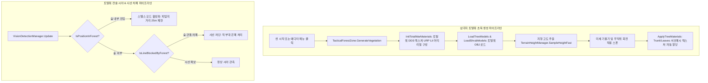

# 🌲 [TacticalForestZone.cs] 전술 숲 & 삼국지 토탈워 3D 초목 시스템 아키텍처 가이드

> **원본 소스 파일**: [TacticalForestZone.cs](file:///c:/unityProject/MiniTotalWar2D/Assets/Scripts/TacticalForestZone.cs)  
> **시스템 역할**: 스팀에 설치된 실제 삼국지 토탈워(Total War: Three Kingdoms) 본편에서 추출/변환한 3D 모델(황산소나무, 대나무, 활엽수, 관목)과 텍스처를 지형 굴곡을 따라 자연스럽게 자동 배치하고, 부대/유닛이 진입했을 때 토탈워 고유의 시야 은폐(매복) 및 사선(Line of Sight) 차폐를 실시간 수행합니다.

---

## 💡 핵심 요약 & 역할 (Summary & Role)

- **핵심 역할**: 삼국지 토탈워 본편의 실제 에셋을 기반으로 전장에 **숲 매복(Ambush) 및 시야 은폐/사선 차폐 메커니즘**을 구현합니다.
- **실제 삼국지 토탈워 3D 초목 모델 연동 (Total War Extracted 3D Assets)**:
  - 기존의 임시 실린더+구체 나무와 깨진 샘플 프리팹을 전면 퇴출하고, 리버스 엔지니어링(REA) 파이프라인으로 추출된 순수 토탈워 3D 모델(`.obj`)과 원본 텍스처(`.dds`)를 URP Lit 셰이더로 렌더링합니다.
  - 저장 위치: `Assets/TotalWar_ThreeKingdoms_Extracted/Vegetation/`
    - `Trees/`: `Huangshan_Pine_A/B` (황산 소나무), `Pine_A` (소나무), `Bamboo_A/C` (대나무), `Castanopsis_A` (활엽수)
    - `Shrubs/`: `Pine_Shrub_Q` (솔관목), `Fern_Royal_A` (고사리), `Scholar_Bush_K` (선비덤불), `Convallaria_Shrub_A` (은방울꽃)
    - `Textures/`: 총 2,125개 텍스처 (672.9MB)
      - `Branches_Leaves/`: 실제 3D 모델용 고해상도 솔잎 가지, 대나무 잎, 활엽수, 버드나무 가지 텍스처
      - `Trunks/`: 황산소나무, 대나무, 소나무, 활엽수 수피 텍스처
      - `Seasons/`: 사계절 빌보드 텍스처 (`Spring/`, `Summer/`, `Autumn/`, `Winter/`)
- **테마별 숲 및 사계절 선택 (Themes & Seasons)**:
  - 숲 테마: `Mixed` (혼합림), `HuangshanPine` (황산 소나무림), `BambooGrove` (대나무숲), `CastanopsisWood` (활엽수림)
  - 계절 설정: `Summer` (여름 녹음), `Spring` (봄 연초록), `Autumn` (가을 단풍), `Winter` (겨울 설경)
- **토탈워 전술 시야 규칙 연동**:
  1. **숲 내부 은폐 (Forest Stealth)**: 숲 속에 들어간 부대(`isHiddenInForest = true`)는 **25m 이내로 초근접하지 않으면 아군 시야에서 완전히 사라집니다.** (단, 전력질주/구보 시에는 45m로 확장)
  2. **숲 관통 사선 차폐 (Line of Sight Block)**: 울창한 숲 지대를 가로지르는 사선은 차단되어, 숲 너머의 적 부대는 보이지 않습니다.

---

## 🌳 1. 아키텍처 트리 맵 (Tree Map)

- 📁 **1. 생명주기 및 정적 레지스트리 (Lifecycle & Static Registry)**
  - `activeZones`: 전장의 모든 활성 숲 영역 정적 목록 관리
  - `OnEnable()`, `OnDisable()`: 활성 레지스트리 등록/해제
  - `Awake()`, `Update()`: 지형 고도 자동 스냅 (`SnapToTerrain`)
- 📁 **2. 삼국지 토탈워 초목 생성 엔진 (Total War Vegetation Spawner)**
  - `GenerateVegetation()`: 지정 형상 및 테마에 맞춰 3D 나무 및 수풀 스폰
  - `InitTotalWarMaterials()`: 토탈워 원본 DDS 텍스처를 적용한 URP Lit 머티리얼 구성
  - `LoadTreeModels()`: 선택된 테마에 해당하는 토탈워 3D 나무 OBJ 프리팹 로드
  - `LoadShrubModels()`: 지표 관목/고사리/덤불 3D OBJ 프리팹 로드
  - `ApplyTreeMaterials()`: 줄기(Trunk)와 잎(Leaves) 서브메시에 각각 전용 머티리얼 바인딩
  - `ApplyShrubMaterials()`: 관목 서브메시에 텍스처 머티리얼 바인딩
  - `ClearVegetation()`: 생성된 초목 오브젝트 일괄 정리
- 📁 **3. 공간 쿼리 및 시야 판정 파이프라인 (Spatial Queries & LoS Engine)**
  - `ContainsPosition()`: 특정 좌표가 해당 숲 영역 내부인지 O(1) 원형/박스 판정
  - `IsPositionInForest()`: 전장의 모든 숲을 순회하여 유닛의 숲 진입 여부 판정
  - `IsLineBlockedByForest()`: 두 지점(아군-적군) 사이의 시선이 숲을 관통하는지 사선 교차 판정
- 📁 **4. 자동 초기화 및 에디터 시각화 (Auto Setup & Gizmos)**
  - `AutoCreateDefaultForests()`: 씬 로드 시 전장 양측 요충지에 소나무림 및 대나무숲 2개소 자동 배치
  - `OnDrawGizmos()`: 지형 굴곡을 따라 에메랄드 그린 와이어 원형/박스 기즈모 렌더링

---

## 🗂️ 2. 해시 테이블 메서드/구조체 색인표 (Hash Table Index)

| Key (메서드 / 구조체) | Value (역할 및 의존성) | 소스 줄 번호 링크 |
| :--- | :--- | :--- |
| `ForestTheme` (enum) | 숲의 수종 테마 (`Mixed`, `HuangshanPine`, `BambooGrove`, `CastanopsisWood`) 정의 | [TacticalForestZone.cs#L27-L33](file:///c:/unityProject/MiniTotalWar2D/Assets/Scripts/TacticalForestZone.cs#L27-L33) |
| `GenerateVegetation` | 토탈워 3D 모델 및 텍스처 머티리얼을 지형 높이에 맞춰 스폰 및 배치 | [TacticalForestZone.cs#L140-L208](file:///c:/unityProject/MiniTotalWar2D/Assets/Scripts/TacticalForestZone.cs#L140-L208) |
| `InitTotalWarMaterials` | 토탈워 원본 베이스 컬러 및 노멀맵 DDS 텍스처(수피, 나뭇잎)를 탑재한 URP Lit 머티리얼 구성 | [TacticalForestZone.cs#L301-L341](file:///c:/unityProject/MiniTotalWar2D/Assets/Scripts/TacticalForestZone.cs#L301-L341) |
| `ApplyTreeMaterials` | 모델의 Trunk/Leaves에 수종별 머티리얼 매핑 및 실시간 그림자(Cast/Receive Shadows) 강제 활성화 | [TacticalForestZone.cs#L382-L418](file:///c:/unityProject/MiniTotalWar2D/Assets/Scripts/TacticalForestZone.cs#L382-L418) |
| `ContainsPosition` | 원형(Radius) 또는 박스(BoxSize) 범위 내 좌표 포함 여부 O(1) 투영 연산 | [TacticalForestZone.cs#L402-L422](file:///c:/unityProject/MiniTotalWar2D/Assets/Scripts/TacticalForestZone.cs#L402-L422) |
| `IsPositionInForest` | 특정 월드 좌표가 전장의 활성 숲 영역에 포함되어 있는지 초고속 판정 | [TacticalForestZone.cs#L427-L445](file:///c:/unityProject/MiniTotalWar2D/Assets/Scripts/TacticalForestZone.cs#L427-L445) |
| `IsLineBlockedByForest` | 아군-적군 간 사선이 숲의 75% 이상 깊이를 통과하는지 검사하여 시야 차폐 확정 | [TacticalForestZone.cs#L450-L498](file:///c:/unityProject/MiniTotalWar2D/Assets/Scripts/TacticalForestZone.cs#L450-L498) |
| `AutoCreateDefaultForests` | 씬 시작 시 서쪽(황산 소나무림) 및 동쪽(대나무숲)에 숲 2개소 자동 생성 | [TacticalForestZone.cs#L505-L530](file:///c:/unityProject/MiniTotalWar2D/Assets/Scripts/TacticalForestZone.cs#L505-L530) |

---

## 🔀 3. 유향 그래프 흐름도 (Directed Graph - Mermaid)

---

## ⚙️ 4. 주요 상태 변수, 데이터 구조체 & 인스펙터 옵션 (State, Structs & Inspector Fields)

| 필드명 | 타입 | 기본값 | 역할 및 튜닝 가이드 |
| :--- | :--- | :--- | :--- |
| `shape` | `ZoneShape` | `Circle` | 숲 구역 형태 (`Circle`: 원형 숲, `Box`: 직사각형 숲) |
| `theme` | `ForestTheme` | `Mixed` | 숲 수종 테마 (`Mixed`, `HuangshanPine`, `BambooGrove`, `CastanopsisWood`) |
| `radius` | `float` | `30.0f` | 원형 숲의 유효 반경 (단위: m) |
| `boxSize` | `Vector2` | `(50, 35)` | 직사각형 숲의 가로(X), 세로(Z) 크기 (단위: m) |
| `treeCount` | `int` | `24` | 스폰할 삼국지 토탈워 3D 나무 개수 |
| `bushCount` | `int` | `45` | 스폰할 삼국지 토탈워 3D 관목/수풀 개수 |
| `treeScaleMultiplier`| `float` | `0.28f` | 나무 스케일 (원본 35~45m -> 게임 내 약 10~13m 실전 크기) |
| `bushScaleMultiplier`| `float` | `0.32f` | 관목 스케일 (원본 4m -> 게임 내 약 1.3m 관목 크기) |
| `stealthDetectionRange`| `float`| `25.0f` | 숲 내부 매복 유닛의 기본 피탐지 거리 (단위: m) |
| `runningDetectionRange`| `float`| `45.0f` | 숲 내부 유닛이 구보(전력질주) 시 발각되는 거리 (단위: m) |
| `blockLineOfSight` | `bool` | `true` | 숲을 통과하는 사선 차폐(LoS Block) 활성화 여부 |

---

## 🛠️ 5. 핵심 알고리즘, 물리/전투 수학 공식 & 조작법 (Algorithms, Math & Controls)

### 1. 토탈워 3D 모델 바이너리 해독 및 변환 사양 (REA Pipeline)
- **팩 포맷**: Total War Three Kingdoms `vegetation.pack` (PFH5 포맷, 2888개 엔트리).
- **RMV2 Version 8 구조**:
  - Vertex Layout: 버텍스 1개당 60바이트.
  - 좌표: 오프셋 8, 10, 12 위치의 `Float16` (IEEE 754 Half-Precision Float).
  - UV: 오프셋 38, 40 위치의 `Float16`.
  - 서브메시: `matType 74` (Trunk - 줄기), `matType 75` (Leaves - 나뭇잎).
- **스케일 보정**:
  - 황산 소나무: 원본 높이 ~46.5m -> 0.28 배율 적용 시 약 13m (웅장한 절벽 고목).
  - 대나무: 원본 높이 ~29m -> 0.28 배율 적용 시 약 8m (운치 있는 대나무 숲).

### 2. 사선 차폐(LoS) 선분-원형 최단 거리 수학 공식
아군 $P_1$과 적군 $P_2$를 잇는 방향 벡터 $\vec{D} = \frac{P_2 - P_1}{\|P_2 - P_1\|}$와 숲 중심점 $C$에 대해,
$$t = (C - P_1) \cdot \vec{D}$$
최단 거리 지점 $P_{close} = P_1 + \vec{D} \cdot t$가 성립하며,
$$\text{dist} = \|P_{close} - C\| < (\text{radius} \times 0.75)$$
인 경우 사선이 숲의 핵심부를 관통하여 시야가 완전히 차폐됩니다.

---

## 🔗 6. 다른 스크립트와의 연동 관계 (Dependencies & Pipeline)

1. **[VisionDetectionManager.cs](file:///c:/unityProject/MiniTotalWar2D/Assets/Scripts/VisionDetectionManager.cs)**:
   - 매 프레임 `TacticalForestZone.IsPositionInForest()`를 호출하여 부대가 숲에 진입했는지 확인하고 스텔스 모드를 적용합니다.
   - `TacticalForestZone.IsLineBlockedByForest()`를 호출하여 숲을 사이에 둔 시야 차폐를 판정합니다.
2. **[TerrainHeightManager.cs](file:///c:/unityProject/MiniTotalWar2D/Assets/Scripts/TerrainHeightManager.cs)**:
   - 숲 구역 자체 및 스폰되는 모든 나무/수풀의 Y 좌표를 지형 표면에 정확하게 밀착시킵니다.
