# 🌲 [TacticalForestZone.cs] 전술 숲 & 삼국지 토탈워 3D 초목 시스템 아키텍처 가이드

> **원본 소스 파일**: [TacticalForestZone.cs](file:///c:/unityProject/MiniTotalWar2D/Assets/Scripts/TacticalForestZone.cs)  
> **시스템 역할**: 스팀에 설치된 실제 삼국지 토탈워(Total War: Three Kingdoms) 본편에서 추출/변환한 3D 모델(황산소나무, 대나무, 활엽수, 관목)과 텍스처를 지형 굴곡을 따라 자연스럽게 자동 배치하고, 부대/유닛이 진입했을 때 토탈워 고유의 시야 은폐(매복) 및 사선(Line of Sight) 차폐를 실시간 수행합니다.

---

## 💡 핵심 요약 & 역할 (Summary & Role)

- **핵심 역할**: 삼국지 토탈워 본편의 실제 에셋을 기반으로 전장에 **숲 매복(Ambush) 및 시야 은폐/사선 차폐 메커니즘**을 구현합니다.
- **실제 삼국지 토탈워 3D 초목 모델 연동 (Total War Extracted 3D Assets)**:
  - 기존의 임시 실린더+구체 나무와 깨진 샘플 프리팹을 전면 퇴출하고, 리버스 엔지니어링(REA) 파이프라인으로 추출된 순수 토탈워 3D 모델(`.obj`)과 원본 텍스처(`.dds`)를 URP Lit 셰이더로 렌더링합니다.
  - 저장 위치: `Assets/TotalWar_ThreeKingdoms_Extracted/Vegetation/`
    - `Trees/`: `Huangshan_Pine_A/B` (황산 소나무), `Pine_A` (소나무), `Bamboo_A/C` (대나무), `Castanopsis_A` (활엽수)
    - `Shrubs/`: `Pine_Shrub_Q` (솔관목), `Fern_Royal_A` (고사리), `Scholar_Bush_K` (선비덤불), `Convallaria_Shrub_A` (은방울꽃)
    - `Textures/`: 총 2,125개 텍스처 (672.9MB)
      - `Branches_Leaves/`: 실제 3D 모델용 고해상도 솔잎 가지, 대나무 잎, 활엽수, 버드나무 가지 텍스처
      - `Trunks/`: 황산소나무, 대나무, 소나무, 활엽수 수피 텍스처
      - `Seasons/`: 사계절 빌보드 텍스처 (`Spring/`, `Summer/`, `Autumn/`, `Winter/`)
- **테마별 숲 및 사계절 선택 (Themes & Seasons)**:
  - 숲 테마: `Mixed` (혼합림), `HuangshanPine` (황산 소나무림), `BambooGrove` (대나무숲), `CastanopsisWood` (활엽수림)
  - 계절 설정: `Summer` (여름 녹음), `Spring` (봄 연초록), `Autumn` (가을 단풍), `Winter` (겨울 설경)
- **토탈워 전술 시야 규칙 연동**:
  1. **숲 내부 은폐 (Forest Stealth)**: 숲 속에 들어간 부대(`isHiddenInForest = true`)는 **25m 이내로 초근접하지 않으면 아군 시야에서 완전히 사라집니다.** (단, 전력질주/구보 시에는 45m로 확장)
  2. **숲 관통 사선 차폐 (Line of Sight Block)**: 울창한 숲 지대를 가로지르는 사선은 차단되어, 숲 너머의 적 부대는 보이지 않습니다.

---

## 🌳 1. 아키텍처 트리 맵 (Tree Map)

- 📁 **1. 생명주기 및 정적 레지스트리 (Lifecycle & Static Registry)**
  - `activeZones`: 전장의 모든 활성 숲 영역 정적 목록 관리
  - `OnEnable()`, `OnDisable()`: 활성 레지스트리 등록/해제
  - `Awake()`, `Update()`: 지형 고도 자동 스냅 (`SnapToTerrain`)
- 📁 **2. 삼국지 토탈워 초목 생성 엔진 (Total War Vegetation Spawner)**
  - `GenerateVegetation()`: 지정 형상 및 테마에 맞춰 3D 나무 및 수풀 스폰
  - `InitTotalWarMaterials()`: 토탈워 원본 DDS 텍스처를 적용한 URP Lit 머티리얼 구성
  - `LoadTreeModels()`: 선택된 테마에 해당하는 토탈워 3D 나무 OBJ 프리팹 로드
  - `LoadShrubModels()`: 지표 관목/고사리/덤불 3D OBJ 프리팹 로드
  - `ApplyTreeMaterials()`: 줄기(Trunk)와 잎(Leaves) 서브메시에 각각 전용 머티리얼 바인딩
  - `ApplyShrubMaterials()`: 관목 서브메시에 텍스처 머티리얼 바인딩
  - `ClearVegetation()`: 생성된 초목 오브젝트 일괄 정리
- 📁 **3. 화재 전파 및 나뭇잎 서브메시 표면 화재 시스템 (Wildfire Simulation & Leaves Surface Fire VFX)**
  - `CalculateTreeLeavesCenterAndRadius()`: 나무 밑동(지면)을 배제하고 Submesh 1(Leaves)의 월드 3D 중심점 및 수관 반경 정밀 산출
  - `CreateTreeFireInstance()`: 전용 복합 화염 셰이더(`TotalWar/VFX/CompositeFlames`)와 머티리얼(`M_TotalWar_CompositeFlames`)을 바인딩하여, 단일 파티클(불 하나)에 삼탈워 3종 화염(A 코어, B 너울, H 팁)이 1:1로 정확하게 포개어져 타오르는 일체형 복합 화염(`Flames_Composite_TotalWar`) 및 2200K 화재 포인트 라이트 스폰
  - `SetupFlamesPS()`: 삼국지 토탈워 8x8 (64프레임) 플립북, 24 FPS 하드웨어 고정, 프레임 간 크로스페이드 보간, 아담한 크기(0.35m~0.55m)로 나뭇잎 서브메시(`Submesh 1: Leaves`) 표면 밀착 연소
  - `TotalWarFoliageWind.shader`: 착화 시점(`_BurnProgress > 0.001`)에 0초 만에 나뭇잎과 그림자를 즉시 클립 소멸시켜 자글거림/붉은색 노이즈를 100% 박멸하고 나뭇잎 자리를 화염이 즉시 대체, 줄기(Trunk)는 40초 동안 검은 숯으로 점진적 탄화
  - `IgniteTreeNode()`: 단일 나무 노드 수관에 화재 착화
  - `UpdateWildfireSimulation()`: 전장 바람(풍향/풍속) 연동 이웃 나무 연쇄 착화 및 숲 은폐 해제 판정
- 📁 **4. 공간 쿼리 및 시야 판정 파이프라인 (Spatial Queries & LoS Engine)**
  - `ContainsPosition()`: 특정 좌표가 해당 숲 영역 내부인지 O(1) 원형/박스 판정
  - `IsPositionInForest()`: 전장의 모든 숲을 순회하여 유닛의 숲 진입 여부 판정
  - `IsLineBlockedByForest()`: 두 지점(아군-적군) 사이의 시선이 숲을 관통하는지 사선 교차 판정
- 📁 **5. 자동 초기화 및 에디터 시각화 (Auto Setup & Gizmos)**
  - `AutoCreateDefaultForests()`: 씬 로드 시 전장 양측 요충지에 소나무림 및 대나무숲 2개소 자동 배치
  - `OnDrawGizmos()`: 지형 굴곡을 따라 에메랄드 그린 와이어 원형/박스 기즈모 렌더링

---

## 🗂️ 2. 해시 테이블 메서드/구조체 색인표 (Hash Table Index)

| Key (메서드 / 구조체) | Value (역할 및 의존성) | 소스 줄 번호 링크 |
| :--- | :--- | :--- |
| `ForestTheme` (enum) | 숲의 수종 테마 (`Mixed`, `HuangshanPine`, `BambooGrove`, `CastanopsisWood`) 정의 | [TacticalForestZone.cs#L27-L33](file:///c:/unityProject/MiniTotalWar2D/Assets/Scripts/TacticalForestZone.cs#L27-L33) |
| `CalculateTreeLeavesCenterAndRadius` | 나뭇잎 서브메시(Leaves) 바운즈를 변환하여 수관 3D 중심점/반경/높이 산출 | [TacticalForestZone.cs#L573-L612](file:///c:/unityProject/MiniTotalWar2D/Assets/Scripts/TacticalForestZone.cs#L573-L612) |
| `CreateTreeFireInstance` | 나뭇잎 서브메시(Submesh 1) 표면에 플립북 화염 에미터 생성 및 컨트롤러 바인딩 | [TacticalForestZone.cs#L614-L695](file:///c:/unityProject/MiniTotalWar2D/Assets/Scripts/TacticalForestZone.cs#L614-L695) |
| `SetupFlamesPS` | 나뭇잎 표면 삼각형 방출, 플립북 블렌딩, 3D 난류 노이즈 및 아담한 불꽃 크기(0.35m~0.65m) 세팅 | [TacticalForestZone.cs#L740-L840](file:///c:/unityProject/MiniTotalWar2D/Assets/Scripts/TacticalForestZone.cs#L740-L840) |
| `GenerateVegetation` | 토탈워 3D 모델 및 텍스처 머티리얼을 지형 높이에 맞춰 스폰 및 배치 | [TacticalForestZone.cs#L199-L271](file:///c:/unityProject/MiniTotalWar2D/Assets/Scripts/TacticalForestZone.cs#L199-L271) |
| `InitTotalWarMaterials` | 토탈워 원본 베이스 컬러 및 노멀맵 DDS 텍스처(수피, 나뭇잎)를 탑재한 URP Lit 머티리얼 구성 | [TacticalForestZone.cs#L1024-L1067](file:///c:/unityProject/MiniTotalWar2D/Assets/Scripts/TacticalForestZone.cs#L1024-L1067) |
| `ApplyTreeMaterials` | 모델의 Trunk/Leaves에 수종별 머티리얼 매핑 및 실시간 그림자(Cast/Receive Shadows) 강제 활성화 | [TacticalForestZone.cs#L1155-L1184](file:///c:/unityProject/MiniTotalWar2D/Assets/Scripts/TacticalForestZone.cs#L1155-L1184) |
| `ContainsPosition` | 원형(Radius) 또는 박스(BoxSize) 범위 내 좌표 포함 여부 O(1) 투영 연산 | [TacticalForestZone.cs#L1216-L1237](file:///c:/unityProject/MiniTotalWar2D/Assets/Scripts/TacticalForestZone.cs#L1216-L1237) |
| `IsPositionInForest` | 특정 월드 좌표가 전장의 활성 숲 영역에 포함되어 있는지 초고속 판정 | [TacticalForestZone.cs#L1242-L1260](file:///c:/unityProject/MiniTotalWar2D/Assets/Scripts/TacticalForestZone.cs#L1242-L1260) |
| `IsLineBlockedByForest` | 아군-적군 간 사선이 숲의 75% 이상 깊이를 통과하는지 검사하여 시야 차폐 확정 | [TacticalForestZone.cs#L1265-L1310](file:///c:/unityProject/MiniTotalWar2D/Assets/Scripts/TacticalForestZone.cs#L1265-L1310) |
| `AutoCreateDefaultForests` | 씬 시작 시 서쪽(황산 소나무림) 및 동쪽(대나무숲)에 숲 2개소 자동 생성 | [TacticalForestZone.cs#L1315-L1350](file:///c:/unityProject/MiniTotalWar2D/Assets/Scripts/TacticalForestZone.cs#L1315-L1350) |

---

## 🔀 3. 유향 그래프 흐름도 (Directed Graph - Mermaid)

```mermaid
flowchart TD
    subgraph Spawning [삼국지 토탈워 초목 생성 파이프라인]
        A[씬 시작 또는 에디터 메뉴 클릭] --> B[TacticalForestZone.GenerateVegetation]
        B --> C[InitTotalWarMaterials: 토탈워 DDS 텍스처 URP Lit 머티리얼 구성]
        C --> D[LoadTreeModels & LoadShrubModels: 토탈워 OBJ 로드]
        D --> E[지형 고도 추출 TerrainHeightManager.SampleHeightFast]
        E --> F[미세 기울기 및 무작위 회전 적용 스폰]
        F --> G[ApplyTreeMaterials: Trunk/Leaves 서브메시 텍스처 자동 할당]
    end

    subgraph FirePipeline [5대 나뭇가지 플립북 화재 파이프라인]
        FA[IgniteTreeNode 호출] --> FB[CalculateTreeLeavesClusters: 5대 가지 끝 잎사귀 뭉치 좌표 산출]
        FB --> FC[5개 가지에 각각 Flames_Branch_k 인스턴스화]
        FC --> FD[SetupFlamesPS: 4x4 16프레임 플립북 애니메이션 활성화]
        FD --> FE[코어 제자리 고정: startSpeed 0.15~0.35m/s 및 볼륨 크기 1.6~2.2m]
        FE --> FF[TotalWarFireVFXController: 연소 진행도에 따른 수명주기 일괄 제어]
    end

    subgraph VisionPipeline [토탈워 전술 시야 & 사선 차폐 파이프라인]
        H[VisionDetectionManager.Update] --> I{IsPositionInForest?}
        I -- 숲 내부 진입 --> J[스텔스 모드 활성화: 피탐지 거리 25m 제한]
        I -- 숲 외부 --> K{IsLineBlockedByForest?}
        K -- 숲 관통 차폐 --> L[사선 차단: 적 부대 은폐 처리]
        K -- 시선 확보 --> M[정상 시야 관측]
    end
```

---

## ⚙️ 4. 주요 상태 변수, 데이터 구조체 & 인스펙터 옵션 (State, Structs & Inspector Fields)

| 필드명 | 타입 | 기본값 | 역할 및 튜닝 가이드 |
| :--- | :--- | :--- | :--- |
| `shape` | `ZoneShape` | `Circle` | 숲 구역 형태 (`Circle`: 원형 숲, `Box`: 직사각형 숲) |
| `theme` | `ForestTheme` | `Mixed` | 숲 수종 테마 (`Mixed`, `HuangshanPine`, `BambooGrove`, `CastanopsisWood`) |
| `radius` | `float` | `30.0f` | 원형 숲의 유효 반경 (단위: m) |
| `boxSize` | `Vector2` | `(50, 35)` | 직사각형 숲의 가로(X), 세로(Z) 크기 (단위: m) |
| `treeCount` | `int` | `24` | 스폰할 삼국지 토탈워 3D 나무 개수 |
| `bushCount` | `int` | `45` | 스폰할 삼국지 토탈워 3D 관목/수풀 개수 |
| `treeScaleMultiplier`| `float` | `0.28f` | 나무 스케일 (원본 35~45m -> 게임 내 약 10~13m 실전 크기) |
| `bushScaleMultiplier`| `float` | `0.32f` | 관목 스케일 (원본 4m -> 게임 내 약 1.3m 관목 크기) |
| `stealthDetectionRange`| `float`| `25.0f` | 숲 내부 매복 유닛의 기본 피탐지 거리 (단위: m) |
| `runningDetectionRange`| `float`| `45.0f` | 숲 내부 유닛이 구보(전력질주) 시 발각되는 거리 (단위: m) |
| `blockLineOfSight` | `bool` | `true` | 숲을 통과하는 사선 차폐(LoS Block) 활성화 여부 |
| `enableFireVFX` | `bool` | `false` | 숲의 화재 시뮬레이션 활성화 (화염, 연기, 불티 점화) |
| `enableWildfirePropagation` | `bool` | `true` | 이웃 나무로의 바람 연동 화재 전파 활성화 |
| `basePropagationRadius` | `float` | `9.0f` | 기본 화재 전파 유효 반경 (단위: m, 삼탈워 공식 실측치) |
| `windSpreadMultiplier` | `float` | `2.5f` | 바람 방향 화재 전파 가속 배율 (순풍 최대 16m) |
| `isForestRevealedByFire`| `bool` | `false` | 화재로 인한 숲 은폐(매복) 해제 여부 (연소율 40% 이상 시 자동 활성화) |
| `burningTreesCount` | `int` | `8` | 숲 내에서 동시에 불타는 나무 수 (1 ~ 20그루) |
| `flameScaleMultiplier` | `float` | `0.45f` | 개별 화염 파티클 크기 배율 (0.15 ~ 1.5, 나뭇가지/잎사귀 크기 1.6~2.2m에 최적화) |

---

## 🛠️ 5. 핵심 알고리즘, 물리/전투 수학 공식 & 조작법 (Algorithms, Math & Controls)

### 1. 토탈워 본편 REA 역공학 일치화 단일 화염 덩어리(Unified Fire Mass) 연출 (Visual Specification)
- **꾸물거림/흔들림 완전 제거 (SkipParticlePositionUpdate = true)**:
  - 삼탈워 실제 팩 파일(`data.pack` 내 `vfx/3k_dlc04_lib_burning_entity.xml`)의 원본 명세에 따라 파티클의 이동 속도 및 난류를 원천 차단(`startSpeed = 0`, `noise.enabled = false`, `gravityModifier = 0`).
  - 파티클이 위로 날아가거나 이리저리 꿈틀대지 않고 방출 위치에 완벽하게 고정되어 제자리에서 연소.
- **불이 부풀어 커지는 현상 완전 제거 (Constant Size & Pure Texture Motion)**:
  - `sizeOverLifetime.enabled = false`로 파티클이 시간에 따라 풍선처럼 부풀어 오르는 현상을 100% 제거.
  - 화염의 일렁임과 펄럭임 모션은 64프레임 플립북 텍스처 자체의 유체 애니메이션이 온전히 담당.
- **나뭇잎 뭉치별 독립 화염 애니메이션 안착 (Individual Branch Flame Animations)**:
  - 개별 파티클 크기를 나뭇잎 뭉치 하나에 알맞게 안착하는 `0.75m ~ 1.15m` 최적 비율로 설정하여 나뭇가지 실루엣을 뭉개지 않고 또렷하게 보존.
  - 파티클들이 거대한 덩어리로 떡지지 않고, 나뭇가지 끝 주요 잎사귀 위치마다 10~15개의 선명한 불꽃 개체들이 독립된 64프레임 유체 화염 애니메이션을 각각 루프 재생.
- **삼국지 토탈워 100% 정품 8x8 (64프레임) 플립북 애니메이션 완전 구동**:
  - 삼탈워 원본 BC7 DDS 텍스처(`3k_anim_fire_a_diffuse.dds`)를 1024x1024 무손실 텍스처로 추출 및 바인딩.
  - `frameOverTime`에 0부터 63까지 전구간 선형 순회 커브(`0f -> 63f`)를 바인딩하여 64개 프레임이 초당 약 30fps로 부드럽게 펄럭이며 회전.
  - `ParticleSystemRenderer`에 `UV`, `UV2`, `AnimBlend` 커스텀 버텍스 스트림을 주입하여 URP 크로스페이드 블렌딩(`_FLIPBOOKBLENDING_ON`) 완벽 구동.
- **나뭇잎 형광 발광 박멸 및 디졸브/탄화 골격**:
  - `TotalWarFoliageWind.shader`의 `burnRim` 두께를 `0.015`로 최소화하고 형광 발광을 억제하여 주황색 단풍잎 노출을 원천 차단.
  - 화염 덩어리 아래에서 잎사귀가 자연스럽게 알파 디졸브로 타들어가 사라지고, 앙상하게 탄화된 검은색 나뭇가지 골격 실루엣만 남음.

### 2. 바람결 연쇄 화재 전파 공식 (Wind-Driven Wildfire Propagation Math)
삼국지 토탈워 실제 데이터베이스 `kv_fire_values_tables`와 풍향 벡터를 결합한 전파 공식:
- 인접 나무 벡터: `ToNeighbor = NeighborPos - SourcePos`
- 유효 전파 거리 계산:
  `EffectiveDistance = BaseRadius(9.0m) + WindSpeed * dot(normalize(ToNeighbor), WindDir) * SpreadMultiplier(2.5m)`
- 순풍(바람이 불어가는 방향, dot = +1): 최대 16.0m까지 불티가 날아가 전파 가속.
- 역풍(바람을 거스르는 방향, dot = -1): 3.5m 이하로 전파 억제.
- 전파 축적 속도:
  `SpreadRate = 0.22 * (1.0 + max(0, dot * 1.4)) * (1.0 - Distance / EffectiveDistance)`
- `neighbor.fireGauge`가 0.20 도달 시 연기 단계(Smoking), 1.0 도달 시 발화(Burning) 전이.

### 3. 사선 차폐(LoS) 선분-원형 최단 거리 공식
- 아군 위치 P1과 적군 위치 P2를 잇는 단위 방향 벡터 D = normalize(P2 - P1)와 숲 중심점 C에 대해:
  `t = dot(C - P1, D)`
- 사선상 최단 거리 지점: `P_close = P1 + D * t`
- 중심점과의 거리: `dist = length(P_close - C)`
- 판정: `dist < (radius * 0.75)`인 경우, 사선이 숲의 75% 이상 핵심부를 관통하므로 시야가 완전히 차폐됩니다.
- 단, 화재로 인해 `isForestRevealedByFire == true` 상태가 되면 사선 차폐 및 은폐가 영구 해제됩니다.

### 4. 에디터 단축 조작법 (Controls)
- **메뉴 상단 실행**:
  - `MiniTotalWar -> 🔥 서쪽 숲 바람결 연쇄 화재 전파 개시`: 풍상측 나무 1~2그루에 착화 후 바람을 타고 숲 전체로 번져나가는 장관 연출.
  - `MiniTotalWar -> 🔥 서쪽 숲 전면 화재 즉시 점화`: 숲의 주요 나무 8그루에 즉시 불길 점화.
  - `MiniTotalWar -> 🧯 전장 화재 전면 진압`: 모든 화재 VFX 제거 및 수목 원상 복원.

---

## 🔗 6. 다른 스크립트와의 연동 관계 (Dependencies & Pipeline)

1. **[TotalWarFireVFXController.cs](file:///c:/unityProject/MiniTotalWar2D/Assets/Scripts/TotalWarFireVFXController.cs)**:
   - `IgniteTreeNode()` 호출 시 각 나무 위치에 화재 파티클 인스턴스를 생성하고, 타겟 나무 렌더러를 전달하여 18초간 실시간 전소(`burnProgress`), 탄화, 디졸브, 조명 깜빡임 및 파티클 감쇠 수명주기를 제어합니다.
2. **[TotalWarWindManager.cs](file:///c:/unityProject/MiniTotalWar2D/Assets/Scripts/TotalWarWindManager.cs)**:
   - 실시간 전장 풍향(`windAngle`)과 풍속(`windSpeed`)을 화재 전파 벡터로 전달하여, 바람이 불어가는 방향으로 불길이 옮겨붙도록 구동합니다.
3. **[VisionDetectionManager.cs](file:///c:/unityProject/MiniTotalWar2D/Assets/Scripts/VisionDetectionManager.cs)**:
   - 매 프레임 `TacticalForestZone.IsPositionInForest()`를 호출하여 부대가 숲에 진입했는지 확인하고 스텔스 모드를 적용합니다. 단, 화재 전소율 40% 이상 도달 시(`isForestRevealedByFire`) 강제 발각됩니다.
4. **[TerrainHeightManager.cs](file:///c:/unityProject/MiniTotalWar2D/Assets/Scripts/TerrainHeightManager.cs)**:
   - 숲 구역 자체 및 스폰되는 모든 나무/수풀의 Y 좌표를 지형 표면에 정확하게 밀착시킵니다.
