# 🌾 [TacticalGrassRenderer.cs] 데이터 기반 방사형 잔디 스트리밍 렌더러 아키텍처 가이드

> **원본 소스 파일**: [TacticalGrassRenderer.cs](file:///c:/unityProject/MiniTotalWar2D/Assets/Scripts/TacticalGrassRenderer.cs)  
> **에디터 소스 파일**: [TacticalGrassRendererEditor.cs](file:///c:/unityProject/MiniTotalWar2D/Assets/Scripts/Editor/TacticalGrassRendererEditor.cs)  
> **연관 기획서**: [토탈워_삼국지_3D_방사형_잔디_LOD_시스템_기획서.md](file:///c:/unityProject/MiniTotalWar2D/Docs/기획서/토탈워_삼국지_3D_방사형_잔디_LOD_시스템_기획서.md)

---

## 💡 핵심 요약 & 역할 (Summary & Role)

전장에 수십만 포기의 풀을 씬에 무겁게 미리 심어두지 않고, **가벼운 데이터 그리드(Data Grid & Spatial Chunks)로 메모리에 보관**하다가, **카메라가 지면 근처로 확대(줌인, 기본 80m 이내)될 때만 카메라 반경 안의 풀들을 GPU 인스턴싱(`Graphics.DrawMeshInstanced`)으로 초고속 실시간 렌더링**하는 차세대 전장 식생 스트리밍 엔진입니다.

- **표준 식생 2대 트랙 전면 구축**:
  - **하층 85% 2D 다방향 지피 군락**: 10열 360도 교차 다방향 군락(지름 0.9m, 별 모양 그림자, 1드로우콜 결합 메쉬)으로 바닥을 빈틈없이 덮는 잔디 융단 구축.
  - **상층 15% 3D 단일 입체 풀포기**: 원시 5m 통짜 패치 메쉬에서 외곽에 눕혀진 잡다한 파편을 전면 배제하고 중심 뿌리 피벗(0,0)에 직립 정렬된 단 1개의 주 풀포기만 정제한 `Clean3DTuft` 메쉬 기반 식생.
  - **예외 식생 2종 보존**: 지면 밀착 바닥 덮개(`Shrub_Flat_A`, 지면 추종률 0.90) 및 대나무 그루터기 군락(`Bamboo_Stump_Group_A`).
- **드로우콜 0 최적화**: 카메라가 전술 조망(줌아웃) 상태일 때는 렌더링 비용이 완전히 0이 됩니다.
- **원클릭 지형 정밀 클리어링**: 도로망([TotalWarRoadSpline](file:///c:/unityProject/MiniTotalWar2D/Assets/Scripts/TotalWarRoadSpline.cs)), 하천([TotalWarRiverSpline](file:///c:/unityProject/MiniTotalWar2D/Assets/Scripts/TotalWarRiverSpline.cs)), 연못/늪지([TacticalWaterZone](file:///c:/unityProject/MiniTotalWar2D/Assets/Scripts/TacticalWaterZone.cs)), 바다 및 32도 초과 절벽 바위에는 풀이 0%로 완벽 배제됩니다.
- **게임플레이 실시간 상호작용**: 유닛 이동 시 풀밭 감속(0.82배) 판정 및 부대 진군 짓밟힘(Trample)으로 풀을 납작하게 눕히는 물리 API를 제공합니다.

---

## 🌳 1. 아키텍처 트리 맵 (Tree Map)

```
TacticalGrassRenderer Master Architecture
 ├── 1. 데이터 저장 및 공간 분할 계층 (Data & Spatial Chunking)
 │    ├── FoliageState 열거형 (Healthy, Trampled, Burning, AshDecal)
 │    ├── TacticalGrassPrototype (메쉬, URP 인스턴싱 머티리얼, 스케일 범위)
 │    └── TacticalGrassChunk (32m x 32m 공간 분할 바운딩 박스 & 1023개 단위 행렬 배치)
 │
 ├── 2. 3D 메쉬 정제 및 표준화 파이프라인 (Procedural Tuft Mesh Optimization)
 │    ├── GetOrCreateClean3DTuftMesh (5m 원시 패치에서 외곽 파편 배제 -> 중심 1포기 엄선 직립 정제)
 │    ├── GetOrCreateGroundedTuftMesh (지피 1자 띠 메쉬의 중심 뿌리 Y=0 지면 정규화)
 │    └── EnsureDefaultPrototypes (8대 표준 프로토타입 자동 검증 및 정제 메쉬 바인딩)
 │
 ├── 3. 지형 스플랫맵 기반 데이터 빌드 계층 (Procedural Foliage Baking)
 │    ├── 경사도 검사 (0~32도 평지/완경사 통과, 32도 초과 절벽 바위 0% 배제)
 │    ├── 도로망 마스크 (TotalWarRoadSpline.IsOnAnyRoad 0% 배제)
 │    ├── 전장 수계 마스크 (하천, 워터존, 바다 수면 아래 0% 배제)
 │    ├── 스플랫맵 필터링 (Layer 0 잔디 가중치 18% 이상 서식)
 │    ├── 황금각 나선 분산 (1.6m 간격, 군락 20~30% 겹침으로 바둑판 격자 영구 소거)
 │    └── CalculateSlopeGroundedTransform (5점 지형 샘플링 & 비탈면 밀착)
 │
 ├── 4. 디스크 영구 저장/로드 파이프라인 (Disk Save & Load System)
 │    ├── 저장 위치: Assets/Settings/Vegetation/Data/[MapName]/ 하위 폴더 자동 생성
 │    ├── FoliageManifest.json (맵명, 터레인 크기, 청크수, 총 인스턴스수, 프로토타입 메타데이터)
 │    ├── FoliageChunks.bytes (TWFG 매직 시그니처 32m 청크 바이너리 초고속 압축 로딩)
 │    └── FoliageRuntimeDelta.json (게임 플레이 도중 짓밟힘/화재 잿더미 흔적 영구 보존)
 │
 ├── 5. 카메라 줌인 감지 및 GPU 렌더링 계층 (Zoom Detection & DrawMeshInstanced)
 │    ├── 활성 카메라 감지 (런타임 Camera.main / ForceRenderCamera ⇄ 에디터 SceneView)
 │    ├── 카메라 고도 줌아웃 판정 (maxRenderDistance 초과 시 즉시 리턴, 드로우콜 0)
 │    ├── 거리 기반 청크 쿼리 (카메라 반경 80m 이내 바운딩 박스 선별)
 │    └── Graphics.DrawMeshInstanced (1회 1,023개 인스턴스 일괄 고속 렌더링)
 │
 └── 6. 게임플레이 연동 API 계층 (Gameplay Interactions)
      ├── GetFoliageResistance(worldPos) -> 도로 1.0f, 풀밭 0.82f, 수계 0.50f
      ├── ApplyTrample(worldPos, radius) -> 부대 통행 시 풀 Y축 1/4 납작 눕힘 및 델타 기록
      ├── IgniteAt(worldPos, radius) -> 풍향 연동 3D 화재 연소 및 잿더미 전이
      └── ClearFoliageData() -> 메모리 즉각 해제
```

---

## 🗂️ 2. 해시 테이블 메서드/구조체 색인표 (Hash Table Index)

| Key (메서드 / 구조체) | Value (역할 및 세부 기술 명세) | 소스 줄 번호 링크 |
| :--- | :--- | :--- |
| `FoliageState` | 풀의 4대 물리 상태 (정상, 짓밟힘, 연소 중, 전소 잿더미) | [TacticalGrassRenderer.cs#L18-L24](file:///c:/unityProject/MiniTotalWar2D/Assets/Scripts/TacticalGrassRenderer.cs#L18-L24) |
| `TacticalGrassPrototype` | 3D 풀포기 메쉬, URP 인스턴싱 머티리얼, 규격 스케일 페어 구조체 | [TacticalGrassRenderer.cs#L55-L75](file:///c:/unityProject/MiniTotalWar2D/Assets/Scripts/TacticalGrassRenderer.cs#L55-L75) |
| `TacticalGrassChunk` | 32m x 32m 공간 분할 단위, 1023개 배치 행렬 배열 보관 클래스 | [TacticalGrassRenderer.cs#L81-L140](file:///c:/unityProject/MiniTotalWar2D/Assets/Scripts/TacticalGrassRenderer.cs#L81-L140) |
| `ActiveChunkCount` | 현재 로드된 유효 공간 분할 청크 개수 반환 프로퍼티 | [TacticalGrassRenderer.cs#L474](file:///c:/unityProject/MiniTotalWar2D/Assets/Scripts/TacticalGrassRenderer.cs#L474) |
| `ForceRenderCamera` | 외부 캡처/시네마틱 카메라를 강제 주입하여 즉시 인스턴싱 렌더링을 구동하는 수동 호출 API | [TacticalGrassRenderer.cs#L630-L634](file:///c:/unityProject/MiniTotalWar2D/Assets/Scripts/TacticalGrassRenderer.cs#L630-L634) |
| `GetOrCreateClean3DTuftMesh` | 5m 원시 패치 OBJ에서 외곽 거미줄 잎사귀를 100% 버리고 중심 피벗(0,0)의 가장 꼿꼿한 단 1개의 주 풀포기만 엄선 추출하여 기저부 Y=0 및 직립 정렬 후 `_Clean3DTuft.asset`으로 영구 저장하는 알고리즘 | [TacticalGrassRenderer.cs#L1169-L1412](file:///c:/unityProject/MiniTotalWar2D/Assets/Scripts/TacticalGrassRenderer.cs#L1169-L1412) |
| `GetOrCreateGroundedTuftMesh` | 8m 광역 평판 메쉬 내부의 서브 풀포기 군집을 분리하고 중심부 최저 Y를 검출해 Y=0.000m 지면에 정규화하는 접지 알고리즘 | [TacticalGrassRenderer.cs#L903-L1165](file:///c:/unityProject/MiniTotalWar2D/Assets/Scripts/TacticalGrassRenderer.cs#L903-L1165) |
| `EnsureDefaultPrototypes` | 기획서 표준 8대 프로토타입(하층 지피 70%, 꽃 군락 15%, 상층 3D 정제 풀포기 15%, 지면 밀착 예외 2종)을 자동 검증 및 정합 바인딩하는 초기화 엔진 | [TacticalGrassRenderer.cs#L1474-L1673](file:///c:/unityProject/MiniTotalWar2D/Assets/Scripts/TacticalGrassRenderer.cs#L1474-L1673) |
| `CalculateSlopeGroundedTransform` | 중심점 + 4방위 5점 지형 높이 샘플링, 식물 기립력 보장(경사면 노멀 정렬 최대 0.35f 캡), 경사각 비례 미세 침하로 지면 밀착 및 거꾸로 서는 현상 방지 | [TacticalGrassRenderer.cs#L2070-L2130](file:///c:/unityProject/MiniTotalWar2D/Assets/Scripts/TacticalGrassRenderer.cs#L2070-L2130) |
| `BakeFoliageData` | 터레인 스플랫맵 분석 + 도로/하천/바위 배제 + 황금각 나선 1.6m 지피 융단 및 표준 8대 식생 청크 인스턴스 영구 생성 | [TacticalGrassRenderer.cs#L1992-L2338](file:///c:/unityProject/MiniTotalWar2D/Assets/Scripts/TacticalGrassRenderer.cs#L1992-L2338) |
| `EnsureDefaultPrototypes` | 표준 9대 프로토타입(하층 지피 + 가을 건조 잔디 + 야생화 군락 + 상층 3D 풀포기/갈대 2종 + 고사리) 자동 검증 및 `ResolveRefinedAssetMesh` 정제 메쉬·계절 머터리얼 바인딩 | [TacticalGrassRenderer.cs#L1481-L1710](file:///c:/unityProject/MiniTotalWar2D/Assets/Scripts/TacticalGrassRenderer.cs#L1481-L1710) |
| `ResolveRefinedAssetMesh` | 누락된 계절별 `.asset` 이름을 마스터 정제 메쉬(`Clump`/`Plume`/`Spike`/`Sword`/`Royal`/`LotusCluster`) 및 계절 머터리얼로 자동 해석·복구 | [TacticalGrassRenderer.cs#L1715-L1750](file:///c:/unityProject/MiniTotalWar2D/Assets/Scripts/TacticalGrassRenderer.cs#L1715-L1750) |
| `CalculateSlopeGroundedTransform` | 중심점 + 4방위 5점 지형 높이 샘플링, 식물 기립력 보장(경사면 노멀 정렬 최대 0.35f 캡), 경사각 비례 미세 침하로 지면 밀착 및 거꾸로 서는 현상 방지 | [TacticalGrassRenderer.cs](file:///c:/unityProject/MiniTotalWar2D/Assets/Scripts/TacticalGrassRenderer.cs) |
| `BakeFoliageData` | 터레인 스플랫맵 분석 + 셀 중심 무작위 지터(`±0.44 * sampleSpacing`) + 2단 펄린 노이즈 군락(`patchDensity`/`SmoothStep`) 기반 다종 유기적 식생 청크 생성 | [TacticalGrassRenderer.cs#L2153-L2400](file:///c:/unityProject/MiniTotalWar2D/Assets/Scripts/TacticalGrassRenderer.cs#L2153-L2400) |
| `SaveFoliageDataToDisk` | `Assets/Settings/Vegetation/Data/[MapName]/` 하위에 Manifest.json 및 Chunks.bytes 바이너리 영구 저장 | [TacticalGrassRenderer.cs#L2344-L2443](file:///c:/unityProject/MiniTotalWar2D/Assets/Scripts/TacticalGrassRenderer.cs#L2344-L2443) |
| `LoadFoliageDataFromDisk` | 디스크의 `FoliageChunks.bytes` 파일에서 0.01초 만에 식생 데이터 복원 및 델타 적용 | [TacticalGrassRenderer.cs#L2449-L2561](file:///c:/unityProject/MiniTotalWar2D/Assets/Scripts/TacticalGrassRenderer.cs#L2449-L2561) |
| `RenderGrassBatchesForCamera` | 카메라 거리/줌인 실시간 감지 및 `DrawMeshInstanced` 고속 렌더링 루프 | [TacticalGrassRenderer.cs#L2620-L2710](file:///c:/unityProject/MiniTotalWar2D/Assets/Scripts/TacticalGrassRenderer.cs#L2620-L2710) |
| `ConfigureGrassTuftFireVFX` | 삼탈워 8x8 플립북 화염(`CompositeFlames`), 연기(`VolumetricSmoke`), 불똥(`RisingEmbers`) 및 동적 조명을 풀포기 3D 메쉬 표면에 장착 | [TacticalGrassRenderer.cs#L2965-L3180](file:///c:/unityProject/MiniTotalWar2D/Assets/Scripts/TacticalGrassRenderer.cs#L2965-L3180) |
| `IgnitePlantAt` | 지정 월드 좌표의 개별 풀포기를 찾아 초록 인스턴스를 숨기고 3D 탄화 메쉬 + 8x8 화염 VFX 스폰 및 확률 기반 착화 검증 후 3D 숯 풀 잔해 안착 | [TacticalGrassRenderer.cs#L3616-L3796](file:///c:/unityProject/MiniTotalWar2D/Assets/Scripts/TacticalGrassRenderer.cs#L3616-L3796) |
| `SpawnTerrainConformingAshMark` | 16각 링 3중 동심원(49정점) 지형 곡면 밀착 메쉬, 삼탈워 정품 잿더미 텍스처, 월드 UV 타일링 및 3단계 알파 페더링을 통한 무결점 잿더미/그을음 스폰 | [TacticalGrassRenderer.cs#L3327-L3442](file:///c:/unityProject/MiniTotalWar2D/Assets/Scripts/TacticalGrassRenderer.cs#L3327-L3442) |
| `CleanupResidualFireVFX` | 게임 시작 시 씬에 남아있던 잔여 화재 VFX, 불티, 화염 파티클 및 잔해 전수 소거 | [TacticalGrassRenderer.cs#L525-L552](file:///c:/unityProject/MiniTotalWar2D/Assets/Scripts/TacticalGrassRenderer.cs#L525-L552) |

---

## 🔀 3. 유향 그래프 흐름도 (Directed Graph - Mermaid)

```mermaid
flowchart TD
    subgraph Mesh_Refinement ["0단계: 표준 식생 메쉬 정제 파이프라인"]
        RawOBJ["5m 원시 패치 OBJ (Tem/Sbt_Grass)"] --> CleanTuft["GetOrCreateClean3DTuftMesh"]
        CleanTuft --> IslandSplit["Union-Find 섬(Island) 분리"]
        IslandSplit --> Filter["피벗(0,0) 중심부 주 풀포기 1개 선별"]
        Filter --> DropLaying["외곽 눕혀진 파편 100% 폐기"]
        DropLaying --> AlignUpright["기저부 Y=0 정렬 & 직립 노멀 보정"]
        AlignUpright --> CleanAsset["_Clean3DTuft.asset 영구 저장"]
    end

    subgraph Data_Bake ["1단계: 전장 풀 데이터 생성 (Bake)"]
        TerrainSplat["터레인 스플랫맵 분석"] --> FilterMask{"배제 조건 검사"}
        FilterMask -- "도로 위 (IsOnAnyRoad)" --> Skip["생성 0% (도로 클리어링)"]
        FilterMask -- "하천/워터존/바다 수면 아래" --> Skip
        FilterMask -- "경사도 > 32도 (절벽 바위)" --> Skip
        FilterMask -- "풀밭 (Layer 0 잔디)" --> GoldenSpiral["황금각 나선 1.6m 살포"]
        GoldenSpiral --> TrackSelect{"표준 식생 2대 트랙 분기"}
        TrackSelect -- "하층 85% 지피/꽃 군락" --> SlopeGrounded["CalculateSlopeGroundedTransform (5점 지형 밀착)"]
        TrackSelect -- "상층 15% 3D 단일 포기" --> SlopeGrounded
        SlopeGrounded --> ChunkPack["32m x 32m 청크에 행렬 및 물리 지수 패킹"]
        ChunkPack --> DiskSave["FoliageChunks.bytes (27.7MB) 영구 저장"]
    end

    subgraph Runtime_Streaming ["2단계: 실시간 카메라 스트리밍 렌더링"]
        CamMove["카메라 이동 / 줌 (SceneView or Camera.main)"] --> ZoomCheck{"카메라-지면 거리 > maxRenderDistance?"}
        ZoomCheck -- "Yes (원거리 줌아웃)" --> ZeroCost["렌더링 스킵 (드로우콜 0, 연산 0)"]
        ZoomCheck -- "No (근접 줌인 확대)" --> ChunkQuery["반경 80m 이내 바운딩 청크 선별"]
        ChunkQuery --> GPUInstancing["Graphics.DrawMeshInstanced() 고속 드로우"]
    end

    subgraph Gameplay_Interaction ["3단계: 인게임 물리 & 전술 상호작용"]
        UnitMove["부대 이동 (Squad.cs / ECS / JobSystem)"] --> RoadCheck{"도로 위? (TotalWarRoadSpline)"}
        RoadCheck -- "Yes (황토길)" --> RoadSpd["1.0배 표준 속도 유지 & 은신 해제"]
        RoadCheck -- "No (수풀 진입)" --> FoliageEval["GetFoliageResistance() & IsPositionInDeepStealth()"]
        FoliageEval --> SpeedDrag["이동 저항 (0.68배~0.82배 감속)"]
        FoliageEval --> Stealth["완전 은신 (적 25m 접근 시에만 발각)"]
        FireArrow["화살/화공 투사체"] --> Ignite["IgniteAt() 화재 점화"]
        Ignite --> WindSpread["풍향 바람 벡터 기반 인접 청크 연소 확산"]
        WindSpread --> AshDecal["전소 후 재(Ash) 데칼 평탄화 -> 1.0배 고속도로화"]
    end
```



---

## ⚙️ 4. 주요 상태 변수, 데이터 구조체 & 인스펙터 옵션 (State & Fields)

> [!NOTE] 
> `TacticalGrassRendererEditor.cs`는 100% 한국어 라벨로 커스텀 렌더링되며, 모든 필드에 마우스를 올리면(Hover) 영문 전문용어와 세부 튜닝 가이드가 유니티 표준 툴팁으로 제공됩니다.

### 4.1 완벽한 표준 4대 프로토타입 규격 일람표 (1~4번 전장 융단 100%)

| 슬롯 ID | 프로토타입 명칭 | 메쉬 에셋 및 규격 | 점유율 | 직립도 (alignToGround) | 높이 배율 | 역할 및 시각적 특징 |
| :--- | :--- | :--- | :--- | :--- | :--- | :--- |
| `[0]` | 🌾 온대 순수 잔디 다방향 군락 | `TotalWar_MultiDirectionalGrassCluster_CustomMesh.asset` | **85%** | 0.28f (직립 위주) | 0.40m | 전장 잔디 융단 핵심, 10열 360도 교차 직립 띠, 별 모양 그림자 |
| `[1]` | 🌸 분홍 꽃망울 다방향 군락 | `TotalWar_FlowerCluster_PinkBuds_Photo1_Mesh.asset` | **5%** | 0.28f (직립 위주) | 0.42m | 원작 픽셀 1:1 매칭 분홍 꽃망울 포인트 지피 (사진 1 고증) |
| `[2]` | 💜 연보라 꽃송이 다방향 군락 | `TotalWar_FlowerCluster_PurplePetals_Photo2_Mesh.asset` | **5%** | 0.28f (직립 위주) | 0.42m | 원작 픽셀 1:1 매칭 연보라 꽃송이 포인트 지피 (사진 2 고증) |
| `[3]` | 🧡 주황 꽃이삭 다방향 군락 | `TotalWar_FlowerCluster_OrangeSpikes_Photo3_Mesh.asset` | **5%** | 0.28f (직립 위주) | 0.44m | 원작 픽셀 1:1 매칭 주황 꽃이삭 포인트 지피 (사진 3 고증) |

> 💡 **알림**: 5, 6, 7, 8번(원시 OBJ 기반 파편 3D 및 바닥 덮개)은 비주얼 결함으로 인해 전면 배제되었으며, 향후 **순수 절차적 방사형(Radial Fan) 3D 지피 풀포기 알고리즘**으로 완전 대체될 예정입니다.

### 4.2 주요 인스펙터 필드 사양
1. **`sampleSpacing` (기본값: 1.6f)**:
   - 풀포기 간격(Grid Step). 지름 0.9m 군락이 20~30% 자연스럽게 중첩되도록 1.6m로 튜닝되어 바닥 노출을 원천 방지합니다.
2. **`maxRenderDistance` (기본값: 80.0f)**:
   - 카메라 줌인 시 렌더링이 활성화되는 최대 가시 거리. 80m를 벗어나면 드로우콜 0으로 차단됩니다.
3. **`chunkSize` (기본값: 32.0f)**:
   - 전장을 분할하는 정방형 청크 크기(32m x 32m). URP 1회 드로우콜 한계(1,023개)에 최적화되어 있습니다.
4. **`sceneViewRenderDistance` (기본값: 450.0f)**:
   - 유니티 에디터 작업 시 광활한 전장 씬 전체를 한눈에 조망할 수 있는 씬 뷰 전용 가시 거리.

---

## 🛠️ 5. 핵심 알고리즘, 물리/전투 수학 공식 & 조작법 (Algorithms & Controls)

### 5.1 단일 3D 풀포기 정제 알고리즘 (`GetOrCreateClean3DTuftMesh`)
5m 원시 패치 OBJ에서 외곽에 눕혀진 잡다한 파편과 거미줄 잎사귀들을 100% 버리고 중심 피벗(0,0)의 단 1개 주 풀포기만 엄선 추출하는 핵심 알고리즘:

1. **삼각형 연결성 분리 (Union-Find Island Partitioning)**:
   - 메쉬의 모든 삼각형을 정점 공유 관계에 따라 개별 독립 섬(Island)으로 분리.
2. **외곽 눕혀진 파편 필터링**:
   - 섬의 중심 좌표 `IslandCenter`와 원점 `(0, 0)` 간의 거리가 `maxRadius * 0.70` 이내인 섬만 통과.
   - 평균 법선 벡터의 수직도 `Vector3.Dot(Normal, Vector3.up) > 0.55`를 만족하는 직립 섬만 통과(바닥에 누운 파편 배제).
3. **주 풀포기(Main Island) 엄선**:
   - 중심에 가장 가깝고 정점 수가 풍부한 단 1개의 주 포기(Main Tuft)를 선택.
4. **기저부 Y=0 및 직립 정렬 (Root Pivot Grounding)**:
   - 추출된 주 포기의 최하단 Y(`minY`)를 0.000m 지면으로 시프트.
   - 전체 수평 직경을 0.35m~0.40m로 클램핑하여 단정하고 정갈한 3D 메쉬 완성.

### 5.2 황금각 나선 분산 (Golden Angle Spiral Dispersion)
바둑판 격자 줄무늬를 소거하고 유기적인 자연 잔디 융단을 형성하기 위해 1개 샘플링 지점당 3개의 풀포기를 황금각(137.5077도)으로 분산 배치:
### 5.2 유기적 펄린 군락 & 지터 황금각 분산 (Organic Perlin Cluster & Jittered Golden Angle)
기계적인 `1.6m` 바둑판 격자 줄무늬를 없애고 자연 군락을 형성하기 위해 셀 중심 무작위 지터(`±0.44 * sampleSpacing`), 2단 펄린 노이즈 군락 밀도(`patchDensity`) 및 `SmoothStep` 가장자리 페이드를 결합한 뒤 1~4포기를 가변 분산 배치:

```
tuftCount = 3
cellRadius = 0.45 * sampleSpacing (1.6m 기준 0.72m)
jitterX/Z = (Random(-0.44, 0.44)) * sampleSpacing
patchDensity = Clamp01(0.65 * PerlinMacro + 0.35 * PerlinMicro)
grassWeight *= SmoothStep(0.18, 0.55, patchDensity)
tuftCount = Lerp(1, 4, patchDensity) + jitterCount (가변 포기 수)
cellRadius = 0.68 * sampleSpacing

for i = 0 to tuftCount - 1:
    angle = (i * 137.5077도) + perlinAngleOffset
    radius = cellRadius * sqrt((i + 0.5) / tuftCount)
    offset.x = cos(angle) * radius
    offset.z = sin(angle) * radius
    tuftPos = gridCenter + offset
    angle = baseRandomAngle + (i * 137.5077도) + perlinAngleOffset
    radius = cellRadius * sqrt((i + 0.5) / tuftCount) * Random(0.75, 1.15)
    tuftPos = jitteredCellCenter + (cos(angle), sin(angle)) * radius
```

### 5.3 식생 높이·밀도 차등형 은폐 지수 계산 공식
청크 내 식생 프로토타입의 고유 은폐율과 인스턴스 밀도를 결합하여 청크 은폐 지수를 도출:

```
평균 은폐율 = (시그마 프로토타입 은폐율) / 프로토타입 개수
정규화 밀도 = Clamp01(청크 내 인스턴스 개수 / 기준 밀도(80개))
chunkStealthPower = Clamp01(평균 은폐율 * 0.7 + 정규화 밀도 * 0.3)

if chunkStealthPower >= 0.55:
    isPositionInDeepStealth = true (완전 은신)
```

### 5.4 이동속도 저항 및 도로 연동 공식
군사 도로는 장애물이 없는 1.0배 표준 속도를 제공하며, 길 밖 식생은 밀도에 비례한 저항을 가집니다:

```
if TotalWarRoadSpline.IsOnAnyRoad(pos):
    return 1.0 (도로 위: 표준 속도 보장)

switch (chunkState):
    case Healthy:
        return Clamp(chunkSpeedMultiplier, 0.68, 1.0) // 키 큰 갈대/수풀 0.68배~0.72배, 잔디 0.82배
    case Trampled:
        return 0.92 (짓밟힌 풀: 통행 저항 완화)
    case Burning:
        return 0.50 (화염 속: 극심한 혼란 및 감속)
    case AshDecal:
        return 1.00 (전소된 재: 장애물 소멸로 도로화)
```

### 5.5 조작법 및 단축 메뉴
- **유니티 상단 메뉴**:
  - `TotalWar > 🌾 데이터 기반 방사형 풀 렌더러 장착 및 빌드`: 렌더러 컴포넌트 자동 장착 및 초기화.
  - `TotalWar > 🌾 [Game2] 표준 식생 2대 트랙 터레인 전면 베이크`: 전장 터레인 전체를 8대 표준 프로토타입으로 일괄 자동 베이크 및 디스크 영구 저장.
- **인스펙터 버튼**:
  - `[🌾 전장 풀 데이터 즉시 생성 (Bake)]`: 현재 씬의 터레인 스플랫맵을 읽어 즉시 풀 데이터 생성.
  - `[💾 디스크에 영구 저장 (Save)]`: 현재 청크 데이터를 바이너리/JSON 파일로 영구 저장.
  - `[📂 디스크에서 로드 (Load)]`: 바이너리 파일에서 0.01초 초고속 복원.
  - `[🗑️ 초기화 (Clear)]`: 보관된 모든 풀 데이터 즉시 메모리 해제.

---

## 🔗 6. 다른 스크립트와의 연동 관계 (Dependencies & Pipeline)

1. **[TotalWarTerrainManager.cs](file:///c:/unityProject/MiniTotalWar2D/Assets/Scripts/TotalWarTerrainManager.cs)**:
   - 터레인 생성 및 식생 파이프라인 관리자. `defaultGrassSpacing = 1.6f` 및 `TotalWarRadialGrassLOD` 셰이더 프로퍼티 동기화 연동.
   - 터레인 생성 및 식생 파이프라인 관리자. `defaultGrassSpacing = 1.6f` 및 `TotalWarRadialGrassLOD` 셰이더(URP `TransformWorldToShadowCoord` 그림자 감쇠, 하부 앰비언트 오클루전 `rootAO`, 패치 색조 변조 포함) 동기화 연동.
2. **[RadialGrassConfig.cs](file:///c:/unityProject/MiniTotalWar2D/Assets/Scripts/RadialGrassConfig.cs)**:
   - 중원/남만/서북 등 지역별 식생 팩 구성 데이터. `Pack_CentralPlains20()`에서 8대 표준 프로토타입 메쉬 에셋 및 비율을 정의하여 렌더러에 공급.
   - 중원/남만/서북 등 지역별 식생 팩 구성 데이터. `Pack_CentralPlains20()`에서 정제 마스터 메쉬(`Clump`, `Plume`, `Spike`, `Sword`, `Royal`) 및 가을 건조 잔디 조합을 정의하여 렌더러에 공급.
3. **[TotalWarRoadSpline.cs](file:///c:/unityProject/MiniTotalWar2D/Assets/Scripts/TotalWarRoadSpline.cs)**:
   - `TotalWarRoadSpline.IsOnAnyRoad(pos)`를 호출하여 도로망 내부의 풀을 100% 클리어링.
   - 도로 위 통행 유닛에게는 식생 저항 0%(1.0배 표준 속도)와 은신 불가 판정 적용.
4. **[VisionDetectionManager.cs](file:///c:/unityProject/MiniTotalWar2D/Assets/Scripts/VisionDetectionManager.cs)**:
   - `TacticalGrassRenderer.Instance.IsPositionInDeepStealth(pos)`를 호출하여 키 큰 수풀/관목 군락 진입 시 `s.isHiddenInForest`로 직결, 적 15m~25m 초근접 시에만 발각되는 완전 은신 구현.
5. **[SquadECSSimulationBridge.cs](file:///c:/unityProject/MiniTotalWar2D/Assets/Scripts/ECS/SquadECSSimulationBridge.cs)**:
   - 순수 ECS 모드 매 프레임 동기화 루프에서 `GetFoliageResistance(mov.Position)`를 호출하여 유닛 이동 속도에 실시간 합성.
   - 순수 ECS 모드 동기화 루프에서 4프레임 분산으로 `GetFoliageResistance(mov.Position)`를 샘플링하고, `SquadSyncInfo.EngagedSpeed`와 `Speed`를 분리해 교전 중 속도 붕괴 없이 식생 저항을 합성.
6. **[UnitJobSimulationManager.cs](file:///c:/unityProject/MiniTotalWar2D/Assets/Scripts/UnitJobSimulationManager.cs)**:
   - C# 잡 시뮬레이션 모드 유닛 이동 속도에 `GetFoliageResistance(u.transform.position)`를 실시간 반영.
7. **[Squad.cs](file:///c:/unityProject/MiniTotalWar2D/Assets/Scripts/Squad.cs)**:
   - 부대 이동 명령 하달 시 목적지/슬롯 식생 저항 계수 합성.
   - 이동 경로 상의 풀에 `ApplyTrample(unitPos, radius)`를 호출하여 풀 눕힘 물리 연동.
8. **[TotalWarRiverSpline.cs](file:///c:/unityProject/MiniTotalWar2D/Assets/Scripts/TotalWarRiverSpline.cs)** & **[TacticalWaterZone.cs](file:///c:/unityProject/MiniTotalWar2D/Assets/Scripts/TacticalWaterZone.cs)**:
   - 하천, 연못, 늪지대 수면 아래의 풀을 100% 클리어링.
9. **[TotalWarWindManager.cs](file:///c:/unityProject/MiniTotalWar2D/Assets/Scripts/TotalWarWindManager.cs)**:
   - 화재 연소 시 전장 풍향 벡터를 참조하여 풍하(풍향 방향)로 불길 자동 전파.
