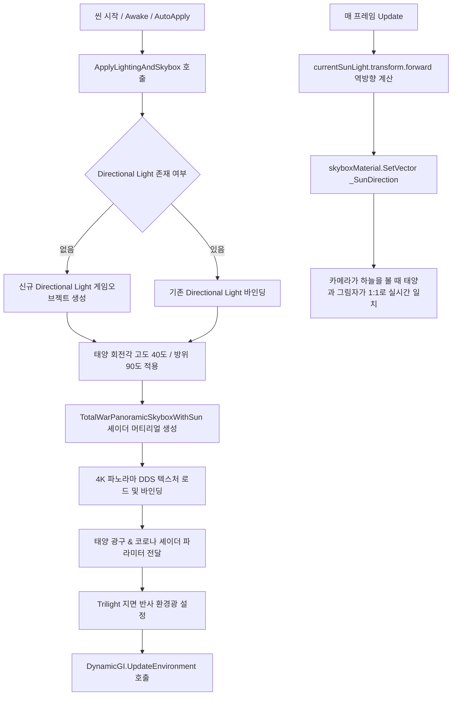

# ☀️ 삼국지 토탈워 환경 조명 및 태양 합성 스카이박스 시스템 (TotalWarEnvironmentLighting)

## 💡 핵심 요약 & 역할 (Summary & Role)
- **핵심 목적**: 삼국지 토탈워(Total War: Three Kingdoms) 본편의 실제 라이팅 파이프라인과 태양 렌더링 셰이더 메커니즘을 1:1로 구현하여 전장에 생생한 조명과 하늘을 제공합니다.
- **주요 역할**:
  1. **태양광 자동 구성**: 삼탈워 공식 스펙(고도각 40°, 방위각 90°, Intensity 1.35f, Soft Shadows)의 Directional Light 자동 제어.
  2. **4K 파노라마 스카이박스 래핑**: 삼탈워 원본 하늘 DDS 파일(`3k_sky_blue_1_diffuse.dds`)을 360도로 완벽 투영.
  3. **실시간 태양 광구 & 대기 코로나 합성 (`TotalWarPanoramicSkyboxWithSun.shader`)**: 태양 위치를 하늘 텍스처와 실시간 동기화하여 동그란 태양 원반(Sun Disk)과 찬란한 황금빛 대기 코로나 후광(Atmospheric Corona Halo)을 셰이더로 가산 합성(Additive Blending).
  4. **지면 반사광(Ground Bounce) Trilight 환경광**: 삼탈워의 6방향 큐브 환경광을 반영하여 상공(Sky), 수평선(Equator), 지면 반사광(Ground) 3분할 조명 연출.

---

## 🌳 1. 아키텍처 트리 맵 (Tree Map)
```
TotalWarEnvironmentLighting (MonoBehaviour, ExecuteAlways)
│
├── ☀️ 태양광 관리 (Sun Light Subsystem)
│   ├── Directional Light 자동 탐색 및 생성
│   ├── 오일러 회전 (sunElevation, sunAzimuth)
│   └── 광원 속성 (sunColor, sunIntensity, Soft Shadows)
│
├── 🌌 스카이박스 및 태양 셰이더 연동 (Skybox & Sun Shader)
│   ├── TotalWarPanoramicSkyboxWithSun.shader 인스턴스 생성
│   ├── 4K 파노라마 텍스처 로드 (3k_sky_blue_1_diffuse.dds)
│   ├── 태양 역방향 벡터(_SunDirection) 실시간 프레임 동기화 (Update)
│   ├── 태양 광구(Sun Disk) 파라미터 제어 (_SunSize, _SunColor)
│   └── 대기 코로나 후광(Corona Halo) 제어 (_SunGlowExponent, _SunGlowIntensity)
│
└── 🌍 Trilight 환경광 서브시스템 (Ambient Trilight)
    ├── RenderSettings.ambientMode = Trilight
    ├── Sky Ambient Color (청명한 대기 하늘빛)
    ├── Equator Ambient Color (수평선 대기 산란광)
    └── Ground Ambient Color (지면에서 튕겨 올라오는 따뜻한 황토빛 반사광)
```

---

## 🗂️ 2. 해시 테이블 메서드/구조체 색인표 (Hash Table Index)

| Key (메서드 / 구조체) | Value (역할, 의존성 및 설명) | 소스 링크 |
| :--- | :--- | :--- |
| `Awake()` | 씬 로드시 조명 및 스카이박스 초기 자동 적용 | [TotalWarEnvironmentLighting.cs#L54](file:///c:/unityProject/MiniTotalWar2D/Assets/Scripts/TotalWarEnvironmentLighting.cs#L54) |
| `Update()` | 에디터/런타임에서 태양광 회전각 변경 시 스카이박스 셰이더의 `_SunDirection` 실시간 동기화 | [TotalWarEnvironmentLighting.cs#L59](file:///c:/unityProject/MiniTotalWar2D/Assets/Scripts/TotalWarEnvironmentLighting.cs#L59) |
| `AutoApplyOnSceneLoad()` | 씬이 로드될 때 컴포넌트가 없으면 자동 생성하여 즉시 적용 (`RuntimeInitializeOnLoadMethod`) | [TotalWarEnvironmentLighting.cs#L69](file:///c:/unityProject/MiniTotalWar2D/Assets/Scripts/TotalWarEnvironmentLighting.cs#L69) |
| `ApplyLightingAndSkybox()` | 태양광 세팅, 스카이박스 머티리얼 바인딩, Trilight 환경광 설정을 일괄 수행하는 핵심 메서드 | [TotalWarEnvironmentLighting.cs#L81](file:///c:/unityProject/MiniTotalWar2D/Assets/Scripts/TotalWarEnvironmentLighting.cs#L81) |

---

## 🔀 3. 유향 그래프 흐름도 (Directed Graph - Mermaid)



---

## ⚙️ 4. 주요 상태 변수, 데이터 구조체 & 인스펙터 옵션 (State, Structs & Inspector Fields)

| 변수명 | 타입 | 기본값 | 설명 및 인스펙터 튜닝 가이드 |
| :--- | :--- | :--- | :--- |
| `sunElevation` | `float` | `29.5f` | **태양 고도각 (Elevation)**: 지평선에서 수직으로 올라간 각도. 구름 속 햇살 튜닝 기본값 29.5도. |
| `sunAzimuth` | `float` | `275.0f` | **태양 방위각 (Azimuth)**: 정북(0도) 기준 시계방향 회전각. 스카이박스 햇살 중심점 튜닝 기본값 275도. |
| `sunIntensity` | `float` | `1.59f` | **태양광 강도**: 전장 지면과 유닛에 내리쬐는 직사광의 밝기. |
| `sunColor` | `Color` | `(1.0, 0.96, 0.88)` | **태양 직사광 색상**: 따뜻하고 화사한 온백색 햇살. |
| `enableSunDisk` | `bool` | `true` | **태양 광구 디스크 활성화 여부**: 체크 시 하늘에 동그란 해와 코로나 후광 렌더링. |
| `sunDiskSize` | `float` | `0.005f` | **태양 광구 시직경(크기)**: 각반경(Angular Radius). 선명하고 정밀한 태양 원반. |
| `sunDiskColor` | `Color` | `(2.5, 2.3, 1.8)` | **태양 광구 HDR 색상**: 맑고 찬란한 온백색 발광 색상. |
| `sunCoronaColor` | `Color` | `(1.0, 0.82, 0.55)` | **대기 코로나 후광 색상**: 태양 주변으로 은은하게 퍼지는 황금빛 산란광. |
| `sunCoronaFalloff` | `float` | `5.0f` | **대기 후광 감쇄 지수**: 값이 높을수록 태양 중심에 응집되고, 주변 하늘 백화 방지. |
| `skyExposure` | `float` | `1.0f` | **스카이박스 노출값**: 하늘 배경 텍스처의 전체적인 밝기. |
| `skyRotation` | `float` | `0.0f` | **스카이박스 수평 회전각 (Yaw)**: 0~360도. 텍스처 속 원래 구름 햇살과 광원 방향을 1:1로 일치. |
| `horizonOffset` | `float` | `0.0f` | **수평선 높이 오프셋**: 카메라 쿼터뷰 각도에 맞춰 지평선 위치 조절. |
| `horizonFogIntensity`| `float`| `0.55f`| **지평선 대기 안개 강도**: 삼탈워 공식 지평선 연무(Horizon Fog) 세기. 지형과 하늘 경계 융합. |
| `horizonFogHeight` | `float` | `0.22f` | **지평선 안개 퍼짐 높이**: 안개가 수평선 위아래로 퍼지는 높이 범위. |
| `horizonFogColor` | `Color` | `(0.72, 0.75, 0.78)` | **지평선 안개 색상**: 원경의 아련한 대기 연무빛. |
| `skyboxTextureName`| `string` | `"3k_sky_blue_1_diffuse.dds"` | 추출된 삼탈워 스카이박스 DDS 파일명 (morning, evening, overcast 등 교체 가능). |
| `ambientSky` | `Color` | `(0.40, 0.52, 0.68)` | **상공 환경광**: 푸른 하늘에서 내려오는 대기광. |
| `ambientEquator` | `Color` | `(0.52, 0.50, 0.44)` | **수평선 환경광**: 지평선 부근의 대기 산란광. |
| `ambientGround` | `Color` | `(0.48, 0.42, 0.28)` | **지면 반사광**: 흙과 잔디에서 나뭇잎 아래와 병사들의 음영으로 튕겨 올라오는 따뜻한 반사광. |

---

## 🛠️ 5. 핵심 알고리즘, 물리/전투 수학 공식 & 조작법 (Algorithms, Math & Controls)

### 1. 삼탈워 스카이돔 반구 투영 및 지평선 안개 융합 (Skydome Horizon Fog)
정규화된 시선 방향 벡터 D = (x, y, z)로부터 삼탈워 스카이돔 UV와 안개를 연산합니다:
- **수평 회전 및 방위각 U (절단선 없는 360도 래핑)**:
  RotDir = Y축 회전(D, SkyRotation)
  u = frac(atan2(RotDir.z, RotDir.x) / (2 * π) + 0.5)
- **수직 고도각 V (천정: V=0.0, 지평선: V=1.0)**:
  elevation = asin(clamp(RotDir.y + HorizonOffset, -1.0, 1.0))
  normElevation = clamp(elevation / (0.5 * π), 0.0, 1.0)
  v = 1.0 - normElevation
- **삼탈워 공식 지평선 대기 안개 (Atmospheric Horizon Fog)**:
  fogDist = abs(elevation) / HorizonFogHeight
  horizonFogFactor = exp(-fogDist * fogDist * 2.0) * HorizonFogIntensity
  FinalSkyColor = lerp(SkyTexColor, HorizonFogColor, horizonFogFactor)
- **세로 이음새(Seam line) 밉맵 깨짐 완벽 제거**:
  dx = ddx(uv), dy = ddy(uv)
  if (abs(dx.x) > 0.5) dx.x = 0;
  if (abs(dy.x) > 0.5) dy.x = 0;
  tex2Dgrad(_MainTex, uv, dx, dy)

### 2. 삼탈워 공식 태양 광구 & 국소 코로나 렌더링 수식
카메라 시선 방향 단위 벡터 V와 태양 광원 방향 단위 벡터 S의 내적(Dot Product)을 계산합니다:
d = V · S = cos(θ)

1. **태양 본체 광구 디스크 (Sun Disk)**:
   DiskAlpha = smoothstep(cos(SunSize) - EdgeSoftness, cos(SunSize), cos(θ))
   SunDisk = SunColor * DiskAlpha
2. **국소 대기 코로나 후광 (Localized Atmospheric Corona - 화면 전체 백화 방지)**:
   maxCoronaAngle = clamp(SunSize * 4.5, 0.05, 0.45)
   cosCorona = cos(maxCoronaAngle)
   GlowFactor = pow(saturate((cos(θ) - cosCorona) / (1.0 - cosCorona)), Falloff)
   CoronaGlow = SunCoronaColor * GlowFactor * Intensity
3. **최종 합성 (Additive Blending)**:
   FinalSkyColor = SkyTextureColor + SunDisk + CoronaGlow

---

## 🔗 6. 다른 스크립트와의 연동 관계 (Dependencies & Pipeline)
- **`TotalWarPanoramicSkyboxWithSun.shader`**: 셰이더 인스턴스를 동적으로 생성하여 파라미터를 실시간 주입.
- **`RenderSettings`**: 씬의 Ambient Mode(Trilight), Ambient Sky/Equator/Ground 색상, Skybox Material을 전역 제어.
- **`TacticalForestZone.cs`**: 씬 내의 3D 초목(나무, 나뭇잎, 수풀)이 어두운 그림자에 묻히지 않고 삼탈워 고유의 화사한 색감과 지면 반사광을 받도록 라이팅 환경 제공.
- **`Directional Light`**: 전장의 메인 그림자 방향과 하늘의 태양 위치를 1:1로 완벽 동기화.
