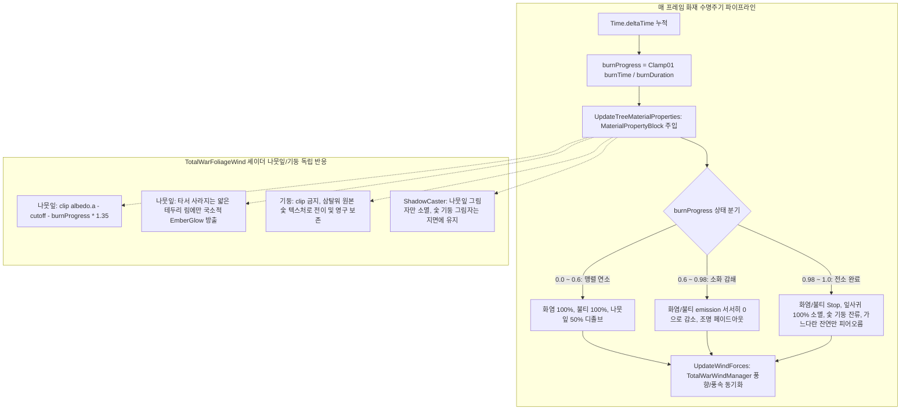

# 🔥 [TotalWarFireVFXController.cs] 삼국지 토탈워 전장 화재·수목 전소 컨트롤러 아키텍처 가이드

> **원본 소스 파일**: [TotalWarFireVFXController.cs](file:///c:/unityProject/MiniTotalWar2D/Assets/Scripts/TotalWarFireVFXController.cs)  
> **시스템 역할**: 삼국지 토탈워(Total War: Three Kingdoms) 본편의 실제 화재 연출과 동일하게 화염(Rising Flames), 연기(Wispy Smoke), 불티(Embers) 파티클을 전장 풍향/풍속에 맞춰 방출하고, 18초 연소 수명주기(Burn Lifecycle)에 따라 타겟 나무 메쉬의 나뭇잎 알파 디졸브(Dissolve), 수피 탄화 흑화(Charring), 이글거리는 불씨(Ember Glow), 그리고 최종 완전 전소(Burnout) 및 잔여 숯 기둥(Charred Trunk) 보존을 실시간 제어합니다.

---

## 💡 핵심 요약 & 역할 (Summary & Role)

- **삼탈워 4단계 화재 수명주기 FSM (4-Stage Burn Lifecycle)**:
  1. **착화기 (0 ~ 3초, Burn 0.0 → 0.2)**: 붉은 불씨(Ember Glow)가 나뭇잎 가장자리에 번지며 수목이 서서히 그을리기 시작.
  2. **맹렬 연소기 (3 ~ 12초, Burn 0.2 → 0.8)**: 화염과 불티가 솟구치고 풍향으로 비산. 나뭇잎이 바스러져 50% 이상 소멸(알파 디졸브)되며 줄기와 가지가 새까만 숯으로 탄화.
  3. **전소 및 불꽃 소화기 (12 ~ 18초, Burn 0.8 → 1.0)**: 나뭇잎이 100% 완전 소멸(그림자 포함). 연료가 다 떨어져 화염(`Flames_Core`)과 불티(`Embers`)의 emission이 0으로 줄어들며 완전 소화. 화염 포인트 라이트 서서히 페이드아웃.
  4. **잔여 훈연 및 숯 기둥 영구 잔해 (18초 이후)**: 타버린 숯 기둥에서 가느다란 흰/회색 잔여 연기(Wispy Smoke)만 약하게 피어오르다 가라앉고, 앙상하고 새까만 숯 나무(Charred Trunk)가 맵에 영구 보존.
- **실시간 MaterialPropertyBlock 머티리얼 바인딩**:
  - 나무 렌더러들의 원본 머티리얼 인스턴스를 오염시키지 않고 GPU 인스턴싱 호환성을 유지하면서 `_BurnProgress` (0.0 → 1.0)를 매 프레임 초고속 주입.
- **풍향 동기화 및 화염 조명 깜빡임**:
  - [TotalWarWindManager.cs](file:///c:/unityProject/MiniTotalWar2D/Assets/Scripts/TotalWarWindManager.cs)의 전장 풍향 각도와 풍속을 연기 및 불티 파티클의 Force over Lifetime에 실시간 주입.
  - Perlin Noise 기반의 무작위 깜빡임(Flicker)을 갖는 동적 화염 조명(Point Light) 연출.

---

## 🌳 1. 아키텍처 트리 맵 (Tree Map)

- 📁 **1. 생명주기 및 초기화 (Lifecycle & Initialization)**
  - `Awake()`, `OnEnable()`: 파티클 서브시스템 및 조명 컴포넌트 캐싱
  - `OnValidate()`: 인스펙터 슬라이더 조작 시 에디터 씬 뷰 즉시 반영
  - `SetTargetTree()`: 연소 대상 나무 등록 및 렌더러 목록 수집
  - `FindNearbyTreeRenderers()`: 미지정 시 반경 2.5m 이내 가장 가까운 나무 자동 탐색
- 📁 **2. 전소 수명주기 엔진 (Burn Lifecycle Engine)**
  - `Update()`: 시간 누적 및 `burnProgress` 계산 (0.0 → 1.0)
  - `UpdateTreeMaterialProperties()`: `MaterialPropertyBlock`으로 `_BurnProgress` 주입
  - `UpdateParticleLifecycle()`: 화염/불티/연기 방출량(emission) 수명 단계별 제어
- 📁 **3. 화염 조명 및 바람 연동 (Lighting & Wind Reaction)**
  - `UpdateFireLight()`: 펄린 노이즈 조명 깜빡임 및 전소 시 조명 페이드아웃
  - `UpdateWindForces()`: 전장 바람 벡터에 맞춘 파티클 외력 갱신
- 📁 **4. 상태 리셋 및 복원 (Reset & Utility)**
  - `ResetFireState()`: 화재를 초기화하여 정상 녹색 수목 및 파티클 재생 상태로 원복

---

## 🗂️ 2. 해시 테이블 메서드/구조체 색인표 (Hash Table Index)

| Key (메서드 / 구조체) | Value (역할, 의존성, 소스 링크) | 소스 줄 번호 링크 |
| :--- | :--- | :--- |
| `SetTargetTree` | 외부 스폰 시점에 타겟 나무 GameObject를 바인딩하고 렌더러 목록 캐싱 | [TotalWarFireVFXController.cs#L66-L73](file:///c:/unityProject/MiniTotalWar2D/Assets/Scripts/TotalWarFireVFXController.cs#L66-L73) |
| `InitComponents` | Flames, Smoke, Embers 파티클과 Point Light를 탐색하고 초기 방출량 캐싱 | [TotalWarFireVFXController.cs#L75-L135](file:///c:/unityProject/MiniTotalWar2D/Assets/Scripts/TotalWarFireVFXController.cs#L75-L135) |
| `FindNearbyTreeRenderers` | 타겟 미지정 시 반경 2.5m 구체 검사로 주변 나무 렌더러를 자동 탐색하여 바인딩 | [TotalWarFireVFXController.cs#L137-L162](file:///c:/unityProject/MiniTotalWar2D/Assets/Scripts/TotalWarFireVFXController.cs#L137-L162) |
| `UpdateTreeMaterialProperties` | `MaterialPropertyBlock`을 통해 타겟 렌더러들에 `_BurnProgress`를 주입 | [TotalWarFireVFXController.cs#L190-L206](file:///c:/unityProject/MiniTotalWar2D/Assets/Scripts/TotalWarFireVFXController.cs#L190-L206) |
| `UpdateParticleLifecycle` | 연소 진행도에 따라 화염 소화, 불티 감쇄, 잔여 훈연 연기 조절 | [TotalWarFireVFXController.cs#L215-L277](file:///c:/unityProject/MiniTotalWar2D/Assets/Scripts/TotalWarFireVFXController.cs#L215-L277) |
| `UpdateFireLight` | 화염 깜빡임 노이즈 및 전소 막바지 조명 밝기 감쇄 | [TotalWarFireVFXController.cs#L282-L305](file:///c:/unityProject/MiniTotalWar2D/Assets/Scripts/TotalWarFireVFXController.cs#L282-L305) |
| `UpdateWindForces` | `TotalWarWindManager` 바람 각도와 풍속을 파티클 forceOverLifetime에 적용 | [TotalWarFireVFXController.cs#L310-L336](file:///c:/unityProject/MiniTotalWar2D/Assets/Scripts/TotalWarFireVFXController.cs#L310-L336) |
| `ResetFireState` | `burnProgress = 0` 및 파티클 재생 복원으로 정상 수목 원복 | [TotalWarFireVFXController.cs#L341-L368](file:///c:/unityProject/MiniTotalWar2D/Assets/Scripts/TotalWarFireVFXController.cs#L341-L368) |

---

## 🔀 3. 유향 그래프 흐름도 (Directed Graph - Mermaid)

---

## ⚙️ 4. 주요 상태 변수, 데이터 구조체 & 인스펙터 옵션 (State, Structs & Inspector Fields)

| 필드명 | 타입 | 기본값 | 역할 및 튜닝 가이드 |
| :--- | :--- | :--- | :--- |
| `enableBurnProgression` | `bool` | `true` | 실시간 시간 경과에 따른 나무 연소 및 탄화/전소 진행 활성화 |
| `burnDuration` | `float` | `18.0f` | 완전 전소까지 걸리는 총 연소 시간 (단위: 초, 5 ~ 60초 범위 조절 가능) |
| `burnProgress` | `float` | `0.0f` | 현재 나무 연소 진행도 (0.0 = 정상 녹색 수목, 1.0 = 완전 전소된 숯 잔해). 인스펙터 슬라이더로 실시간 조절 가능 |
| `targetRenderers` | `Renderer[]` | `null` | 탄화 및 나뭇잎 디졸브가 적용될 타겟 나무의 렌더러 목록 |
| `enableFireLight` | `bool` | `true` | 이글거리는 주황빛 화염 포인트 라이트 생성 및 깜빡임 활성화 |
| `baseLightIntensity` | `float` | `2.0f` | 화염 조명의 기본 밝기 |
| `flickerSpeed` | `float` | `12.0f` | 조명 깜빡임 펄린 노이즈 속도 |
| `reactToWind` | `bool` | `true` | 전장 풍향/풍속에 따른 연기 및 불티 비산 연동 활성화 |

---

## 🛠️ 5. 핵심 알고리즘, 물리/전투 수학 공식 & 조작법 (Algorithms, Math & Controls)

1. **삼탈워 4단계 전소 감쇄 공식**:
   - `burnProgress >= 0.60f` 구간에서의 화염 방출 감쇄:
     `decay = 1.0f - ((burnProgress - 0.60f) / 0.38f)`
     `flamesEmission = max(0, initialFlamesRate * decay)`
   - 전소 완료(`burnProgress >= 1.0f`) 시 나뭇잎 소멸 판정:
     `clip(alpha - cutoff - burnProgress * 1.35)`
     (`burnProgress`가 0.75를 넘어서면 알파값이 1.0인 불투명 영역까지 모두 클립되어 잎사귀가 완전히 사라짐)
2. **에디터 및 런타임 조작법**:
   - 인스펙터에서 `Burn Progress` 슬라이더를 마우스로 드래그하면, 즉시 씬 뷰에서 나뭇잎이 타서 사라지고 기둥이 숯으로 변하는 과정을 확인 가능.
   - 우클릭 컨텍스트 메뉴 `🧯 화재 초기화 및 수목 복원 (Reset Fire)` 클릭 시 즉시 원래의 싱그러운 초록 나무로 복원.

---

## 🔗 6. 다른 스크립트와의 연동 관계 (Dependencies & Pipeline)

- [TacticalForestZone.cs](file:///c:/unityProject/MiniTotalWar2D/Assets/Scripts/TacticalForestZone.cs):
  - 숲 구역에서 화재 스폰 시 `CreateTreeFireInstance`를 통해 생성되며, 타겟 나무의 GameObject를 전달받아 `SetTargetTree()`로 바인딩.
- [TotalWarWindManager.cs](file:///c:/unityProject/MiniTotalWar2D/Assets/Scripts/TotalWarWindManager.cs):
  - 매 프레임 전장의 실시간 풍향(`windAngle`)과 풍속(`windSpeed`)을 읽어와 연기와 불티를 바람 방향으로 날려 보냄.
- [TotalWarFoliageWind.shader](file:///c:/unityProject/MiniTotalWar2D/Assets/Shaders/TotalWarFoliageWind.shader):
  - ForwardLit 및 ShadowCaster 양쪽 패스에 `_BurnProgress`를 주입하여 나뭇잎 디졸브, 숯 탄화, Ember 이글거림, 그림자 소멸을 동기화 렌더링.
