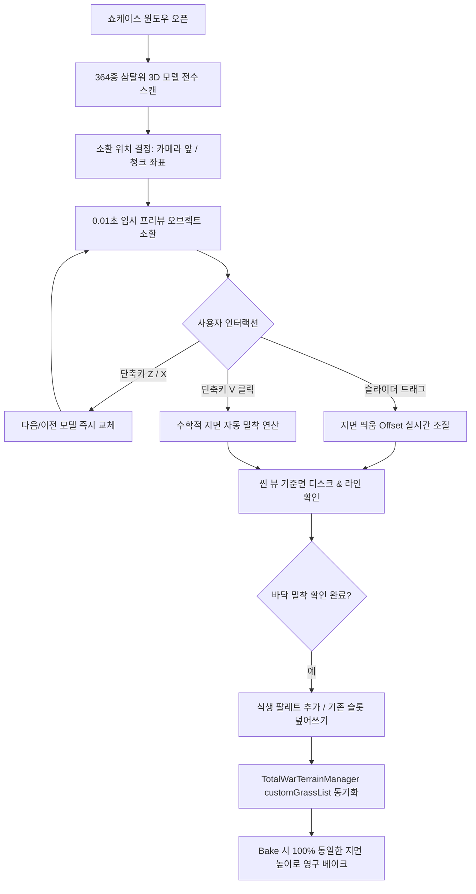

# 🌿 [삼탈워 식생 즉석 쇼케이스 & 지면 띄움 캘리브레이터] 기술 명세 및 가이드 문서

## 💡 핵심 요약 & 역할 (Summary & Role)
`TotalWarFoliageShowcaseWindow.cs`는 삼국지 토탈워(Warscape Engine)에서 추출된 원작 에셋을 기반으로 정제된 **94종의 절차적 4대 유형 식생(지피 잔디, 3D 풀포기, 갈대, 고사리, 수생식물 등) 및 46종의 원작 수목(Trees) 프리팹(총 140종)**을 무거운 데이터 베이크(Bake) 과정 없이 **0.01초 만에 씬 뷰에 즉석 소환하여 확인하고, 피벗 오차와 지면 띄움(Ground Offset), 머티리얼 셰이더 파라미터를 실시간으로 조절/자동 계산하는 에디터 전용 시각화 캘리브레이션 도구**입니다.

사용자는 스크린샷 속 진짜 원하는 풀을 찾기 위해 수만 개 풀을 다시 빌드할 필요 없이, 단축키(`[Z]`, `[X]`)로 모델을 즉시 넘겨보며 지표면에 완벽히 밀착되는 높이를 눈으로 확인한 뒤, 원클릭으로 터레인 식생 팔레트 및 특정 청크에 바인딩할 수 있습니다. 12개의 직관적인 카테고리 탭(`[🌾 지피 잔디]`, `[🌿 3D 풀포기]`, `[🎋 갈대]`, `[🌲 고사리]`, `[🪷 수생식물]`, `[🌳 수목]` 등)을 지원합니다.

---

## 🌳 1. 아키텍처 트리 맵 (Tree Map)

```
TotalWarFoliageShowcaseWindow
 ├── 1. 식생 모델 데이터베이스 스캐너 (ScanAllModels)
 │    ├── Assets/TotalWar_ThreeKingdoms_Extracted/Vegetation/Shrubs (*.obj 126종)
 │    └── DetailGrass/Climate_{Temperate, Arid, Cold, Subtropical} (*.obj 238종)
 ├── 2. 소환 위치 & 관찰 모드 파이프라인 (Spawn & Positioning)
 │    ├── LocationMode (InFrontOfCamera / SpecificChunk / CustomWorldPos)
 │    ├── DisplayMode (Single 단일 포기 관찰 / Patch3x3 군락 관찰)
 │    └── FocusSceneCameraOnShowcase (카메라 자동 텔레포트)
 ├── 3. 임시 프리뷰 렌더링 엔진 (Preview Lifecycle)
 │    ├── __Foliage_Showcase_Preview__ (HideFlags.DontSave 임시 인스턴스)
 │    ├── MeshFilter + MeshRenderer 실시간 바인딩
 │    └── 머티리얼 틴트 전환 (봄철 신록 연두빛 / 여름 / 가을 / 겨울)
 ├── 4. 실시간 지면 띄움 캘리브레이터 & 가이드 핸들 (Calibration & Visuals)
 │    ├── Ground Offset 슬라이더 (-1.50m ~ +2.00m)
 │    ├── [✨ 지면 자동 밀착] AABB bounds.min.y 수학적 바닥 보정
 │    ├── SceneView 핸들 (녹색 지표면 원형 디스크 + 법선 화살표 + 밑둥 오프셋 라인)
 │    └── 단축키 이벤트 시스템 ([Z] 이전, [X] 다음, [C] 카메라포커스, [V] 자동밀착)
 └── 5. 터레인 매니저 & 청크 오버라이드 연동 (Data Binding)
      ├── [➕ 식생 팔레트에 신규 추가] (customGrassList.Add)
      ├── [🔄 기존 슬롯(#N) 교체] (기존 팔레트 덮어쓰기)
      └── [🎯 청크 오버라이드 바인딩] (chunkFoliageOverrides 등록)
```

---

## 🗂️ 2. 해시 테이블 메서드/구조체 색인표 (Hash Table Index)

| Key (메서드 / 구조체) | Value (역할, 의존성, 구현 라인) |
| :--- | :--- |
| `OpenWindow()` | 상단 메뉴 `TotalWar/🌱 삼탈워 식생 즉석 쇼케이스...`를 통해 윈도우 실행 |
| `OpenWindowForChunk(int x, int z)` | 특정 청크 좌표를 전달받아 해당 청크 지면 중심에서 쇼케이스 즉시 실행 |
| `ShowcaseItem` | 모델명, OBJ 파일 경로, 카테고리, 텍스처, 기본 크기 정보를 담는 구조체 |
| `ScanAllModels()` | 삼탈워 추출 폴더(Shrubs 및 DetailGrass)의 364종 OBJ 파일 전수 수집 |
| `UpdateSpawnPosition()` | 카메라 앞, 청크 좌표, 월드 좌표 기반으로 터레인 표면 높이 및 법선 벡터 산출 |
| `CreateOrUpdatePreviewObject()` | 임시 프리뷰 GameObject를 생성/갱신하여 씬 뷰에 0.01초 만에 렌더링 |
| `AutoAlignToGround()` | 메쉬 로컬 바운딩 박스 하단 정점(`bounds.min.y`)을 분석해 지면 밀착 오프셋 자동 산출 |
| `PreviousItem() / NextItem()` | 필터링된 식생 모델 목록을 단축키(`Z`, `X`) 또는 버튼으로 즉시 순회 |
| `OnSceneGUI(SceneView)` | 씬 뷰에 지표면 기준면 디스크(Disc), 법선, 오프셋 라인, 정보 오버레이 렌더링 |

---

## 🔀 3. 유향 그래프 흐름도 (Directed Graph - Mermaid)



---

## ⚙️ 4. 주요 상태 변수, 데이터 구조체 & 인스펙터 옵션 (State, Structs & Inspector Fields)

| 변수명 | 타입 | 기본값 | 상세 역할 및 가이드 |
| :--- | :--- | :--- | :--- |
| `locationMode` | `LocationMode` | `InFrontOfCamera` | 소환 위치 모드 (`InFrontOfCamera`: 카메라 앞 12m 지면, `SpecificChunk`: 특정 청크 중심, `CustomWorldPos`: 좌표 직접 지정) |
| `targetChunkX, Z` | `int` | `31, 31` | 관찰할 목표 공간 분할 청크 좌표 (32m x 32m) |
| `displayMode` | `DisplayMode` | `Single` | `Single`: 단일 포기 밑둥 정밀 관찰, `Patch3x3`: 9포기 군락 지피 커버리지 관찰 |
| `groundOffset` | `float` | `0.0f` | **지면 띄움 오프셋 (-1.50m ~ +2.00m)**. 양수: 위로 솟아오름, 음수: 땅속 파묻힘 |
| `scale` | `float` | `1.0f` | 식생 모델의 가로/너비 배율 (Scale) |
| `heightMultiplier` | `float` | `1.0f` | 식생 모델의 세로/높이 배율 (지피 잔디는 0.35~0.5배 납작 융단, 꽃대는 1.2~1.5배) |
| `alignToNormal` | `float` | `1.0f` | 지형 경사면 법선 밀착도 (1.0: 경사면에 100% 밀착, 0.4: 수직 직립성 유지) |
| `selectedMaterialIndex` | `int` | `0` | 프리뷰 머티리얼 (0: 삼탈워 봄철 신록 연두빛, 1: 여름, 2: 가을, 3: 겨울) |

---

## 🛠️ 5. 핵심 알고리즘, 물리/전투 수학 공식 & 조작법 (Algorithms, Math & Controls)

### 1) 지면 자동 밀착 (Auto Ground Align) 수학 공식
삼탈워 3D OBJ 모델들은 피벗의 위치가 메쉬 바닥(Y=0)에 있는 것도 있고, 정중앙에 위치하여 하단 정점이 음수로 내려가 있는 것도 있습니다.
본 도구는 로드된 메쉬의 AABB 바운딩 박스를 읽어 피벗 오차를 수학적으로 상쇄합니다:

```
effectiveBottom = mesh.bounds.min.y * scale * heightMultiplier
groundOffset = -effectiveBottom
```

- 예시 1: 피벗이 중앙에 있는 Sbt_Grass0_1.obj (bounds.min.y = -0.62m) -> groundOffset = +0.62m 산출 -> 밑둥이 지표면에 0mm 오차로 착 달라붙음.
- 예시 2: 피벗이 바닥에 있는 Shrub_Flat_A.obj (bounds.min.y = 0.0m) -> groundOffset = 0.0m 유지.

### 2) 씬 뷰 단축키 조작 일람표 (ZXCV 라인 배치로 WASD 화면 이동 간섭 완전 배제)
- **`[Z]`**: 이전 식생 모델 즉시 소환
- **`[X]`**: 다음 식생 모델 즉시 소환
- **`[C]`**: 씬 뷰 카메라를 식생 바로 앞 지점으로 텔레포트 이동
- **`[V]`**: 지면 자동 밀착 (Auto Ground Align) 수학적 바닥 맞춤 즉시 계산 및 적용
- **`[R]`**: 하늘로 세우기 / 상하 반전 토글
- **`[G]`**: 초록색 지면 가이드 영역 디스크 켜기/끄기 토글 (시야 방해 차단)

### 3) 머티리얼 셰이더 실시간 튜닝 & 안전 영구 저장 (Material Sandbox & Commit) 파이프라인
1. **임시 인스턴스 복제 (`_previewInstanceMat`)**:
   - 윈도우에서 슬라이더(풀잎 끝 감쇄 시작/완전 소멸점, 알파 컷오프, 바람 흔들림 등)를 조작할 때, 원본 머티리얼 에셋(`.mat`)은 일절 건드리지 않고 **씬 뷰 프리뷰 인스턴스에만 실시간 주입**됩니다.
2. **시각적 실시간 피드백**:
   - 씬 뷰에서 카메라로 1:1 관찰 중인 3D 풀의 풀잎 끝 칼자국 방지 테이퍼링, 알파 컷오프 두께감, 바람 물결을 눈으로 직접 확인하며 미세 튜닝합니다.
3. **명시적 확정 저장 (`SaveTuningToSourceMaterial`)**:
   - 사용자가 **`💾 [머티리얼에 영구 저장 (Save Changes)]`** 버튼을 클릭할 때에만 `Undo.RecordObject` + `EditorUtility.SetDirty` + `AssetDatabase.SaveAssets()`가 호출되어 원본 머티리얼 에셋 파일에 영구 기록됩니다.
4. **즉각 복원 (`SyncMaterialTuningFromSource`)**:
   - 마음에 들지 않을 경우 **`🔄 [원본 수치로 되돌리기 (Reset)]`**를 눌러 언제든 원본 머티리얼 값으로 즉시 복구할 수 있습니다.

---

## 🔗 6. 다른 스크립트와의 연동 관계 (Dependencies & Pipeline)
- [TotalWarRadialGrassShaderGUI.cs](file:///c:/unityProject/MiniTotalWar2D/Assets/Scripts/Editor/TotalWarRadialGrassShaderGUI.cs): 쇼케이스에서 조절된 `_TipFadeStart`, `_TipFadeEnd`, `_EdgeBleedCrop`, `_Cutoff` 수치를 인스펙터에서도 1:1로 조회/수정 가능.
- [TotalWarTerrainManager.cs](file:///c:/unityProject/MiniTotalWar2D/Assets/Scripts/TotalWarTerrainManager.cs): 쇼케이스에서 조절한 모델과 지면 띄움(`groundOffset`)을 `customGrassList`에 직접 신규 등록하거나 기존 슬롯에 덮어씁니다.
- [TotalWarTerrainManagerEditor.cs](file:///c:/unityProject/MiniTotalWar2D/Assets/Scripts/Editor/TotalWarTerrainManagerEditor.cs): 인스펙터 4번 식생 섹션 및 청크 픽커에서 쇼케이스 윈도우를 원클릭 호출합니다.
- [TacticalGrassRenderer.cs](file:///c:/unityProject/MiniTotalWar2D/Assets/Scripts/TacticalGrassRenderer.cs): `SyncPrototypesFromConfigs` 및 `BakeFoliageData`에서 사용자가 쇼케이스를 통해 튜닝한 `cfg.groundOffset`을 100% 동일한 TRS 행렬 오프셋으로 반영하여 베이크합니다.
