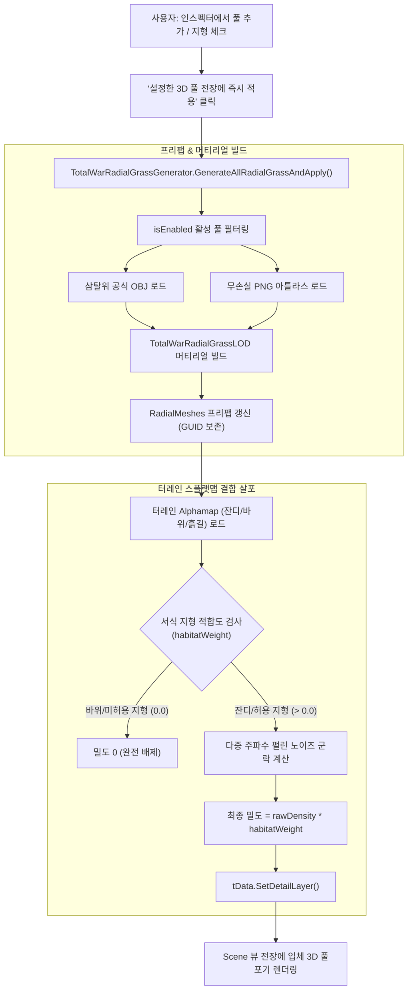

# 🌾 TotalWarRadialGrassGenerator 기술 가이드 명세서

본 문서는 **삼국지 토탈워(Total War: Three Kingdoms)** 원작의 공식 3D 풀포기(Clump)와 꽃대 이삭(Tall Seedheads 롱 글래스)을 유니티 터레인 엔진에 1:1로 장착하고, 인스펙터 커스텀 목록 및 지형 스플랫맵(잔디/바위/흙길) 서식지 필터링에 맞춰 절차적으로 군락 살포하는 에디터 시스템 [TotalWarRadialGrassGenerator.cs](file:///c:/unityProject/MiniTotalWar2D/Assets/Scripts/Editor/TotalWarRadialGrassGenerator.cs) 및 [RadialGrassConfig.cs](file:///c:/unityProject/MiniTotalWar2D/Assets/Scripts/RadialGrassConfig.cs)의 완전체 표준 기술 가이드입니다.

---

## 💡 핵심 요약 & 역할 (Summary & Role)

- **핵심 역할**:
  - 기존 하드코딩 식생 체계를 탈피하여, 사용자가 인스펙터에서 자유롭게 풀의 종류/규격/밀도를 구성하는 완전 커스텀 3D 식생 시스템.
  - **🌍 삼탈워 REA 역공학 기반 10대 전장 생태계 바이옴 메가팩 (원클릭 18~30종 대량 세팅)**:
    - 원작 삼탈워 식생 생성 파라미터(`battleterrain_vegetation_*.xml` 및 `grass_generation_spec.xml`)의 레이어링 구조를 실증 반영하여, 5종 소형 세팅을 탈피하고 각 전장 환경별 18~30종 규모의 대형 생태계 바이옴 10대 메가팩(총 206개 식생 인스턴스) 탑재.
    - **1행**: `[🌾 중원 평원 20종]`, `[🌲 수림 고사리 20종]`, `[🌴 남만 정글 22종]`, `[🌾 강남 습지 20종]`, `[🏜️ 서량 황무지 18종]`
    - **2행**: `[❄️ 한랭 설원 18종]`, `[🌸 봄꽃 만개 22종]`, `[🌾 황금 농경지 20종]`, `[⛰️ 산악 암반 18종]`, `[🌟 올인원 30종]`
  - **📋 간략 테이블 뷰 (Compact View) vs 🎛️ 슬라이더 상세 뷰 (Detailed View) 스위처**:
    - 20~30종이 등록되어도 마우스 스크롤 압박 없이 한눈에 보고 활성 체크 및 서식 지형(잔디/흙/바위)을 일괄 조작 가능한 초경량 테이블 뷰 제공.
  - 삼탈워 원작 게임에서 추출한 **총 364종 전체 3D 식생 브라우저 윈도우(`TotalWarFoliageBrowserWindow`)** 탑재.
    - **지피 잔디(Groundcover Carpet Grass)**: 터레인 표면에 옆으로 5m 넘게 넓고 낮게 깔리는 밑바탕 잔디 238종 전수 복구.
    - **입체 수풀(Standup Shrubs & Reeds)**: 위로 1.2~2.5m 솟아오르는 풍성한 풀포기/꽃대/거대 갈대/고사리 126종.
  - **🌸 진짜 화사한 봄꽃 야생화(Spring Magnolia / Rhododendron) 고해상도 아틀라스 복원**:
    - 삼탈워 원작 봄철 개화 텍스처를 2048×2048 고해상도로 변환하여 목련 및 진달래/철쭉 꽃수풀을 전장에 화사하게 살포.
  - **🌍 토탈워 원작 1:1 고증 지형 스플랫맵(Alphamap) 서식지 필터링**:
    - 풀 종류별로 자라날 지형(`[v] 잔디  [ ] 흙/자갈  [ ] 바위`)을 지정하여, 바위 절벽 위에는 풀이 전혀 자라지 않고 잔디와 지정된 산길에만 자연스럽게 피어나도록 구현.
  - **✨ 베이스 잔디 전역 풍성함 보장 & 스마트 희소 노이즈 보정**:
    - 잔디밭에 휑한 빈땅이 없도록 30~50%의 기본 융단 밀도를 보장하고, 노이즈 골짜기에서도 풍성하게 자라나도록 알고리즘 개선.
- **주요 책임**:
  1. 공식 3D OBJ 모델 및 무손실 PNG 아틀라스 머티리얼 동적 바인딩 (`EnsureDirectories`, `GenerateAllRadialGrassAndApply`)
  2. 에셋 GUID 불변성 보존으로 재빌드 시 씬 참조 단절 방지
  3. 경사도(0~42도) + 다중 주파수 펄린 노이즈 + 터레인 스플랫맵 가중치 결합 살포 (`AutoScatterNativeFoliage`)
  4. 364종 3D 풀 브라우저 창 연동 및 실시간 추가 파이프라인
  5. 10대 생태계 바이옴 메가팩 전환 시 지피 잔디/수풀/고사리/꽃 18~30종 일괄 동기화

---

## 🌳 1. 아키텍처 트리 맵 (Tree Map)

```
TotalWar 3D 식생 커스텀 & 스플랫맵 서식지 파이프라인
 ├── 1. 데이터 정의 계층 (RadialGrassConfig.cs)
 │    ├── 식생 모델 / 알베도 / 노멀맵 파일 경로
 │    ├── 너비 및 높이 Min / Max 규격
 │    ├── 살포 밀도 및 펄린 노이즈 군락 희소도 (noiseThreshold)
 │    ├── 🌍 서식 지형 레이어 (growOnGrass, growOnDirt, growOnRock)
 │    ├── ⛰️ 지형 경사 밀착도 (alignToGround: 0~1) 및 지면 오프셋 (groundOffset)
 │    └── 🌍 10대 전장 생태계 바이옴 메가팩 (CentralPlains20, DeepForest20, Nanman22, AllInclusive30 등)
 ├── 2. 런타임 환경 관리자 (TotalWarTerrainManager.cs)
 │    ├── grassBiomeTheme : 현재 활성화된 10대 식생 생태계 테마
 │    ├── customGrassList : 인스펙터 편집용 3D 풀 리스트 (18~30종)
 │    └── SetGrassBiomeTheme() : 테마 변경 시 10대 메가팩 일괄 갱신
 ├── 3. 에디터 UI 계층 (TotalWarTerrainManagerEditor.cs & TotalWarFoliageBrowserWindow.cs)
 │    ├── ⚡ 10대 생태계 바이옴 2행 그리드 퀵 토글 버튼 그룹
 │    ├── 📋 간략 테이블 뷰 vs 🎛️ 슬라이더 상세 뷰 스위처
 │    ├── 🔍 삼탈워 364종 3D 풀 전체 브라우저 윈도우 (카테고리 검색/원클릭 추가)
 │    ├── ✨ 풀 밀도 풍성하게 자동 보정 버튼
 │    ├── 🌍 서식 지형 레이어 원클릭 토글 (잔디/흙길/바위)
 │    └── 🌾 설정한 3D 풀 전장에 즉시 적용 버튼
 └── 4. 메시·머티리얼 빌더 & 살포 엔진 (TotalWarRadialGrassGenerator.cs)
      ├── 3D OBJ + 무손실 PNG 아틀라스 로드 (Shrubs / DetailGrass 전수 탐색)
      ├── CreateGroundAlignedMesh() : 피벗 바닥면 자동 정렬 (Bottom-Zero Ground Clamping)
      ├── TotalWarRadialGrassLOD 셰이더 및 머티리얼/프리팹 구축
      ├── ApplyNativeFoliageToAllTerrains() : 250m 가시거리 보장
      └── AutoScatterNativeFoliage() : 스플랫맵 가중치 승산 살포 + 베이스 밀도 보장
```

---

## 🗂️ 2. 해시 테이블 메서드/구조체 색인표 (Hash Table Index)

| Key (메서드 / 구조체) | Value (역할 및 핵심 메커니즘) | 의존성 | 소스 줄 번호 링크 |
| :--- | :--- | :--- | :--- |
| `RadialGrassConfig` | 3D 식생 모델, 텍스처, 크기, 밀도, 서식 지형, 경사 밀착도(alignToGround), 지면 띄움(groundOffset) 정의 구조체 | - | [RadialGrassConfig.cs:L10-L75](file:///c:/unityProject/MiniTotalWar2D/Assets/Scripts/RadialGrassConfig.cs#L10-L75) |
| `RadialGrassConfig 12대 프리셋` | Thick Clump, Tall Seedhead, Elephant Grass, Flower, Fern 등 공식 프리셋 팩 | `RadialGrassConfig` | [RadialGrassConfig.cs:L80-L350](file:///c:/unityProject/MiniTotalWar2D/Assets/Scripts/RadialGrassConfig.cs#L80-L350) |
| `CreateGroundAlignedMesh` | 메시의 최하단 버텍스(minY)를 측정하여 피벗 바닥면을 Y=0.0+groundOffset으로 들어올려 파묻힘 완전 방지 | `Mesh` | [L450-L490](file:///c:/unityProject/MiniTotalWar2D/Assets/Scripts/Editor/TotalWarRadialGrassGenerator.cs#L450-L490) |
| `GenerateAllRadialGrassAndApplyMenu` | 유니티 에디터 상단 메뉴(`TotalWar/🌾...`) 트리거 진입점 | `GenerateAllRadialGrassAndApply` | [L34-L38](file:///c:/unityProject/MiniTotalWar2D/Assets/Scripts/Editor/TotalWarRadialGrassGenerator.cs#L34-L38) |
| `GenerateAllRadialGrassAndApply` | 등록된 풀 목록 필터링 후 프리팹/머티리얼 빌드 및 터레인 장착 총괄 | `RadialGrassConfig`, `AssetDatabase` | [L43-L175](file:///c:/unityProject/MiniTotalWar2D/Assets/Scripts/Editor/TotalWarRadialGrassGenerator.cs#L43-L175) |
| `ApplyNativeFoliageToAllTerrains` | 터레인 디테일 프로토타입 장착, alignToGround 동적 바인딩, 가시거리 250m 보장 | `TerrainData`, `DetailPrototype` | [L200-L260](file:///c:/unityProject/MiniTotalWar2D/Assets/Scripts/Editor/TotalWarRadialGrassGenerator.cs#L200-L260) |
| `AutoScatterNativeFoliage` | 경사각 + 펄린 노이즈 + 터레인 스플랫맵 가중치 결합 살포 | `tData.GetAlphamaps` | [L265-L375](file:///c:/unityProject/MiniTotalWar2D/Assets/Scripts/Editor/TotalWarRadialGrassGenerator.cs#L265-L375) |

---

## 🔀 3. 유향 그래프 흐름도 (Directed Graph - Mermaid)



---

## ⚙️ 4. 주요 상태 변수 & 인스펙터 옵션 (State & Inspector Fields)

| 변수명 | 타입 | 기본값 | 역할 및 튜닝 가이드 |
| :--- | :--- | :--- | :--- |
| `displayName` | `string` | `"Thick Clump"` | 인스펙터 카드에 표시되는 식생 명칭 |
| `modelFile` | `string` | `"Shrub_...A.obj"` | `Vegetation/Shrubs/` 내 삼탈워 공식 OBJ 파일명 |
| `albedoFile` | `string` | `"shrub_...png"` | `Vegetation/Textures/` 내 무손실 PNG 아틀라스 파일명 |
| `isEnabled` | `bool` | `true` | 체크 해제 시 해당 풀은 전장 살포에서 즉시 제외 |
| `minWidth / maxWidth` | `float` | `0.9f ~ 1.35f` | 풀포기 가로 폭 크기 범위 (m) |
| `minHeight / maxHeight` | `float` | `0.85f ~ 1.3f` | 풀포기 수직 높이 크기 범위 (m) |
| `noiseThreshold` | `float` | `0.20f` | 군락 형성 임계치 (낮을수록 균일 살포, 높을수록 희귀 군락) |
| `minDensity / maxDensity`| `int` | `40 ~ 90` | 타일 단위 면적당 최대 스폰 밀도 |
| `growOnGrass` | `bool` | `true` | 푸른 잔디 텍스처(Layer 0) 위 서식 허용 |
| `growOnDirt` | `bool` | `false` | 흙/자갈/산길 텍스처(Layer 2) 위 서식 허용 |
| `growOnRock` | `bool` | `false` | 절벽/암반 바위 텍스처(Layer 1) 위 서식 허용 (기본 false) |

---

## 🛠️ 5. 핵심 알고리즘 & 지형 스플랫맵 수학 공식

### 5.1 지형 레이어 가중치(Habitat Weight) 계산식
터레인의 각 좌표 `(normX, normY)`에서 스플랫맵 알파맵 픽셀 `(ax, ay)`을 샘플링하여 허용된 지형 레이어 가중치의 합을 산출합니다:

```
habitatWeight = Sum(splatmap[ay, ax, layerIndex]) (단, 허용된 레이어만 합산)
```

### 5.2 최종 살포 밀도 연산식
```
finalDensity = RoundToInt(rawDensity * habitatWeight)
```
- **바위 지형 100% 지점**: `habitatWeight = 0.0` -> `finalDensity = 0` (풀 돋아남 원천 차단)
- **잔디 지형 100% 지점**: `habitatWeight = 1.0` -> `finalDensity = rawDensity` (풍성한 풀밭)
- **블렌딩 경계 지점**: 잔디 비율에 맞춰 자연스럽게 그라데이션 소멸

---

## 🔗 6. 다른 스크립트와의 연동 관계 (Dependencies & Pipeline)

1. **[TotalWarTerrainManager](file:///c:/unityProject/MiniTotalWar2D/Docs/TotalWarTerrainTheme.md)**:
   - `customGrassList` 데이터를 영구 보관하고, 테마 적용 시 `OnThemeAppliedEditor` 이벤트를 통해 3D 풀포기를 터레인에 자동 장착.
2. **[CreateTotalWarTerrainLayers](file:///c:/unityProject/MiniTotalWar2D/Assets/Scripts/Editor/CreateTotalWarTerrainLayers.cs)**:
   - 평지(Grass), 절벽(Rock), 중경사(Stone/Soil) 3색 스플랫맵을 터레인에 도포하여 본 시스템의 서식지 필터링 기준선 제공.
