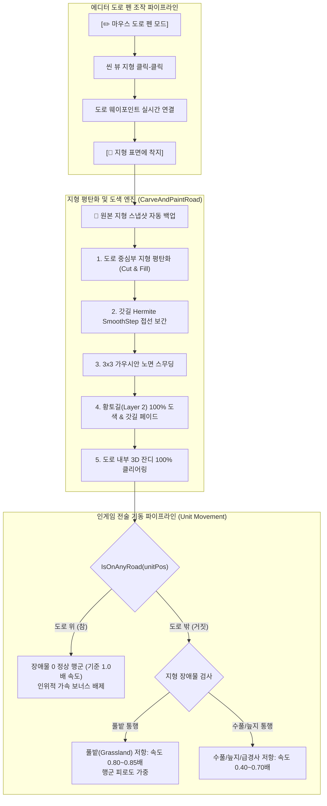

# 🛣️ 삼국지 토탈워 군사 도로망 시스템 기술 문서 (TotalWarRoadSystem)

본 문서는 **삼국지 토탈워(Total War: Three Kingdoms - Warscape Engine)**의 도로망 및 군사 보급로(Roads & Trails System) 역공학 분석을 바탕으로 구축된 **굽이치는 스플라인 도로망 엔진 (`TotalWarRoadSpline.cs`)**과 **에디터 인터랙티브 툴 (`TotalWarRoadSplineEditor.cs`)**의 세부 아키텍처 및 기술 명세서입니다.

---

## 💡 핵심 요약 & 역할 (Summary & Role)

- **핵심 목적**:
  - 토탈워 전장에서 도로는 단순한 텍스처가 아니라 **"대규모 군단이 험난한 산과 숲을 빠르게 통과하는 군사 기동 대동맥"**입니다.
  - 마우스 클릭만으로 험난한 지형을 마차와 기병이 달릴 수 있는 도로로 자동 평탄화(Flatten)하고, 황토길(Layer 2) 도색 및 잔디 클리어링을 원클릭으로 수행합니다.
- **핵심 기능 5대 축**:
  1. **[✏️ 마우스 도로 펜 툴]**: 씬 뷰 지형 위를 클릭-클릭하여 자연스러운 S자 곡선 도로망 실시간 배치.
  2. **[🛣️ 3D 도로 리본 메쉬 (Road Ribbon Mesh)]**: 노드를 찍는 즉시 강물처럼 지형 표면에 밀착하는 황토 흙길 3D 메쉬 실시간 자동 생성 및 렌더링.
  3. **지형 자동 평탄화 (AABB Cut & Fill Flattening)**: 전체 터레인이 아닌 도로 통과 국소 그리드(AABB)만 핀포인트 연산하여 0.05초 만에 초고속 평탄화 + 갓길 Hermite 접선 보간 + 3x3 가우시안 스무딩.
  4. **황토 흙길 스플랫맵 도색 & 잔디 100% 클리어링**: 도로 중심부는 황토길 100% 도색 및 도로 위 3D 잔디 완전 배제, `terrain.Flush()`로 씬 뷰 즉각 반영.
  5. **현실주의적 이동 철학**: 도로는 마법 같은 속도 버프가 아니라 **"장애물(풀, 돌, 요철)이 치워진 정상 표준 통행로 (기준 1.0배)"**이며, 반대로 풀밭/산비탈/수풀 등 거친 자연 지형을 걸어갈 때 장애물 저항으로 이동속도가 줄어들고 피로도가 소모되는 메커니즘을 따름.

---

## 🌳 1. 아키텍처 트리 맵 (Tree Map)

```
TotalWar Battlefield Road System
 ├── 1. 스플라인 곡선 제어 및 보간 (TotalWarRoadSpline.cs)
 │    ├── Catmull-Rom 3차 에르미트 곡선 보간
 │    ├── 마우스 펜 툴 실시간 지형 레이캐스트 노드 스폰
 │    └── Transform 롤/피치(Roll/Pitch) 수평화 자동 보정 (EnforceLevelTransform)
 │
 ├── 2. 3D 도로 리본 메쉬 렌더링 엔진 (Road Ribbon Mesh)
 │    ├── 지형 표면 샘플링 및 Z-Fighting 방지 Y-Offset (0.04m)
 │    ├── 도로 곡선 좌우 수평 단면 벡터 및 UV 타일링 자동 계산
 │    └── 황토 흙길 PBR 머티리얼 (TotalWarRoadMaterial.mat) 자동 바인딩
 │
 ├── 3. 지형 평탄화 및 조각 엔진 (AABB Cut & Fill Smoothing)
 │    ├── 💾 파내기 전 원본 지형 스냅샷 자동 백업 (높이 + 스플랫맵 + 잔디맵)
 │    ├── 도로 AABB 바운딩 박스 국소 그리드 100배 가속 (0.05초 완료)
 │    ├── 도로 중심부 평탄화 (Lerp Height to Spline Y)
 │    ├── 갓길 Hermite SmoothStep 완충 경사면 접선 연결
 │    ├── 3x3 가우시안 스무딩 필터 (노면 요철 및 경계면 각진 모서리 제거)
 │    └── terrain.Flush() 및 에디터 Dirty 플래그로 씬 뷰 즉각 화면 갱신
 │
 ├── 4. 지형 텍스처 및 식생 연동 (Texture & Foliage Exclusion)
 │    ├── 황토 흙길(Layer 2: Dirt Road) 100% 도색
 │    ├── 갓길 그라데이션 알파 블렌딩 (잔디 ⇄ 흙먼지)
 │    └── 도로 내부 3D 잔디 100% 클리어링 (GrassDensity = 0)
 │
 ├── 5. 전술 게임플레이 API (Tactical Gameplay Interface)
 │    ├── 특정 월드 좌표 도로 진입 여부 판정 (Contains)
 │    ├── 전역 도로 정적 조회 (IsOnAnyRoad)
 │    └── 지형 이동 판정: 도로 위(기본 1.0배) vs 풀밭/거친 지형(장애물 감속 적용)
 │
 └── 6. 에디터 툴 & 메뉴 아이템 (Editor & Menu Items)
      ├── GameObject > Total War Roads 원클릭 스폰 메뉴
      └── 인스펙터 커스텀 뷰, 마우스 펜 토글, 개별 노드 3축 위치 핸들, 원클릭 평탄화
```

---

## 🗂️ 2. 해시 테이블 메서드/구조체 색인표 (Hash Table Index)

| Key (메서드 / 구조체 / 클래스) | Value (역할 및 세부 기술 명세) | 소스 줄 번호 링크 |
| :--- | :--- | :--- |
| `TotalWarRoadSpline` | 군사 도로망 스플라인, 3D 메쉬 생성 및 지형 평탄화 총괄 컴포넌트 | [TotalWarRoadSpline.cs](file:///c:/unityProject/MiniTotalWar2D/Assets/Scripts/TotalWarRoadSpline.cs#L23-L70) |
| `RoadSurfaceType` | 도로 표면 재질 열거형 (`ClimateSync` 기후 동기화 기본, `Gravel` 군용 자갈길, `Dirt` 야전 흙길) | [TotalWarRoadSpline.cs](file:///c:/unityProject/MiniTotalWar2D/Assets/Scripts/TotalWarRoadSpline.cs#L23-L31) |
| `SyncWithTerrainClimate` | 현재 터레인의 기후 테마(Temperate, Arid, Cold, Nanman 등) dirtRoadLayer를 감지하여 메쉬 Albedo/Normal/타일링/도색 슬롯을 1:1 일체화 | [TotalWarRoadSpline.cs](file:///c:/unityProject/MiniTotalWar2D/Assets/Scripts/TotalWarRoadSpline.cs#L496-L585) |
| `SetSurfaceType` | 인스펙터 토글 툴바 클릭 시 도로 표면 재질(기후 연동/자갈길/흙길)을 원클릭으로 즉각 전환 | [TotalWarRoadSpline.cs](file:///c:/unityProject/MiniTotalWar2D/Assets/Scripts/TotalWarRoadSpline.cs#L587-L650) |
| `GetCurrentClimateInfo` | 에디터 인스펙터에 현재 연동된 기후 테마 이름 및 dirtRoadLayer 슬롯 정보 실시간 반환 | [TotalWarRoadSpline.cs](file:///c:/unityProject/MiniTotalWar2D/Assets/Scripts/TotalWarRoadSpline.cs#L662-L675) |
| `GenerateRoadMesh` | 지형 표면을 따라 흐르는 3D 도로 리본 메쉬(Ribbon Mesh) 실시간 생성 및 렌더링 | [TotalWarRoadSpline.cs](file:///c:/unityProject/MiniTotalWar2D/Assets/Scripts/TotalWarRoadSpline.cs#L225-L330) |
| `SampleSplinePointsWorld` | Catmull-Rom 알고리즘을 통한 부드러운 도로 곡선 월드 좌표 샘플링 | [TotalWarRoadSpline.cs](file:///c:/unityProject/MiniTotalWar2D/Assets/Scripts/TotalWarRoadSpline.cs#L150-L165) |
| `CarveAndPaintRoad` | AABB 국소 그리드 가속 지형 자동 평탄화 + 황토길 도색 + 잔디 배제 일괄 실행 | [TotalWarRoadSpline.cs](file:///c:/unityProject/MiniTotalWar2D/Assets/Scripts/TotalWarRoadSpline.cs#L678-L820) |
| `RestoreTerrainBackup` | 평탄화 전 원본 지형(높이/스플랫/잔디)으로 1초 만에 100% 원상복구 | [TotalWarRoadSpline.cs](file:///c:/unityProject/MiniTotalWar2D/Assets/Scripts/TotalWarRoadSpline.cs#L825-L870) |
| `Contains` | 특정 월드 좌표가 도로 영역(폭 및 수직 높이 범위)에 있는지 판정 | [TotalWarRoadSpline.cs](file:///c:/unityProject/MiniTotalWar2D/Assets/Scripts/TotalWarRoadSpline.cs#L185-L210) |
| `IsOnAnyRoad` | 전역에 배치된 모든 도로 중 특정 월드 좌표가 도로 위인지 정적 판정 | [TotalWarRoadSpline.cs](file:///c:/unityProject/MiniTotalWar2D/Assets/Scripts/TotalWarRoadSpline.cs#L212-L224) |
| `EnforceLevelTransform` | 도로 오브젝트의 기울어짐(Roll/Pitch)을 0으로 강제 수평 보정 | [TotalWarRoadSpline.cs](file:///c:/unityProject/MiniTotalWar2D/Assets/Scripts/TotalWarRoadSpline.cs#L85-L105) |
| `TotalWarRoadSplineEditor` | 상단 원클릭 스타일 토글 툴바, 마우스 펜 툴, 노드 선택 3축 핸들, 평탄화/도색 인스펙터 | [TotalWarRoadSplineEditor.cs](file:///c:/unityProject/MiniTotalWar2D/Assets/Scripts/Editor/TotalWarRoadSplineEditor.cs#L10-L75) |
| `TotalWarRoadMenuItems` | 유니티 에디터 상단 메뉴 `GameObject > Total War Roads` 스폰 도구 | [TotalWarRoadMenuItems.cs](file:///c:/unityProject/MiniTotalWar2D/Assets/Scripts/Editor/TotalWarRoadMenuItems.cs#L7-L35) |

---

## 🔀 3. 유향 그래프 흐름도 (Directed Graph - Mermaid)



---

## ⚙️ 4. 주요 상태 변수, 데이터 구조체 & 인스펙터 옵션 (State, Structs & Inspector Fields)

### 4.1 `TotalWarRoadSpline` 인스펙터 옵션
- `surfaceType` (기본값: `ClimateSync`):
  - **[ 🌿 기후 테마 연동 (기본 권장)]**: 현재 활성 터레인의 기후 테마(`TotalWarTerrainManager.currentTheme`)의 `dirtRoadLayer` 텍스처/노멀맵/타일링을 1:1로 실시간 자동 바인딩. 터레인 테마가 바뀌면 이벤트(`OnThemeAppliedEditor`)를 수신하여 자동으로 도로 재질 갱신.
  - **[ 🪨 군용 자갈길 (Gravel)]**: 진시황 치도 및 삼국지 군용 관도 고증의 자갈 텍스처(`Pebbles_A`) 및 터레인 자갈 레이어 연동.
  - **[ 🌾 다져진 흙길 (Dirt)]**: 야전 다져진 흙길 텍스처(`Soil_Rocks`) 및 터레인 흙길 레이어 연동.
  - *(참고: 삼국지 토탈워 원작 야전 맵 고증에 따라, 야전 전장에 존재하지 않는 석판/벽돌길은 완전히 배제하여 실전 3대 도로 체계로 정예화)*
- `roadWidth` (기본값: 6.0m): 사람이 다니고 마차가 통행하는 도로 중심 통행로 폭.
- `shoulderWidth` (기본값: 2.5m): 도로 갓길 완충 경사 폭 (원래 지형과 부드럽게 이어지는 완충대).
- `flattenStrength` (기본값: 0.85): 지형 평탄화 강도 (0.0: 지형 유지, 1.0: 완전 평탄화).
- `roadLayerIndex` (기본값: 2): 도색할 터레인 레이어 인덱스 (`Layer 2: Dirt Road & Soil`). 스타일 전환 시 적합한 레이어로 자동 매칭.
- `resolutionPerSegment` (기본값: 12): 스플라인 곡선 세분화 해상도.
- **인스펙터 상단 툴바 & 버튼**:
  - `[🛣️ 도로 표면 스타일 원클릭 토글 툴바]`: 기후 테마 연동 / 군용 자갈길 / 다져진 흙길 3버튼 툴바.
  - `[🔄 재동기화]`: 터레인 기후 테마 변경 시 수동으로 1클릭 즉각 갱신.
  - `[✏️ 마우스 도로 펜 모드]`: 씬 뷰 지형을 클릭하여 마우스 궤적으로 도로 잇기.
  - `[🎯 지형 표면에 착지]`: 도로 노드를 현재 터레인 고도에 스냅.
  - `[+ 끝에 연장]`, `[- 마지막 삭제]`, `[🗑️ 선택된 노드 삭제]`.
  - `[🛣️ 도로 지형 자동 평탄화 (Flatten) + 황토길 도색 + 잔디 배제]`: 원클릭 평탄화 및 도색.
  - `[⏪ 평탄화 전 이전 지형으로 1초 만에 되돌리기 (Undo)]`: 파내기 전 원본 지형으로 즉시 원복.

---

## 🛠️ 5. 핵심 알고리즘, 물리/전투 수학 공식 & 조작법 (Algorithms, Math & Controls)

### 5.1 도로 지형 평탄화 (Cut & Fill) 및 갓길 접선 공식
도로 스플라인 최단 수평 거리 `d`에 따른 높이 보간:

```
1. 도로 중심 영역 (d <= roadWidth * 0.5):
   targetH = Lerp(currentTerrainHeight, roadCenterHeight, flattenStrength)
   heights[y, x] = targetH

2. 갓길 완충 영역 (roadWidth * 0.5 < d <= roadWidth * 0.5 + shoulderWidth):
   tShoulder = (d - roadWidth * 0.5) / shoulderWidth
   blend = SmoothStep(0.0, 1.0, tShoulder)
   shoulderEdgeH = Lerp(currentTerrainHeight, roadCenterHeight, flattenStrength)
   targetH = Lerp(shoulderEdgeH, currentTerrainHeight, blend)
   heights[y, x] = targetH

3. 3x3 가우시안 노면 스무딩 필터:
   파여지거나 깎인 영역 경계 셀에 가우시안 커널 [1 2 1; 2 4 2; 1 2 1] / 16 가중 평균을 적용하여
   마차와 기병이 달릴 수 있는 매끄러운 흙길 노면 완성.

4. 황토길(Layer 2) 스플랫맵 도색:
   - 도로 중심부: Layer 2 = 1.0 (100% 다져진 황토길)
   - 갓길: dirtWeight = SmoothStep(1.0, 0.0, tShoulder)로 기존 풀밭과 자연스럽게 블렌딩.
```

### 5.2 현실주의 이동 저항 역학 (Realistic Movement Drag)
```
- 도로(Road)의 물리적 본질:
  - 도로는 차량이나 부대의 물리 속도를 인위적으로 높여주는 '가속 부스터 패드'가 아님.
  - 바위, 잡초, 요철 등 이동 방해물을 치워둔 "장애물 0의 정규 통행로 (기준 속도 1.0배)".

- 지형 장애물 저항 감속 메커니즘:
  - IsOnAnyRoad(unitPos) == true -> 장애물 저항 0% (기준 속도 1.0배 유지)
  - IsOnAnyRoad(unitPos) == false -> 바닥 지형/식생에 따른 이동 페널티 부과:
    * 일반 풀밭(Grassland): 무릎/발목에 닿는 풀과 연약지반 저항으로 이동속도 0.80~0.85배, 피로도 누적 +20%
    * 수풀/관목(Bush): 빽빽한 나뭇가지 저항으로 이동속도 0.65~0.70배
    * 얕은 물/여울목(Ford): 수중 저항으로 이동속도 0.60~0.70배, 기병 돌격 무력화
    * 깊은 늪지(Swamp): 극심한 침하 저항으로 이동속도 0.40~0.50배
```

---

## 🔗 6. 다른 스크립트와의 연동 관계 (Dependencies & Pipeline)

1. **[CreateTotalWarTerrainLayers.cs](file:///c:/unityProject/MiniTotalWar2D/Assets/Scripts/Editor/CreateTotalWarTerrainLayers.cs)**:
   - `Layer 2: Dirt Road & Soil` 텍스처를 도로 스플라인의 메인 도색 레이어로 사용.
2. **[TotalWarRadialGrassGenerator.cs](file:///c:/unityProject/MiniTotalWar2D/Assets/Scripts/Editor/TotalWarRadialGrassGenerator.cs)**:
   - 도로 내부의 3D 잔디 밀도를 0으로 배제하여 깨끗한 도로망 보장.
3. **[TotalWarRoadMenuItems.cs](file:///c:/unityProject/MiniTotalWar2D/Assets/Scripts/Editor/TotalWarRoadMenuItems.cs)**:
   - 유니티 상단 메뉴 `GameObject > Total War Roads`를 통해 도로 원클릭 스폰 지원.
4. **부대 이동/전투 AI 시스템**:
   - `TotalWarRoadSpline.IsOnAnyRoad(unitPos)`를 호출하여 유닛이 도로 위에 있을 때는 감속 페널티를 배제(1.0배)하고, 도로 밖 풀밭이나 험지를 이동할 때만 자연 저항 감속을 적용.

