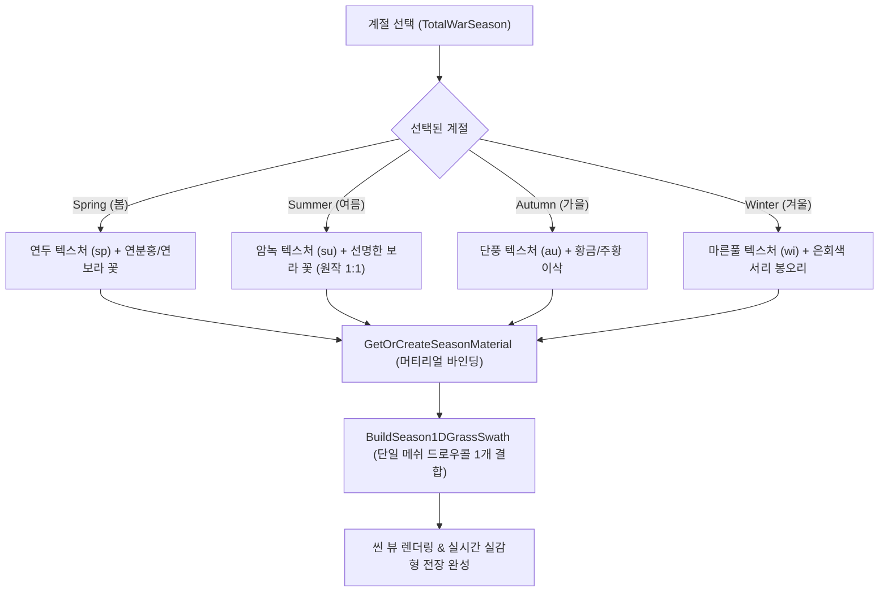

# 🍂 TotalWarSeasonFoliage (삼탈워 사계절 식생 동적 전환 시스템)

---

## 💡 핵심 요약 & 역할 (Summary & Role)
- **책임 영역**: 삼국지 토탈워 원작 전장의 핵심 비주얼 요소인 **봄(Spring), 여름(Summer), 가을(Autumn), 겨울(Winter)** 사계절에 맞추어 지피 잔디 띠, 키 큰 갈대, 보라색 들꽃 야생화 군락의 텍스처와 색상을 실시간으로 1:1 동적 전환합니다.
- **핵심 특징**:
  - **원작 공식 sbt_grass_base_colour 아틀라스 1:1 바인딩**: 가짜 강아지풀이나 임의의 사각 꽃 카드를 완전히 배제하고, 원작 아틀라스 텍스처에 인쇄된 **진짜 키 큰 갈대(상단 V)와 보라색 들꽃 잔디(하단 V)**를 사용.
  - **사계절 정밀 틴트 조색 시스템**:
    - **봄 (Spring)**: 싱그러운 연두 새싹 잔디 + 화사한 연보라/연분홍 들꽃
    - **여름 (Summer)**: 토탈워 원작 1:1 오리지널 짙은 녹음 잔디 + 선명한 보라색 들꽃
    - **가을 (Autumn)**: 황금빛 단풍 억새 갈대 + 노란/주황 들꽃
    - **겨울 (Winter)**: 차가운 서리 맞은 마른 갈대풀 + 은회색 서리 꽃
  - **중앙 볼록 정규분포(Bell Curve) 1자 띠 일체형 메쉬**: 중앙에 키 큰 갈대(`Sbt_Grass1_1`)와 보라꽃 잔디 받침이 위치하고, 양 끝으로 갈수록 작은 잔디(`Sbt_Grass0_1`)로 서서히 낮아지는 정규분포 형태를 **단 1개의 결합 메쉬(Single Draw Call)**로 완벽 구현.
  - **에디터 & 런타임 하이브리드 지원**: 인스펙터의 Enum 드롭다운 선택 시 즉시 실시간 반영되며, Pure ECS 및 GameObject 모드 모두와 호환.

---

## 🌳 1. 아키텍처 트리 맵 (Tree Map)

```
TotalWarSeasonFoliage (사계절 식생 관리 컴포넌트)
├── 1. 계절 열거형 (TotalWarSeason Enum)
│   ├── Spring (0: 봄 - 싱그러운 연두 잔디 & 연분홍/연보라 들꽃)
│   ├── Summer (1: 여름 - 원작 1:1 짙은 녹음 잔디 & 선명한 보라 들꽃)
│   ├── Autumn (2: 가을 - 황금빛 단풍 억새 갈대 & 주황 들꽃)
│   └── Winter (3: 겨울 - 서리 맞은 마른 갈대풀 & 은회색 서리 꽃)
├── 2. 사계절 전용 머티리얼 파이프라인 (sbt_grass_base_colour 기반)
│   ├── sbt_grass_RadialMat_Spring.mat (봄 틴트 조색)
│   ├── sbt_grass_RadialMat_Summer.mat (원작 여름 1:1)
│   ├── sbt_grass_RadialMat_Autumn.mat (가을 단풍 틴트)
│   └── sbt_grass_RadialMat_Winter.mat (겨울 서리 틴트)
├── 3. 메쉬 일체형 결합 (Mesh Interlocking & Bell Curve)
│   ├── 중앙 4열: 키 큰 갈대 (Sbt_Grass1_1, 스케일 0.56) + 보라꽃 잔디 밑동
│   ├── 내측/중간: 풍성한/중간 들꽃 잔디 (Sbt_Grass0_6, Sbt_Grass0_2)
│   └── 외곽 1/7열: 작은 들꽃 잔디 (Sbt_Grass0_1, 스케일 0.32)
└── 4. 에디터 메뉴 및 4계절 전수 비교 전시
    ├── SpawnFourSeasonsComparisonDemo (전면 1자 띠 + 후면 원작 1:1 군락 4구역 나란히 전시)
    └── SpawnSeasonGrassDemo (단일 계절 1자 띠 & 융단 소환)
```

---

## 🗂️ 2. 해시 테이블 메서드/구조체 색인표 (Hash Table Index)

| Key (메서드 / 구조체) | Value (역할, 의존성 및 줄 번호 링크) |
| :--- | :--- |
| `TotalWarSeason` (Enum) | [TotalWarSeasonFoliage.cs#L5-L11](file:///c:/unityProject/MiniTotalWar2D/Assets/Scripts/TotalWarSeasonFoliage.cs#L5-L11) : 사계절(Spring, Summer, Autumn, Winter) 식생 상태 정의 |
| `CurrentSeason` (Property) | [TotalWarSeasonFoliage.cs#L25-L36](file:///c:/unityProject/MiniTotalWar2D/Assets/Scripts/TotalWarSeasonFoliage.cs#L25-L36) : 인스펙터 계절 프로퍼티 및 변경 시 즉각 갱신 트리거 |
| `ApplySeason` | [TotalWarSeasonFoliage.cs#L49-L65](file:///c:/unityProject/MiniTotalWar2D/Assets/Scripts/TotalWarSeasonFoliage.cs#L49-L65) : 자식 렌더러에 해당 계절 전용 머티리얼 일괄 바인딩 |
| `GetOrCreateSeasonMaterial` | [TotalWarProceduralFoliageDemo.cs](file:///c:/unityProject/MiniTotalWar2D/Assets/Scripts/Editor/TotalWarProceduralFoliageDemo.cs) : 계절별 공식 텍스처를 바인딩한 URP 전용 머티리얼 캐싱 및 생성 |
| `BuildSeason1DGrassSwathMeshAndPrefab` | [TotalWarProceduralFoliageDemo.cs](file:///c:/unityProject/MiniTotalWar2D/Assets/Scripts/Editor/TotalWarProceduralFoliageDemo.cs) : 8포기 잔디 + 2송이 계절 꽃 카드를 단일 메쉬로 결합 빌드 |
| `CreateMicroFlowerCardMesh` | [TotalWarProceduralFoliageDemo.cs](file:///c:/unityProject/MiniTotalWar2D/Assets/Scripts/Editor/TotalWarProceduralFoliageDemo.cs) : 풀잎 사이에 쏙 들어가는 앙증맞은 14cm 꽃 카드 쿼드 메쉬 생성 |
| `SpawnFourSeasonsComparisonDemo` | [TotalWarProceduralFoliageDemo.cs](file:///c:/unityProject/MiniTotalWar2D/Assets/Scripts/Editor/TotalWarProceduralFoliageDemo.cs) : 씬에 4계절을 한 줄로 나란히 소환하여 색상 변화 동시 비교 |

---

## 🔀 3. 유향 그래프 흐름도 (Directed Graph - Mermaid)



---

## ⚙️ 4. 주요 상태 변수, 데이터 구조체 & 인스펙터 옵션

| 필드명 | 타입 | 기본값 | 상세 설명 |
| :--- | :--- | :---: | :--- |
| `_currentSeason` | `TotalWarSeason` | `Summer` | 현재 전장의 계절 (Spring / Summer / Autumn / Winter) |
| `_flowerColor (Spring)` | `Color` | `(0.88, 0.65, 0.98)` | 봄의 화사하고 산뜻한 연분홍/연보라 야생화 색상 |
| `_flowerColor (Summer)` | `Color` | `(0.55, 0.38, 0.88)` | 여름 원작 인게임 스크린샷 1:1 선명한 보라색 야생화 색상 |
| `_flowerColor (Autumn)` | `Color` | `(0.92, 0.58, 0.18)` | 가을에 노랗고 붉게 익은 황금/주황빛 이삭 씨앗머리 색상 |
| `_flowerColor (Winter)` | `Color` | `(0.72, 0.74, 0.82)` | 한겨울 서리와 눈발을 머금은 차가운 은회색 마른 꽃봉오리 |

---

## 🛠️ 5. 핵심 알고리즘, 물리/전투 수학 공식 & 조작법

### 1. 단일 메쉬 인터로킹 (Single Mesh Interlocking)
- 8포기 수직 1자 잔디의 2~3번 사이($x = -0.18m$)와 5~6번 사이($x = +0.16m$) 깊숙한 곳에 높이 0.14m의 미세 꽃 쿼드를 삽입하여 결합합니다.
- 잔디의 중앙 높이(0.28m)보다 절반가량 낮게 설정되어, 풀잎 사이로 꽃송이만 살짝 고개를 내밀도록 배치됩니다.

### 2. 조작 단축 메뉴 (Unity Editor Menu)
- **`TotalWar` → `🌸 [4계절 비교 전시] 봄·여름·가을·겨울 1자 잔디 & 야생화 앙상블`**: 사계절을 한 줄로 나란히 씬에 소환하여 시각 비교.
- **`TotalWar` → `🌸 [계절 전환] 1. 봄 (Spring)`**: 화사한 연두 잔디와 연분홍 꽃으로 씬 전환.
- **`TotalWar` → `🌿 [계절 전환] 2. 여름 (Summer)`**: 짙은 녹음과 선명한 보라 꽃(원작 1:1)으로 씬 전환.
- **`TotalWar` → `🍁 [계절 전환] 3. 가을 (Autumn)`**: 황금빛 단풍 잔디와 주황 이삭으로 씬 전환.
- **`TotalWar` → `❄️ [계절 전환] 4. 겨울 (Winter)`**: 서리 맞은 마른 풀과 은회색 봉오리로 씬 전환.

---

## 🔗 6. 다른 스크립트와의 연동 관계 (Dependencies & Pipeline)
- [TotalWarProceduralFoliageDemo.cs](file:///c:/unityProject/MiniTotalWar2D/Assets/Scripts/Editor/TotalWarProceduralFoliageDemo.cs) : 사계절 메쉬 및 프리팹 빌드, 씬 뷰 캡처 파이프라인.
- [`TotalWarRadialGrassLOD.shader`](file:///c:/unityProject/MiniTotalWar2D/Assets/Shaders/TotalWarRadialGrassLOD.shader) : 계절별 텍스처 및 버텍스 컬러 틴트 렌더링.
- [Docs/업데이트_내용.md](file:///c:/unityProject/MiniTotalWar2D/Docs/업데이트_내용.md) : 사계절 식생 시스템 작업 내역 실시간 기록.

