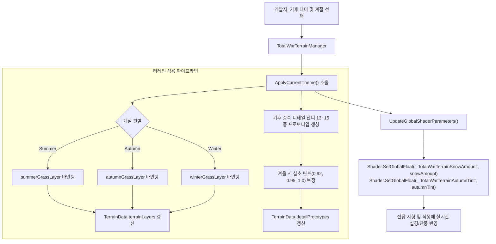

# 🌍 TotalWarTerrainTheme.cs & TotalWarTerrainManager.cs

## 💡 핵심 요약 & 역할 (Summary & Role)
- **핵심 역할**: 삼국지 토탈워(Total War: Three Kingdoms) 원작의 기후(Climate: 온대 Temperate, 남만 Nanman, 서량 건조 Arid, 강남 아열대 Subtropical, 하북 한랭 Cold)별 지형 텍스처 레이어와 238종 디테일 잔디 모델의 종속 매핑 관계를 보존·관리하고, 유니티 Terrain 컴포넌트에 사계절(봄/여름/가을/겨울) 텍스처 및 전역 적설 셰이더를 실시간 적용하는 지형 관리 시스템입니다.
- **사계절 전환**: 여름 기본 녹음 텍스처(`_su`), 가을 단풍 및 마른 잔디 텍스처(`_au`), 겨울 얼어붙은 지면 텍스처(`_wi`)를 지원하며, `_TotalWarTerrainSnowAmount` 슬라이더를 통해 지표면의 낮은 홈부터 눈이 소복하게 차오르는 자연스러운 전역 설경 블렌딩을 수행합니다.

---

## 🌳 1. 아키텍처 트리 맵 (Tree Map)

```
TotalWar 지형 기후 및 사계절 관리 시스템
 ├── 1. 기후 테마 데이터 자산 (TotalWarTerrainTheme ScriptableObject)
 │    ├── ClimateType (Temperate, Nanman, Arid, Subtropical, Cold)
 │    ├── 사계절 지형 레이어 (Summer, Autumn, Winter, ForestFloor, Cliff, Dirt)
 │    └── 238종 기후 종속 디테일 잔디 프리셋 (DetailGrassConfig 리스트)
 │         ├── Arid (13종 건조 잔디 및 모래 잡초)
 │         ├── Nanman (12종 열대 톱니풀 및 덩굴 잔디)
 │         ├── Cold (10종 북방 침엽형 한대 잔디)
 │         └── Temperate (13종 중원 평야 잔디)
 └── 2. 터레인 환경 런타임 관리자 (TotalWarTerrainManager)
      ├── 대상 Terrain 컴포넌트 자동 탐색 및 바인딩
      ├── ApplyThemeToTerrain() : 기후 테마 및 계절 지형 레이어 1:1 적용
      ├── 전역 셰이더 프로퍼티 브로드캐스트
      │    ├── _TotalWarTerrainSnowAmount (적설량)
      │    ├── _TotalWarTerrainAutumnTint (가을 단풍 틴트)
      │    └── _TotalWarGlobalSnow (전체 식생 공용 적설량)
      └── 원클릭 계절 전환 퀵 액션 (Spring, Summer, Autumn, Winter)
```

---

## 🗂️ 2. 해시 테이블 메서드/구조체 색인표 (Hash Table Index)

| Key (메서드 / 구조체) | Value (역할, 의존성, 소스 링크) |
| :--- | :--- |
| `ClimateType` | 기후 환경 분류 열거형 (온대, 남만, 건조, 아열대, 한랭) - [TotalWarTerrainTheme.cs:L15-L29](file:///c:/unityProject/MiniTotalWar2D/Assets/Scripts/TotalWarTerrainTheme.cs#L15-L29) |
| `DetailGrassConfig` | 3D 잔디 프리팹, 밀도, 크기 범위, 경사면 정렬 옵션 구조체 - [TotalWarTerrainTheme.cs:L31-L47](file:///c:/unityProject/MiniTotalWar2D/Assets/Scripts/TotalWarTerrainTheme.cs#L31-L47) |
| `5대 기후 테마 에셋 (.asset)` | `Assets/Settings/TerrainThemes/` (Temperate, Nanman, Arid, Cold, Subtropical 5종) |
| `CreateDefaultTerrainThemes.GenerateAllThemes()` | 5대 기후 테마 프리셋 에셋 자동 생성 및 씬 매니저 기본 연결 - [CreateDefaultTerrainThemes.cs:L25](file:///c:/unityProject/MiniTotalWar2D/Assets/Scripts/Editor/CreateDefaultTerrainThemes.cs#L25) |
| `ApplyThemeToTerrain(...)` | 지정한 Terrain에 기후 테마, 사계절 텍스처, 디테일 잔디 세트 일괄 적용 - [TotalWarTerrainTheme.cs:L77-L157](file:///c:/unityProject/MiniTotalWar2D/Assets/Scripts/TotalWarTerrainTheme.cs#L77-L157) |
| `TotalWarTerrainManager.ApplyCurrentTheme()` | 현재 설정된 테마와 계절을 터레인에 즉시 반영 - [TotalWarTerrainManager.cs:L64-L78](file:///c:/unityProject/MiniTotalWar2D/Assets/Scripts/TotalWarTerrainManager.cs#L64-L78) |
| `TotalWarTerrainManager.SetSeason(...)` | 계절 전환 시 적설량 및 단풍 틴트를 적응형 설정하고 적용 - [TotalWarTerrainManager.cs:L83-L105](file:///c:/unityProject/MiniTotalWar2D/Assets/Scripts/TotalWarTerrainManager.cs#L83-L105) |
| `UpdateGlobalShaderParameters()` | 전역 셰이더 프로퍼티(_TotalWarTerrainSnowAmount 등) 브로드캐스트 - [TotalWarTerrainManager.cs:L55-L61](file:///c:/unityProject/MiniTotalWar2D/Assets/Scripts/TotalWarTerrainManager.cs#L55-L61) |

---

## 🔀 3. 유향 그래프 흐름도 (Directed Graph - Mermaid)



---

## ⚙️ 4. 주요 상태 변수 & 인스펙터 옵션 (State & Inspector Fields)

| 변수명 | 타입 | 기본값 | 역할 및 튜닝 가이드 |
| :--- | :--- | :--- | :--- |
| `targetTerrain` | `Terrain` | `null` | 관리할 목표 Terrain 컴포넌트 (미지정 시 활성 터레인 자동 탐색) |
| `currentTheme` | `TotalWarTerrainTheme` | `null` | 적용할 기후 테마 ScriptableObject 자산 |
| `season` | `Season` | `Summer` | 사계절 모드 (봄, 여름, 가을, 겨울) |
| `globalSnowAmount` | `float` | `0.0f` | 전장 전역 눈 덮임 비율 (0.0: 완전 녹음 -> 1.0: 100% 설경) |
| `globalAutumnTint` | `float` | `0.0f` | 전장 전역 가을 단풍 틴트 강도 |
| `detailDistance` | `float` | `90f` | 디테일 잔디 최대 표시 거리 (m) |
| `detailDensity` | `float` | `0.65f` | 디테일 잔디 밀도 (Density) |

---

## 🛠️ 5. 핵심 알고리즘, 물리/전투 수학 공식 & 조작법

### 5.1 사계절 적설 적응형 전환 공식
```csharp
if (season == Season.Winter)
{
    globalSnowAmount = Mathf.Max(globalSnowAmount, 0.85f);
    globalAutumnTint = 0f;
}
else if (season == Season.Autumn)
{
    globalAutumnTint = 1.0f;
    globalSnowAmount = 0f;
}
```

---

## 🔗 6. 다른 스크립트와의 연동 관계 (Dependencies & Pipeline)

1. **[TerrainHeightManager](file:///c:/unityProject/MiniTotalWar2D/Docs/TerrainHeightManager.md)**:
   - 터레인의 높이맵 캐시와 지형 표면 노멀을 상호 참조하여 유닛 및 식생 밀착 지원.
2. **[TacticalForestZone](file:///c:/unityProject/MiniTotalWar2D/Docs/TacticalForestZone.md) & [TacticalBushZone](file:///c:/unityProject/MiniTotalWar2D/Docs/TacticalBushZone.md)**:
   - `TacticalForestZone.Season` 열거형 및 전역 적설량(`_TotalWarGlobalSnow`)을 공유하여 수목, 관목, 바닥 지형이 동일한 계절 생태계로 완벽 동기화.
3. **[TotalWarRadialGrassGenerator](file:///c:/unityProject/MiniTotalWar2D/Docs/TotalWarRadialGrassGenerator.md)**:
   - `ApplyCurrentTheme()` 호출 시 2D 빌보드 잔디 대신 원작 1:1 공식 3D 풀포기 5종(풍성한 풀포기, 꽃대 이삭, 마른 풀, 야생화)이 자동으로 생성 및 터레인에 장착·살포되는 파이프라인 연계.
