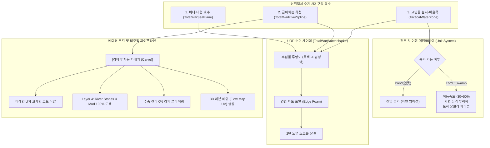

# 🌊 삼국지 토탈워 삼위일체 전장 수계 시스템 기술 문서 (TotalWarWaterSystem)

본 문서는 **삼국지 토탈워(Total War: Three Kingdoms - Warscape Engine)**의 전장 수계(Water System) 역공학 분석을 바탕으로 구축된 **1) 전역 바다·대형 호수 수면 평면 (`TotalWarSeaPlane`)**, **2) 굽이치는 스플라인 하천 (`TotalWarRiverSpline`)**, **3) 고인 물·남만 늪지·도하 여울목 택티컬 존 (`TacticalWaterZone`)**, 그리고 **4) URP 고품질 투명 수면 셰이더 (`TotalWarWater.shader`)**의 아키텍처 및 세부 기술 명세서입니다.

---

## 💡 핵심 요약 & 역할 (Summary & Role)

- **핵심 목적**:
  - 전장 지형의 기후감과 시각적 풍성함을 극대화하고, 삼국지 전장의 핵심 요소인 **"자연 방어선, 병목 결사대 방어, 여울목 도하 전술, 늪지대 기병 궤멸 지형"**을 완벽하게 시뮬레이션합니다.
- **3대 수계 분담 체계**:
  1. **바다 & 대형 호수 (`TotalWarSeaPlane.cs`)**: 전역 수위(Water Level Y) 기준 광활한 수면 평면, 연안 파도 포말(Foam), 심해 색상 그라데이션.
  2. **굽이치는 하천 & 강 (`TotalWarRiverSpline.cs`)**: 씬 뷰 베지에 스플라인 곡선 클릭 -> U자 강바닥 자동 음각 조각(Trench Carving) + 바닥 자갈(Layer 4) 도색 + 잔디 0% 배제 + 유속 흐름 3D 리본 메쉬 생성.
  3. **고인 물 & 늪지 & 여울목 (`TacticalWaterZone.cs`)**: 원형/박스형 전술 기즈모 배치 -> 늪지(보병 이속 -50%, 기병 돌격 무력화, 피로도 3.5배), 여울목(보병 이속 -30%, 도하 물보라 이펙트).

---

## 🌳 1. 아키텍처 트리 맵 (Tree Map)

```
TotalWar Battlefield Water System
 ├── 1. URP 수면 셰이더 파이프라인 (TotalWarWater.shader)
 │    ├── 카메라 씬 뎁스(SampleSceneDepth) 기반 수심 연산
 │    ├── 수심 페이드 (ShallowColor -> DeepColor)
 │    ├── 2단 법선 스크롤(Wave Speed 1, 2) 및 절차적 사인파 잔물결
 │    ├── 연안 접안선 파도 거품 (Edge Foam)
 │    └── URP 메인 라이트 스펙큘러 및 프레넬(Fresnel) 반사
 │
 ├── 2. 전역 바다 & 대형 호수 수면 평면 (TotalWarSeaPlane.cs)
 │    ├── 전역 수위 평면(waterLevelY) 및 터레인 맞춤 메쉬 생성
 │    ├── 터레인 최저 고도 자동 감지 알고리즘
 │    ├── 지형 페인팅(River Stones & Mud) 수위 동기화
 │    └── 수면 아래 3D 잔디 0% 자동 배제
 │
 ├── 3. 굽이치는 스플라인 하천 엔진 (TotalWarRiverSpline.cs)
 │    ├── 씬 뷰 웨이포인트(Catmull-Rom) 곡선 보간
 │    ├── 💾 파내기 전 원본 지형 스냅샷 자동 백업 (높이 + 텍스처 + 잔디)
 │    ├── ⏪ [이전 지형으로 되돌리기] 1초 만에 100% 완벽 복원 (RestoreTerrainBackup)
 │    ├── 터레인 강바닥 U자 코사인 음각 조각 (Carve Riverbed)
 │    ├── 강바닥 자갈(Layer 4) 스플랫맵 100% 도색
 │    ├── 하천 내부 3D 잔디 0 클리어링 (Foliage Exclusion)
 │    └── 유속 흐름(Flow Map UV) 3D 리본 메쉬 자동 빌드
 │
 ├── 4. 전술 수계·늪지·여울목 존 (TacticalWaterZone.cs)
 │    ├── ZoneType: ShallowFord, Swamp, Pond, Puddle
 │    ├── 원형(Circle) / 박스형(Box) 기즈모 씬 뷰 드래그 핸들
 │    ├── 이동속도 저하, 기병 돌격 무력화, 피로도 가중치 디버프
 │    └── 정적 런타임 조회 API (EvaluateMovementAt)
 │
 └── 5. 에디터 툴 & 메뉴 아이템 (Editor & Menu Items)
      ├── GameObject > Total War Water 원클릭 스폰 메뉴
      └── 인스펙터 커스텀 뷰 및 씬 뷰 Position/Radius 핸들
```

---

## 🗂️ 2. 해시 테이블 메서드/구조체 색인표 (Hash Table Index)

| Key (메서드 / 구조체 / 클래스) | Value (역할 및 세부 기술 명세) | 소스 줄 번호 링크 |
| :--- | :--- | :--- |
| `TotalWarSeaPlane` | 전역 바다/호수 수위 평면 총괄 관리자 | [TotalWarSeaPlane.cs](file:///c:/unityProject/MiniTotalWar2D/Assets/Scripts/TotalWarSeaPlane.cs#L16-L45) |
| `GetGlobalWaterLevel` | 전역 수위 Y 높이 정적 반환 API | [TotalWarSeaPlane.cs](file:///c:/unityProject/MiniTotalWar2D/Assets/Scripts/TotalWarSeaPlane.cs#L82-L89) |
| `GenerateSeaPlane` | 터레인 크기에 맞춘 대형 수면 평면 메쉬 생성 및 머티리얼 바인딩 | [TotalWarSeaPlane.cs](file:///c:/unityProject/MiniTotalWar2D/Assets/Scripts/TotalWarSeaPlane.cs#L94-L125) |
| `AutoDetectWaterLevelFromTerrain` | 터레인 고도 스캔을 통해 최적의 전역 수위 자동 산출 | [TotalWarSeaPlane.cs](file:///c:/unityProject/MiniTotalWar2D/Assets/Scripts/TotalWarSeaPlane.cs#L130-L168) |
| `TotalWarRiverSpline` | 굽이치는 S자 스플라인 하천 및 강바닥 조각 엔진 | [TotalWarRiverSpline.cs](file:///c:/unityProject/MiniTotalWar2D/Assets/Scripts/TotalWarRiverSpline.cs#L16-L55) |
| `SampleSplinePoints` | Catmull-Rom 알고리즘을 통한 부드러운 강줄기 곡선 샘플링 | [TotalWarRiverSpline.cs](file:///c:/unityProject/MiniTotalWar2D/Assets/Scripts/TotalWarRiverSpline.cs#L79-L105) |
| `GenerateRiverMesh` | 강줄기를 따라 유속 흐름 UV를 가진 3D 리본 메쉬 생성 | [TotalWarRiverSpline.cs](file:///c:/unityProject/MiniTotalWar2D/Assets/Scripts/TotalWarRiverSpline.cs#L122-L215) |
| `CarveTerrainRiverbed` | 코사인 U자 곡면 터레인 음각 파내기 + 자갈 도색 + 잔디 클리어링 | [TotalWarRiverSpline.cs](file:///c:/unityProject/MiniTotalWar2D/Assets/Scripts/TotalWarRiverSpline.cs#L240-L360) |
| `RestoreTerrainBackup` | 강바닥 파내기 직전의 원본 지형(높이/스플랫/잔디)으로 1초 만에 100% 원상복구 | [TotalWarRiverSpline.cs](file:///c:/unityProject/MiniTotalWar2D/Assets/Scripts/TotalWarRiverSpline.cs#L500-L540) |
| `TacticalWaterZone` | 전술 수계·늪지·여울목 구역 컴포넌트 | [TacticalWaterZone.cs](file:///c:/unityProject/MiniTotalWar2D/Assets/Scripts/TacticalWaterZone.cs#L17-L50) |
| `EvaluateMovementAt` | 특정 월드 좌표에서 수계 구역 및 부대 이동 저항/돌격 디버프 일괄 반환 | [TacticalWaterZone.cs](file:///c:/unityProject/MiniTotalWar2D/Assets/Scripts/TacticalWaterZone.cs#L240-L280) |
| `TotalWarWaterMenuItems` | 유니티 에디터 상단 메뉴 `GameObject > Total War Water` 스폰 도구 | [TotalWarWaterMenuItems.cs](file:///c:/unityProject/MiniTotalWar2D/Assets/Scripts/Editor/TotalWarWaterMenuItems.cs#L10-L45) |

---

## 🔀 3. 유향 그래프 흐름도 (Directed Graph - Mermaid)



---

## ⚙️ 4. 주요 상태 변수, 데이터 구조체 & 인스펙터 옵션 (State, Structs & Inspector Fields)

### 4.1 `TotalWarSeaPlane` 인스펙터 옵션
- `waterLevelY` (기본값: 2.0m): 전역 수면의 월드 Y 높이. 슬라이더 조절 시 즉시 수면 평면 높이 갱신.
- `seaMargin` (기본값: 200m): 터레인 바깥으로 수면이 확장되는 여유 반경.
- `waterMaterial`: URP 수면 머티리얼 (`TotalWarWater.mat`).
- **인스펙터 버튼**:
  - `[🌊 전역 바다·수면 평면 생성 / 메쉬 동기화]`: 터레인 크기에 맞춘 평면 메쉬 자동 생성.
  - `[📐 터레인 고도 스캔 및 최저 수위 자동 산출]`: 터레인 고도차를 분석하여 권장 수위 자동 계산.

### 4.2 `TotalWarRiverSpline` 인스펙터 옵션
- `riverWidth` (기본값: 16m): 강줄기의 수면 폭.
- `riverDepth` (기본값: 2.5m): 강바닥의 최대 굴착 깊이.
- `bankWidth` (기본값: 4m): 강둑 완충 경사면 폭.
- `surfaceYOffset` (기본값: 0.05m): 지파이팅 방지용 수면 미세 오프셋.
- `resolutionPerSegment` (기본값: 10): 스플라인 곡선 부드러움 분할 수.
- `uvTilingLength` (기본값: 20m): 강줄기 길이 방향 텍스처 타일링 비율.
- **인스펙터 버튼**:
  - `[+ 웨이포인트 끝에 추가]`, `[- 마지막 삭제]`, `[🎯 지형 표면에 맞추기]`
  - `[🌊 강바닥 자동 파내기 (Carve) + 자갈 도색 + 잔디 배제]`
  - `[🔄 3D 수면 리본 메쉬만 재생성]`

### 4.3 `TacticalWaterZone` 인스펙터 옵션
- `shape`: `Circle` (원형) 또는 `Box` (직사각형).
- `zoneType`:
  - `ShallowFord` (얕은 여울목): 보병 이속 0.7배, 기병 이속 0.6배, 돌격 0배, 피로도 2.2배.
  - `Swamp` (남만/강남 늪지): 보병 이속 0.5배, 기병 이속 0.4배, 돌격 0배, 피로도 3.5배.
  - `Pond` (깊은 연못): 통과 불가 (`isPassable = false`).
  - `Puddle` (물웅덩이): 보병 이속 0.9배, 물보라 연출.
- `createLocalWaterMesh`: 구역 내에 로컬 수면 메쉬 자동 생성 여부.
- **인스펙터 버튼**:
  - `[🎯 현재 지형 표면에 높이 맞추기]`, `[🔄 로컬 수면 메쉬 즉시 갱신]`
  - `[🌊 연못·웅덩이 지형 파내기 (Carve Basin) + 진흙 도색 + 잔디 배제]`: 워터존 형태에 맞춰 오목한 그릇(Bowl) 모양으로 지형을 파내고 바닥과 백사장에 진흙/자갈(Layer 4) 도색.
  - `[⏪ 파내기 전 이전 지형으로 1초 만에 되돌리기 (Undo)]`: 파내기 직전 지형으로 1초 만에 100% 원상복구.

---

## 🛠️ 5. 핵심 알고리즘, 물리/전투 수학 공식 & 조작법 (Algorithms, Math & Controls)

### 5.1 스플라인 하천 유선형 S-Curve Hermite 곡면 조각 및 3x3 가우시안 스무딩 공식
강줄기 최단 수평 거리 `d`에 따른 높이 보간:

```
1. 수면 기준 높이 정의:
   riverSurfaceY = 스플라인 접점 높이
   centerBedY = riverSurfaceY - riverDepth (강바닥 중심 최대 깊이)
   edgeBedY = riverSurfaceY - 0.15 (수면 경계가 수면보다 0.15m 아래에 안착되어 틈새 방지)

2. 중심 강바닥 영역 (d <= halfRiverWidth):
   tCenter = d / halfRiverWidth
   bedFactor = Cos(tCenter * 0.5 * PI)
   targetHeight = Lerp(edgeBedY, centerBedY, bedFactor)
   if (targetHeight < originalH) heights[y, x] = targetHeight

3. 강둑 완충 영역 (halfRiverWidth < d <= halfRiverWidth + bankWidth):
   tBank = (d - halfRiverWidth) / bankWidth
   bankBlend = SmoothStep(0.0, 1.0, tBank)
   targetHeight = Lerp(edgeBedY, originalTerrainHeight, bankBlend)
   if (targetHeight < originalH) heights[y, x] = targetHeight

4. 찰흙처럼 매끄러운 3x3 가우시안 스무딩 필터:
   파여진 영역 경계 셀에 대해 가우시안 커널 [1 2 1; 2 4 2; 1 2 1] / 16 가중 평균을 적용하여
   계단식 절벽 턱과 칼자국을 100% 매끄러운 유선형 자연 강기슭으로 정돈.

5. 자갈(Layer 4) 스플랫맵 소프트 블렌딩:
   중심부는 자갈 1.0, 강둑 경사면은 SmoothStep(1.0, 0.0, tBank)로 원래 풀밭 지형과 자연스럽게 페이드.
```

### 5.2 삼국지 토탈워 PBR 물리 수면 렌더링 공식 (투명도 + Schlick Fresnel + 하늘 반사)
```
1. 물 자체의 투명도 (Beer-Lambert Absorption):
   물은 자체적으로 파란색이 아니며 무색투명합니다.
   수직으로 내려다볼 때(_ShallowColor.a = 0.12) 바닥의 모래, 자갈, 진흙이 훤히 들여다보입니다.
   수심이 깊어질수록 파장이 긴 붉은빛이 먼저 흡수되어 서서히 짙은 청록빛(_DeepColor)으로 감쇄됩니다.

2. Schlick Fresnel 법칙 (각도에 따른 하늘 거울 반사):
   NdotV = Saturate(dot(normalWS, viewDirWS))
   fresnel = pow(1.0 - NdotV, _FresnelPower)
   fresnel = Lerp(0.02, 0.98, fresnel) // 물의 F0 반사율(2%) 기준 물리 블렌딩

   - 수직 시선 (NdotV = 1): 반사율 2% -> 투명한 바닥 흙/자갈이 98% 투과!
   - 비스듬한 시선 (NdotV = 0): 반사율 98% -> 하늘(스카이박스/대기광)이 거울처럼 반사되어 푸른 수면 형성!

3. 하늘 스카이박스 IBL 반사 및 대기광 그라데이션:
   reflectVector = reflect(-viewDirWS, normalWS)
   envProbe = GlossyEnvironmentReflection(reflectVector, roughness, 1.0)
   skyAtmosphere = Lerp(_SkyReflectionTint * 0.8, _SkyReflectionTint * 1.25, Saturate(reflectVector.y * 0.7 + 0.3))
   skyReflection = Lerp(skyAtmosphere, envProbe, envLuma) * _ReflectionIntensity

4. 최종 합성:
   finalRGB = Lerp(waterBodyColor.rgb, skyReflection, fresnel) + mainLight.color * Specular
   finalAlpha = Saturate(Lerp(waterBodyColor.a, 0.92, fresnel))
```

### 5.3 유닛 신장(크기) 기준 수심 계층화 및 도하(Fording) 물리 판정 규칙

토탈워 원작(Warscape Engine)의 유닛 물리와 전장 수계 시스템의 핵심 철학:
**"건널 수 있는 물은 무조건 유닛의 신장보다 현저히 낮은 안전 수위여야만 한다."**
유닛의 스케일과 물리적 수심(Water Depth)의 3단계 상호작용 규칙:

```
1. 표준 유닛 신장 기준:
   - 보병 신장: 약 1.7m ~ 1.8m (무릎: 0.5m, 허리: 0.9m, 가슴/어깨: 1.4m)
   - 기병 신장: 군마 체고 1.5m ~ 1.6m, 기수 탑승 시 총 높이 약 2.4m

2. 수심에 따른 3단계 도하(Fording) 및 통과 가능성(Passability) 규칙:
   - [1단계] 발목~무릎 수심 (0.1m ~ 0.5m - 얕은 여울목, 비온 뒤 물웅덩이):
       - 판정: 모든 유닛 자유 통과 (Passable: True)
       - 패널티: 경미한 이동속도 저하 (보병 -10~30%, 기병 -15%), 발자국 물보라(Water Splash) 연출.
       - 기병 돌격 보너스 유지 (50~80%).
   - [2단계] 허리~가슴 수심 (0.6m ~ 1.2m - 본격적인 하천 도하, 늪지대):
       - 판정: 도하는 가능하나 치명적 전술 취약 (Passable: True)
       - 패널티: 강한 유체 저항으로 보병 이속 -50~60% 급감.
       - 군마의 다리가 물에 깊이 잠겨 기병 돌격 보너스 완전 무력화 (Charge Bonus = 0%).
       - 피로도(Fatigue) 소모율 2.5배 ~ 3.5배 급증.
       - 도하 중 사격에 노출될 경우 치명적인 병목 결사 궤멸 지점 형성.
   - [3단계] 유닛 신장 초과 수심 (1.4m 이상 - 깊은 강, 호수, 바다, 연못):
       - 판정: 도하 완전 불가 (Passable: False - 절대 진입 금지)
       - 철학: 중갑옷과 무기를 착용한 병사들이 빠지면 익사(Drown)하므로 배나 다리 없이는 통과할 수 없는 자연 방어선(Natural Barrier)으로 작동!
       - AI 및 플레이어 이동 경로 탐색(NavMesh/Pathfinding)에서 완전 장애물(Blocked)로 마스킹.

3. 3D Y축 수면 높이 검사 (Vertical Clearance):
   - 수면 표면(surfaceY) 높이 기준 상하 [surfaceY - waterDepth, surfaceY + 0.6m] 범위에 유닛의 발이 위치할 때만 수계 판정.
   - 강 위를 가로지르는 높은 다리(Bridge) 위나 절벽, 공중 투사체(화살)는 물의 감속을 일절 받지 않음.
```

---

## 🔗 6. 다른 스크립트와의 연동 관계 (Dependencies & Pipeline)

1. **[CreateTotalWarTerrainLayers.cs](file:///c:/unityProject/MiniTotalWar2D/Assets/Scripts/Editor/CreateTotalWarTerrainLayers.cs)**:
   - `TotalWarSeaPlane.Instance.waterLevelY`를 실시간 감지하여, 수위 이하 저지대를 자동으로 `River Stones & Mud`로 페인팅.
2. **[TotalWarRadialGrassGenerator.cs](file:///c:/unityProject/MiniTotalWar2D/Assets/Scripts/Editor/TotalWarRadialGrassGenerator.cs)**:
   - 전역 수위 또는 스플라인 하천 내부의 지형 좌표를 감지하여 3D 잔디 밀도를 0으로 강제 배제.
3. **[TotalWarWaterMenuItems.cs](file:///c:/unityProject/MiniTotalWar2D/Assets/Scripts/Editor/TotalWarWaterMenuItems.cs)**:
   - 유니티 에디터 메뉴 `GameObject > Total War Water`를 통해 바다 평면, 스플라인 하천, 여울목/늪지 존 원클릭 생성.
4. **부대 이동/전투 AI 시스템 (차기 연계)**:
   - `TacticalWaterZone.EvaluateMovementAt()`를 호출하여 부대가 물/늪지를 지날 때 이동속도 감속 및 기병 돌격 보너스 무력화 처리.
