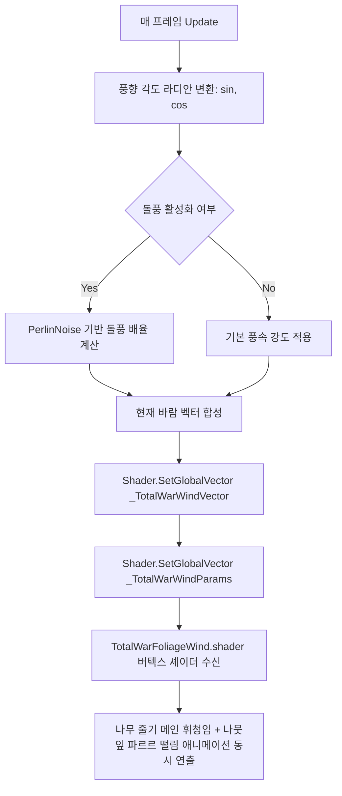

# 🍃 삼국지 토탈워 전장 바람 시스템 (TotalWarWindManager)

## 💡 핵심 요약 & 역할 (Summary & Role)
- **핵심 목적**: 삼국지 토탈워(Total War: Three Kingdoms) 본편의 전장 바람 시스템(Wind System)을 구현하여, 전장의 풍향(Wind Direction), 풍속(Wind Speed), 돌풍(Gustiness)을 전역 시뮬레이션하고 모든 3D 초목(나무, 솔잎, 대나무, 수풀)에 실시간 바람 흔들림을 부여합니다.
- **주요 역할**:
  1. **전장 풍향/풍속 시뮬레이션**: 0~360도 풍향과 기본 풍속을 실시간 연산.
  2. **펄린 노이즈(Perlin Noise) 기반 자연스러운 돌풍**: 불규칙하게 몰아치는 산바람 연출.
  3. **전역 셰이더 프로퍼티 브로드캐스트**: `_TotalWarWindVector`, `_TotalWarWindParams`를 통해 모든 초목 머티리얼이 일괄적으로 동기화된 바람을 타도록 제어.
  4. **초목 바람 전용 URP 셰이더 연동**: `TotalWarFoliageWind.shader`와 직결되어 나무 줄기 휘청임과 잎사귀 카드의 파르르 떨림을 물리적으로 구동.

---

## 🌳 1. 아키텍처 트리 맵 (Tree Map)
```
TotalWarWindManager (MonoBehaviour, ExecuteAlways)
│
├── 🌬️ 풍향 및 풍속 연산 서브시스템 (Wind Vector Core)
│   ├── windAngle (0~360도 오일러 각도)
│   ├── windSpeed (주기 및 시간 배율)
│   └── windStrength (버텍스 변위 진폭)
│
├── 💨 돌풍 시뮬레이션 (Perlin Gust Generator)
│   ├── Mathf.PerlinNoise(time * gustFrequency)
│   └── gustMultiplier (최대 돌풍 배율 보간)
│
└── 🌐 전역 셰이더 브로드캐스트 (Global Shader Properties)
    ├── _TotalWarWindVector: (DirX * Strength, DirY * Strength, Speed, Time)
    └── _TotalWarWindParams: (Strength, GustFactor, 0, 0)
```

---

## 🗂️ 2. 해시 테이블 메서드/구조체 색인표 (Hash Table Index)

| Key (메서드 / 구조체) | Value (역할, 의존성 및 설명) | 소스 링크 |
| :--- | :--- | :--- |
| `Awake()` / `OnEnable()` | 싱글톤 인스턴스 등록 및 초기 바람 셰이더 전역 변수 설정 | [TotalWarWindManager.cs#L45](file:///c:/unityProject/MiniTotalWar2D/Assets/Scripts/TotalWarWindManager.cs#L45) |
| `AutoApplyOnSceneLoad()` | 씬 로드 시 매니저 오브젝트가 없으면 자동 생성하여 즉시 가동 (`RuntimeInitializeOnLoadMethod`) | [TotalWarWindManager.cs#L56](file:///c:/unityProject/MiniTotalWar2D/Assets/Scripts/TotalWarWindManager.cs#L56) |
| `Update()` | 에디터 및 런타임에서 매 프레임 바람 벡터와 돌풍을 연산하여 셰이더로 브로드캐스트 | [TotalWarWindManager.cs#L68](file:///c:/unityProject/MiniTotalWar2D/Assets/Scripts/TotalWarWindManager.cs#L68) |
| `UpdateWindShaderGlobals()` | 삼각함수와 펄린 노이즈로 바람 4차원 벡터를 조립하여 `Shader.SetGlobalVector` 호출 | [TotalWarWindManager.cs#L76](file:///c:/unityProject/MiniTotalWar2D/Assets/Scripts/TotalWarWindManager.cs#L76) |
| `OnDrawGizmosSelected()` | 에디터 씬 뷰에서 현재 풍향과 세기를 하늘색 화살표 기즈모로 시각화 | [TotalWarWindManager.cs#L107](file:///c:/unityProject/MiniTotalWar2D/Assets/Scripts/TotalWarWindManager.cs#L107) |

---

## 🔀 3. 유향 그래프 흐름도 (Directed Graph - Mermaid)



---

## ⚙️ 4. 주요 상태 변수, 데이터 구조체 & 인스펙터 옵션 (State, Structs & Inspector Fields)

| 변수명 | 타입 | 기본값 | 설명 및 인스펙터 튜닝 가이드 |
| :--- | :--- | :--- | :--- |
| `windAngle` | `float` | `45.0f` | **풍향 (Wind Direction)**: 0도=북, 90도=동, 180도=남, 270도=서. 바람이 불어가는 나침반 각도. |
| `windSpeed` | `float` | `1.35f` | **기본 풍속 (Wind Speed)**: 나무가 좌우로 흔들리는 주기적 속도. |
| `windStrength` | `float` | `0.35f` | **바람 강도 (Wind Strength)**: 나뭇가지와 잎이 휘어지는 물리적 진폭. |
| `enableGust` | `bool` | `true` | **돌풍 활성화**: 체크 시 일정 주기로 바람이 거세지는 돌풍 시뮬레이션 적용. |
| `gustFrequency` | `float` | `0.45f` | **돌풍 빈도**: 노이즈 주파수. 높을수록 바람 세기가 자주 바뀜. |
| `gustMultiplier` | `float` | `1.6f` | **돌풍 최대 배율**: 강풍이 불 때 평상시 풍속 대비 증가 비율. |

---

## 🛠️ 5. 핵심 알고리즘, 물리/전투 수학 공식 & 조작법 (Algorithms, Math & Controls)

### 1. 풍향 벡터 및 돌풍 연산 공식
풍향 각도 θ(degree)로부터 2D 평면 풍향 단위 벡터를 산출합니다:
- rad = θ * (π / 180)
- WindDir = (sin(rad), cos(rad))

돌풍 팩터(Gust Factor):
- Noise = PerlinNoise(Time * GustFrequency, 0.5)
- GustFactor = lerp(0.7, GustMultiplier, Noise)
- CurrentStrength = WindStrength * GustFactor

### 2. 초목 버텍스 변위 공식 (TotalWarFoliageWind.shader)
버텍스의 높이(y)와 월드 위치(x, z)에 따라 2중 파동을 중첩합니다:
- **줄기 메인 스웨이 (Height-dependent Main Sway)**:
  HeightFactor = saturate(max(0, VertexY) * 0.12)
  Wave1 = sin(Time * WindSpeed + dot(WorldPos.xz, (0.15, 0.11))) * 0.28
- **나뭇잎 고주파 플러터 (Leaf Flutter)**:
  Wave2 = sin(Time * WindSpeed * 3.2 + dot(VertexPos.xyz, (1.8, 2.5, 1.4))) * (0.09 * LeafFlutter)
- **최종 변위**:
  Displacement = (WindVector.x, 0, WindVector.z) * ((Wave1 + Wave2) * HeightFactor * Multiplier)

---

## 🔗 6. 다른 스크립트와의 연동 관계 (Dependencies & Pipeline)
- **`TotalWarFoliageWind.shader`**: 전역 바람 프로퍼티를 공급받아 버텍스를 물리적으로 변위시킴.
- **`TacticalForestZone.cs`**: 스폰되는 모든 3D 나무와 관목이 이 바람 시스템의 영향을 받도록 머티리얼 바인딩.
- **`TotalWarEnvironmentLighting.cs`**: 전장의 태양광 및 스카이박스 환경과 유기적으로 결합하여 생동감 넘치는 전장 환경 연출.
