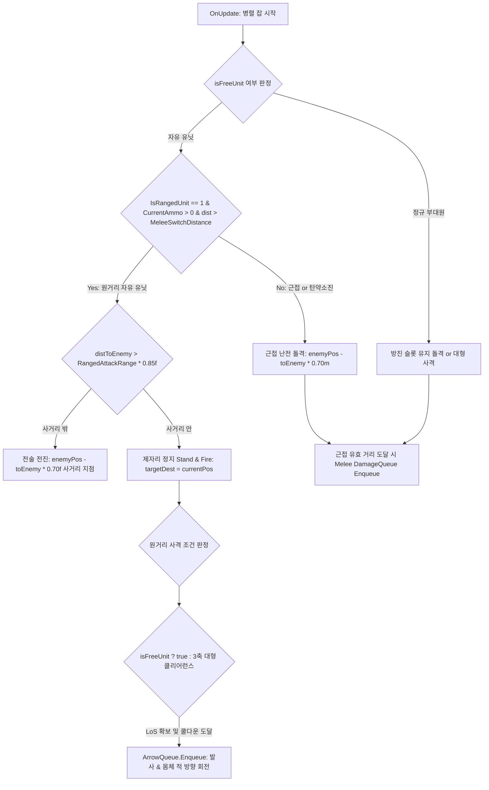

# ⚡ [UnitCombatAndMovementSystem.cs] Pure ECS 이동 & 전투 시스템 가이드

> **원본 소스 파일**: [UnitCombatAndMovementSystem.cs](file:///c:/unityProject/MiniTotalWar2D/Assets/Scripts/ECS/Systems/UnitCombatAndMovementSystem.cs), [UnitECSComponents.cs](file:///c:/unityProject/MiniTotalWar2D/Assets/Scripts/ECS/Components/UnitECSComponents.cs)

---

## 💡 1. 핵심 요약 & 역할 (Summary & Role)
수만 명(1,200 ~ 50,000기)의 초대규모 군단을 150~220+ FPS로 초고속 시뮬레이션하는 **순수 ECS(Pure ECS) 모드의 핵심 전투/이동 시스템**입니다. 공간 해시 그리드 기반 타겟팅, 넉백/백병전 타격 판정(1.45m 유효 사거리), 원거리 무기 3축 클리어런스(후방 공간, 측면 간격, 전방 사선/언덕 경사면 여유고), 순차 사격(Rolling Volley), **자유 원거리 유닛 전용 사거리 유지 제자리 사격(Stand & Fire)**, 그리고 NativeQueue 기반 병렬 데미지 처리를 총괄합니다.

---

## 🌳 2. 아키텍처 트리 맵 (Tree Map)

- 📁 **1. 시스템 수명주기 및 쿼리 (System Lifecycle & Query)**
  - `OnCreate()`: 시스템 초기화, 컴포넌트 룩업 및 공간 쿼리 캐싱
  - `OnUpdate()`: 매 프레임 병렬 Job 스케줄링 및 데미지 일괄 적용
- 📁 **2. 순수 ECS 데이터 구조체 (`UnitECSComponents.cs`)**
  - `UnitEntityTag`: 진영(`Faction`), 소속부대(`SquadId`), 생존(`IsAlive`), 자유유닛 플래그(`IsFreeUnit`), 격자 인덱스(`Row`, `Col`)
  - `UnitMovementData`: 위치(`Position`), 회전(`Rotation`), 속도(`Velocity`), 목표좌표(`TargetPosition`), 가속도(`Acceleration`)
  - `UnitCombatData`: 체력(`CurrentHp`), 공격력(`Damage`), 넉백속도(`KnockbackVelocity`), 질량(`Mass`), 목표적부대(`TargetSquadId`), 타겟위치캐시(`CachedEnemyPos`), 탐색타이머(`TargetSearchTimer`), 원거리 속성(`IsRangedUnit`, `CurrentAmmo`, `RangedAttackRange`), 3축 클리어런스 및 순차사격 필드
  - `DamageEvent`: 병렬 스레드 간 충돌/피격 데미지 큐 이벤트 구조체
- 📁 **3. 병렬 연산 파이프라인 (Execution Pipeline)**
  - 📂 3.1. 공간 해시 타겟팅 및 0.1초 주기화 캐싱 (Targeting & 10Hz Staggered Cache)
    - 0.1초 주기(`TargetSearchTimer >= 0.1f`)로만 전체 유닛/부대 맵을 탐색하여 `CachedEnemyPos` 갱신
    - 지정 목표 부대(`TargetSquadId`) 최우선 탐색
    - 목표 부대 미지정 시 레이더(`RadarTargetEntity`) 결과 참조
  - 📂 3.2. 상태 전이 및 속도 제어 (State & Movement)
    - 단순 이동(`Move = 1`) 시 교전 즉시 이탈 및 목적지 최우선 질주
    - 🛑 **자유 유닛 대기(Idle) 시 무단 돌격 방지**: 부대 해체 후 또는 대기 상태(`CurrentState == 0`)인 자유 유닛은 레이더에 적이 잡히더라도 명령(`isAttacking == 1`)이나 2.5m 초근접 위협이 없으면 제자리를 사수하여 진형 붕괴 및 무단 난전 방지.
    - 🏹 **자유 원거리 유닛 전용 교전 원칙 (Stand & Fire & Tactical Advance)**:
      - 사거리 밖(`distToEnemy > maxRange * 0.85f`): 사거리 안(70% 지점)으로 전술 전진 (`isCharging = false`)
      - 사거리 안(`distToEnemy <= maxRange * 0.85f`): 제자리 정지(`targetDest = currentPos`) 후 조준 사격
      - 백병전 전환: 적이 1.2m 코앞까지 쇄도하거나 잔여 탄약이 0발일 때 비로소 칼을 뽑아 근접 돌격
    - ⚔️ 자유 근접 유닛 / 탄약 소진 유닛: 공격 명령 수신 시 12m 이내 돌격 가속(`isCharging = true`) 및 0.7m 밀착 난전
    - 🌊 정규 부대원: 접촉 전까지 방진 슬롯 유지 돌격 → 접촉 후 백병전 전환
  - 📂 3.3. 원거리 사격 및 클리어런스 판정 (Ranged Combat & Clearance)
    - 백병전 교전 중(`CurrentState == 3`)이거나 1.5m 이내 적 진입 시 사격 100% 금지
    - 🛑 **사격 정지 제동 보장 (`shouldHaltForRangedFire`)**: 사격 자격(사거리, 탄약, LoS)을 갖춘 유닛은 속도가 줄어들기를 기다리지 않고 `maxDesiredSpeed = 0f`로 즉시 강제 감속 제동을 걸어, 전열/후열 분리 없이 전군이 일제히 정지하여 발사 개시
    - 👁️ **자동 사격(자유 사격) 시야(LoS) 필수화**: 눈높이 1.1m 기준 지형 5점 광선 검사를 수행하여, 플레이어가 목표 부대를 명시 타겟팅(`TargetSquadId != -1`)하지 않은 자동 사격 상태에서는 반드시 사선이 트였을 때(`isLosClear == true`)에만 발사. 언덕 너머 보이지 않는 적에게 맹목적으로 곡사 화살을 낭비하는 현상 완전 차단.
    - 🏹 **활 직사(저각) 우선 사격 원칙**: 1~2열 사수 및 자유 유닛은 적이 교전 중이더라도 낮고 빠른 직사(`hasAlly = 0`)로 신속하게 타격. 3열 이상 뒷열 사수이거나 언덕 너머 사격 시에만 고각 곡사(`hasAlly = 1`) 발사.
    - 🏹 자유 유닛 클리어런스 면제: 대형이 없는 독립 산개 유닛은 3축 대형 클리어런스 자동 통과 (`isClearanceSatisfied = true`)
    - 정규 부대원: 후방, 측면, 전방 사선(언덕 경사면) 3축 기하학적 여유고 검증
    - 조준 회전: 사격 중이거나 사거리 내 적 조준 시 적 방향 실시간 정렬
  - 📂 3.4. 물리 척력 및 틈새 슬라이딩 (Separation & Deflection)
  - 📂 3.5. 백병전 타격 판정 및 데미지 큐 적용 (`ApplyDamageJob`)

---

## 🗂️ 3. 해시 테이블 메서드 및 구조체 색인표 (Hash Table Index)

| 식별자 (Key) | 종류 / 반환형 | 핵심 역할 & 기능 요약 (Value) | 실행 단계 | 소스 줄 번호 링크 |
| :--- | :--- | :--- | :--- | :--- |
| `DamageEvent` | `struct` | 피격 대상 엔티티, 데미지, 넉백 방향/속도 데이터 | 전체 시스템 공유 | [UnitCombatAndMovementSystem.cs#L11](file:///c:/unityProject/MiniTotalWar2D/Assets/Scripts/ECS/Systems/UnitCombatAndMovementSystem.cs#L11) |
| `OnCreate` | `void (ref state)` | 컴포넌트 룩업 및 엔티티 쿼리 초기화 | 시스템 생성 시 | [UnitCombatAndMovementSystem.cs#L28](file:///c:/unityProject/MiniTotalWar2D/Assets/Scripts/ECS/Systems/UnitCombatAndMovementSystem.cs#L28) |
| `OnUpdate` | `void (ref state)` | 공간 맵 빌드 대기, IJobEntity 및 ApplyDamageJob 실행 | 매 프레임 | [UnitCombatAndMovementSystem.cs#L40](file:///c:/unityProject/MiniTotalWar2D/Assets/Scripts/ECS/Systems/UnitCombatAndMovementSystem.cs#L40) |
| `Execute` | `void (entity, tag, mov, combat, sep)` | 타겟팅, 자유 원거리 거리 제어, 사격, 백병전 판정 일괄 실행 | `IJobEntity` 병렬 스레드 | [UnitCombatAndMovementSystem.cs#L92](file:///c:/unityProject/MiniTotalWar2D/Assets/Scripts/ECS/Systems/UnitCombatAndMovementSystem.cs#L92) |
| `ApplyDamageJob` | `struct : IJob` | NativeQueue의 데미지 이벤트를 단일 스레드에서 안전 차감 | `IJob` 단일 스레드 | [UnitCombatAndMovementSystem.cs#L1040](file:///c:/unityProject/MiniTotalWar2D/Assets/Scripts/ECS/Systems/UnitCombatAndMovementSystem.cs#L1040) |

---

## 🔀 4. 유향 그래프 흐름도 (Directed Graph - Mermaid)

---

## ⚙️ 5. 주요 상태 변수, 데이터 구조체 & 인스펙터 옵션 (State, Structs & Inspector Fields)

| 변수명 | 타입 | 기본값 | 상세 역할 & 튜닝 가이드 |
| :--- | :--- | :--- | :--- |
| `IsFreeUnit` | `int` | `0` | 1 = 부대 없는 자유 유닛(산개 난전/독립 사격), 0 = 부대 소속 정규병(대형 슬롯 유지) |
| `IsRangedUnit` | `int` | `0 / 1` | 1 = 원거리 사격 병과(궁병/총병), 0 = 근접 보병 |
| `CurrentAmmo` | `int` | `25` | 실시간 잔여 화살/총탄 수 (0발 소진 시 즉시 근접 보병으로 전환) |
| `RangedAttackRange` | `float` | `60.0f ~ 150.0f` | 유닛의 최대 유효 사거리 |
| `MeleeSwitchDistance` | `float` | `1.2f ~ 1.5f` | 사격을 중단하고 보조무기(단검/칼)를 뽑아 백병전으로 강제 전환되는 임계 거리 |
| `CanFireWhileMoving` | `int` | `0` | 이동 중 사격 가능 여부 (0 = 제자리 정지 시에만 사격 허용) |

---

## 🛠️ 6. 핵심 알고리즘, 물리/전투 수학 공식 & 조작법 (Algorithms, Math & Controls)

### (1) 자유 원거리 유닛 전술 거리 제어 수식 (Stand & Fire)
* **사거리 밖 (dist > RangedAttackRange * 0.85)**:
  `TargetDest = Pos_enemy - ToEnemy * (RangedAttackRange * 0.70)`
  * 무조건 적 코앞으로 달리지 않고 자신의 최적 사거리(70% 지점)로 안전하게 진입.
* **사거리 안 (dist <= RangedAttackRange * 0.85)**:
  `TargetDest = Pos_current`
  * `maxDesiredSpeed = 0f`로 즉각 감속하여 제자리에 멈춰 서고, `CurrentSpeed <= 0.25 m/s` 정지 사격 조건을 충족하여 즉시 발사 태세 확립.

### (2) 자유 사격 시야(LoS) 5점 광선 검사 알고리즘
* 눈높이(1.1m) 샘플링: 사수 눈높이와 목표 피격점(지상 +1.1m) 사이에 5개 지형 높이를 검사:
  `rayPoint = lerp(shooterEye, targetEye, frac)`
  `terrainY = sampleTerrain(rayPoint.xz)`
  `rayPoint.y < terrainY + 0.1m` 이면 지형에 사선이 막힘 (`isLosClear = false`)
* 판정:
  - 플레이어가 목표 부대를 우클릭 지정했을 때: 언덕 너머 곡사 지원 (`hasAlly = 1`)
  - 자동 사격(Free Fire): 사선이 완전히 트였을 때만 사격 허용 (`isLosClear == true`)

### (3) 활 직사(저각) 및 곡사(고각) 분기 공식
* 3열 이상 뒷열 사수이거나 언덕 너머 사격일 때만 고각 곡사 채택:
  `hasAlly = (!isFreeUnit && Row >= 2) || !isLosClear`
* 1~2열 사수 및 자유 유닛은 적이 백병전 중이라도 시야가 트여 있으면 낮고 빠른 직사(`hasAlly = 0`)로 즉시 사격.

### (4) 제자리 사격 조준 시선 회전 정렬
* 정지 사격 중 속도가 0이어도 목표 적을 향해 몸체를 정확히 회전:
  `LookDir = Pos_enemy - Pos_my`
  `TargetRot = quaternion.LookRotationSafe(normalize(LookDir), math.up())`

---

## 🔗 7. 다른 스크립트와의 연동 관계 (Dependencies & Pipeline)

*   **`UnitTargetSearchSystem.cs`**:
    *   동적 레이더(최대 65m)가 탐지한 `RadarTargetEntity`를 전달받아 사거리 내 적을 O(1)로 조준 및 교전.
*   **`Squad.cs`**:
    *   부대 해체 시 자유 유닛으로 전환된 병사들이 이 시스템의 자유 원거리 교전 행동 규범에 따라 독립적으로 전투 수행.
*   **`ArrowSimulationManager.cs`**:
    *   `ArrowQueue`로 인큐된 투사체 발사 커맨드를 받아 지형 고저차 및 직사/곡사 탄도학 시뮬레이션 구동.
