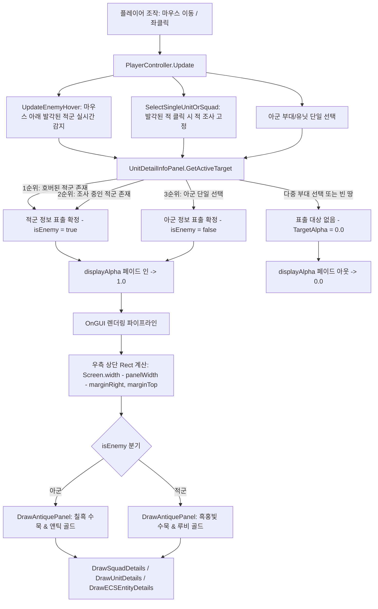

# 📜 [UnitDetailInfoPanel.cs] 삼국지 토탈워 스타일 우측 상단 상세 정보 UI 패널 아키텍처 가이드

> **원본 소스 파일**: [UnitDetailInfoPanel.cs](file:///c:/unityProject/MiniTotalWar2D/Assets/Scripts/UnitDetailInfoPanel.cs)  
> **시스템 역할**: 아군 단일 부대/유닛 선택 또는 적군 부대/유닛 클릭(조사) 및 마우스 오버(호버) 시 화면 우측 상단에 삼국지 토탈워 풍의 수묵/앤틱 프레임 정보창을 표출하고, 생명력, 체력(피로도), 사기, 전투 스탯을 실시간 시각화

---

## 💡 1. 핵심 요약 & 역할 (Summary & Role)

- **핵심 역할**: 플레이어가 전장에서 아군 **단일 부대(`SelectedSquads.Count == 1`)** 또는 **단일 자유 유닛**을 선택하거나, **적군 부대/유닛을 마우스 오버(Hover) 또는 클릭(Inspect)**했을 때 화면 **우측 상단 (Top-Right)**에 삼국지 토탈워 특유의 칠흑빛 먹물 배경과 앤틱 프레임으로 구성된 고품격 정보 패널을 0.05초 페이드 인으로 팝업합니다.
- **화면 우측 상단 배치**: 하단의 부대 카드(Squad Cards UI), 좌상단 성능 HUD, 중앙 상단 전황 바(Balance of Power) 및 우하단 명령 단축키 창과 일절 간섭하지 않는 독립적 명당 위치에 배치.
- **적 부대 상호작용 및 피아 식별 (Friend or Foe Identification)**:
  - **아군 (Friend)**: 칠흑 수묵 차콜 배경 + 앤틱 골드 테두리 + 청록/골드 뱃지 (`🛡️ [아군]`)
  - **적군 (Enemy)**: 흑홍빛 수묵 먹물 배경 + 진홍 루비 골드 테두리 + 루비 레드 뱃지 (`⚔️ [적군]`)
  - **전장의 안개(Fog of War) 연동**: 시야에 발각된 적(`isSpotted == true`)만 정보창 표출이 허용되어 안개 속 미발각 적의 치트성 조회를 원천 차단.
- **3대 핵심 게이지 이원화**:
  1. **생명력 (Health / HP)**: 피격 수명 및 생존 병력 비율 바 (아군: 에메랄드 그린, 적군: 크림슨 레드)
  2. **사기 (Morale / Leadership)**: 4단계 심리 상태 (`안정`, `동요`, `붕괴 위기`, `패주 중`)
  3. **체력 및 활력 (Fatigue / Stamina)**: 6단계 활력 단계 (`신선함`, `활기참`, `약간 지침`, `지침`, `매우 지침`, `탈진`)
- **전투 스탯 격자**: 방진 밀집도(Tightness) 보너스가 합산된 실효 방어력, 근접 공격력(AP 포함), 근접 방어, 돌격 보너스, 유효 사거리, 잔여 탄약 발수, 이동 속도, 물리 질량 및 현재 행동/진형 실시간 브리핑.

---

## 🌳 2. 아키텍처 트리 맵 (Tree Map)

- 📁 **1. 생명주기 및 싱글톤 관리 (Lifecycle & Singleton)**
  - `Awake()`: 인스턴스 싱글톤 보장 및 `DontDestroyOnLoad` 등록
  - `Start()`: `PlayerController` 참조 바인딩
  - `Update()`: 활성 대상 검출(`GetActiveTarget`) 및 실시간 페이드 인/아웃 알파(`displayAlpha`) 연산
- 📁 **2. 표출 대상 우선순위 파이프라인 (Target Arbitration Pipeline)**
  - `GetActiveTarget()`:
    1. 1순위: 마우스 오버 중인 발각된 적군 (Hovered Enemy Preview)
    2. 2순위: 플레이어가 클릭하여 조사 중인 발각된 적군 (Inspected Enemy Lock)
    3. 3순위: 플레이어가 단일 선택한 아군 부대/유닛/엔티티 (Player Single Selection)
- 📁 **3. 시각 렌더링 파이프라인 (Visual Rendering Engine - OnGUI)**
  - `OnGUI()`: 해상도 독립적 우측 상단 배치(`Screen.width - panelWidth - marginRight`, `marginTop`) 및 알파 렌더링
  - `DrawAntiquePanel(Rect, bool isEnemy)`: 아군(골드) / 적군(루비) 테마별 수묵 배경, 이중 테두리 및 4개 코너 장식 드로잉
  - `DrawBorder()`: 지정 두께 사각 테두리 텍스처 드로잉
- 📁 **4. 상세 정보 표출 분기 (Data Presentation Dispatch)**
  - `DrawSquadDetails(area, squad, isEnemy)`: 부대(Squad) 데이터 바인딩 (인원수, 사기, 체력, 방진 스탯, 탄약, 킬수, 피아 뱃지)
  - `DrawUnitDetails(area, unit, isEnemy)`: 자유 GameObject 유닛(Unit) 데이터 바인딩
  - `DrawECSEntityDetails(area, entity, isEnemy)`: 순수 ECS 엔티티(Entity) 데이터 바인딩
- 📁 **5. GUI 헬퍼 및 텍스처/스타일 캐시 (GUI Helpers & Theme Styles)**
  - `DrawStatGaugeRow()`: 가로 게이지 바(배경 트랙 + 채우기 바 + 라벨/수치 텍스트) 공통 드로잉
  - `DrawStatItem()`: 2열 전투 스탯 아이템(라벨 + 수치) 드로잉
  - `GetUnitTypeBadge()`: 병종(보병/창병/궁병/기병) 뱃지 텍스트 반환
  - `GetMoraleStateName()`: 사기 수치에 따른 4단계 컬러 리치 텍스트 반환
  - `GetFatigueStageName()`: 체력 잔여율에 따른 6단계 활력 컬러 리치 텍스트 반환
  - `InitStylesIfNeeded()`, `MakeTex()`: 아군 골드 및 적군 루비 수묵 텍스처/GUIStyle 절차적 캐싱

---

## 🗂️ 3. 해시 테이블 메서드 색인표 (Method Fast-Index Table)

| 메서드 / 프로퍼티 (Key) | 반환형 / 파라미터 | 핵심 역할 & 기능 요약 (Value) | 호출자 (Callers) | 소스 줄 번호 링크 |
| :--- | :--- | :--- | :--- | :--- |
| `Instance` | `UnitDetailInfoPanel (get)` | 씬 내 인스턴스 자동 탐색 및 생성 보장 싱글톤 프로퍼티 | `PlayerController.Awake` | [UnitDetailInfoPanel.cs#L16-L32](file:///c:/unityProject/MiniTotalWar2D/Assets/Scripts/UnitDetailInfoPanel.cs#L16-L32) |
| `GetActiveTarget` | `bool (out Squad, out Unit, out Entity, out bool)` | 호버 적군 → 조사 적군 → 아군 단일 선택 우선순위 판정 및 피아 여부 반환 | `Update`, `OnGUI` | [UnitDetailInfoPanel.cs#L106-L177](file:///c:/unityProject/MiniTotalWar2D/Assets/Scripts/UnitDetailInfoPanel.cs#L106-L177) |
| `DrawAntiquePanel` | `void (Rect rect, bool isEnemy)` | 아군(차콜 수묵+골드) / 적군(흑홍 수묵+루비 골드) 테마별 프레임 렌더링 | `OnGUI` | [UnitDetailInfoPanel.cs#L215-L245](file:///c:/unityProject/MiniTotalWar2D/Assets/Scripts/UnitDetailInfoPanel.cs#L215-L245) |
| `DrawSquadDetails` | `void (Rect area, Squad squad, bool isEnemy)` | 부대의 3대 게이지, 2열 전투 스탯, 킬수, 진형 상태 및 피아 뱃지 표출 | `OnGUI` | [UnitDetailInfoPanel.cs#L257-L343](file:///c:/unityProject/MiniTotalWar2D/Assets/Scripts/UnitDetailInfoPanel.cs#L257-L343) |
| `DrawUnitDetails` | `void (Rect area, Unit unit, bool isEnemy)` | 개별 유닛 체력, 활력, 사기, 공격력, 사거리 및 피아 뱃지 표출 | `OnGUI` | [UnitDetailInfoPanel.cs#L349-L402](file:///c:/unityProject/MiniTotalWar2D/Assets/Scripts/UnitDetailInfoPanel.cs#L349-L402) |
| `DrawECSEntityDetails` | `void (Rect area, Entity entity, bool isEnemy)` | 순수 ECS 엔티티 컴포넌트 실시간 바인딩 및 피아 뱃지 표출 | `OnGUI` | [UnitDetailInfoPanel.cs#L404-L442](file:///c:/unityProject/MiniTotalWar2D/Assets/Scripts/UnitDetailInfoPanel.cs#L404-L442) |
| `DrawStatGaugeRow` | `void (x, ref y, width, label, val, ratio, tex)` | 라벨, 수치 및 가로 막대 게이지 바 통합 드로잉 | `DrawSquadDetails` 등 | [UnitDetailInfoPanel.cs#L448-L464](file:///c:/unityProject/MiniTotalWar2D/Assets/Scripts/UnitDetailInfoPanel.cs#L448-L464) |

---

## 🔀 4. 유향 그래프 흐름도 (Directed Graph - Mermaid)

---

## ⚙️ 5. 주요 상태 변수 & 인스펙터 옵션 (State & Inspector Fields)

| 필드 / 변수명 | 타입 | 기본값 | 상세 역할 및 인스펙터 가이드 |
| :--- | :--- | :--- | :--- |
| `isEnabled` | `bool` | `true` | 정보창 패널의 전체 표시 기능 On/Off 토글 |
| `panelWidth` | `float` | `350f` | 우측 상단 패널의 가로 폭 (px) |
| `panelHeight` | `float` | `360f` | 우측 상단 패널의 세로 높이 (px) |
| `marginRight` | `float` | `20f` | 화면 우측 여백 (px) |
| `marginTop` | `float` | `35f` | 화면 상단 여백 (px) |
| `displayAlpha` | `float` | `0f` | 팝업/숨김 시 부드러운 수묵 페이드 인/아웃 알파값 (0.0 ~ 1.0) |

---

## 🛠️ 6. 색상 테마 및 삼국지 비주얼 명세 (Visual Specifications)

- **아군 테마**:
  - 수묵 칠흑빛 배경 (`bgTex`): `RGBA(0.08, 0.09, 0.11, 0.94)`
  - 앤틱 골드 외곽선 (`goldBorderTex`): `RGBA(0.82, 0.68, 0.38, 0.90)`
  - 앤틱 브론즈 내곽선 (`borderTex`): `RGBA(0.45, 0.38, 0.28, 0.45)`
  - 생명력 바 (`healthBarTex`): 에메랄드 그린 `RGBA(0.18, 0.80, 0.44, 0.95)`
  - 헤더 텍스트: `🛡️ [아군] 부대명` (상아 골드)
- **적군 테마**:
  - 흑홍빛 수묵 배경 (`enemyBgTex`): `RGBA(0.14, 0.05, 0.05, 0.95)`
  - 진홍 루비 골드 외곽선 (`enemyGoldBorderTex`): `RGBA(0.88, 0.30, 0.25, 0.95)`
  - 짙은 루비 내곽선 (`enemyBorderTex`): `RGBA(0.55, 0.20, 0.20, 0.50)`
  - 생명력 바 (`enemyHealthBarTex`): 크림슨 레드 `RGBA(0.92, 0.25, 0.25, 0.95)`
  - 헤더 텍스트: `⚔️ [적군] 부대명` (루비 로즈 골드)
- **사기(Morale) 상태**: 안정(녹색 `#2ECC71`), 동요(황색 `#F1C40F`), 붕괴 위기(주황 `#E67E22`), 패주(적색 `#E74C3C`)
- **체력(Stamina) 상태**: 신선함(청록 `#1ABC9C`), 활기참(녹색 `#2ECC71`), 약간 지침(라임 `#A6E22E`), 지침(황색 `#F1C40F`), 매우 지침(주황 `#E67E22`), 탈진(적색 `#E74C3C`)
