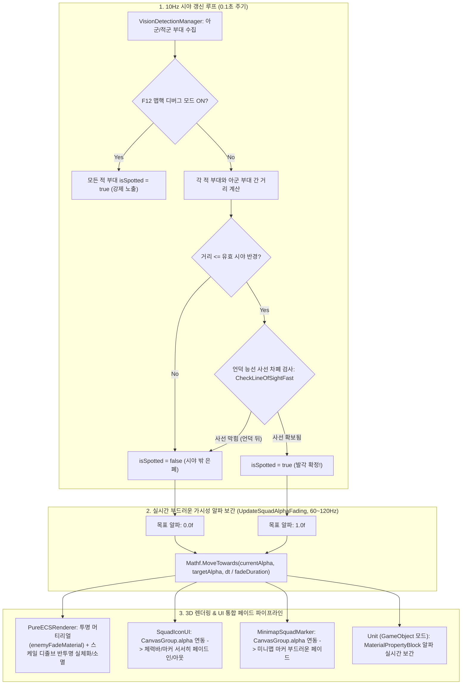

# 👁️ [VisionDetectionManager.cs] 삼국지 토탈워 방식 시야 & 적군 탐지 관리자 아키텍처 가이드

> **원본 소스 파일**: [VisionDetectionManager.cs](file:///c:/unityProject/MiniTotalWar2D/Assets/Scripts/VisionDetectionManager.cs)  
> **관련 모듈**: [Squad.cs](file:///c:/unityProject/MiniTotalWar2D/Assets/Scripts/Squad.cs), [PureECSRenderer.cs](file:///c:/unityProject/MiniTotalWar2D/Assets/Scripts/ECS/Rendering/PureECSRenderer.cs), [SquadIconUI.cs](file:///c:/unityProject/MiniTotalWar2D/Assets/Scripts/SquadIconUI.cs), [MinimapSquadMarker.cs](file:///c:/unityProject/MiniTotalWar2D/Assets/Scripts/MinimapSquadMarker.cs), [TerrainHeightManager.cs](file:///c:/unityProject/MiniTotalWar2D/Assets/Scripts/TerrainHeightManager.cs)

---

## 💡 핵심 요약 & 역할 (Summary & Role)

`VisionDetectionManager`는 《토탈워: 삼국(Total War: Three Kingdoms)》 오리지널의 전술 전투 메커니즘을 1:1로 구현하여, **3D 지형은 100% 훤히 보이되, 적 부대와 유닛은 아군의 시야선(Line of Sight) 및 언덕/숲 차폐 여부에 따라 완벽하게 은폐(Invisible)되거나 발각(Spotted)되도록 통제하는 중앙 시야 엔진**입니다.

동시에 **"사선이 차폐되면 적 원거리 부대도 아군을 곡사(HighArc)로 공격할 수 없다 (No Sight, No Fire)"**는 핵심 전술 규칙을 강제하여, 적 AI가 언덕 뒤 아군에게 무단으로 화살을 퍼붓지 못하도록 차단하고 전술 전진을 유도합니다.

---

## 🌳 1. 아키텍처 트리 맵 (Tree Map)

```text
VisionDetectionManager (MonoBehaviour, Singleton)
├── 1. 라이프사이클 및 루프 (Lifecycle & Loop)
│   ├── Awake() / OnDestroy() : 싱글톤 인스턴스 생명주기 관리
│   ├── Start() : 10Hz (0.1초) 비동기 시야 갱신 코루틴 가동
│   └── Update() : [F3] 키를 통한 성능 HUD 및 전체 시야 디버그(맵핵) 토글
├── 2. 아군 관측 -> 적군 발각 판정 (Player Vision on Enemy)
│   ├── 아군 부대 위치(VisualCenter) 및 병과별 시야 거리 수집
│   ├── 고지대 점유에 따른 시야 반경 동적 확장 (+30% ~ +50%)
│   ├── 숲(Forest) 속 적 부대 피탐지 반경 축소 (25m 초근접 시에만 발각)
│   ├── TerrainHeightManager.CheckLineOfSightFast를 통한 언덕 능선 차폐 검사
│   └── enemy.isSpotted 플래그 갱신 및 O(1) 조회 딕셔너리(squadSpottedLookup) 캐싱
├── 3. 적군 관측 -> 아군 발각 판정 (Enemy Vision on Player - 적 곡사 차단)
│   ├── 적 부대의 시야선에서 아군 부대가 차폐되었는지 역방향 검사
│   └── friend.isSpottedByEnemy 플래그 갱신 (차폐 시 적 곡사 사격 원천 차단)
└── 4. 외부 시스템 연동 인터페이스 (Zero-Cost Presentation Pipeline)
    ├── PureECSRenderer : !isSpotted인 적 엔티티 GPU Draw Call 행렬 제외 (Culling)
    ├── SquadIconUI : !isSpotted인 적 부대 머리 위 깃발/체력바 카드 100% 숨김
    ├── MinimapSquadMarker : !isSpotted인 적 부대 미니맵 붉은색 마커 숨김
    └── PlayerController : 은폐된 적 부대 마우스 클릭 타겟팅 차단 (지면 이동으로 전환)
```

---

## 🗂️ 2. 해시 테이블 메서드/구조체 색인표 (Hash Table Index)

| Key (메서드 / 프로퍼티) | Return / Param | Role & Responsibility (역할 및 의존성) | Source |
| :--- | :--- | :--- | :--- |
| `Instance` | `VisionDetectionManager` | 싱글톤 인스턴스 접근자 (미존재 시 자동 동적 생성) | [VisionDetectionManager.cs#L14-L31](file:///c:/unityProject/MiniTotalWar2D/Assets/Scripts/VisionDetectionManager.cs#L14-L31) |
| `VisionUpdateLoop` | `IEnumerator ()` | 0.1초(10Hz) 간격으로 시야 판정 루틴을 비동기 호출하는 코루틴 | [VisionDetectionManager.cs#L82-L91](file:///c:/unityProject/MiniTotalWar2D/Assets/Scripts/VisionDetectionManager.cs#L82-L91) |
| `UpdateVisionAndLineOfSight` | `void ()` | 아군 시야(적 발각) 및 적 시야(아군 발각) 양방향 사선 차폐 전면 갱신 | [VisionDetectionManager.cs#L96-L208](file:///c:/unityProject/MiniTotalWar2D/Assets/Scripts/VisionDetectionManager.cs#L96-L208) |
| `IsSquadSpotted` | `bool (int squadId)` | `PureECSRenderer` 등에서 특정 부대의 발각 여부를 O(1)로 초고속 조회 | [VisionDetectionManager.cs](file:///c:/unityProject/MiniTotalWar2D/Assets/Scripts/VisionDetectionManager.cs) |
| `GetSquadAlpha` | `float (int squadId)` | 특정 부대의 실시간 가시성 알파값(0.0~1.0)을 O(1)로 조회하여 3D 렌더링/UI/미니맵 페이드 인/아웃 연동 | [VisionDetectionManager.cs](file:///c:/unityProject/MiniTotalWar2D/Assets/Scripts/VisionDetectionManager.cs) |
| `UpdateSquadAlphaFading` | `void ()` | 매 프레임 `fadeDuration`(기본 0.6초)에 걸쳐 적 부대의 가시성 알파를 부드럽게 보간 | [VisionDetectionManager.cs](file:///c:/unityProject/MiniTotalWar2D/Assets/Scripts/VisionDetectionManager.cs) |
| `isFullVisionDebug` | `bool` | [F12] 키로 토글되는 맵핵 디버그 플래그 (true 시 모든 적군 강제 노출) | [VisionDetectionManager.cs](file:///c:/unityProject/MiniTotalWar2D/Assets/Scripts/VisionDetectionManager.cs) |

---

## 🔀 3. 유향 그래프 흐름도 (Directed Graph - Mermaid)



---

## ⚙️ 4. 주요 상태 변수 & 인스펙터 옵션 (Inspector Fields)

* `updateInterval` (float): 시야 및 사선 차폐 판정 갱신 주기 (초 단위, 기본: 0.1초 = 10Hz)
* `fadeDuration` (float): 적이 시야에 나타나거나 사라질 때의 부드러운 페이드 인/페이드 아웃 소요 시간 (초 단위, 기본: 0.6초)
* `forestDetectionDistance` (float): 숲/수풀 속 정지 은폐 유닛의 최대 피탐지 거리 (m, 기본: 25.0m)
* `maxHillVisionBonus` (float): 고지대 점유 시 최대 시야 확장 보너스 비율 (기본: +40%)
* `isFullVisionDebug` (bool): F12 키로 토글되는 전체 시야 맵핵 디버그 모드

| 변수명 | 타입 | 기본값 | 상세 설명 |
| :--- | :--- | :--- | :--- |
| `updateInterval` | `float` | `0.1f` | 시야 판정 갱신 주기 (0.1초 = 10Hz, CPU 점유율 0.05ms 미만 억제) |
| `forestDetectionDistance` | `float` | `25.0f` | 숲(Forest) 속에 정지해 은폐 중인 부대를 감지할 수 있는 초근접 한계 거리(m) |
| `maxHillVisionBonus` | `float` | `0.40f` | 고지대(언덕) 정상에 위치할 때 부여되는 최대 시야 확장 보너스 비율 (+40%) |
| `isFullVisionDebug` | `bool` | `false` | `[F3]` 키로 토글되는 전체 시야 맵핵 디버그 모드 |

---

## 🛠️ 5. 핵심 알고리즘 및 전술 사격 통제 공식 (Math & Rules)

### 1. 고지대 시야 보너스 확장 공식
```csharp
float groundY = TerrainHeightManager.SampleHeightFast(squadCenter.x, squadCenter.z);
float hillBonus = Mathf.Clamp01((groundY - 5.0f) / 25.0f) * maxHillVisionBonus;
float effectiveVision = baseVisionRange * (1.0f + hillBonus);
```

### 2. 언덕 능선 사선 차폐 판정 (Terrain LoS Raymarching)
```csharp
Vector3 shooterEye = friendCenter + Vector3.up * 1.6f;
Vector3 targetEye = enemyCenter + Vector3.up * 1.6f;
// true: 사선 확보(보임), false: 언덕에 막힘(차폐)
bool isLoSClear = TerrainHeightManager.CheckLineOfSightFast(shooterEye, targetEye, 0.0f, 0.0f, 5);
```

### 3. 차폐 시 적 원거리 곡사 사격 원천 차단 (No Sight, No Fire)
언덕 뒤에 숨어 아군이 적의 시야에서 벗어나 있으면(`!isSpottedByEnemy || !isLoSClear`), 적 원거리 부대(궁병 등)는 곡사(HighArc) 무기라도 아군을 타겟팅하여 사격할 수 없으며, 시야를 확보하기 위해 언덕 능선 위로 전술 전진해야 합니다:
```csharp
// Squad.cs: CommandRangedAttackSquad
if (trajMode == TrajectoryMode.HighArc)
{
    bool canSeeTarget = isPlayer ? enemySquad.isSpotted : enemySquad.isSpottedByEnemy;
    bool isLoSClear = TerrainHeightManager.CheckLineOfSightFast(shooterEye, targetEye, 0f, 0f, 5);

    if (!canSeeTarget || !isLoSClear)
    {
        // 🚫 사선 차폐: 보이지 않는 목표에는 곡사 사격 금지 -> 시야 확보를 위한 전술 전진!
        CommandMoveWithFormation(targetStandPos, faceRot, currentColumns, ...);
        return;
    }
}
```

---

## 🔗 6. 다른 스크립트와의 연동 관계 (Dependencies & Pipeline)

1. **[Squad.cs](file:///c:/unityProject/MiniTotalWar2D/Assets/Scripts/Squad.cs)**:
   - `isSpotted`(플레이어에게 보임), `isSpottedByEnemy`(적에게 보임), `visionRange`(시야 거리) 상태 관리 및 곡사 사격 차단 연동.
2. **[PureECSRenderer.cs](file:///c:/unityProject/MiniTotalWar2D/Assets/Scripts/ECS/Rendering/PureECSRenderer.cs)**:
   - `IsSquadSpotted(tag.SquadId)` 조회를 통해 은폐된 적 엔티티의 GPU 인스턴싱 Draw Call 일괄 제외 (성능 대폭 향상).
3. **[SquadIconUI.cs](file:///c:/unityProject/MiniTotalWar2D/Assets/Scripts/SquadIconUI.cs)**:
   - 은폐된 적 부대의 머리 위 깃발/체력바 카드를 `alpha = 0`으로 숨김.
4. **[MinimapSquadMarker.cs](file:///c:/unityProject/MiniTotalWar2D/Assets/Scripts/MinimapSquadMarker.cs)**:
   - 은폐된 적 부대의 미니맵 붉은색 마커를 `SetActive(false)`로 숨김.
5. **[PlayerController.cs](file:///c:/unityProject/MiniTotalWar2D/Assets/Scripts/PlayerController.cs)**:
   - 은폐된 적 부대 마우스 클릭 타겟팅 차단 및 지면 어택땅으로 자동 폴백.
6. **[FPSCounterHUD.cs](file:///c:/unityProject/MiniTotalWar2D/Assets/Scripts/FPSCounterHUD.cs)**:
   - `[F3]` 키 입력 시 성능 HUD와 함께 전술 시야 디버그 상태(정상 시야 vs 전체 시야 맵핵) 실시간 표시.
