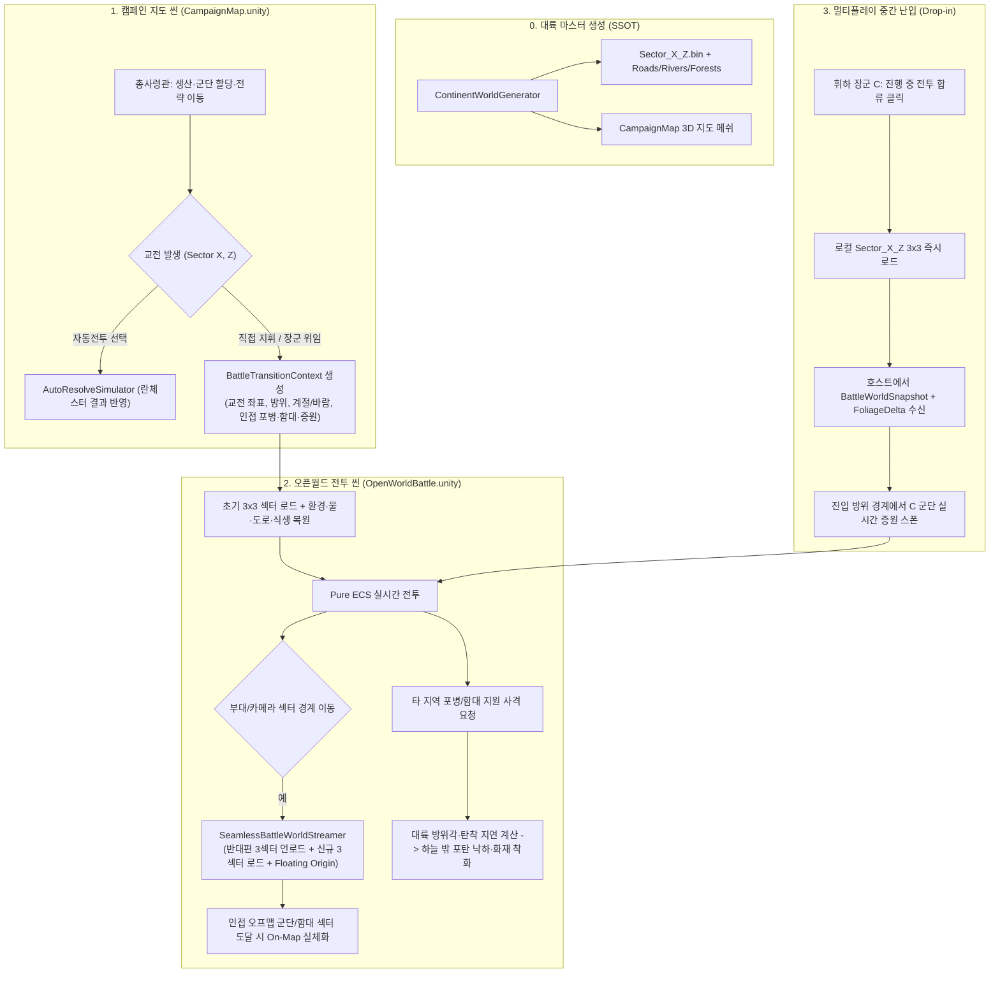

# 🗺️ 대륙 오픈월드 캠페인 · 연속 스트리밍 전투 · 지휘계통 멀티플레이 마스터 기획서

> **작성 일자**: 2026-11-20  
> **문서 성격**: 복수 시스템(대륙 생성, 캠페인 지도, 멀티 터레인 스트리밍, Pure ECS 전투, 타 지역 포격/함포, A안 Listen Server 멀티플레이, 역사·유동 적 AI)이 유기적으로 결합되는 영구 마스터 아키텍처 기획서  
> **실험 씬 보존 원칙**: 기존 [Game2.unity](file:///c:/unityProject/MiniTotalWar2D/Assets/Scenes/Game2.unity)는 지형·식생·물·전투 단위 기능 실험용 샌드박스로 보존하고, 본 시스템은 신규 씬(`CampaignMap.unity`, `OpenWorldBattle.unity`)과 공용 데이터 계층으로 구축합니다.

---

## 💡 1. 핵심 비전 & 게임플레이 구조 (Core Vision)

본 프로젝트는 **단일 대륙 위에서 캠페인 전략과 심리스 오픈월드 전술 전투가 하나로 이어지고, 싱글플레이와 소규모 협동·대전 멀티플레이(A안: 호스트-클라이언트 2~16명)가 동일한 코드베이스로 동작**하는 대규모 전장 시뮬레이션입니다.

### 1.1 지휘 계통 (Chain of Command — 총사령관 & 휘하 장군)
- **총사령관 (Supreme Commander / 멀티 호스트 / 싱글 플레이어)**:
  - 대륙 캠페인 지도에서 내정, 병력 생산, 보급선, 대전략(군단 이동·집결·상륙·포격 지원 배치)을 총괄합니다.
  - 생산된 부대를 **직접 지휘**하거나, **휘하 장군 플레이어(또는 부관 AI)** 에게 군단·제대 단위로 할당(Assign / Delegate)합니다.
  - 교전 발생 시 4가지 선택권을 가집니다:
    1. **직접 참전 지휘**: 총사령관이 직접 전투 씬에 진입해 전투 지휘
    2. **자동전투 (Auto-Resolve)**: 란체스터 전투 모델 + 지형·상성 보정으로 신속 결판
    3. **휘하 장군 위임**: 해당 전선을 담당 장군 플레이어(또는 AI 장군)에게 맡기고, 총사령관은 캠페인 지도에서 다른 전선·보급·원거리 포병/함대 지원을 계속 지휘
    4. **전투 중 실시간 난입 (Drop-in)**: 장군이 싸우고 있는 전장에 총사령관이나 다른 장군이 증원군을 이끌고 중간 접속해 합류
- **휘하 장군 플레이어 (Subordinate Generals / 클라이언트)**:
  - 총사령관으로부터 배정받은 군단(예: 선봉 보병대, 좌익 기병대, 장강 함대, 포병대)을 전장에서 직접 지휘합니다.
  - 담당 부대를 **자율 AI 위임/자동전투**로 맡길 수도 있고, 타 장군이 싸우는 인접 전장으로 행군해 **중간 난입(Drop-in)** 하거나 원거리 포격/함포 화력을 지원할 수 있습니다.
- **싱글플레이 (Solo Mode)**:
  - 유저 1명이 총사령관과 전 장군의 권한을 모두 가지며, `LocalLoopbackTransport`를 통해 멀티플레이와 동일한 엔진으로 지연 없이 동작합니다.
  - 싱글 전용 권한으로 **캠페인 및 전투 중 자유로운 일시정지 / 0.5배속 / 2배속**을 지원하며, 원하는 전선이나 부대는 언제든 부관 AI 위임 또는 자동전투로 넘길 수 있습니다.

---

## 🌳 2. 전체 아키텍처 트리 맵 (Architecture Tree Map)

```
MiniTotalWar2D 대륙 오픈월드 & 지휘계통 통합 아키텍처
 ├── 1. 대륙 단일 진실 원천 데이터 (Assets/WorldData/<Continent>/)
 │    ├── WorldMeta.json (대륙 크기, 섹터 규격 512m, 해수면, 기후대)
 │    ├── Sector_X_Z.bin (섹터별 16-bit 높이맵, 5슬롯 스플랫, 수심/숲/식생 시드)
 │    ├── MasterNetworks.json (대륙 도로망, 강줄기 스플라인, 성채·항구·여울목)
 │    └── CampaignMapMesh (저해상도 1/16 축소 캠페인 3D 대륙 지도)
 │
 ├── 2. 멀티 터레인 기반 리팩토링 (기존 단일 Terrain.activeTerrain 탈피)
 │    ├── MultiTileTerrainHeightManager (3x3 타일 NativeArray O(1) 높이/법선/LoS)
 │    ├── WorldWaterQueryAPI (바다·강 통합 수심·파도 높이·유속 조회 -> 군함 부력 대비)
 │    └── WorldCoord (절대 대륙 좌표: SectorX/Z + LocalX/Z <-> 클라이언트 Floating Origin)
 │
 ├── 3. 캠페인 전략 지도 씬 (CampaignMap.unity)
 │    ├── CampaignWorldController (생산, 보급, 군단 이동, 지휘권 할당 UI)
 │    ├── CampaignBattleTrigger (교전 판정 + 사거리 내 타 지역 포병/함대·증원 수집)
 │    └── AutoResolveSimulator (란체스터 + 지형/기후/병종 상성 기반 신속 자동전투)
 │
 ├── 4. 심리스 오픈월드 전투 씬 (OpenWorldBattle.unity)
 │    ├── BattleLoadingSequence (교전 좌표 기준 3x3 섹터 로드 + 환경/수계/식생 복원)
 │    ├── SeamlessBattleWorldStreamer (전선 이동 시 3x3 슬라이딩 윈도우 + Floating Origin 시프트)
 │    ├── OffMapFireSupportManager (타 지역 포병/함대 포격 궤적·탄착 지연·화재 착화)
 │    └── DynamicReinforcementPromoter (전선 이동으로 인접 군단 조우 시 Off-Map -> On-Map 실체화)
 │
 ├── 5. A안 Listen Server 네트워크 & 난입 계층 (2~16명)
 │    ├── IBattleTransport (싱글: LocalLoopback / 멀티: Listen Server 소켓)
 │    ├── BattleCommandQueue (모든 지휘 명령의 단일 관문, NetworkSquadId 기반)
 │    └── BattleWorldSnapshot (부대당 32B + 병사 생존 비트마스크 + FoliageDeltaRecord -> 초고속 난입)
 │
 └── 6. 역사적 교리 + 유동적 적응형 적군 AI (Historical & Adaptive Enemy AI)
      ├── CampaignStrategicAI (보급선·요충지·양동작전·협공 판단)
      └── TacticalDoctrineAI (역사적 교리 프리셋 + 실시간 상황 적응형 예비대/우회/퇴각 FSM)
```

---

## 🔀 3. 캠페인 ↔ 오픈월드 전투 · 난입 · 원거리 지원 흐름도 (Mermaid)



---

## ⚙️ 4. 핵심 모듈별 기술 명세

### 4.1 대륙 자동 생성기 & 섹터 규격 (`ContinentWorldData`)
- **기본 규격 (권장)**:
  - 1 섹터 크기: `512m x 512m` (현재 `Game2` 전장과 유사한 실전 교전 규모)
  - 초기 대륙 크기: `16 x 16` 섹터 = **`8.19km x 8.19km`** (확장 시 `32 x 32` = `16.4km`까지 동일 포맷 지원)
  - 활성 전투 윈도우: 항상 전선 중심 **`3 x 3` 섹터 (`1.54km x 1.54km`)** 를 메모리에 유지
- **자동 생성 파이프라인**:
  1. 대륙 윤곽 + 산맥(Ridge Noise) + 해안선 + 수문 침식 기반 강줄기(River Graph) 생성
  2. 위도·고도 기반 5대 기후대(`Temperate`, `Cold`, `Arid`, `Subtropical`, `Nanman`) 자동 배정
  3. 주요 요충지(성채·항구·여울목) 배치 후 A* 최소 경사 경로로 대륙 도로망(`Roads_Master.json`) 자동 연결
  4. 경사도·습도·기후에 맞춰 숲 구역(`Forests_Master.json`)과 5슬롯 스플랫맵(`0: 잔디, 1: 절벽, 2: 흙/도로, 3: 숲, 4: 자갈`)을 섹터별 바이너리로 분할 저장
  5. 경계 높이 1픽셀을 인접 섹터와 공유해 `Terrain.SetNeighbors()` 호출 시 타일 틈새(Seam) 0% 보장

### 4.2 기존 단일 터레인 의존성 해체 (9개 스크립트 멀티 타일 전환)
현재 `Terrain.activeTerrain`에 직접 묶인 9개 핵심 스크립트를 멀티 타일 공용 서비스로 전환합니다.

| 대상 스크립트 | 현재 한계 | 멀티 타일 전환 방안 |
| :--- | :--- | :--- |
| [TerrainHeightManager.cs](file:///c:/unityProject/MiniTotalWar2D/Assets/Scripts/TerrainHeightManager.cs) | 단일 `NativeArray<float>` 1장 | `3x3` 타일 높이맵 슬롯 배열 (`MultiTileTerrainHeightData`)로 O(1) 조회 확장 |
| [TacticalGrassRenderer.cs](file:///c:/unityProject/MiniTotalWar2D/Assets/Scripts/TacticalGrassRenderer.cs) | 단일 터레인 기준 베이크/표면 맵 | 섹터 단위 청크 로드/언로드 + 활성 3x3 기준 `TerrainSurfaceMap` 갱신 |
| [TotalWarTerrainManager.cs](file:///c:/unityProject/MiniTotalWar2D/Assets/Scripts/TotalWarTerrainManager.cs) | 단일 `targetTerrain` 테마 적용 | 활성 섹터별 기후 테마 일괄 관리 및 계절/적설 전역 브로드캐스트 |
| [TotalWarSeaPlane.cs](file:///c:/unityProject/MiniTotalWar2D/Assets/Scripts/TotalWarSeaPlane.cs) | 고정 위치 1장 평면 | 카메라/원점 추적 무한 대양 평면 + 군함 부력용 `SampleWaveHeightAndNormal` 제공 |
| [TotalWarRiverSpline.cs](file:///c:/unityProject/MiniTotalWar2D/Assets/Scripts/TotalWarRiverSpline.cs) / [TotalWarRoadSpline.cs](file:///c:/unityProject/MiniTotalWar2D/Assets/Scripts/TotalWarRoadSpline.cs) | 씬 정적 스플라인 | 섹터 경계로 클리핑된 구간 메쉬 동적 생성 + 기존 O(1) AABB 캐시 유지 |
| [TacticalWaterZone.cs](file:///c:/unityProject/MiniTotalWar2D/Assets/Scripts/TacticalWaterZone.cs) / `MinimapManager` / `CameraController` | 단일 터레인 바운드 가정 | 활성 스트리밍 영역 바운드 + 절대 대륙 좌표 변환 API 연동 |

### 4.3 좌표 체계 & 원점 시프트 (WorldCoord & Floating Origin)
- **절대 대륙 좌표 (`WorldCoord`)**: `(int sectorX, int sectorZ, float localX, float localZ)` 또는 `double2`로 표현.
- **불변 규칙**:
  - 호스트 시뮬레이션, 캠페인 저장 파일, 네트워크 패킷, 오프맵 포격 좌표는 **항상 `WorldCoord` 절대 좌표**만 사용합니다.
  - 각 클라이언트의 Unity 3D 씬은 렌더링 시에만 `renderPos = ToLocalUnityPos(worldCoord, clientOriginOffset)`으로 변환합니다.
  - 카메라/주력 전선이 로컬 원점에서 `1,024m` 이상 벗어나면 `clientOriginOffset`을 한 섹터(`512m`) 단위로 시프트하여 부동소수점 떨림을 영구 방지합니다.

### 4.4 타 지역 포병·함대 화력 지원 (`OffMapFireSupportManager`)
- **사거리 판정**: 캠페인 지도에서 교전 중심 좌표 기준 인접 섹터(예: 야포 `1.5km`, 중포/전함 함포 `3.0km`) 안에 아군/적군 포병대·함대가 있으면 `BattleTransitionContext.fireSupports`에 자동 등록됩니다.
- **실전 동작**:
  1. 전투 중 플레이어가 지원 사격 아이콘 선택 → 전장 목표 지점 지정 (탄착 예상 원 및 방향 화살표 미리보기).
  2. 실제 대륙 상의 포병/함대 좌표와의 거리·방위각을 계산해 **원거리 포성 지연 + 실제 방위 하늘 너머에서 포물선 포탄 낙하** (`4 ~ 12초` 비행시간).
  3. 탄착 시 Pure ECS 폭발 피해·넉백 + [TacticalGrassRenderer.cs](file:///c:/unityProject/MiniTotalWar2D/Assets/Scripts/TacticalGrassRenderer.cs) / [TacticalForestZone.cs](file:///c:/unityProject/MiniTotalWar2D/Assets/Scripts/TacticalForestZone.cs) **화재 착화 연동**.
  4. **군함/포병대 실체화**: 전투 중 부대가 실제 그 포병대/함대가 있는 섹터까지 오픈월드로 밀고 들어가면, 오프맵 지원 상태가 해제되고 해당 섹터에 실제 3D 포병대·군함(수심 `GetWaterDepthAt` 및 파도 부력 `SampleWaveHeightAndNormal` 기반)으로 즉시 실체화됩니다.

### 4.5 A안 Listen Server 멀티플레이 & 진행 중 난입 프로토콜 (2~16명)
기존 `멀티플레이_전환_기획서.md`(1v1 순수 락스텝)를 **중간 난입(Drop-in)과 오픈월드 병합이 가능한 하이브리드 부대-스냅샷 호스트 권위 구조**로 발전시킵니다.

- **역할 권한 모델 (`PlayerCommandAuthority`)**:
  - 각 군단/부대는 `uint SquadNetId` (기존 `GetInstanceID()` 대체)와 `byte OwnerPlayerId` (`0 = 총사령관`, `1~15 = 휘하 장군`, `255 = AI`)를 가집니다.
  - 총사령관은 언제든 `AssignSquadCommand(squadNetId, targetGeneralId)`로 실시간 지휘권을 위임·회수할 수 있습니다.
  - 클라이언트가 [BattleCommandQueue.cs](file:///c:/unityProject/MiniTotalWar2D/Assets/Scripts/BattleCommandQueue.cs)에 명령을 넣으면, 호스트가 소유권(`OwnerPlayerId` 또는 총사령관 권한)을 검증한 뒤 실행·브로드캐스트합니다.
- **초경량 대역폭 예산 (유닛 3,000명 / 부대 50개 기준)**:
  - 부대 상태 스냅샷 (`50부대 x 32B` @ 10Hz) = 약 `16 KB/s`
  - 병사 생존·체력 압축 델타 (비트마스크 + 변경분) = 약 `4~8 KB/s`
  - 지휘 명령 RPC + 포격/화재/사망 이벤트 = 약 `1~2 KB/s`
  - **총합 약 `25 KB/s` / 플레이어** → 호스트 1대가 장군 15명까지 안정적으로 수용 가능하며, **신규 난입자도 로컬 대륙 섹터 로드 + 1회 스냅샷 수신으로 1~2초 내 완벽 합류**합니다.
- **멀티 vs 싱글 시간 흐름**:
  - **멀티플레이**: A와 B가 전투 중에도 대륙 시간이 계속 흘러 C가 캠페인 지도에서 달려와 난입하거나 포격을 지원할 수 있습니다.
  - **싱글플레이**: 전투 진입 시 대륙 시간을 일시정지(또는 저속 전술 시간)하고, 전투 중 일시정지·배속을 자유롭게 제어합니다.

### 4.6 싱글플레이용 역사적 교리 + 유동적 적응형 적군 AI
유저에게 매 전투마다 "공략하는 재미"를 주기 위해, 적군 AI는 **역사적 작전 교리 (Historical Doctrine)** 와 **실시간 상황 적응 (Adaptive Tactical Response)** 의 2계층으로 동작합니다.

1. **역사적 교리 프리셋 (`EnemyDoctrineType`)**:
   - **고지 선점·사격 진지 (High-Ground Defense)**: 언덕 능선·고지를 먼저 점령하고 전열 방진 + 후열 궁병/포병 화망 구축 (유저에게 우회·연막·포격 유인 공략 유도)
   - **병목·여울목 수비 (Chokepoint / Ford Hold)**: 다리·강 여울목·협곡 입구에서 접촉 방어 태세(`Bracing`)로 버티며 기병 돌격 무력화
   - **양익 포위 기동 (Double Envelopment / 칸나이형)**: 중앙 보병이 접전을 유도하는 동안 기병·정예 보병이 숲을 끼고 좌우 측면으로 크게 우회
   - **숲 매복·화공 기습 (Forest Ambush & Fire)**: [TacticalForestZone.cs](file:///c:/unityProject/MiniTotalWar2D/Assets/Scripts/TacticalForestZone.cs) 은신(25m 피탐지)을 활용해 숲에 매복했다가 아군 측면·포병대가 지날 때 급습, 풍향(`TotalWarWindManager`)이 유리하면 숲/풀에 화공 시도
   - **수군·포병 화력 연동 (Combined Arms)**: 인접 강·바다 함대나 후방 포병이 아군 밀집 방진을 향해 지원 사격을 요청
2. **유동적 상황 적응 계층 (`AdaptiveTacticalController`)**:
   - 아군이 측면 우회하면 고정 교리를 고집하지 않고 예비대(Reserve)를 해당 측면으로 즉시 회전 배치
   - 아군 궁병/포병 화력이 강하면 자동으로 산개진(`Loose Formation`) 전환 및 숲·능선 뒤 엄폐 기동
   - 아군이 숲에 화공을 걸거나 포위망이 붕괴되면, 전멸하기 전에 **질서 있는 전술 후퇴(Fighting Withdrawal) → 인접 섹터 아군 본대/성채로 합류 재편성** (오픈월드 연속 추격전 유도!)

---

## 🛠️ 5. 단계별 구현 로드맵 (Phased Implementation Roadmap)

한 번에 모든 기능을 섞지 않고, 매 단계마다 플레이어블 검증이 가능하도록 6단계로 진행합니다.

| 단계 | 핵심 목표 | 주요 산출물 | 검증 기준 |
| :--- | :--- | :--- | :--- |
| **Phase 1** | 멀티 터레인 & 절대 좌표 기반 정비 | `WorldCoord`, `MultiTileTerrainHeightManager`, `WorldWaterQueryAPI`, `SquadNetId` 도입 | 3x3 터레인 타일 위에서 ECS 부대 이동·사선·물·풀이 이음새 없이 동작 |
| **Phase 2** | 대륙 자동 생성기 & 섹터 저장 포맷 | `ContinentWorldGenerator` (`16x16` 섹터, 5대 기후, 강/도로/숲 자동 생성) + `CampaignMapMesh` | 에디터 원클릭으로 대륙 데이터 파일 + 축소 캠페인 3D 지도 생성 완료 |
| **Phase 3** | 오픈월드 3x3 전투 스트리밍 씬 | `OpenWorldBattle.unity`, `BattleLoadingSequence`, `SeamlessBattleWorldStreamer`, `FloatingOrigin` | 부대를 맵 끝까지 끝없이 행군해도 지형·숲·물·도로·풀이 끊김 없이 연속 로드 |
| **Phase 4** | 캠페인 지도 씬 & 지휘권·자동전투 | `CampaignMap.unity`, 생산/할당 UI, `AutoResolveSimulator`, 캠페인↔전투 왕복 루프 | 지도 이동 → 교전 → 해당 지형 전투 → 생존 병력·최종 좌표 캠페인 반영 |
| **Phase 5** | 타 지역 포병/함대 지원 & 역사·유동 적 AI | `OffMapFireSupportManager`, `EnemyDoctrineAI`, `AdaptiveTacticalController` | 인접 섹터 함포/포격 호출·화재 착화 + 교리별 공략 재미 검증 |
| **Phase 6** | A안 Listen Server 멀티플레이 & 난입 | `IBattleTransport` 네트워크 구현, `BattleWorldSnapshot`, 총사령관↔장군 위임·난입(Drop-in) | 호스트(총사령관) + 클라이언트(장군) 2인 이상 동시 접속 및 전투 중 난입 성공 |

---

## 🔗 6. 기존 문서와의 연계
- [근현대_대규모_전선_사단급_자동전투_및_전략지도_스트리밍_기획서.md](file:///c:/unityProject/MiniTotalWar2D/Docs/기획서/근현대_대규모_전선_사단급_자동전투_및_전략지도_스트리밍_기획서.md): 초경량 부대 데이터(32B) 및 란체스터 자동전투 모델 계승
- [멀티플레이_전환_기획서.md](file:///c:/unityProject/MiniTotalWar2D/Docs/기획서/멀티플레이_전환_기획서.md): 기존 1v1 순수 락스텝 검토를 본 기획서의 **A안 하이브리드 부대-스냅샷 호스트 권위(난입 지원)** 모델로 고도화
- [BattleRosterContext.cs](file:///c:/unityProject/MiniTotalWar2D/Assets/Scripts/BattleRosterContext.cs) & [BattleCommandQueue.cs](file:///c:/unityProject/MiniTotalWar2D/Assets/Scripts/BattleCommandQueue.cs): 캠페인↔전투 전달 및 싱글/멀티 공용 명령 파이프라인의 핵심 기반으로 직접 확장
