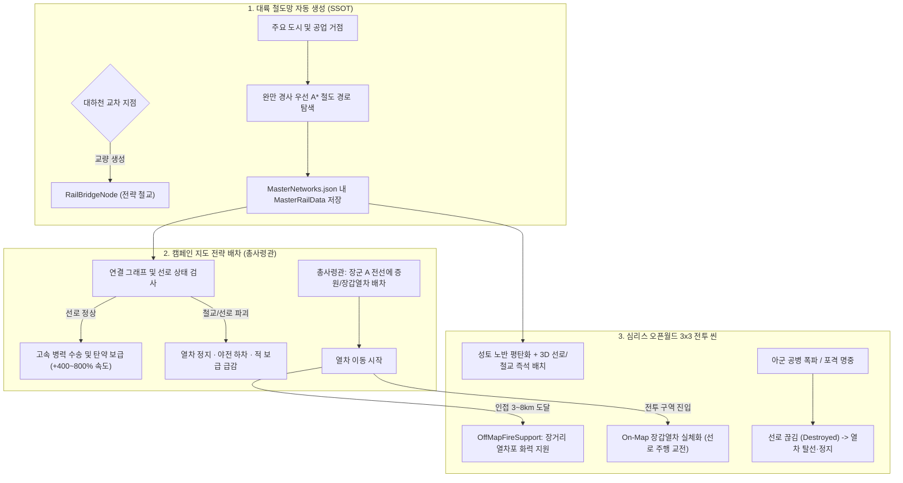

# 🚂 대륙 전략 철도망 · 군수 보급수송 · 철교 폭파 · 장갑열차 전투 통합 기획서

> **작성 일자**: 2026-11-20  
> **문서 성격**: 복수 시스템(114km 대륙 생성기, 캠페인 보급·기동, 오픈월드 3x3 스트리밍 전투, 지형/사선 차폐, 오프맵 열차포 화력, A안 멀티플레이)이 유기적으로 결합되는 영구 보존용 마스터 확장 기획서  
> **적용 범위**: 근현대 총력전(중일전쟁 · 국공내전 등) 프리셋에서 활성화되며, 삼국지 고전 프리셋에서는 철도 레이어를 꺼서 기존 환경과 100% 독립 호환됩니다.

---

## 💡 1. 핵심 비전 & 게임플레이 가치 (Core Vision)

`114.2km x 89.6km` 대륙 스케일에서는 도로만 사용하는 보병·차량 행군 외에 **대륙 간선 철도 (Trunk Railway)** 가 전쟁의 핵심 동맥이 됩니다. 철도 시스템을 도입하면 단순 전면전뿐만 아니라 **보급선 절단, 철교 폭파 공방, 장갑열차 기동 지원, 철도 요충지(관문·분기역) 쟁탈전** 같은 깊이 있는 전략·전술 플레이가 열립니다.

1. **캠페인 전략 계층 (대동맥 수송 & 보급선)**:
   - 아군 도시·공업지대와 전선을 잇는 철도 선로가 개통되어 있으면 병력과 포병을 일반 도로 대비 **4 ~ 8배 속도**로 전략 수송할 수 있고, 전선 사단의 탄약·보급 충전율이 높게 유지됩니다.
   - 반대로 적의 철도 분기역이나 대형 강 위 **철교(Rail Bridge)** 를 폭파·점령하면 해당 철도에 의존하던 적 전선 전체의 보급과 증원이 동시에 마비됩니다.
2. **오픈월드 전술 전투 계층 (지형 엄폐 & 장갑열차/열차포)**:
   - 교전 구역(`3x3` 섹터, `1.54km x 1.54km`)을 철도가 통과할 경우, 전장 한가운데 또는 측면을 가로지르는 **성토 제방(Embankment) 철로와 철교**가 실시간 생성되어 시야(LoS)를 끊고 총포탄을 막는 핵심 엄폐 능선이자 병목 지형으로 작동합니다.
   - 인접 섹터 철로 위의 **열차포**가 원거리 지원 사격을 가하거나, **장갑열차**가 선로를 따라 직접 전투 구역으로 진입해 화력을 투사하다가 선로 폭파 시 고립·나포되는 입체적 전장이 구현됩니다.

---

## 🌳 2. 전체 아키텍처 트리 맵 (Architecture Tree Map)

```text
MiniTotalWar.OpenWorld.Railway (확장 시스템 계층)
 ├── 1. 대륙 SSOT 철도망 생성 계층 (ContinentWorldGenerator 확장)
 │    ├── MasterRailData (철도 노선 ID, 궤간/노반 폭, 복선 여부, WorldCoord 스플라인)
 │    ├── RailStationNode (도시역 · 보급창 · 분기점 — WorldMeta/MasterNetworks 연계)
 │    ├── RailBridgeNode (황하·장강·주강 및 하천 교차 고정 철교 — 폭파/복구 핵심 타겟)
 │    └── ContinentSectorSynthesizer 연동 (철도 통과 구간 성토 평탄화 + 자갈 노반 스플랫)
 │
 ├── 2. 캠페인 철도 수송 & 보급선 시뮬레이션 (CampaignMap.unity)
 │    ├── CampaignRailNetworkGraph (역·분기점 연결 그래프 + 선로 파괴 상태 반영 동적 탐색)
 │    ├── CampaignTrainEntity (선로 위 병력 수송 열차 · 보급 열차 · 장갑열차 · 열차포)
 │    ├── StrategicSupplyPropagator (역 반경 + 철도 연결도 기반 전선 탄약/사기 보급 산출)
 │    └── A안 총사령관 배차 UI (휘하 장군 전선으로 증원/탄약 열차 편성 및 우선순위 지정)
 │
 ├── 3. 심리스 오픈월드 전투 씬 연동 (OpenWorldBattle.unity)
 │    ├── TacticalRailSpline & RailBedBuilder (3x3 섹터 즉석 합성 시 자갈 노반 · 침목 · 레일 생성)
 │    ├── TacticalArmoredTrain (스플라인 거리 기반 이동 · 차륜/포탑 독립 조준 · 탈선/파괴 판정)
 │    ├── OffMapSupportType.RailwayArtillery (선로를 이동하며 사격하는 오프맵 장거리 열차포)
 │    └── RailSabotageAndRepair (공병/포격에 의한 선로/철교 파괴 및 전투/캠페인 중 공병 복구)
 │
 └── 4. 네트워크 동기화 & 적 AI 교리 연동
      ├── RailDeltaState (파괴 구간 비트/인덱스 + 열차당 24B 스플라인 위치 동기화)
      └── EnemyRailDoctrineAI (철교/분기역 우선 타격 · 선로 매복 급습 · 아군 보급 열차 요격)
```

---

## 🔀 3. 캠페인 ↔ 오픈월드 철도 수송 · 파괴 · 열차포 전투 흐름도 (Mermaid)



---

## ⚙️ 4. 모듈별 상세 기술 명세

### 4.1 대륙 철도 경로 생성 규칙 (`ContinentWorldGenerator` 확장)
도로([MasterRoadData](file:///c:/unityProject/MiniTotalWar2D/Assets/Scripts/World/ContinentWorldData.cs#L118))와 달리 철도는 열차가 오를 수 있는 **최대 허용 경사(Grade)** 가 매우 낮아야 현실감이 살아납니다.

| 구분 | 일반 군사 도로 (`MasterRoadData`) | 대륙 간선 철도 (`MasterRailData`) |
| :--- | :--- | :--- |
| **경사 허용치** | 완만~중간 경사 통과 가능 (`cost ~ slope^1.5`) | 급경사 강력 억제 (`cost ~ slope^3.5` + 평탄화) |
| **하천 교차 처리** | 도하 여울목 (`RiverFord`) 생성 | 반드시 고정 **대형 철교 (`RailBridgeNode`)** 생성 |
| **노반 지형 성형** | 흙/자갈 길 도색 + 풀 배제 | 지형 깎기/쌓기(Cut & Fill)로 수평 성토 제방 형성 |
| **유지·파괴 단위** | 상시 통과 가능 | 선로 세그먼트 단위(`512m` 섹터 또는 교량) 파괴/복구 |

- **중국 대륙 대표 축선 (16대 거점 연동 예시)**:
  - **평한선 / 경한선 계열**: 유주(북평) → 업(한단) → 정주/낙양 → 양양/한구 → 장사 → 남해(광주)
  - **농해선 계열**: 서량/장안 → 낙양 → 허창 → 하비(서주) → 동부 해안
  - **진포선 / 경호선 계열**: 유주 → 하비 → 합비 → 건업(남경/상해)
  - **서남 협곡 노선 (선택/난이도 높음)**: 장안 → 한중 → 성도 (험준한 산악으로 인해 다수의 터널/교량과 긴 건설·복구 비용 부여)

### 4.2 지형 합성 및 전술 엄폐 연동 (`ContinentSectorSynthesizer` + `TerrainHeightManager`)
1. **성토 노반 (Railway Embankment)**:
   - 평지·습지를 지나는 철로는 지면보다 `1.2m ~ 2.2m` 높게 흙·자갈 제방을 쌓아 올립니다.
   - 이 높이가 [TerrainHeightManager.cs](file:///c:/unityProject/MiniTotalWar2D/Assets/Scripts/TerrainHeightManager.cs) 높이맵에 그대로 합산되므로, 별도 충돌 계산 없이도 보병이 제방 뒤에 엎드리면 [CheckLineOfSight](file:///c:/unityProject/MiniTotalWar2D/Assets/Scripts/TerrainHeightManager.cs#L109)에 의해 적의 직사 화기 사선이 자연스럽게 차폐됩니다.
2. **절개지 (Railway Cutting)**:
   - 언덕을 지나는 구간은 지형을 낮춰 선로 수평을 유지하므로, 고지대 양옆에서 선로를 내려다보며 장갑열차나 선로 위 병력을 매복 사격하는 전술이 가능합니다.
3. **선로 위 이동 페널티 & 위험**:
   - 일반 보병·기병은 철교나 제방을 횡단할 수 있으나 대형(Formation) 정렬이 흐트러지고, 열차 접근 경적 시 선로 위 병력은 튕겨 나가 큰 충격 피해를 입습니다.

### 4.3 캠페인 철도 수송 & 보급선 (`CampaignRailLogistics`)
1. **전략 철도 이동 (Rail Redeployment)**:
   - 역(`RailStationNode`)에 인접한 군단은 **[철도 탑승 이동]** 명령 가능.
   - 연결된 정상 선로를 따라 일반 행군 속도의 `5배` 이상으로 고속 이동 (예: `114km` 대륙 기준 북부 유주에서 중원 허창까지 빠르게 증원 가능).
   - **전술적 약점**: 탑승 상태에서는 즉각 전투 대형을 펼칠 수 없으므로, 적군이나 유격대에 의해 선로가 끊긴 지점 직전에서 강제 하차하며 초기 사기/질서 디버프를 안고 야전에 돌입(기습·매복 전투 유발).
2. **실시간 보급선 (Supply Graph)**:
   - 각 거점 보급창 → 정상 연결된 철도망(`Intact`) → 최전선 역 → 전선 야전 보급로(도로) 순으로 매 캠페인 틱마다 보급량 전파.
   - 철교나 분기역이 점령·파괴되면 우회 선로가 없는 한 전선 부대의 탄약 보충이 중단되고 피로 회복 속도가 하락합니다.

### 4.4 장갑열차 & 오프맵 열차포 (`ArmoredTrain` & `RailwayArtillery`)
1. **오프맵 열차포 지원 (`OffMapSupportType.RailwayArtillery`)**:
   - 캠페인 지도에서 교전 좌표 반경 `3 ~ 8km` 내의 아군 철도 선로 위에 열차포 부대가 있으면 [BattleTransitionContext.offMapFireSupports](file:///c:/unityProject/MiniTotalWar2D/Assets/Scripts/World/WorldCoord.cs#L359)에 자동 등록됩니다.
   - 일반 야포보다 훨씬 긴 사거리와 거대한 폭발 반경·화재 착화율을 가지며, 1회 일제사격 후 캠페인 선로를 따라 앞뒤로 기동해 적의 대포병 역추적을 회피하는 기믹을 가집니다.
2. **전투 씬 온맵(On-Map) 장갑열차**:
   - 전장에 철도가 지나가고 해당 노선에 장갑열차가 배정되어 있거나, 증원/난입으로 전선 섹터에 진입하면 선로 스플라인을 따라 3D 열차 엔티티(기관차 + 포탑차량 + 장갑 보병차량 + 탄약차량)로 실체화됩니다.
   - 각 차량은 철도 스플라인 누적 거리(`splineDistanceMeters`) 1개 값만으로 위치·방향·기울기가 계산되므로 전차·보병과 달리 별도 길찾기(NavMesh)가 필요 없습니다.
   - 선로 앞쪽 구간이 폭파(`Destroyed`)되면 열차는 급제동하거나 고속 주행 중이었다면 탈선·전복(`Derailed`)되어 고정 포대로 전락합니다.

### 4.5 선로 파괴 · 폭파 · 공병 복구 (`RailSabotageAndRepair`)
- **세그먼트 단위 상태 (`RailSegmentState`)**:
  - 선로를 `256m` 또는 `512m`(1섹터) 구간별 비트 상태(`0: 정상 Intact`, `1: 손상 Slow/Damaged`, `2: 단절 Destroyed`)로 관리합니다.
  - 철교(`RailBridgeNode`)는 별도 HP를 가진 파괴 가능 구조물로 취급합니다.
- **파괴 수단**:
  1. 공병 분대의 선로 폭약 매설 명령 (근접 작업 `10~15초`)
  2. 중포 · 열차포 · 폭격의 선로 직격 명중
  3. 캠페인 지도상 게릴라/기병 기습 부대의 후방 철도 사보타주 행동
- **복구 수단**:
  - 공병 분대 또는 보급·공병 열차가 단절 구간 끝까지 접근해 작업 완료 시 복구(전투 씬에서의 파괴·복구 결과는 전투 종료 시 캠페인 `CampaignRailNetworkGraph`에 그대로 반영).

---

## 📊 5. 초경량 데이터 구조체 & 멀티플레이 동기화 예산

| 데이터 구조체 | 핵심 필드 | 크기 / 대역폭 특징 |
| :--- | :--- | :--- |
| `MasterRailData` | `railId`, `displayName`, `trackWidth`, `List<WorldCoord> points`, `List<string> stationNodeIds` | 정적 SSOT (`MasterNetworks.json` 저장, 런타임 전송 0B) |
| `RailBridgeData` | `bridgeId`, `railId`, `coord`, `spanLength`, `maxHp`, `currentHp` | 대륙 전체 ~40개 수준, 파괴 이벤트 발생 시만 RPC 전송 |
| `RailSegmentState` | `(int railIndex, int segIndex)` -> `byte state` (`Intact / Damaged / Destroyed`) | 대륙 전체를 합쳐도 수 KB, 변경된 세그먼트 델타만 동기화 |
| `ArmoredTrainSnapshot` | `trainNetId`, `railIndex`, `splineDistMeters`, `speed`, `hp`, `turretYawBits` | 열차 1편성당 **약 24 Bytes**, A안 호스트-클라 대역폭에 부담 거의 없음 |

- **A안 지휘계통 멀티플레이 시너지**:
  - 총사령관(Host)이 후방에서 **보급·증원 열차 배차** 및 **철도 복구 우선순위**를 지시하면, 최전선에서 고군분투 중인 휘하 장군(Client) 플레이어의 전장에 실제로 증원 열차가 경적을 울리며 진입하거나 열차포 지원 포탄이 날아와 **후방 사령관 ↔ 전선 장군 협동 플레이**가 극대화됩니다.

---

## 🛠️ 6. 기존 로드맵과의 연계 배치

본 철도 시스템은 현재 진행 중인 마스터 로드맵([대륙_오픈월드_캠페인_및_지휘계통_멀티플레이_기획서.md](file:///c:/unityProject/MiniTotalWar2D/Docs/기획서/대륙_오픈월드_캠페인_및_지휘계통_멀티플레이_기획서.md))의 기반 위에서 아래와 같이 **확장 모듈(Phase 7 또는 Phase 4~5 옵션)** 로 무리 없이 결합되도록 설계했습니다.

1. **선행 기반 완료됨 (Phase 1~2)**: `WorldCoord`, `TerrainHeightManager` 멀티 타일 높이/사선, `WorldSourceCacheData`, `MasterNetworks.json` 스키마.
2. **스트리밍/캠페인 구축 시 접속점 확보 (Phase 3~5)**: `SeamlessBattleWorldStreamer`의 섹터 장식/스플라인 로더에 철도 훅(Hook)을 두고, `OffMapSupportType` 열거형에 `RailwayArtillery`를 확장 가능하게 유지.
3. **Phase 7 (철도망 & 장갑열차 구현 단계)**:
   - 7-1: `ContinentWorldGenerator` 내 `MasterRailData` · `RailBridgeNode` 생성 및 `ContinentSectorSynthesizer` 성토 노반 합성 추가
   - 7-2: `CampaignMap.unity` 철도 수송 · 동맥 보급선 · 총사령관 배차 UI 추가
   - 7-3: `OpenWorldBattle.unity` 3D 철로/철교 메쉬, 장갑열차 · 오프맵 열차포 · 공병 선로 폭파/복구 구현

---

## 🔗 7. 연계 기획서 목록
- [대륙_오픈월드_캠페인_및_지휘계통_멀티플레이_기획서.md](file:///c:/unityProject/MiniTotalWar2D/Docs/기획서/대륙_오픈월드_캠페인_및_지휘계통_멀티플레이_기획서.md)
- [근현대_대규모_전선_사단급_자동전투_및_전략지도_스트리밍_기획서.md](file:///c:/unityProject/MiniTotalWar2D/Docs/기획서/근현대_대규모_전선_사단급_자동전투_및_전략지도_스트리밍_기획서.md)
- [삼국지_토탈워_전장_터레인_지형_식생_도로망_및_화재_시스템_기획서.md](file:///c:/unityProject/MiniTotalWar2D/Docs/기획서/삼국지_토탈워_전장_터레인_지형_식생_도로망_및_화재_시스템_기획서.md)
