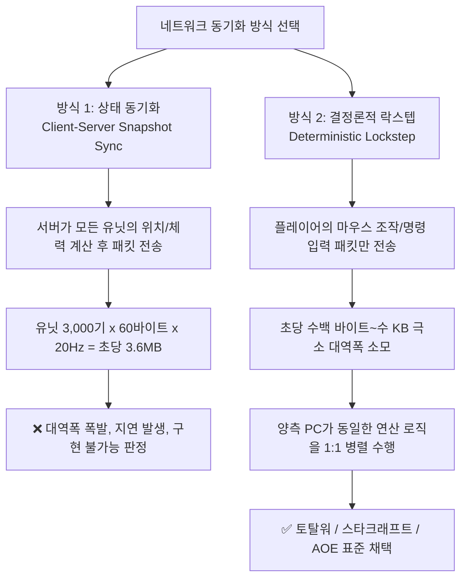
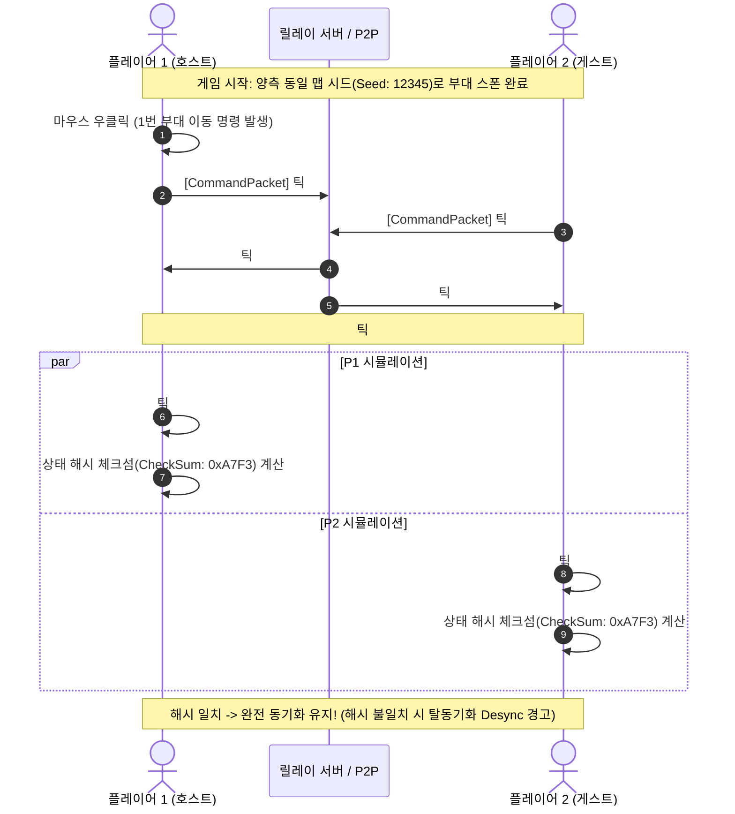
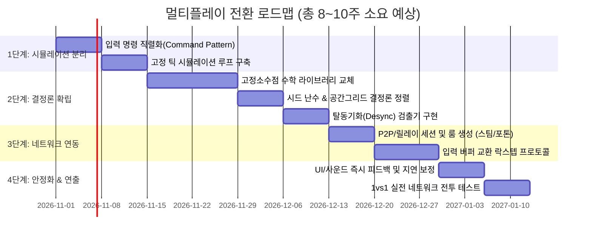

# 🌐 MiniTotalWar2D 멀티플레이 전환 기술 기획서 (Multiplayer Transition Design Document)

## 📌 문서 개요 (Executive Summary)

* **문서 목적**: 로컬 싱글플레이(Pure ECS + Job System) 기반으로 설계된 `MiniTotalWar2D`를 1vs1 대전 및 대규모 회전 멀티플레이 게임으로 전환하기 위한 기술적 타당성, 구조적 차이점, 구현 로드맵 및 리스크를 체계적으로 분석하여 개발 착수 여부를 결정하는 의사결정 가이드.
* **작성 일자**: 2026-10-15
* **대상 게임 장르**: 대규모 실시간 전술 시뮬레이션 (RTT / RTS, Total War 스타일)
* **핵심 질문**: *"지금 구조와 많은 차이가 날까? 초기 기획을 보고 할지 말지 정하고 싶다."*
* **핵심 결론 미리보기**:
  * **전체 코드 재작성(X)**: 렌더링, UI, 부대 편성, 대형 생성 알고리즘은 **80% 이상 그대로 유지**됩니다.
  * **시뮬레이션 코어 개편(O)**: 수천~수만 기의 유닛을 네트워크로 전송하려면 **'결정론적 락스텝 (Deterministic Lockstep)'** 방식이 유일한 해법이며, 이를 위해 **부동소수점 고정소수점화(Fixed-point Math)**, **시드 기반 난수**, **결정론적 틱 루프(Fixed Tick)** 구축이 필수적입니다.
  * **개발 난이도**: **상(High)**. 단, 이미 데이터 지향(ECS / Job) 구조를 갖추고 있어 기존 객체지향(OOP) 스파게티 구조의 게임들보다 락스텝 전환에 훨씬 유리한 위치에 있습니다.

---

## 🌳 1. 네트워크 동기화 방식 비교 및 선정 (Network Architecture)

대규모 유닛(수천~수만 기)이 등장하는 전투 게임에서 네트워크 아키텍처를 선택할 때 고려할 수 있는 방식은 두 가지입니다.

### 방식 1: 상태 동기화 (Client-Server Snapshot / RPC Sync)
* **방식**: 전용 서버가 모든 물리와 유닛 상태를 연산하고, 매 틱마다 유닛 위치/체력을 클라이언트들에 브로드캐스팅(전송).
* **적용 게임**: 롤(LoL), 배틀그라운드, 발로란트, 일반적인 온라인 MMORPG.
* **본 프로젝트 적합 여부**: **절대 불가능 (Unfeasible)**
  * 유닛 2,000기만 되어도 초당 수십 메가바이트의 대역폭이 소모되어 가정용 네트워크에서 핑이 수초 단위로 치솟고 패킷 유실이 발생합니다.

### 방식 2: 결정론적 락스텝 (Deterministic Lockstep) - [선택]
* **방식**: 양측 클라이언트가 동일한 초기 맵과 부대 배치(Seed)에서 출발하며, **"1번 부대 (X, Z)로 이동", "방진 전개" 같은 유저의 입력 명령(Command Input)만 서로 주고받음**.
* **적용 게임**: 토탈워(Total War) 시리즈 전편, 스타크래프트 1/2, 에이지 오브 엠파이어, 워크래프트 3.
* **대역폭**: 플레이어당 **초당 1~5 KB 미만** (극도로 경제적이며 모바일 환경에서도 원활).
* **결론**: **대규모 회전 게임인 본 프로젝트는 100% '결정론적 락스텝'으로 가야 합니다.**

---

## 🗂️ 2. 현재 구조 vs 멀티플레이(락스텝) 구조 1:1 비교표

| 비교 항목 | 현재 로컬 싱글플레이 구조 | 멀티플레이 (결정론적 락스텝) 전환 시 | 구조적 차이도 / 작업량 |
| :--- | :--- | :--- | :---: |
| **명령 입력 (Input)** | 마우스 우클릭 즉시 `Squad.MoveTo()` 로컬 실행 | 명령을 패킷으로 묶어 서버/피어로 전송 -> 합의된 틱(N+2)에 동시 실행 | **보통 (Medium)** 입력 버퍼 큐 도입 |
| **게임 루프 (Loop)** | 유니티 가변 프레임 (`Update`, `Time.deltaTime`) | 고정 시뮬레이션 틱 (`FixedTick`, 예: 20Hz/50ms 단위 강제 동기화) | **보통 (Medium)** 시뮬레이션과 렌더링 분리 |
| **수학 연산 (Math)** | 기본 `float`, `Vector3`, `Mathf.Sin/Cos` 사용 | **고정소수점(Fixed-point Math, 32비트 정수)** 또는 소프트웨어 부동소수점 | **높음 (High)** 연산자 치환 필요 |
| **난수 생성 (RNG)** | `UnityEngine.Random` 전역 상태 사용 | 시드(Seed) 기반 격리된 결정론적 난수 (`Unity.Mathematics.Random`) | **낮음 (Low)** 단순 교체 가능 |
| **시뮬레이션 엔진** | `UnitJobSimulationManager` (C# Job + Burst) | C# Job + Burst 유지 (단, 병렬 정렬 및 레이스 컨디션 제거 필요) | **보통 (Medium)** 기존 ECS 기반 덕분에 유리 |
| **지형 감지 (Terrain)** | `Terrain.activeTerrain.SampleHeight()` 직접 호출 | 사전 베이킹된 고도 그리드(Elevation Heightmap Data Array)에서 조회 | **낮음 (Low)** 오프라인 맵 베이킹 |
| **화살 투사체** | `ArrowSimulationManager` 매 프레임 로컬 물리 | 락스텝 틱 물리 계산 또는 렌더링 전용 비동기 연출 분리 | **보통 (Medium)** 시뮬레이션과 이펙트 분리 |
| **카메라 & UI** | 로컬 플레이어 시점 | 100% 로컬 클라이언트 전용 (네트워크와 무관) | **변화 없음 (None)** 그대로 사용 |
| **유닛 렌더링** | `PureECSRenderer`, GPU Instancing | 100% 로컬 클라이언트 전용 (네트워크와 무관) | **변화 없음 (None)** 그대로 사용 |

---

## 🔀 3. 락스텝 네트워크 파이프라인 (Data Flow Diagram)

---

## ⚙️ 4. 기술적 핵심 난제와 해결 전략 (Core Challenges)

### 1) 부동소수점 비결정론 (Floating-point Non-determinism & Desync)
* **문제점**:
  * 인텔(Intel) CPU와 AMD CPU, 혹은 x86과 ARM 환경에서 유니티 기본 `float` 곱셈/삼각함수를 실행하면 컴파일러 파이프라인(FMA, SIMD)에 의해 최하위 1~2비트의 미세한 오차가 발생합니다.
  * 유닛 1기의 위치가 0.0001m 틀어지면, 30초 뒤 그 유닛이 적 칼에 맞느냐 피하느냐가 갈리고, 1분 뒤에는 **한쪽 화면에서는 플레이어 1이 이기고, 다른 쪽 화면에서는 플레이어 2가 이기는 완전한 게임 붕괴(Desync)**가 발생합니다.
* **해결책**:
  * **전투 시뮬레이션 내부 연산을 100% 고정소수점(Fixed-point Math, 32비트/64비트 정수 기반)으로 통일**합니다.
  * 대표 오픈소스 라이브러리: `FixedMath.Net`, `BEPUphysics FP`, 또는 Unity DOTS용 고정소수점 패키지.
  * 렌더링(화면 출력)할 때만 고정소수점을 일반 `float`로 변환하여 부드럽게 보간(Interpolation) 표시합니다.

### 2) C# Job System 병렬 순서 결정론 (Job Determinism)
* **문제점**:
  * 현재 `UnitJobSimulationManager`는 `IJobParallelFor`를 사용하여 수천 기의 유닛을 멀티스레드로 처리합니다.
  * OS 스레드 스케줄러에 따라 1번 코어가 먼저 끝날지 2번 코어가 먼저 끝날지 매 프레임 순서가 달라지며, 네이티브 배열에 쓰는 순서가 비결정적이면 결과가 달라집니다.
* **해결책**:
  * 쓰기 작업 시 고정된 유닛 인덱스(`index`) 슬롯에만 1:1로 기록하도록 설계 (이미 현재 코드의 대다수가 슬롯 기반으로 격리되어 있어 아주 양호함).
  * 공간 분할 그리드(`SpatialHashGridSystem`)의 정렬(Sort) 시 반드시 고유 유닛 ID를 보조 정렬 키(Secondary Sort Key)로 사용하여 완전 결정론적 순서를 보장.

### 3) 입력 지연(Input Latency) 체감 완화
* **문제점**:
  * 락스텝은 상대방의 패킷을 받아야 다음 틱을 실행할 수 있으므로, 핑이 60ms라면 약 60~100ms 정도 명령 반응이 느려질 수 있습니다.
* **해결책**:
  * 토탈워, 스타크래프트와 동일하게 마우스 클릭 즉시 **선택 효과음("알겠습니다!", "전진하라!"), 대형 프리뷰 녹색 점선, UI 애니메이션을 로컬에서 0ms로 즉각 피드백**하여 체감 딜레이를 완벽히 숨깁니다.
  * 턴제 명령이 아니므로 60~100ms 지연은 대규모 전술 시뮬레이션에서 유저가 거의 인지하지 못합니다.

---

## 🛠️ 5. 멀티플레이 엔진/솔루션 선택지 비교

| 솔루션 | 장점 | 단점 | 적합도 |
| :--- | :--- | :--- | :---: |
| **1. Photon Quantum (포톤 퀀텀)** | - 상용 결정론적 락스텝/ECS 특화 엔진 - 물리, 고정소수점, 롤백, 릴레이 완벽 내장 - 토탈워/RTS/대규모 전투에 가장 최적화 | - 상용 라이선스 비용 발생 - 전용 프레임워크 문법 학습 필요 | **강력 추천 (상용)** |
| **2. 자체 커스텀 락스텝 (Steamworks P2P / LiteNetLib)** | - 비용 0원, 완전한 코드 제어권 - 현재의 Pure ECS/Job 구조를 그대로 살릴 수 있음 | - 고정소수점 변환 및 Desync 디버깅을 직접 개발해야 함 (약 3~4주 소요) | **추천 (인디/독립)** |
| **3. Unity Netcode for Entities** | - 유니티 공식 DOTS 네트워크 패키지 | - 락스텝이 아닌 클라이언트-서버 예측 방식 위주라 수천 기 동기화 시 대역폭 부담 | **비추천** |

---

## 🗺️ 6. 단계별 개발 로드맵 및 예상 일정 (Milestones)

### 단계별 세부 작업량:
1. **1단계 (입력 분리 & 틱 루프)**: 마우스 조작을 `CommandData` 구조체로 직렬화하여 큐에 넣고 실행하는 구조로 전환 (기존 코드의 `PlayerController`와 `Squad` 인터페이스 연결부 수정).
2. **2단계 (결정론 엔진 확립)**: 전투 연산의 `float`를 고정소수점으로 변경. 두 개의 프로세스를 띄워 10만 번 연산 후 체크섬 해시가 100% 일치하는지 자동 검증 테스트.
3. **3단계 (네트워크 연결)**: 1vs1 P2P(Steamworks P2P 또는 Photon Relay)로 패킷 송수신 연동.
4. **4단계 (폴리싱)**: 로비, 매칭, 승패 판정, 핑 지연 보상.

---

## ⚖️ 7. 최종 의사결정 분석표: 할 것인가 말 것인가? (Pros & Cons)

### 👍 멀티플레이 전환을 추천하는 경우 (Go)
1. **차별화된 인디 게임 경쟁력**:
   * 토탈워 스타일의 대규모 부대 지휘를 모바일이나 PC에서 1vs1로 실시간 대전할 수 있는 인디 게임은 시장에 거의 없습니다. 성공 시 엄청난 유저 흡입력을 가집니다.
2. **현재 프로젝트의 우수한 기반**:
   * 이미 **Pure ECS, Burst 컴파일러, C# Job System, 공간 분할 그리드** 등 고성능 데이터 지향 설계를 갖추고 있습니다. 객체지향 기반 일반 유니티 프로젝트에 비해 락스텝 전환 진입장벽이 절반 이하로 낮습니다.
3. **네트워크 트래픽 비용 최소화**:
   * 락스텝 방식은 서버가 게임 연산을 하지 않고 패킷 릴레이만 하므로, 고가의 게임 서버 비용 없이 초저비용(클라우드 릴레이나 P2P)으로 멀티플레이를 운영할 수 있습니다.

### 👎 싱글플레이에 집중하는 것이 유리한 경우 (No-Go)
1. **빠른 1인 개발 출시가 목표인 경우**:
   * 멀티플레이를 붙이는 순간 개발 기간이 최소 **2개월 이상 증가**합니다.
   * 특히 CPU 아키텍처별 미세한 부동소수점 오차로 인한 **Desync(탈동기화) 버그를 추적하고 잡는 과정**이 매우 까다롭고 인내심을 요구합니다.
2. **복잡한 물리 엔진(Rigidbody 래그돌)을 대거 도입하고 싶은 경우**:
   * 유니티 PhysX 물리 엔진은 비결정론적이므로 락스텝에서 쓸 수 없으며, 모든 물리/넉백을 직접 수학 코드로 계산해야 합니다 (현재 프로젝트는 이미 수학 코드로 넉백을 직접 계산하고 있으므로 이 문제는 적습니다).

---

## 🎯 에이전트의 전략적 제언 (Recommendation)

* **결론 요약**:
  * "현재 구조와 완전히 다른 새로운 게임을 만들어야 하는가?" -> **아닙니다.** (렌더링, 맵, 부대 진형 로직, UI는 그대로 유지됩니다.)
  * "하지만 아무것도 안 고치고 네트워크 플러그인만 끼우면 되는가?" -> **그것도 아닙니다.** (수학 연산의 '결정론' 확보를 위한 코어 엔진 수정이 필수적입니다.)
* **추천 로드맵 (단계적 접근법)**:
  1. 지금 당장 멀티플레이로 전부 뜯어고치기보다는, 먼저 **"입력 명령 패턴 (Command Pattern)"**을 도입하여 마우스 클릭과 부대 실행 로직을 깔끔하게 분리해 두는 것을 권장합니다.
  2. 이렇게 입력 레이어만 분리해 두면, 싱글플레이 개발을 계속 진행하면서도 나중에 언제든지 멀티플레이 모듈(락스텝 큐)을 손쉽게 플러그인 형태로 연결할 수 있습니다.
