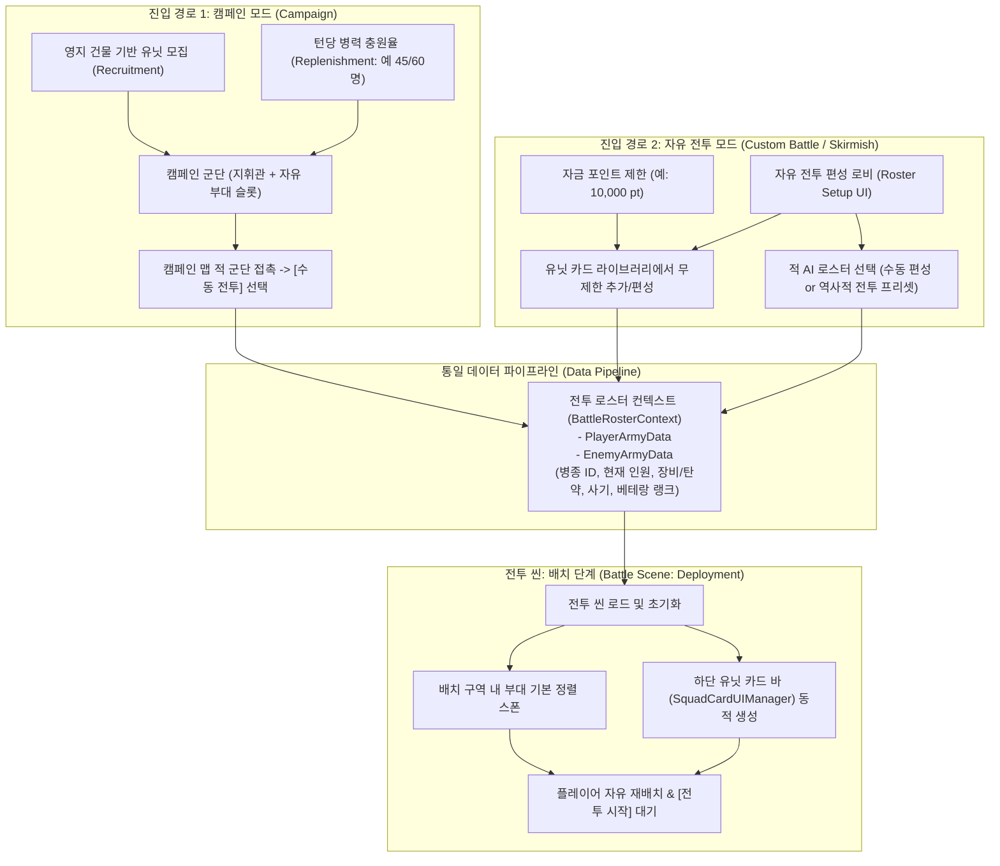
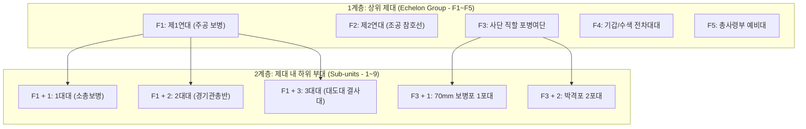

# 🏛️ 토탈워 코어 아키텍처 역공학 및 미구현 시스템 이식(Porting) 기술 기획서

본 문서는 **토탈워(Total War) 시리즈의 전투 엔진 아키텍처**를 역공학(Reverse-Engineering) 관점에서 해체하고, 현재 **MiniTotalWar2D** 프로젝트(C# / Pure ECS 듀얼 엔진)에 즉시 이식(Porting) 가능한 **데이터 구조체, 상태 머신, 수학 알고리즘, 파이프라인 명세**를 정의합니다.

---

## 💡 1. 핵심 요약 & 아키텍처 이식 목표 (Summary & Objective)

토탈워의 전투 시스템은 단순한 액션 전투가 아니라 **엄격한 기하학(Geometry), 사기 심리학(Morale Psychology), 군대 수명주기(Battle Lifecycle State Machine)**의 유기적 결합체입니다.

MiniTotalWar2D는 현재 조작감, 3D 탄도학, 물리 넉백, 지형 사선 차폐(LoS), ECS 군집 시뮬레이션 등의 **"단위 전투 물리(Local Combat Mechanics)"**는 이미 완성되어 있습니다.

본 기획서의 목표는 토탈워의 실제 엔진 뼈대에서 다음 **7대 핵심 아키텍처를 떼어와 C# 코드로 바로 구현할 수 있는 형태로 규격화**하는 것입니다:
1. **전투 수명주기 상태 머신 (Battle Phase State Machine)**: 배치 -> 전투 -> 군대 손실 -> 승패 결과
2. **배치 구역 지오메트리 (Deployment Zone Geometry)**: 다각형 경계 검사 및 부대 앵커링
3. **전황 게이지 & 군대 손실 도미노 알고리즘 (Balance of Power & Army Losses)**
4. **피습 방향 기하학 및 사기 충격 파이프라인 (Facing Geometry & Morale Shock)**
5. **버티기(Bracing) 및 대형/자세 상성 시스템 (Formations & Bracing Pipeline)**
6. **군단 로스터 편성 & 유닛 카드 파이프라인 (Roster DTO & Unlimited Cards)**: 캠페인 및 자유 전투 2대 진입 경로와 무제한 카드 슬롯
7. **2단계 계층형 제대 지휘 통제 체계 (Hierarchical Echelon C2)**: F1~F5 상위 제대 및 Shift+1~9 하위 부대 지휘망

---

## 🌳 2. 토탈워 전투 엔진 모듈 분해 트리 (Warscape Engine Architecture)

```mermaid
flowchart TD
    Engine["토탈워 전투 코어 엔진 (Battle Core)"]

    subgraph "Phase 1: 전투 수명주기 (Battle Lifecycle)"
        SM["전투 상태 머신 (BattlePhaseStateMachine)"]
        Deploy["배치 구역 지오메트리 (DeploymentZoneManager)"]
        Timer["전투 타이머 & 배속 제어 (TimeController)"]
        EndJudge["승패 및 군대 손실 판정 (ArmyLossCalculator)"]
    end

    subgraph "Phase 2: 전술 기하학 & 사기 (Tactical Geometry & Morale)"
        Facing["피습 방향 기하학 (Facing & Angle Calculator)"]
        Shock["돌격 사기 충격 파이프라인 (MoraleShockSystem)"]
        Brace["버티기 자세 엔진 (BracingSystem - Mass Multiplier)"]
        FormStance["대형/자세 상태기 (FormationStanceController)"]
    end

    subgraph "Phase 3: 지휘 통제 & 화력 (Command & Firepower)"
        CommandAura["지휘관 사기 오라 (CommanderAuraSystem)"]
        RallySkill["전술 액티브 스킬 (Rally / Call Fire Support)"]
        VolleyFire["교대 일제사격 루프 (RankFireController)"]
        Suppression["기관총 제압/포복 시스템 (SuppressionSystem)"]
    end

    Engine --> SM
    Engine --> Deploy
    Engine --> Timer
    Engine --> EndJudge
    Engine --> Facing
    Engine --> Shock
    Engine --> Brace
    Engine --> FormStance
    Engine --> CommandAura
    Engine --> RallySkill
    Engine --> VolleyFire
    Engine --> Suppression
```



---

## 🗂️ 3. 토탈워 핵심 데이터 모델 & 열거형 규격 (Data Models & Enums)

AI 에이전트와 개발자가 C# 스크립트로 즉시 작성할 수 있는 핵심 데이터 구조입니다.

```csharp
// 1. 전투 전체 수명주기 상태
public enum BattlePhase
{
    NotStarted = 0,     // 씬 초기화 중
    Deployment = 1,     // 부대 배치 단계 (시뮬레이션 동결, 구역 내 자유 이동/회전)
    BattleStarting = 2, // 전투 개시 카운트다운 및 나팔/팡파레 연출 (1~2초)
    CombatRunning = 3,  // 정규 실시간 교전 진행 중
    ArmyRouting = 4,    // 한쪽 군대가 완전히 붕괴되어 승패가 확정된 상태
    PostBattle = 5      // 결과 화면 (사살수/손실수 통계 표시, 재시작/메뉴 버튼)
}

// 2. 부대 전술 자세 (Stance)
public enum UnitTacticalStance
{
    Standard = 0,       // 일반 자유 교전 상태
    Bracing = 1,        // 버티기 상태 (정면 대기 3초 이상, 질량 x3, 돌격 피해 반사)
    RankFire = 2,       // 화승총 3단 교대 사격 상태 (1열 쏴 -> 2열 쏴 -> 장전)
    Loose = 3,          // 산개 대형 (포탄/화살/기관총 면적 피해 60% 경감)
    ShieldWall = 4,     // 방패벽/귀갑진 (화살 방호 85%, 이동속도 50% 감소)
    Suppressed = 5      // 제압/포복 상태 (기관총 화망에 엎드림, 이동 70% 감소, 공격 불가)
}

// 3. 피습 방향 판정 결과
public enum AttackFacing
{
    Front = 0,          // 전방 60도 (정상 방어)
    Flank = 1,          // 측면 (사기 -12)
    Rear = 2            // 후방 (사기 -25, 기병 돌격 시 -45 즉각 충격)
}

// 4. 전황 및 승패 평가 데이터 구조체
public struct ArmyBattleStatus
{
    public float TotalInitialPower;   // 전투 시작 시 초기 총 전력
    public float CurrentPower;          // 현재 생존 부대 전력 합산
    public int AliveUnitsCount;         // 생존 병사 수
    public int RoutingSquadsCount;      // 패주 중인 부대 수
    public int TotalSquadsCount;        // 전체 부대 수
    public bool IsArmyLossTriggered;    // 집단 군대 손실(총퇴각) 발동 여부
}
```

---

## ⚙️ 4. 토탈워 핵심 엔진 알고리즘 상세 명세 (Algorithms & Math)

### 4.1 전투 수명주기 상태 머신 (Battle Phase State Machine)

토탈워의 전투 흐름은 아래 6개 상태 전이 파이프라인을 엄격하게 준수합니다:

```
[ Deployment (배치) ] 
       │ 
       ▼ (플레이어가 [전투 시작] 버튼 클릭)
[ BattleStarting (개시 연출) ] 
       │ (1.5초 팡파레 후 자동 전이)
       ▼ 
[ CombatRunning (정규 전투) ] ◄───► 실시간 전황 게이지 (Balance of Power)
       │ 
       ▼ (한쪽 전력 15% 이하 & 대다수 부대 패주 -> Army Losses 발동)
[ ArmyRouting (군대 붕괴) ] 
       │ (플레이어가 '전투 종료' 클릭 또는 잔당 소탕)
       ▼ 
[ PostBattle (결과 화면) ] ───► 부대별 킬수/손실수 통계 및 메뉴 복귀
```

1. **`Deployment` (배치 단계) 제어 규칙**:
   - `Time.timeScale`은 유지되거나 일시 정지되지만, **`Squad.cs` 및 `UnitJobSimulationManager`의 AI 공격/이동 로직은 비활성화**됩니다.
   - 플레이어는 우클릭 드래그로 아군 부대를 **아군 배치 구역(`DeploymentBounds`)** 내에서 자유롭게 이동 및 방향 회전시킵니다.
   - 적 부대는 자신의 배치 구역에 대형을 갖춘 채 대기하며, 전장의 안개로 인해 플레이어에게 보이지 않습니다.
2. **`BattleStarting` -> `CombatRunning` 전이**:
   - 화면 상단 [전투 시작 (Start Battle)] 버튼 클릭 시:
     - 배치 구역 테두리 메쉬가 서서히 페이드아웃.
     - 전투 나팔 사운드 1회 재생.
     - `CombatRunning`으로 상태 전환되며, 모든 부대의 자율 AI 및 물리 엔진이 전면 가동.
     - 상단 버튼이 **일시정지(`[P]`) / 배속 조절(`1x`, `2x`, `3x`) UI**로 동적 교체.

---

### 4.2 배치 구역(Deployment Zone) 지오메트리 & 경계 검사

부대가 지정된 사각형(또는 다각형) 구역 밖으로 나가지 못하도록 실시간으로 클램핑합니다:

```csharp
// 아군 배치 구역 경계 (월드 좌표 X, Z 기준)
public struct DeploymentZone
{
    public float minX;
    public float maxX;
    public float minZ;
    public float maxZ;

    // 점(부대 중심)이 구역 내부에 있는지 검사
    public bool Contains(Vector3 position)
    {
        return position.x >= minX && position.x <= maxX &&
               position.z >= minZ && position.z <= maxZ;
    }

    // 부대 중심이 경계 밖으로 벗어났을 때 안전하게 경계 내부로 클램핑
    public Vector3 ClampPosition(Vector3 position, float margin = 5f)
    {
        float clampedX = Mathf.Clamp(position.x, minX + margin, maxX - margin);
        float clampedZ = Mathf.Clamp(position.z, minZ + margin, maxZ - margin);
        return new Vector3(clampedX, position.y, clampedZ);
    }
}
```

* **지면 시각화**:
  - 배치 단계 중 지면 위에 반투명 초록색(아군) / 붉은색(적군) 라인 렌더러 또는 셰이더 프로젝터를 투영하여 플레이어가 배치 가능 범위를 한눈에 인지할 수 있도록 렌더링.

---

### 4.3 전황 게이지 (Balance of Power) 및 군대 손실 (Army Losses)

토탈워에서 "전세를 뒤집거나 항복시키는" 핵심 수학 공식입니다:

#### 1) 개별 부대 전력 평가 (Unit Combat Power)
부대 i의 전력 P_i는 단순 병력 수뿐만 아니라 사기와 잔여 탄약의 가중치를 곱하여 산출합니다:
- **전력 계산식**:
  P_i = (CurrentHP_i / MaxHP_i) * (0.5 + 0.5 * (Morale_i / MaxMorale_i)) * TierWeight_i * AmmoFactor_i

- 패주 중인 부대(`isRouting == true`): P_i = 0 (전력 산정에서 즉시 제외)
- 탄약 가중치(`AmmoFactor`): 탄약이 0인 원거리 부대는 근접 공격력 기준으로 전력 40% 감쇄(0.6 곱연산).

#### 2) 상단 전황비 (Power Ratio)
- **플레이어 전력 비율 공식**:
  Ratio_Player = TotalPlayerPower / (TotalPlayerPower + TotalEnemyPower)
- 이 비율(0.0 ~ 1.0)에 따라 화면 최상단 듀얼 게이지 바의 너비를 실시간 갱신합니다.

#### 3) 군대 손실 (Army Losses) 도미노 판정:
다음 두 조건이 동시에 충족되면, 해당 군대에 **즉각적인 사기 -100(영구 붕괴)** 페널티가 주어지며 모든 부대가 동시에 패주합니다:
1. `CurrentPower <= TotalInitialPower * 0.15f` (초기 총전력의 15% 이하로 파탄)
2. `CurrentPower <= EnemyCurrentPower * 0.20f` (적 전력 대비 1:5 이하로 압도당함)

---

### 4.4 피습 방향 기하학 (Facing Geometry) & 망치와 모루 사기 충격

토탈워의 전투 꽃인 '측후방 기습' 판정 공식입니다:

```
                  [ 적 부대 정면 Heading Vector (H) ]
                                 ▲
                                 │
                   ( -60° )      │      ( +60° )
                       \         │         /
                        \  [ Front ]      /
                         \               /
                          \             /
               [ Flank ]   \           /   [ Flank ]
             ( -120° ) ─────● 부대 중심 ───── ( +120° )
                           /           \
                          /   [ Rear ]  \
                         /  (후방 기습)   \
                        /                 \
```

#### 기하 판정 알고리즘 (Signed Angle):
피격 부대의 정면 시선 벡터 `H`와 공격해오는 유닛의 이동/돌격 벡터 `A`의 수평 각도 계산:
```csharp
Vector3 toAttacker = (attackerPos - victimPos).normalized;
toAttacker.y = 0;
Vector3 victimHeading = victimTransform.forward;
victimHeading.y = 0;

float angle = Vector3.Angle(victimHeading, toAttacker); // 0 ~ 180도

AttackFacing facing;
if (angle <= 60f) 
    facing = AttackFacing.Front;
else if (angle <= 120f) 
    facing = AttackFacing.Flank;
else 
    facing = AttackFacing.Rear;
```

#### 사기 충격 (Morale Shock Pipeline):
- **정면 교전 중 후방 피습 (`facing == AttackFacing.Rear`)**:
  - 기본 후방 피습 사기 감소: **-25**
  - 만약 공격 부대가 **기병 돌격 보너스 활성 상태(`isCharging == true`)**라면: **추가 -20 (총 -45 충격)**
  - 이 충격은 10초간 지속되며, 사기가 0 미만으로 떨어진 부대는 `Wavering`을 건너뛰고 즉각 **`Routing(패주)`**으로 돌입.

---

### 4.5 버티기(Bracing) 및 방진/자세 상성 시스템

기병의 정면 돌격을 무력화시키는 토탈워의 핵심 방어 메커니즘입니다:

1. **버티기 (Bracing State) 트리거 조건**:
   - 부대가 이동 명령 없이 **제자리에 정지한 지 3.0초 이상 경과**.
   - 부대원이 앞열을 바라보고 촘촘한 대형 유지.
2. **버티기 효과**:
   - **유닛 질량 300% 증가 (`Mass = BaseMass * 3.0f`)**: 기병이 들이받아도 튕겨나가지 않고 제자리를 지킴.
   - **적 돌격 보너스 반사 (Reflect Charge Bonus)**:
     - 창병/극병이 버티기 상태에서 정면으로 돌격을 맞으면, 적 기병이 가져온 돌격 보너스 데미지를 **돌격해온 기병 본인에게 역으로 100% 반사**.
     - 정면으로 들이받은 기병 1열이 그 자리에서 즉사하거나 낙마하는 연출 발생.

---

### 4.6 전장 지휘관(Commander & Hero) 통제 시스템 (1:1 일기토 배제)

판타지식 결투를 배제하고, 실제 전쟁사 기반의 지휘 통제(C2, Command & Control) 시스템을 구축합니다:

1. **지휘관 오라 파이프라인 (Command Aura)**:
   - 지휘관 위치 P_cmd로부터 반경 R = 40m 내에 위치한 모든 아군 부대에게 거리 반비례 실시간 사기 버프 부여:
     - MoraleBonus = 15 * (1 - Distance / R)
   - 지휘관 주변에 있는 부대는 사기가 잘 꺾이지 않고 끈질기게 버팀.
2. **사기 재집결 (Rally Ability)**:
   - 쿨다운: 60초.
   - 발동 시 반경 50m 내에 사기가 꺾여 패주 중인(`Routing`) 아군 부대의 사기를 즉시 +30 회복시켜 전선으로 복귀시킴.
3. **지휘관 사망 충격 (General Casualty Shock)**:
   - 지휘관 사망 시:
     - 반경 50m 내 부대: 즉시 **사기 -25** (국소 패닉)
     - 전장 전체 모든 아군 부대: **사기 -15** 영구 감소.

---

### 4.7 19~20세기 무기 진화(화승총, 볼트액션, 기관총, 전차) 인터페이스

향후 확장될 근현대 무기 체계를 위한 공통 인터페이스 명세입니다:

```csharp
public interface IRangedWeaponFireController
{
    // 1. 화승총: 3단 교대 일제사격 (Rank Fire)
    void ExecuteRankFire(Squad squad, int firingRankIndex);

    // 2. 기관총: 십자화망 제압 (Suppressive Fire)
    void ApplySuppression(Squad targetSquad, float suppressionValue);

    // 3. 전차 주포: 장갑 관통 및 도탄 판정 (Armor Penetration & Ricochet)
    bool EvaluateArmorPenetration(float armorThickness, float impactAngle, float shellPenetration);
}
```

* **기관총 제압(Suppression) 메커니즘**:
  - 총알이 머리 위를 스쳐 지나갈 때마다 부대의 `SuppressionGauge`가 누적.
  - 임계치(100) 도달 시 `UnitTacticalStance = Suppressed(포복)`:
    - 병사들이 땅바닥에 엎드려 이동 속도 70% 감소, 공격 불가, 하지만 화간/포탄 피격 면적 50% 감소.
    - 지휘관의 `Rally(재집결)` 스킬로만 즉시 해제 가능.

---

---

## 🇨🇳 6. 중일전쟁(1937~1945) 배경 확장 및 근현대 무기 체계 명세 (Sino-Japanese War Expansion)

본 섹션은 삼국지 토탈워의 실제 중국 대륙 지형(화북, 산시, 강남 등)을 활용하여, **냉병기 대도(Big Sword) 백병전부터 볼트액션 소총, 기관총 십자화망, 참호전, 초기 경전차까지 공존했던 중일전쟁(1937~1945)**을 구현하기 위한 세부 기술 및 게임 디자인 명세입니다.

### 6.1 중국 대륙 3대 대표 전장(Battlefield) 지형 규격
우리 엔진의 `TerrainHeightManager`(고저차 및 능선 사선 차폐)와 1:1로 결합되는 3대 전장 프리셋입니다:

1. **태행산맥 / 산시성 협곡 전장 (평형관 전투 & 게릴라 매복)**:
   - **지형 형태**: 양옆이 깎아지른 절벽 산맥이고 중앙에 좁은 비포장 도로가 관통하는 협곡 지형.
   - **실제 삼탈워 매핑 데이터**: `terrain.pack` 내 `gate_battles_a_v2_both_deployments`(관문/협곡) 또는 `test_zhangjiajie`(장가계 절벽 지형).
   - **전술 메커니즘**: 높은 능선 위에 아군 보병/기관총을 배치하여 사각 없는 하향 화망(Plunging Volley)을 투사하고, 도로를 따라 행군하는 적의 선두와 후미를 차단하여 포위 섬멸.
2. **타이얼좡 / 화북 평원 참호 전장 (1938)**:
   - **지형 형태**: 완만한 구릉과 흙벽 참호선, 얕은 언덕 능선.
   - **실제 삼탈워 매핑 데이터**: `terrain.pack` 내 `historical_battle_changban`(장판파 평원 구릉) 또는 `flat`/`encampment_01`.
   - **전술 메커니즘**: 전방 흙더미/참호에 거치식 중기관총 진지를 구축하고 정면으로 돌격해오는 적 보병을 십자화망(Crossfire)으로 저지.
3. **상하이 / 강남 수로 지형 (1937 송호회전 & 사행창고)**:
   - **지형 형태**: 얕은 하천, 논밭(진흙탕으로 유닛 이동 속도 40% 감쇄), 좁은 제방 도로와 도심 건물 밀집.
   - **실제 삼탈워 매핑 데이터**: `terrain.pack` 내 `resource_han_farm_rice_a_large`(강남 대형 벼농장 수로) 또는 `naval_river_a`.
   - **전술 메커니즘**: 기갑/차량 기동이 봉쇄된 좁은 수로와 제방길을 둘러싼 보병 간의 치열한 엄폐 및 시가 방어전.

#### 💡 실측 분석 검증 완료: 삼탈워 지형 100% 유니티 직결 파이프라인
사용자 PC에 설치된 삼국지 토탈워(`Total War THREE KINGDOMS/data/terrain.pack`)를 직접 역공학 파싱하여 실측 검증을 완료했습니다:
- **확인된 전투 맵 수량**: `terrain.pack` 내 **총 143개의 실제 전장 디렉터리** 존재 (역사적 전장, 관문, 농장, 광산, 도시 등 전수 확인).
- **지형 높이맵 파일 규격**: `lf_height_map.dds`
  - 해상도: **512 x 512** (픽셀)
  - 채널/비트수: **16-bit 단일 채널 그레이스케일 (픽셀당 2바이트 = 총 524,288바이트 순수 고도 데이터)**
  - 유니티 호환성: **유니티 표준 `TerrainData.SetHeights` 및 `Import Raw (512x512, 16-bit Little-Endian)` 규격과 100% 동일!**
- **결론**: 삼탈워의 143개 실제 전장 높이맵을 1초 만에 유니티 지형으로 그대로 변환하여 중일전쟁 전장으로 즉시 활용 가능함이 기술적으로 완벽히 입증됨.

---

### 6.2 양대 진영 및 비대칭 무기 체계 (Asymmetric Armies & Weapons)

중일전쟁의 핵심 재미는 **"화력과 기갑의 우세 vs 결사의 지형 엄폐 및 백병전"**이라는 비대칭 상성입니다:

#### 1) 중국 국민혁명군 (수비 / 매복 / 백병전 특화)
- **중앙군 정예 보병대 (German-trained Infantry)**:
  - 무장: 한양 88식 / 중정식 볼트액션 소총, M35 철모.
  - 특성: 높은 명중률과 원거리 정밀 사격, 참호 방어 시 사기 유지력 우수.
- **체코제 ZB-26 경기관총 분대**:
  - 무장: 20발 상부 탄창식 경기관총.
  - 특성: 빠른 점사(Burst Fire) 및 거치 사격, 기동 사격 가능.
- **결사 대도대 (Big Sword Corps / 29군 대도대)**:
  - 무장: 대도(냉병기 칼) + 모젤 C96 권총 + 수류탄 다발.
  - 특성: 사격 화력은 낮으나, 5m 이내 근접 돌격 시 적의 총검을 쳐내며 맹렬한 넉백과 난전 공격력을 발휘하는 백병전 결사대.
- **맥심 수랭식 중기관총 진지 (Type 24 HMG)**:
  - 무장: 수랭식 중기관총 고정 거치.
  - 특성: 분당 수백 발의 지속 탄막 투사, 적 부대를 그 자리에 못 박는 제압(Suppression) 모루 역할.

#### 2) 일본 제국 육군 (화력 / 돌파 / 기갑 특화)
- **아리사카 38식 보병대**:
  - 무장: 38식 보병총 + 30년식 총검.
  - 특성: 높은 단발 데미지, 돌격 시 총검 돌격 보너스(+30% 충격력) 보유.
- **92식 중기관총반 (딱따구리)**:
  - 무장: 공랭식 92식 중기관총.
  - 특성: 중거리에서 지속적인 십자화망을 구성하여 아군 돌격을 차단.
- **92식 보병포 / 박격포반**:
  - 무장: 70mm 곡사 경포.
  - 특성: 3D 곡사 포격으로 아군 참호와 언덕 뒤의 엄폐된 병력을 직접 타격.
- **95식 하고 / 89식 중전차 (Light / Medium Tank)**:
  - 무장: 37mm/57mm 주포 + 차체 기관총, 장갑 두께 12mm.
  - 특성: 일반 소총탄(한양/아리사카)에 **100% 면역(도탄)**, 보병 참호선을 짓밟으며 돌파, 오직 대전차 수류탄 다발이나 근접 백병전 포위로만 파괴 가능.

---

### 6.3 근현대 전투 엔진 파이프라인 (Modern Warfare Engine Pipeline)

우리가 구축한 Unity DOTS / Pure ECS 엔진에 얹히는 5대 근현대 물리 메커니즘입니다:

#### 1) 볼트액션 소총 사격 루프
- **격발 파이프라인**:
  - 목표 조준(Aim) 0.5초 -> 발사(Fire: 고속 3D 탄환 ECS 생성) -> 노리쇠 후퇴 및 탄피 배출(Bolt-Action Cycle: 1.2초) -> 재조준.
- 소총 탄환은 ECS 시스템에서 초속 750m/s로 지형과 유닛 콜라이더를 향해 직선 비행.

#### 2) 기관총 십자화망 및 제압/포복 시스템 (Suppression & Pinned Down)
- 부대 머리 위 1.5m 이내로 기관총 탄환이 스쳐 지나갈 때마다 `SuppressionGauge += 2.5f` 누적.
- 누적치 100 도달 시 해당 부대는 즉시 **포복 상태(`UnitTacticalStance.Suppressed`)**로 강제 전환:
  - 병사들이 지면에 엎드려 이동 속도 70% 감소, 공격 불가.
  - 대신 전면 투영 면적이 50% 줄어들어 총탄 피격 확률 급감.
  - 소대장/지휘관의 **'재집결(Rally)' 호각 스킬**로만 즉시 해제 가능.

#### 3) 참호 및 흙더미 지형 엄폐 (Cover System)
- `TerrainHeightManager`의 높낮이와 능선 차폐를 활용:
  - 흙더미 뒤나 참호 안에서 사격하는 유닛은 전면 총탄에 대해 **70%의 엄폐 방호율(Cover Armor)** 적용.
  - 직사 화기는 지형에 막히고, 오직 곡사 박격포나 우회 기동(Flanking)으로만 제압 가능.

#### 4) 총검술 및 대도대 백병전 (Brawl Flow)
- 적 부대와 5m 이내로 거리가 좁혀지면 사격을 즉시 중단하고 **냉병기 백병전 모드**로 자동 전환:
  - 우리가 이미 완성한 **'0.7m 척력 난전(Brawl Flow)'**과 **'U자형 포위망'**이 가동되어 진흙탕 속의 혈투 연출.
  - 대도대는 일반 보병의 총검 공격을 쳐내며 추가 넉백과 높은 데미지 부여.

#### 5) 초기 경전차(Tank) 물리 및 도탄 (Armor & Ricochet)
- 유닛 태그에 `ArmorType = LightVehicle` 부여:
  - 일반 보병 소총탄 피격 시: `Damage = 0`, 튕겨나가는 금속 스파크 파티클 렌더링.
  - 보병 수류탄 다발 및 대전차포 피격 시에만 관통 데미지 적용.
  - 전차가 보병 대형을 들이받으면 대형 붕괴 및 질량 비례 넉백.

#### 6) 하천/수면(River & Water) 및 도하 전술 시스템 (Water Crossing & Bridge Battles)
- **수면 고도 판정 (Water Level Check)**:
  - 삼탈워의 `lf_sea_height_map.dds` 구조처럼, 특정 수면 고도(예: Y <= WaterLevel) 또는 워터 콜라이더 구역을 '하천/습지'로 인식.
- **보병 도하 패널티 (Water Drag)**:
  - 물에 발이 닿으면 보병 부대 이동 속도 **40~50% 감쇄** 및 돌격(Charge) 가속 불가.
  - 강남 논밭/진흙탕에서도 유사한 기동 저하 적용.
- **기갑 전차 도하 불가 (Tank Water Obstacle)**:
  - 전차 및 중화기(보병포)는 깊은 강을 건널 수 없음 -> 오직 **다리(Bridge)**나 **얕은 여울목(Ford)**으로만 기동 가능.
- **다리 사수 병목 전투 (Chokepoint Battle)**:
  - 강 건너 좁은 다리목에 기관총 진지와 참호를 구축하고, 다리를 건너오려는 적 종대를 십자화망으로 막아내는 토탈워식 다리 결전 유도.

---

## 🚀 7. 1단계 즉시 구현 대상 C# 컴포넌트 설계 명세 (Implementation Blueprint)

게임 루프를 당장 완성하기 위해 이번 1단계에서 생성/연동할 핵심 C# 파일 3개입니다:

### 1) `BattlePhaseManager.cs` (전투 수명주기 관리자)
- **역할**: `BattlePhase` 상태 머신 관리, [전투 시작] 버튼 이벤트, 타이머, 승패 판정 트리거.
- **연동**: `BattleManager.cs`, `CommandUIManager.cs`.

### 2) `DeploymentZoneManager.cs` (배치 구역 시각화 및 제어)
- **역할**: 아군/적군 배치 사각 구역 정의, 배치 단계 중 지면 테두리 렌더링, 부대 드래그 시 구역 밖 이탈 클램핑.
- **연동**: `PlayerController.cs`, `Squad.cs`.

### 3) `BalanceOfPowerUI.cs` (상단 전황 바 & 결과 화면)
- **역할**: 실시간 양군 전력비 슬라이더 바 갱신, 전투 승리/패배 시 킬수/손실수 통계 팝업 UI 표출.
- **연동**: `Squad.cs`, `BattlePhaseManager.cs`.

### 4) `BattleRosterContext.cs` (군단 로스터 데이터 전송 객체 DTO)
- **역할**: 캠페인 및 자유 전투에서 전투 씬으로 전달되는 `UnitCardData`, `ArmyRosterData` 보관 및 전달.
- **연동**: `BattleManager.cs`, `SquadCardUIManager.cs`.

### 5) `PlayerController.cs` (계층형 제대 지휘 통제 확장)
- **역할**: `F1~F5` 상위 제대 묶기/일괄 선택, 제대 선택 상태에서 `Shift+1~9` 및 `1~9` 부대지정 및 단독 선택 지원.
- **연동**: `SquadCardUIManager.cs`, `SquadIconUI.cs`.

---

## 🎴 8. 군단 로스터 편성 및 유닛 카드 파이프라인 (Army Roster & Unit Card Pipeline)

### 8.1 삼국지 토탈워 유닛 카드 제한(21장) 역공학 및 한계 극복
삼국지 토탈워(및 역대 토탈워 시리즈)가 군단당 유닛 카드를 **최대 21장(장수 3명 + 각 장수당 수행원 6부대 = 총 21카드)**으로 엄격히 제한한 배경은 다음과 같습니다:
1. **인지 부하(Cognitive Load) 한계**: 인간이 실시간 마이크로 컨트롤로 관리 가능한 부대 수는 밀러의 법칙(7+-2)에 따라 20개 내외가 현실적 한계였습니다.
2. **1080p 화면 UI 면적의 물리적 한계**: 1920x1080 화면에서 카드 1장당 최소 70~80px 폭을 차지하므로 하단 1열에 들어갈 수 있는 물리적 카드 한계가 약 20장이었습니다.
3. **Warscape 3D 렌더링 병목**: 풀 3D 모델과 모션 캡처 관절 애니메이션으로 인해 유닛 1만 기 초과 시 극심한 프레임 드랍이 발생하여 인원수를 제한했습니다.
4. **오행(五行) 3장수 체제**: 3명의 장수가 각각 6개 부대를 거느리는 기획적 규칙에 종속되어 있었습니다.

**💡 MiniTotalWar2D의 차별점**:
- 우리는 이미 **초고성능 Pure ECS & GPU 인스턴싱으로 5만 기 시뮬레이션**을 거뜬히 구동하므로, 하드웨어 성능상의 카드 수량 제한이 불필요합니다.
- 중일전쟁의 **연대/사단급 대규모 전선과 참호선**을 다루기 위해 **유닛 카드의 최대 수량 제한을 원천 해제(무제한 슬롯 지원)**합니다.

---

### 8.2 두 가지 진입 경로 (Entry Point)와 데이터 흐름



---

### 8.3 공통 데이터 전송 모델 명세 (Data Transfer Object)

캠페인과 자유 전투가 전투 씬으로 넘겨주는 공통 직렬화 규격입니다:

```csharp
namespace MiniTotalWar.Roster
{
    // 1. 개별 부대 카드 데이터 DTO
    [System.Serializable]
    public class UnitCardData
    {
        public string unitTypeId;         // 병종 고유 ID (예: "CHN_Infantry_Hanyang", "JPN_Tank_HaGo")
        public string customSquadName;    // 부대 명칭 (예: "제1연대 1대대")
        public int currentUnitCount;      // 현재 생존 병력 수 (완편: 60명, 손실 상태: 38명)
        public int maxUnitCount;          // 완편 기준 최대 병력 수 (60명)
        public float startingAmmoRatio;   // 시작 탄약 잔량 비율 (0.0 ~ 1.0, 기본 1.0)
        public int veteranRank;           // 숙련도 랭크 (0~9단계)
        public bool isCommander;          // 지휘관 여부 (사기 오라 35m 보유)
        public int assignedEchelon;       // 소속 상위 제대 번호 (1: F1, 2: F2, ..., 기본 0: 미지정)
    }

    // 2. 군단 전체 로스터 데이터 DTO
    [System.Serializable]
    public class ArmyRosterData
    {
        public string factionId;          // 진영 식별자 ("Republic_Of_China", "Empire_Of_Japan")
        public string commanderName;      // 군단장 명칭
        public List<UnitCardData> cards = new List<UnitCardData>(); // 부대 카드 목록 (개수 무제한)
    }

    // 3. 씬 전환 간 데이터를 유지하는 전역 컨텍스트
    public static class BattleRosterContext
    {
        public static ArmyRosterData PlayerArmy;
        public static ArmyRosterData EnemyArmy;
        public static string SelectedMapId = "Hulao_Pass"; // 전장 맵 식별자
        public static bool IsCustomBattle = true;          // 진입 경로 플래그

        // 디버그 또는 기본값 초기화
        public static void EnsureDefaultFallback()
        {
            if (PlayerArmy == null || PlayerArmy.cards.Count == 0)
            {
                PlayerArmy = new ArmyRosterData { factionId = "Republic_Of_China", commanderName = "디버그 사령관" };
                PlayerArmy.cards.Add(new UnitCardData { unitTypeId = "CHN_Infantry", customSquadName = "제1 보병대", currentUnitCount = 60, maxUnitCount = 60 });
                PlayerArmy.cards.Add(new UnitCardData { unitTypeId = "CHN_Gunner", customSquadName = "제2 총병대", currentUnitCount = 40, maxUnitCount = 40 });
                PlayerArmy.cards.Add(new UnitCardData { unitTypeId = "CHN_Archer", customSquadName = "제3 궁병대", currentUnitCount = 40, maxUnitCount = 40 });
            }
        }
    }
}
```

---

### 8.4 무제한 유닛 카드를 위한 스마트 트레이 UI/UX
- **가변 축소 & 스크롤 트레이 (Responsive Scroll Tray)**:
  - 카드가 20개 이하일 때는 표준 크기로 표시.
  - 카드가 20개를 초과하면 가로 폭이 점진적으로 콤팩트하게 압축되며, 마우스 휠 또는 좌우 패닝으로 부드럽게 스크롤.
- **병과/제대 필터 탭**:
  - 카드 바 상단에 `[전체]`, `[F1: 1연대]`, `[F2: 2연대]`, `[보병]`, `[기관총]`, `[기갑/포병]` 필터 탭 제공.

---

## 🎖️ 9. 계층형 제대 지휘 통제 체계 (Hierarchical Echelon C2 System)

### 9.1 개요 & 군사 교리 기반 2단계 지휘망
기존 RTS의 단일 10개 번호키(`0~9`) 한계를 극복하고 수십~수백 개 부대를 통제하기 위해, 실제 군사 편제(사단/연대 -> 대대/중대)를 1:1로 반영한 **2단계 계층형 제대 지휘 체계**를 도입합니다.



---

### 9.2 단축키 조작 명세 (Keybindings & C2 Pipeline)

| 단축키 입력 | 동작 명칭 | 상세 조작 메커니즘 |
| :--- | :--- | :--- |
| `Ctrl + F1 ~ F5` | 상위 제대 편성 | 현재 마우스로 드래그 선택한 부대들을 해당 상위 제대(`F1~F5`)로 묶어 저장 |
| `F1 ~ F5` (단독 클릭) | 상위 제대 일괄 선택 | 해당 제대에 속한 **모든 예하 부대 일괄 선택** 및 현재 제대 컨텍스트 활성화. 하단 카드 바가 해당 제대 부대로 포커스 |
| `F1 ~ F5` (더블 클릭) | 제대 화면 포커스 | 카메라가 해당 제대 소속 부대들의 기하학적 중심점으로 즉각 부드럽게 이동 |
| `F1` 상태에서 `Shift + 1 ~ 9` | 하위 부대 슬롯 지정 | 활성화된 상위 제대(`F1`) 내에서 선택된 부대를 세부 번호 슬롯(`1~9`)에 등록 |
| `F1` 상태에서 `1 ~ 9` (단독) | 하위 부대 단독 선택 | 활성화된 상위 제대(`F1`) 내의 `1~9번` 세부 부대만 즉각 단독 선택 |
| `Ctrl + 1 ~ 9` / `1 ~ 9` (제대 미선택 시) | 레거시 전역 부대지정 | 상위 제대가 선택되지 않은 상태에서는 기존 1~9번 단일 부대지정으로 정상 동작 |

- **용량 및 통제력**: 5개 상위 제대 x 10개 번호 슬롯 = **최대 50개 부대를 손가락 동선 낭비 없이 완벽 통제**.

---

### 9.3 UI 및 시각 피드백 연동
1. **하단 카드 트레이 상단 제대 탭 바**:
   - `[F1: 제1연대] [F2: 제2연대] [F3: 포병여단] [F4: 전차대대] [F5: 예비대]` 탭 버튼 상시 표출.
   - 마우스 클릭으로도 키보드와 100% 동일하게 제대 선택 및 전환 지원.
2. **부대 머리 위 월드 마커 (SquadIconUI)**:
   - 상위 제대로 묶인 부대 머리 위 깃발 아이콘 상단에 소속 제대 뱃지(`[I]`, `[II]`, `[III]`) 표시.
3. **디버그 단축키 정리**:
   - 기존 전장의 안개 맵핵 디버그 키(`F3`)는 이번 전술 제대 키(`F3`)와의 충돌을 방지하기 위해 **`F12`**로 이전.


