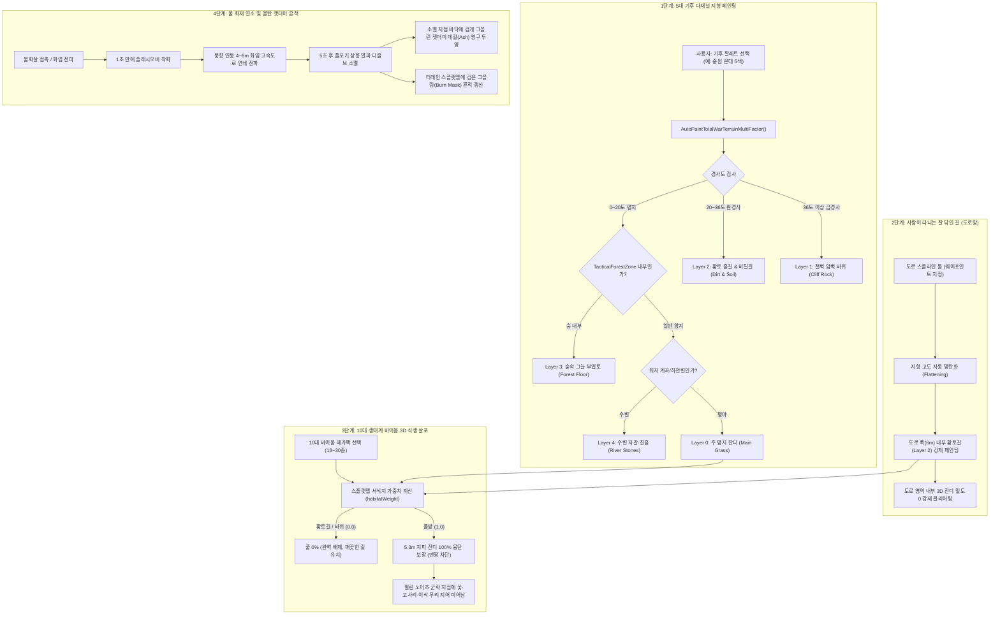

# 🌍 삼국지 토탈워 전장 터레인 지형·식생 생태계·도로망 및 화재 시스템 종합 기술 기획서

본 기획서는 **삼국지 토탈워(Total War: Three Kingdoms - Warscape Engine)** 본편의 지형(Terrain), 식생(Foliage), 도로망(Roads/Trails), 화재 연소(Wildfire) 시스템의 심층 역공학(REA) 분석 결과를 바탕으로, **1) 10대 대형 생태계 바이옴 메가팩 (18~30종, 총 206개 식생 인스턴스)**, **2) 5대 기후 다채널(5색) 복합 지형 절차적 자동 페인팅 엔진**, **3) 동적 스플랫맵 기반 풀밭 100% 융단 보장 및 황토길/바위 배제 알고리즘**, **4) 유니티 6 네이티브 메모리 폭증 방지 정규화 엔진**, **5) 사람이 다니는 잘 닦인 길 (도로망 스플라인 평탄화 및 부대 진군 짓밟힘)**, **6) 풀 화재 연소(Flashover) 및 불탄 잿더미 흔적(Charcoal/Ash Decal) 파이프라인**을 정의한 프로젝트 영구 보존용 완전체 기술 자산 명세서입니다.

---

## 💡 1. 핵심 요약 & 시스템 목표 (Summary & Objective)

토탈워에서 터레인과 식생, 그리고 사람이 다니는 도로는 단순한 배경 그래픽이 아니라 **"전장 기후의 정체성이자 부대 기동의 대동맥, 그리고 화공(火攻)의 도화선"**입니다.
본 시스템은 지형 텍스처부터 바닥 잔디 융단, 수풀과 고사리, 잘 닦인 황토길, 그리고 화재로 인한 불탄 흔적까지 완벽하게 하나로 상호작용하는 완성형 전장 환경을 구축하는 것을 목표로 합니다.

```
+---------------------------------------------------------------------------------------------------+
|               삼국지 토탈워 전장 터레인·식생·도로·화재·하천 5대 통합 아키텍처                     |
+---------------------------------------------------------------------------------------------------+
|  [1. 5대 기후 다채널 지형 페인팅 (Multi-Layer Splatmap)]                                          |
|   - 온대, 서량 사막, 남만 정글, 하북 설원, 강남 아열대의 5개 기후 팔레트 지원                     |
|   - 4대 복합 요소: 경사도(Slope) + 숲 마스크(Forest Mask) + 고도/수변(Riverbed) + 펄린 프랙탈 노이즈|
|   - 숲속 바닥은 자동으로 짙은 부엽토(Forest Floor)로 도색, 하천 바닥은 자갈/진흙으로 자동 도색      |
|                                                                                                   |
|  [2. 10대 생태계 바이옴 메가팩 & 동적 스플랫맵 연동 (Foliage Ecosystem)]                         |
|   - 18~30종 대량 등록 (총 206개 식생 인스턴스, 364종 전수 자원 연동)                             |
|   - 풀밭(Grass Layer): 5.3m 대형 지피 패치가 모든 셀에 100% 융단처럼 깔려 맨땅 노출 원천 차단    |
|   - 황토길(Dirt) 및 바위(Rock): 풀이 0%로 완벽 배제되어 시원하게 뚫린 길과 암벽 보장               |
|   - 유니티 6 엔진 보호: 셀당 1~3개 인스턴스 정규화 및 확률적 디더링으로 크래시 0% 달성            |
|                                                                                                   |
|  [3. 사람이 다니는 잘 닦인 길 (Road Spline & Trample System)]                                     |
|   - 씬 뷰 원클릭 스플라인 도로: 클릭한 경로를 따라 지형 자동 평탄화(Flatten) + 황토길 페인팅       |
|   - 스플라인 내부 풀 0% 자동 클리어링으로 마차와 군마가 달리는 깨끗한 통행로 완성                 |
|   - 인게임 부대 진군 짓밟힘(Trample): 대규모 병력이 풀밭을 지나가면 풀이 눕고 이동로 생성         |
|                                                                                                   |
|  [4. 삼위일체 전장 수계 시스템 (Battlefield Tri-Water Architecture)]                             |
|   - 1) 바다/대형 호수: 전역 수면 평면(Global Water Plane Y)으로 광활한 해안선 및 연안 파도 포말 표현|
|   - 2) 굽이치는 하천: 스플라인 곡선(Spline River Mesh)으로 U자 강바닥 자동 음각(Carving) 및 유속 연출 |
|   - 3) 고인 물/늪지/여울목: 택티컬 존(TacticalWaterZone)으로 웅덩이, 남만 독성 늪지, 도하 여울목 구현|
|   - 전 공통: 강바닥 자갈/진흙(Layer 4) 자동 도색 + 수중 풀 0% 완전 배제 + URP 수심 투명 셰이더       |
|   - 전술 연동: 깊은 물(진입 불가 결사 방어선) vs 얕은 여울목/늪지(보병 이속 -30~50%, 기병 돌격 무력화)|
|                                                                                                   |
|  [5. 풀 화재 연소 및 불탄 잿더미 흔적 (Grass Wildfire & Scorch Decal)]                            |
|   - 불화살/불길 접촉 시 1초 만에 플래시오버(Flashover) 착화 -> 5초 전소 디졸브 소멸               |
|   - 풍향 연동 4~8m 화염 고속도로(Wildfire Highway) 연쇄 전파                                      |
|   - 소멸 지점 바닥에 검게 그을린 잿더미 데칼(Ash Decal) 및 스플랫맵 번 텍스처(Burn Mask) 영구 투영 |
+---------------------------------------------------------------------------------------------------+
```

---

## 🌳 2. 아키텍처 및 계층 트리 맵 (Architecture Tree Map)

```
TotalWar Battlefield Terrain & Foliage Master System
 ├── 1. 지형 텍스처 레이어 계층 (Multi-Layer Splatmap Subsystem)
 │    ├── 5대 기후 팔레트 (Temperate5, Arid5, Nanman5, Cold5, Subtropical5)
 │    │    ├── Layer 0: 주 평지 잔디 (Main Grass)
 │    │    ├── Layer 1: 절벽 암벽 바위 (Cliff Rock)
 │    │    ├── Layer 2: 완경사 황토 흙길/비탈 (Dirt Road & Soil)
 │    │    ├── Layer 3: 숲속 그늘 낙엽 부엽토 (Forest Floor)
 │    │    └── Layer 4: 계곡 저지대 수변 자갈·진흙 (River Stones & Mud)
 │    └── 절차적 복합 페인팅 엔진 (CreateTotalWarTerrainLayers.cs)
 │         ├── 경사도 기반 분기 (0~20도 평지, 20~36도 흙길, 36도 이상 암벽)
 │         ├── TacticalForestZone 숲 마스크 감지 (숲 내부 부엽토 자동 도색)
 │         ├── 고도 스캔 (최저점 하천 수변 자갈 자동 도색)
 │         └── 펄린 프랙탈 노이즈 유기적 경계선 블렌딩
 │
 ├── 2. 식생 생태계 및 방사형 잔디 계층 (Radial Grass Ecosystem)
 │    ├── 10대 전장 생태계 바이옴 메가팩 (RadialGrassConfig.cs)
 │    │    ├── 중원 대평원 20종, 원시림 고사리 20종, 남만 정글 22종, 강남 습지 20종
 │    │    ├── 서량 황무지 18종, 하북 설원 18종, 봄꽃 만개 22종, 황금 농경지 20종
 │    │    └── 산악 암반 18종, 364종 올인원 하이퍼 30종
 │    ├── 살포 엔진 및 메모리 보호 (TotalWarRadialGrassGenerator.cs)
 │    │    ├── 피벗 바닥면 자동 정렬 (Bottom-Zero Ground Clamping)
 │    │    ├── 풀밭 100% 융단 보장 (5.3m 대형 패치 셀당 2~3개 빽빽한 중첩)
 │    │    ├── 서식 지형 동적 필터링 (황토길/바위 0% 완전 배제)
 │    │    └── 유니티 6 DetailCombinedMeshGenerationJob 힙 폭증 방지 정규화
 │    └── 에디터 UI (TotalWarTerrainManagerEditor.cs)
 │         ├── 10대 생태계 바이옴 2행 그리드 원클릭 버튼
 │         └── 📋 간략 테이블 뷰 vs 🎛️ 슬라이더 상세 뷰 스위처
 │
 ├── 3. 사람이 다니는 잘 닦인 길 계층 (Road Spline & Trample Pipeline)
 │    ├── 도로 스플라인 페인터 (TotalWarRoadSplinePainter.cs - 신규 구축)
 │    │    ├── 씬 뷰 웨이포인트 클릭 곡선 생성 (Catmull-Rom Spline)
 │    │    ├── 도로 폭(4~10m) 기준 터레인 자동 평탄화 및 경사 완화 (Road Flattening)
 │    │    ├── 도로 중심 황토길(Layer 2) 페인팅 및 가장자리 흙먼지 페이드
 │    │    └── 도로 스플라인 내부 3D 잔디 밀도 0 강제 클리어링 (Foliage Exclusion)
 │    └── 인게임 부대 진군 짓밟힘 (Unit Trample Interactor)
 │         ├── 보병/기병 대규모 통행 시 잔디 버텍스 하향 절곡 (Vertex Trample)
 │         └── 반복 통행 구역 스플랫맵 흙길 가중치 점진적 누적
 │
 │
 ├── 4. 풀 화재 연소 및 불탄 흔적 계층 (Grass Wildfire & Scorch Subsystem)
 │    ├── 3D 잔디 및 관목 화재 연동 (TotalWarFoliageWind.shader _IsFireActive)
 │    │    ├── 불화살 접촉 시 1초 만에 착화(Flashover)
 │    │    ├── 풍향 연동 4~8m 화염 고속도로 연쇄 전파 (Wildfire Highway)
 │    │    └── 상향 알파 디졸브 및 5초 전소 소멸
 │    └── 불탄 흔적 영구 보존 (Burned Ground & Ash Pipeline)
 │         ├── 전소 지점 바닥에 검게 탄 잿더미 데칼(Ash/Charcoal Decal) 프로젝션
 │         └── 터레인 스플랫맵 번 마스크(Burn Mask) 적용으로 그을린 흙바닥 영구 표현
 │
 └── 5. 삼위일체 전장 수계 계층 (Battlefield Tri-Water Architecture)
      ├── 1) 전역 바다·대형 호수 수면 평면 (TotalWarSeaPlane.cs)
      │    ├── 전역 수위 평면 (Global Water Level Y)
      │    ├── 광활한 해안선(Coastline) 및 연안 파도 거품(Shoreline Foam)
      │    ├── 터레인 경계선 수변 자갈·모래(Layer 4) 자동 페인팅
      │    └── 전장 외곽 심해 구역 진입 불가(Out of Bounds) 자연 경계
      ├── 2) 굽이치는 스플라인 하천 (TotalWarRiverSpline.cs)
      │    ├── 씬 뷰 베지에 곡선 클릭 강줄기 경로/폭/수심 정의
      │    ├── 강바닥 U자 음각 파내기(Terrain Trench Carving) & 바닥 자갈 도색
      │    ├── 강줄기 곡면을 따르는 3D 리본 메쉬(Ribbon Mesh) 및 유속 노멀 스크롤
      │    └── 수면 아래 잔디/관목 0% 강제 클리어링 (Water Foliage Exclusion)
      └── 3) 택티컬 수계·늪지·여울목 존 (TacticalWaterZone.cs)
           ├── ZoneType: Pond(연못/고인물), Swamp(남만 독성 늪지), Ford(얕은 여울목), Puddle(웅덩이)
           ├── 원형(Circle) 및 박스(Box) 전술 구역 기즈모 에디터
           ├── 늪지(Swamp): 보병 이동속도 -50%, 극심한 피로도, 기병 돌격 무력화
           └── 여울목(Ford): 보병 이속 -30%, 도하 물보라(Splash VFX), 전략적 도하 결전지
```

---

## 🗂️ 3. 해시 테이블 메서드/구조체 색인표 (Hash Table Index)

| Key (메서드 / 구조체 / 클래스) | Value (역할 및 세부 기술 명세) | 의존 파일 및 소스 링크 |
| :--- | :--- | :--- |
| `ClimateTerrainPalette` | 5대 기후군별 5개 지형 레이어 팔레트 열거형 (Temperate5, Arid5, Nanman5, Cold5, Subtropical5) | [CreateTotalWarTerrainLayers.cs](file:///c:/unityProject/MiniTotalWar2D/Assets/Scripts/Editor/CreateTotalWarTerrainLayers.cs#L10-L24) |
| `GetOrCreatePaletteLayers` | 기후별 5대 PBR 터레인 레이어 로드 및 2048 PNG 텍스처 자동 바인딩 | [CreateTotalWarTerrainLayers.cs](file:///c:/unityProject/MiniTotalWar2D/Assets/Scripts/Editor/CreateTotalWarTerrainLayers.cs#L51-L125) |
| `AutoPaintTotalWarTerrainMultiFactor` | 4대 복합 요소(경사도 + 숲 마스크 + 고도/수변 + 노이즈) 결합 5색 자동 페인팅 엔진 | [CreateTotalWarTerrainLayers.cs](file:///c:/unityProject/MiniTotalWar2D/Assets/Scripts/Editor/CreateTotalWarTerrainLayers.cs#L180-L340) |
| `GrassBiomeTheme` | 10대 전장 생태계 바이옴 테마 열거형 (CentralPlains20, DeepForest20, Nanman22 등) | [RadialGrassConfig.cs](file:///c:/unityProject/MiniTotalWar2D/Assets/Scripts/RadialGrassConfig.cs#L11-L42) |
| `GetBiomeFoliagePack` | 생태계 테마 선택 시 18~30종 3D 식생(지피+수풀+이삭+고사리+꽃) 일괄 생성 팩토리 | [RadialGrassConfig.cs](file:///c:/unityProject/MiniTotalWar2D/Assets/Scripts/RadialGrassConfig.cs#L150-L190) |
| `AutoScatterNativeFoliage` | 풀밭 100% 융단 보장, 황토길/바위 배제, 셀당 1~3개 정규화 및 확률적 디더링 살포 | [TotalWarRadialGrassGenerator.cs](file:///c:/unityProject/MiniTotalWar2D/Assets/Scripts/Editor/TotalWarRadialGrassGenerator.cs#L274-L404) |
| `CreateGroundAlignedMesh` | 최하단 버텍스(minY)를 감지하여 피벗을 Y=0+offset으로 보정, 바닥 파묻힘 완전 방지 | [TotalWarRadialGrassGenerator.cs](file:///c:/unityProject/MiniTotalWar2D/Assets/Scripts/Editor/TotalWarRadialGrassGenerator.cs#L470-L505) |
| `TotalWarRoadSpline` | 씬 뷰 마우스 펜 툴 기반 도로 경로, 지형 평탄화, 황토길 도색 및 잔디 배제 총괄 컴포넌트 | [TotalWarRoadSpline.cs](file:///c:/unityProject/MiniTotalWar2D/Assets/Scripts/TotalWarRoadSpline.cs) |
| `TotalWarSeaPlane` | 전역 수위 평면(Global Water Plane Y) 관리 및 연안 해안선 셰이더 연동 컴포넌트 | [TotalWarSeaPlane.cs](file:///c:/unityProject/MiniTotalWar2D/Assets/Scripts/TotalWarSeaPlane.cs) |
| `TotalWarRiverSpline` | 굽이치는 S자 강줄기 베지에 스플라인, 강바닥 자동 음각(Carving) 및 리본 메쉬 생성기 | [TotalWarRiverSpline.cs](file:///c:/unityProject/MiniTotalWar2D/Assets/Scripts/TotalWarRiverSpline.cs) |
| `TacticalWaterZone` | 고인 물(Pond), 남만 늪지(Swamp), 얕은 여울목(Ford) 구역 정의 및 부대 속도/돌격 디버프 인터랙터 | [TacticalWaterZone.cs](file:///c:/unityProject/MiniTotalWar2D/Assets/Scripts/TacticalWaterZone.cs) |
| `TotalWarWaterMenuItems` | 유니티 에디터 상단 메뉴 `GameObject > Total War Water` 원클릭 스폰 도구 | [TotalWarWaterMenuItems.cs](file:///c:/unityProject/MiniTotalWar2D/Assets/Scripts/Editor/TotalWarWaterMenuItems.cs) |
| `CarveAndPaintRoad` | 스플라인 경로를 따라 터레인 고도 평탄화 + 흙길(Layer 2) 도색 + 잔디 클리어링 일괄 실행 | [TotalWarRoadSpline.cs](file:///c:/unityProject/MiniTotalWar2D/Assets/Scripts/TotalWarRoadSpline.cs#L215-L355) |
| `TotalWarRoadSplineEditor` | 씬 뷰 마우스 클릭 도로 펜 툴, 노드 3축 핸들 제어 및 1초 Undo 에디터 인스펙터 | [TotalWarRoadSplineEditor.cs](file:///c:/unityProject/MiniTotalWar2D/Assets/Scripts/Editor/TotalWarRoadSplineEditor.cs) |
| `GrassScorchDecalManager` (예정) | 불타버린 잔디/수풀 위치에 검은 잿더미 데칼 및 그을린 텍스처를 남기는 연소 관리자 | `TotalWarFireVFXController.cs` |

---

## 🔀 4. 유향 그래프 흐름도 (Directed Graph - Mermaid)



---

## ⚙️ 5. 주요 상태 변수, 데이터 구조체 & 인스펙터 옵션 (State & Fields)

### 5.1 지형 텍스처 및 팔레트 구조체
```csharp
[System.Serializable]
public struct ClimateTerrainConfig
{
    public ClimateTerrainPalette palette; // Temperate5, Arid5, Nanman5, Cold5, Subtropical5
    public TerrainLayer mainGrassLayer;    // 평지 잔디
    public TerrainLayer cliffRockLayer;    // 절벽 바위
    public TerrainLayer dirtRoadLayer;     // 황토 흙길
    public TerrainLayer forestFloorLayer;  // 숲속 부엽토
    public TerrainLayer riverStonesLayer;  // 수변 자갈/진흙
    public float stoneSlopeMin;            // 흙길/완경사 시작 경사도 (기본: 20도)
    public float cliffSlopeMin;            // 절벽 암벽 시작 경사도 (기본: 36도)
}
```

### 5.2 도로 스플라인 데이터 구조체 (Road Spline)
```csharp
[System.Serializable]
public class RoadSplineSegment
{
    public List<Vector3> waypoints = new List<Vector3>(); // 도로 경유점 목록
    public float roadWidth = 6.0f;                        // 도로 중심 폭 (m)
    public float shoulderWidth = 2.5f;                    // 갓길 페이드 폭 (m)
    public float flattenStrength = 0.85f;                 // 지형 평탄화 강도 (0~1)
    public bool clearFoliage = true;                      // 도로 위 풀 완전 제거 여부
    public int roadLayerIndex = 2;                        // 칠할 지형 레이어 (기본: 2 황토길)
}
```

### 5.3 풀 화재 및 불탄 흔적 상태 구조체 (Foliage Scorch)
```csharp
[System.Serializable]
public struct FoliageFireState
{
    public bool isBurning;            // 현재 연소 중 여부
    public float burnProgress;        // 연소 진행률 (0: 착화 -> 1: 전소)
    public float ignitionDuration;    // 착화 지속 시간 (기본: 5.0초)
    public GameObject ashDecalPrefab; // 전소 후 바닥에 남길 잿더미 데칼 프리팹
    public float scorchRadius;        // 그을린 잿더미 반경 (m)
    public Color ashColor;            // 잿더미 색상 (기본: 짙은 숯검정 R:0.1, G:0.1, B:0.1)
}
```

---

## 🛠️ 6. 핵심 알고리즘, 물리/전투 수학 공식 & 조작법 (Algorithms & Math)

### 6.1 4대 복합 스플랫맵 절차적 도색 공식
터레인의 각 정규화 좌표 `(normX, normY)`에서 5개 레이어 가중치를 산출하는 수학 공식:

```
1. 실효 경사도:
   effectiveSlope = slope + (PerlinNoise(normX * 18, normY * 18) - 0.5) * 6.0

2. 숲 구역 차폐 계수 (Forest Factor):
   dist = DistanceXZ(worldPos, forestCenter)
   if dist < forestRadius:
       forestFactor = Clamp01((forestRadius - dist) / 5.0)

3. 수변 저지대 계수 (River Factor):
   if height <= riverThreshold:
       riverFactor = 1.0 - Clamp01((height - minHeight) / (riverThreshold - minHeight))

4. 레이어별 분기:
   if effectiveSlope >= 36도:
       RockWeight = 0.8 + 0.2 * ((effectiveSlope - 36) / 10)
       DirtWeight = 0.2 * (1.0 - RockWeight)
   else if effectiveSlope >= 20도:
       DirtWeight = 1.0 - ((effectiveSlope - 20) / 16) * 0.5
       RockWeight = ((effectiveSlope - 20) / 16) * 0.5
   else:
       if forestFactor > 0.05:
           ForestWeight = forestFactor
           GrassWeight = 1.0 - forestFactor
       else if riverFactor > 0.05:
           StonesWeight = riverFactor * 0.85
           GrassWeight = 1.0 - StonesWeight
       else:
           GrassWeight = 1.0
```

### 6.2 도로 스플라인 지형 평탄화 및 풀 클리어링 알고리즘
도로 곡선(Catmull-Rom) 상의 가장 가까운 선분 투영점 `P_proj`와 점의 거리 `d`:

```
1. 도로 중심 영역 (d <= roadWidth * 0.5):
   - 고도 평탄화: height = Lerp(height, P_proj.y, flattenStrength)
   - 텍스처: DirtWeight = 1.0, GrassWeight = 0.0
   - 3D 풀 밀도: GrassDensity = 0 (100% 완전 배제!)

2. 갓길 영역 (roadWidth * 0.5 < d <= roadWidth * 0.5 + shoulderWidth):
   - t = (d - roadWidth * 0.5) / shoulderWidth
   - 텍스처: DirtWeight = 1.0 - t, GrassWeight = t (자연스러운 흙먼지 갓길)
   - 3D 풀 밀도: GrassDensity = Round(OriginalDensity * t) (풀이 서서히 돋아남)
```

### 6.3 풀 화재 플래시오버 및 잿더미(Ash Decal) 프로젝션 공식
```
1. 연소 디졸브:
   DissolveAmount = burnProgress (0.0 -> 1.0)
   VertexShrink = (1.0 - burnProgress * 0.6)

2. 화염 고속도로 전파:
   SpreadRadius = BaseSpeed (2.5m/s) + WindSpeed * Dot(SpreadDir, WindDir)

3. 잿더미 데칼 프로젝션:
   if burnProgress >= 1.0:
       SpawnDecal(worldPos, ashDecalPrefab, scorchRadius)
       SetTerrainBurnMask(worldPos, scorchRadius, intensity=1.0)
```

### 6.4 삼위일체 수계(바다·하천·택티컬존) 물리 및 수학 공식
```
1. 전역 바다·대형 호수 연안 파도 포말 (Shoreline Foam Formula):
   waterDepth = Max(0.0, seaLevel - terrainHeight)
   ShorelineFoam = 1.0 - Clamp01(waterDepth / foamDistance) // 수심 0~1m 접안선에 포말 발생
   DeepSeaColorLerp = Clamp01(waterDepth / 10.0) // 10m 이상 짙은 감청색 심해

2. 스플라인 하천 U자 강바닥 음각 파내기 (River Trench Carving):
   d = DistanceToRiverSpline(worldPos)
   if d < riverWidth * 0.5:
       t = d / (riverWidth * 0.5)
       // 코사인 함수로 자연스러운 U자형 강바닥 파내기
       targetHeight = riverSurfaceLevel - maxRiverDepth * Cos(t * 0.5 * PI)
       terrainHeight = Min(terrainHeight, targetHeight)
       StonesMudWeight = 1.0 - t * 0.3
       WaterFoliageMask = 0.0 (풀 100% 배제)

3. 택티컬 수계 존(TacticalWaterZone) 전술 판정 및 디버프:
   - Type = Pond(고인 물):
       Passable = False (진입 불가)
   - Type = Swamp(늪지대):
       Passable = True
       InfantrySpeedPenalty = 0.50 (이속 50% 격감)
       CavalrySpeedPenalty = 0.40 (기병 이속 60% 격감 및 돌격 보너스 0)
       FatigueDrainRate = 3.5 (피로도 소모 3.5배)
   - Type = ShallowFord(여울목 도하):
       Passable = True
       InfantrySpeedPenalty = 0.70 (이속 30% 감속)
       CavalryChargeMultiplier = 0.0 (기병 돌격 무력화)
       SpawnVFX = WaterSplashOnFootstep
```

### 6.5 유닛 신장(크기) 기준 수심 계층화 및 도하(Fording) 물리 판정 규칙

토탈워 원작(Warscape Engine)의 유닛 물리와 전장 수계 시스템의 핵심 철학:
**"건널 수 있는 물은 무조건 유닛의 신장보다 현저히 낮은 안전 수위여야만 한다."**
유닛의 스케일과 물리적 수심(Water Depth)의 3단계 상호작용 규칙:

```
1. 표준 유닛 신장 기준:
   - 보병 신장: 약 1.7m ~ 1.8m (무릎: 0.5m, 허리: 0.9m, 가슴/어깨: 1.4m)
   - 기병 신장: 군마 체고 1.5m ~ 1.6m, 기수 탑승 시 총 높이 약 2.4m

2. 수심에 따른 3단계 도하(Fording) 및 통과 가능성(Passability) 규칙:
   - [1단계] 발목~무릎 수심 (0.1m ~ 0.5m - 얕은 여울목, 비온 뒤 물웅덩이):
       - 판정: 모든 유닛 자유 통과 (Passable: True)
       - 패널티: 경미한 이동속도 저하 (보병 -10~30%, 기병 -15%), 발자국 물보라(Water Splash) 연출.
       - 기병 돌격 보너스 유지 (50~80%).
   - [2단계] 허리~가슴 수심 (0.6m ~ 1.2m - 본격적인 하천 도하, 늪지대):
       - 판정: 도하는 가능하나 치명적 전술 취약 (Passable: True)
       - 패널티: 강한 유체 저항으로 보병 이속 -50~60% 급감.
       - 군마의 다리가 물에 깊이 잠겨 기병 돌격 보너스 완전 무력화 (Charge Bonus = 0%).
       - 피로도(Fatigue) 소모율 2.5배 ~ 3.5배 급증.
       - 도하 중 사격에 노출될 경우 치명적인 병목 결사 궤멸 지점 형성.
   - [3단계] 유닛 신장 초과 수심 (1.4m 이상 - 깊은 강, 호수, 바다, 연못):
       - 판정: 도하 완전 불가 (Passable: False - 절대 진입 금지)
       - 철학: 중갑옷과 무기를 착용한 병사들이 빠지면 익사(Drown)하므로 배나 다리 없이는 통과할 수 없는 자연 방어선(Natural Barrier)으로 작동!
       - AI 및 플레이어 이동 경로 탐색(NavMesh/Pathfinding)에서 완전 장애물(Blocked)로 마스킹.

3. 3D Y축 수면 높이 검사 (Vertical Clearance):
   - 수면 표면(surfaceY) 높이 기준 상하 [surfaceY - waterDepth, surfaceY + 0.6m] 범위에 유닛의 발이 위치할 때만 수계 판정.
   - 강 위를 가로지르는 높은 다리(Bridge) 위나 절벽, 공중 투사체(화살)는 물의 감속을 일절 받지 않음.
```

### 6.6 도로망(Roads)의 물리적 본질 및 지형 장애물 저항 이동 철학

토탈워 전장에서 도로의 물리적 본질과 지형 이동 메커니즘의 대원칙:
**"도로는 인위적인 이동속도 가속 패드가 아니며, 거친 돌과 잡초, 요철을 최대한 치워둔 정상 표준 통행로(기준 1.0배 속도)에 불과하다. 속도 저하는 도로를 벗어나 풀밭이나 험지를 걸어갈 때 자연 장애물의 물리적 저항으로 인해 발생한다."**

```
1. 도로(Road)의 정의:
   - 도로 내부: 3D 잔디 100% 클리어링 + 지형 평탄화 완료된 황토길(Layer 2).
   - 상태: 장애물 0의 정규 통행로 (Standard Baseline).
   - 이동속도: 1.0배 (가속 보너스 없음, 페널티 없음).
   - 피로도 소모율: 1.0배 (기본 정규 행군 소모율 유지).

2. 지형 장애물 저항 감속 메커니즘 (Terrain Obstacle Drag):
   - TotalWarRoadSpline.IsOnAnyRoad(unitPos) == false일 때, 유닛이 밟고 있는 지형/식생에 따라 저항 발생:
     * [일반 풀밭 (Grassland / Meadow)]:
       - 무릎과 발목을 스치는 빽빽한 잡초와 푹신한 연약지반 저항.
       - 이동속도: 0.80 ~ 0.85배로 감소.
       - 행군 피로도: 소모율 1.2배 ~ 1.25배 가중.
     * [수풀 / 덤불 / 원시림 (Bush / Dense Scrub)]:
       - 거친 나뭇가지와 엉킨 덩굴 저항.
       - 이동속도: 0.65 ~ 0.70배로 감속.
     * [얕은 물 / 여울목 (Ford / Shallow Stream)]:
       - 수중 유체 저항으로 이동속도 0.60 ~ 0.70배, 기병 돌격 무력화.
     * [깊은 늪지 / 진흙탕 (Swamp / Mud)]:
       - 다리가 푹푹 빠지는 심각한 지반 침하로 이동속도 0.40 ~ 0.50배 급감.

3. 전술적 의미:
   - 장군과 플레이어는 부대를 신속하게 전선으로 전개하거나 군단을 합류시킬 때,
     별도의 마법 버프를 받는 것이 아니라 **"풀밭의 감속을 피하기 위해 자연스럽게 잘 닦인 도로망을 따라 행군"**하게 유도됨.
```

---

## 🔗 7. 다른 스크립트와의 연동 관계 (Dependencies & Pipeline)

1. **[CreateTotalWarTerrainLayers.cs](file:///c:/unityProject/MiniTotalWar2D/Assets/Scripts/Editor/CreateTotalWarTerrainLayers.cs)**:
   - 5대 기후 팔레트 생성, 4대 복합 페인팅 알고리즘 총괄 실행, 수변 고도 감지 시 `River Stones & Mud` 자동 도색.
2. **[TotalWarRadialGrassGenerator.cs](file:///c:/unityProject/MiniTotalWar2D/Assets/Scripts/Editor/TotalWarRadialGrassGenerator.cs)**:
   - 페인팅된 스플랫맵을 실시간 읽어 풀밭에는 100% 융단 잔디를, 황토길/바위/수면 아래에는 풀 0% 클리어링 적용.
3. **[RadialGrassConfig.cs](file:///c:/unityProject/MiniTotalWar2D/Assets/Scripts/RadialGrassConfig.cs)**:
   - 10대 생태계 바이옴 메가팩(18~30종) 정의 및 지형 서식지 옵션 바인딩.
4. **[TotalWarTerrainManager.cs](file:///c:/unityProject/MiniTotalWar2D/Assets/Scripts/TotalWarTerrainManager.cs)**:
   - 런타임 및 에디터에서 기후 테마, 사계절 적설 셰이더, 전역 잔디 흔들림(Waving) 총괄 제어.
5. **[TacticalForestZone.cs](file:///c:/unityProject/MiniTotalWar2D/Assets/Scripts/TacticalForestZone.cs)**:
   - 숲 구역 좌표 및 반경을 지형 페인팅 엔진에 제공하여 숲 바닥 부엽토 자동 도색 연동.
6. **[TotalWarRoadSpline.cs](file:///c:/unityProject/MiniTotalWar2D/Assets/Scripts/TotalWarRoadSpline.cs)**:
   - 마우스 펜 툴 기반 굽이치는 군사 도로망 생성, 터레인 지형 자동 평탄화(Cut & Fill), 황토길(Layer 2) 도색, 도로 위 잔디 100% 클리어링, 장애물 제거 기준 노면(1.0배) 판정 API 제공.
7. **[TotalWarSeaPlane.cs](file:///c:/unityProject/MiniTotalWar2D/Assets/Scripts/TotalWarSeaPlane.cs)** & **[TotalWarRiverSpline.cs](file:///c:/unityProject/MiniTotalWar2D/Assets/Scripts/TotalWarRiverSpline.cs)** & **[TacticalWaterZone.cs](file:///c:/unityProject/MiniTotalWar2D/Assets/Scripts/TacticalWaterZone.cs)**:
   - 전역 바다 평면, 스플라인 굽이치는 하천 트렌치 및 리본 메쉬, 늪지/연못/여울목 택티컬 존 전술 인터랙터.
8. **[TotalWarFireVFXController.cs](file:///c:/unityProject/MiniTotalWar2D/Docs/TotalWarFireVFXController.md)**:
   - 풀과 수풀이 연소될 때 화염 파티클 스폰 및 전소 후 바닥 잿더미 데칼 투영 파이프라인 연계.

---

## 📝 8. 문서 관리 및 개정 이력

- **2026-10-27 (개정 완료)**:
   - 도로망 물리적 본질 재정립: 인위적인 도로 속도 버프(+25%)를 배제하고 도로를 '장애물을 치워둔 기준 통행로(1.0배 속도)'로 확립. 풀밭/수풀/늪지 등 험지 진입 시 자연 장애물 저항으로 인한 속도 저하(-15~50%) 및 피로도 가중 체계 명세화.
   - 기존 `토탈워_삼국지_3D_방사형_잔디_LOD_시스템_기획서.md`에서 **`삼국지_토탈워_전장_터레인_지형_식생_도로망_및_화재_시스템_기획서.md`**로 전면 승격 및 명칭 변경.
   - 10대 생태계 바이옴 메가팩(18~30종), 5대 기후 다채널 복합 페인팅 엔진, 풀밭 100% 융단 보장, 사람이 다니는 잘 닦인 길(도로 스플라인 & 평탄화 & 짓밟힘), 풀 화재 연소 및 잿더미 데칼 파이프라인 통합 명세화 완료.

