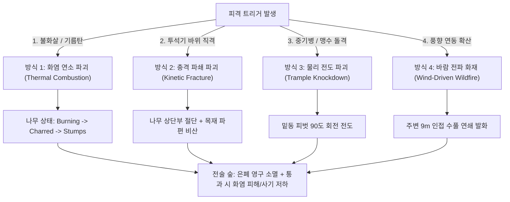

# 🔥 삼국지 토탈워 초목 화재 연소 및 동적 파괴 시스템 기술 기획서

본 문서는 **삼국지 토탈워(Total War: Three Kingdoms)의 전투 엔진 역공학(REA, Reverse-Engineering Anything)** 분석 결과를 기반으로, 전장 초목(나무, 수풀)의 **불타는 연출(Ignition & Burning), 불탄 후 탄화/재 렌더링(Charred & Ash), 투석기/돌격에 의한 물리 파괴(Kinetic Destruction)** 및 **Entities Graphics(DOTS ECS) 기반 파괴 파이프라인**을 정의합니다.

---

## 💡 1. 핵심 요약 & 아키텍처 목표 (Summary & Objective)

삼국지 토탈워의 가장 혁신적인 전장 환경 요소는 **"살아 숨 쉬는 가연성 전장(Flammable Battlefield)"**입니다.
단순히 시각적인 불꽃 파티클에 그치지 않고, **바람 방향에 따른 화재 전파, 나뭇잎 디졸브 소멸, 줄기의 탄화 흑화(Charring), 지면 잔해 데칼 생성, 숲 은폐 영구 소멸 및 화염 통과 시 사기(Morale) 붕괴**까지 유기적으로 맞물려 동작합니다.

### 🎯 핵심 구현 목표
1. **역공학 실측 수치 기반 화재 전파 엔진**: 삼탈워 원본 `kv_fire_values_tables`의 9.0m 전파 반경, 20% 전파 확률, 500ms 갱신 틱 준수.
2. **불타는 모습 (Burning Phase)**:
   - 착화(Smoking) -> 발화(Ignition) -> 격렬 연소(Full Blaze) 단계 전이.
   - GPU 셰이더의 `_BurnAmount` (탄화 파라미터) 증가에 따른 점진적 흑화 및 주황색 이글거림(Embers).
   - 나뭇잎 알파 디졸브(Alpha Dissolve)로 잎사귀가 타서 재로 바스러지는 연출.
3. **불탄 뒤 (Post-Burn Phase)**:
   - 나뭇잎 완전 소멸, 앙상하게 남은 검은 숯 기둥(Charred Trunk) 렌더링.
   - 지면에 그을린 숯 잔해 데칼(Burn Decal) 투영.
   - 숲 영역([TacticalForestZone.cs](file:///c:/unityProject/MiniTotalWar2D/Assets/Scripts/TacticalForestZone.cs))의 시야 은폐 기능 영구 소멸 및 진입 유닛 지속 화염 피해/사기 디버프.
4. **다양한 동적 파괴 방식 확장 (Destruction Modes)**:
   - **방식 1 (화염 연소 - Thermal)**: 불화살, 기름 항아리 피격 시 연소 및 바람결 전파.
   - **방식 2 (투석기 파쇄 - Kinetic Fracturing)**: 고중량 투석탄 직격 시 나무가 2~3조각으로 쪼개지며 목재 파편 비산.
   - **방식 3 (중기병/코끼리 돌격 넉다운 - Trample Fall)**: 대형 돌격체 통과 시 나무 밑동이 꺾이며 지면으로 쓰러지는 물리 회전.
5. **Entities Graphics 하이브리드 ECS 전환 설계**: 파괴 가능한 나무만 동적으로 경량 엔티티로 전환하여 수천 그루의 숲에서도 60fps 무감속 유지.

---

## 🔬 2. 삼탈워 코어 엔진 역공학(REA) 데이터 분석

실제 삼국지 토탈워 게임 바이너리 데이터(`database.pack`, `shaders.pack`, `models.pack`)를 REA 역공학 디코딩하여 추출한 실제 엔진 스펙입니다.

### 2.1 삼탈워 화재 데이터베이스 테이블 실측치 (`kv_fire_values_tables`)

| 파라미터 키 (Key) | 실측 값 (Value) | 물리적 의미 및 엔진 역할 |
| :--- | :--- | :--- |
| `fire_propagation_distance` | **9.0 m** | 화재 전파 유효 반경. 불타는 나무로부터 9m 이내 인접 식생으로 전파 |
| `vegetation_catch_fire_chance` | **0.20 (20%)** | 불화살 피격 1발당 식생 착화 기본 확률 |
| `vegetation_propagation_chance` | **0.20 (20%)** | 9m 반경 내 인접 식생으로 불길이 옮겨붙을 확률 |
| `vegetation_propagation_frequency`| **500 ms (0.5초)** | 화재 전파 연산 주기 (500틱마다 공간 트리거 판정) |
| `smoking_hit_point_percentage` | **0.33 (33%)** | 체력 33% 손상 시 흰 연기(Smoke) 방출 단계 진입 |
| `smoking_ignition_threshold_percentage` | **0.50 (50%)** | 연기 점화 게이지가 50% 누적되면 불길(Fire)로 전이 |
| `smoking_ignition_percentage_increase` | **0.01 (1%/tick)** | 화염원 접촉 시 틱당 누적되는 착화 점수 |
| `fire_intensity_increase` | **0.10 (10%/sec)** | 화재 강도 증가 속도 (10초 만에 최대 화력 도달) |
| `fire_damage_building_modifier` | **75.0** | 건물/목책 화재 초당 피해량 |
| `fire_damage_siege_vehicle_modifier` | **200.0** | 공성병기(투석기, 충차) 화재 초당 피해량 |

### 2.2 삼탈워 셰이더 및 머티리얼 구조 (`shaders.pack`)
- **전용 화재 셰이더**: `dx11_rigidambientmapfiremesh.hlsl`
  - 버텍스 셰이더: 열기에 의한 메쉬 열팽창 및 상승기류 파동(Heat Shimmer).
  - 프래그먼트 셰이더: 탄화 텍스처(`charred_rubble_decal`) 블렌딩 및 앰버 발광(Embers Glow HDR).
  - 알파 채널: 탄화도(`_BurnAmount`)가 증가함에 따라 잎사귀 메쉬의 알파 컷아웃 임계치(`_Cutoff`)를 높여 가장자리부터 바스러지며 사라지는 디졸브 구현.

---

## 🌳 3. 전장 초목 파괴 4대 방식 (Destruction Modes)



### 방식 1: 화염 연소 파괴 (Thermal Combustion) - 삼탈워식 3단계 화재
1. **1단계 (Smoking - 연기 단계)**:
   - 불화살 명중 시 20% 확률로 착화 게이지 누적 시작.
   - 밑동과 잔가지에서 백색 연기 파티클 발생.
2. **2단계 (Burning - 연소 및 탄화 단계)**:
   - 착화 게이지 50% 돌파 시 적황색 불길 폭발.
   - 바람 벡터([TotalWarWindManager.cs](file:///c:/unityProject/MiniTotalWar2D/Assets/Scripts/TotalWarWindManager.cs)) 방향으로 불꽃과 불티(Embers)가 비산.
   - 셰이더 탄화 파라미터(`_BurnProgress` 0.0 -> 1.0) 진행:
     - 나뭇잎: 가장자리부터 검게 타들어가며 지글지글 디졸브(소멸).
     - 기둥: 수피가 검게 그을리고 갈라진 틈 사이로 붉은 화염 발광(Ember Emission).
3. **3단계 (Charred Stumps - 소멸 및 숯 잔해 단계)**:
   - 나뭇잎 완전 소멸, 기둥 상단 잔가지는 숯가루로 바스러짐.
   - 검게 그을린 숯 기둥(Charred Trunk)만 남고, 바닥에 숯 재 데칼(Ash Decal) 생성.

### 방식 2: 투석기 바위 충격 파쇄 (Kinetic Fracture)
- **발동 조건**: 투석기 화염탄/일반 바위의 물리 직격(`Direct Hit`).
- **연출 메커니즘**:
  - 나무 줄기를 2개 메쉬(밑동 Stump + 상단 Trunk)로 분리.
  - 상단부는 바위의 운동량(Momentum) 벡터 방향으로 튕겨 날아가며 지면에 나뒹굼.
  - 충돌 순간 나무 껍질 및 목재 파편(Wood Splinters) 파티클 30~50개 폭발적 비산.

### 방식 3: 중기병 및 맹수 돌격 전도 (Trample Knockdown)
- **발동 조건**: 질량 300 이상의 중기병 웨이브 또는 맹수 돌격체 통과.
- **연출 메커니즘**:
  - 나무가 밑동 피벗(Pivot)을 기준으로 돌격 진행 방향으로 75~90도 천천히 쓰러짐(Fall Over).
  - 지면 격돌 시 흙먼지(Dust Shockwave) 및 잎사귀 먼지 파티클 방출.

### 방식 4: 바람결 화재 전파 (Wind-Driven Wildfire)
- **전파 공식**:
  - 인접 나무 탐색 거리: 기본 9.0m.
  - **바람 벡터 반영 공식**:
    ```
    EffectiveDistance = 9.0m + WindSpeed * dot(ToNeighborDir, WindDir) * 3.0m
    ```
  - 순풍(바람이 불어가는 쪽)으로는 최대 15m~18m까지 불티가 날아가 불이 번지고, 역풍으로는 3m 이하로 전파가 억제됨.
  - 제갈량의 적벽대전이나 호로관 화공처럼, **풍향을 등지고 불화살을 쏘면 숲 전체가 바람을 타고 집단 전소**하는 삼탈워의 정수를 그대로 재현.

---

## 🎨 4. 불타는 모습 & 불탄 뒤 셰이더 파이프라인

기존 [TotalWarFoliageWind.shader](file:///c:/unityProject/MiniTotalWar2D/Assets/Shaders/TotalWarFoliageWind.shader)에 추가될 **탄화 및 디졸브 셰이딩 파이프라인**입니다.

### 4.1 셰이더 속성 및 파라미터
```hlsl
// 탄화 및 연소 제어 파라미터
_BurnProgress   ("Burn Progress (0:정상, 1:완전연소)", Range(0.0, 1.0)) = 0.0
_CharredColor   ("Charred Ash Color", Color) = (0.05, 0.04, 0.04, 1.0)
_EmberColor     ("Ember Glow Color", Color) = (3.5, 0.9, 0.1, 1.0) // HDR 발광
_DissolveNoise  ("Dissolve Noise Map", 2D) = "white" {}
_BurnEdgeWidth  ("Burn Edge Width", Range(0.01, 0.15)) = 0.06
```

### 4.2 연소 및 탄화 프래그먼트 수식 (Burn Math)
```hlsl
// 1. 노이즈 기반 디졸브 마스크
half noise = SAMPLE_TEXTURE2D(_DissolveNoise, sampler_DissolveNoise, input.uv * 4.0).r;
half burnFactor = saturate((_BurnProgress * 1.2 - noise) / _BurnEdgeWidth);

// 2. 나뭇잎 알파 디졸브 (불타서 사라짐)
#if defined(_IS_LEAVES)
    clip(albedo.a - _Cutoff - _BurnProgress * 0.8);
#endif

// 3. 기둥 탄화 흑화 (검은 숯으로 변함)
half3 charredAlbedo = lerp(albedo.rgb, _CharredColor.rgb, saturate(_BurnProgress * 1.5));

// 4. 타오르는 가장자리 이글거리는 불씨 (Ember Glow)
half emberEdge = smoothstep(0.0, 1.0, 1.0 - abs(burnFactor - 0.5) * 2.0) * step(0.05, _BurnProgress) * step(_BurnProgress, 0.95);
half3 finalEmission = _EmberColor.rgb * emberEdge * 2.5;

finalColor = charredAlbedo * (diffuse + ambient) + finalEmission;
```

---

## ⚙️ 5. Pure ECS ⇄ Entities Graphics 아키텍처 설계

나무를 통째로 엔티티로 만들면 수백 그루의 씬 로드 및 관리가 무거워지므로, **"하이브리드 온디맨드 엔티티 변환(On-Demand Entity Conversion)"** 방식을 채택합니다.


### 5.1 ECS 컴포넌트 구조체
```csharp
// 파괴 가능 나무 엔티티 컴포넌트
public struct DestructibleTreeComponent : IComponentData
{
    public Entity TreeEntity;
    public float3 Position;
    public float Health;             // 나무 체력 (기본 100)
    public float FireGauge;          // 점화 게이지 (0.0 ~ 1.0)
    public float BurnProgress;       // 탄화 진행도 (0.0 ~ 1.0)
    public TreeDestructionState State; // Healthy, Smoking, Burning, Fracturing, Charred
    public float StateTimer;
}

public enum TreeDestructionState : byte
{
    Healthy = 0,    // 정상 나무
    Smoking = 1,    // 연기 단계 (체력 33% 이하)
    Burning = 2,    // 연소 및 화재 전파 단계
    Fracturing = 3, // 투석기에 맞아 부러지는 물리 단계
    Charred = 4     // 완전 연소 후 숯 잔해 단계
}
```

### 5.2 화재 전파 시스템 (`TreeCombustionSystem : SystemBase`)
- **버스트(Burst) 컴파일 병렬 작업**:
  - `SpatialHashGrid`를 활용하여 `Burning` 상태의 나무 주변 9.0m 이내의 이웃 나무를 O(1)로 조회.
  - 현재 바람 벡터(`_TotalWarWindVector`) 방향으로 전파 가중치 부여.
  - 500ms 주기마다 이웃 나무의 `FireGauge`를 누적시켜 연쇄 발화 유도.

---

## ⚔️ 6. 전술 게임플레이 연동 (Tactical Impact)

1. **시야 은폐(Concealment) 영구 상실**:
   - 숲의 나무가 50% 이상 연소/파괴되면, [TacticalForestZone.cs](file:///c:/unityProject/MiniTotalWar2D/Assets/Scripts/TacticalForestZone.cs)의 `hasConcealmentBuff` 플래그가 꺼지며 숨어 있던 매복 부대가 강제 노출.
2. **화염 지속 피해 (Damage over Time)**:
   - 불타는 숲 구역 내부의 병사들은 1초당 최대 체력의 2.5% 지속 화염 피해.
3. **사기 충격 (Morale Shock - Panic)**:
   - 불타는 숲에 진입한 부대는 **[화재 공포: 사기 -16]** 디버프 부여.
   - 패주(Routing) 확률이 급증하여, 적이 숲에 매복해 있을 때 화공(火攻)을 가해 진형을 강제 붕괴시키는 토탈워 특유의 전술 완성.

---

## 📅 7. 단계별 개발 로드맵 (Development Roadmap)

- **1단계: 셰이더 및 탄화 머티리얼 개발**:
  - `TotalWarFoliageWind.shader`에 `_BurnProgress`, 나뭇잎 디졸브, 숯 흑화, Ember Glow 추가.
- **2단계: 화재 전파 및 상태 머신 구축**:
  - `TreeCombustionManager` (또는 ECS `TreeCombustionSystem`) 구현 (9m 전파, 풍향 연동).
- **3단계: 파티클(VFX) 및 사운드 바인딩**:
  - 착화 연기(Smoke), 화염(Blaze), 불티(Embers), 목재 파쇄 파편(Splinters) VFX 제작.
- **4단계: 투석기/불화살 투사체 충돌 연동**:
  - 화살 및 투석기 낙탄 지점에서 식생 레이어 감지 및 착화 트리거.
- **5단계: 전술 숲 시야 및 사기 시스템 연동**:
  - 은폐 해제 및 숲 내부 화염 틱 피해/사기 디버프 바인딩.
