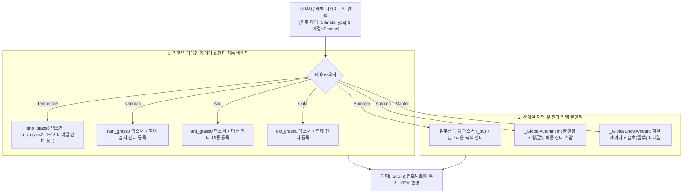
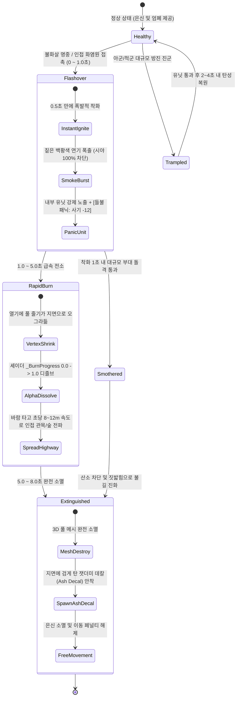
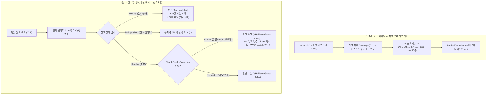
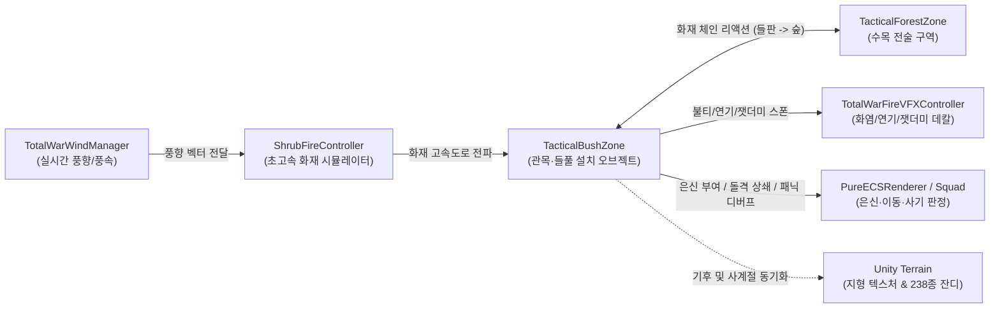

# 🌾 삼국지 토탈워 전장 터레인 기후·계절 식생 생태계 및 관목·들풀 전술 시스템 종합 기술 기획서

본 문서는 **삼국지 토탈워(Total War: Three Kingdoms)** 원작의 지형(Terrain) 및 하층 식생(Understory: 관목, 들풀, 잔디, 농작물) 생태계를 역공학(REA) 분석하여, **1) 기후(Climate)별 터레인 레이어 및 디테일 잔디 238종 종속 매핑**, **2) 사계절(봄·여름·가을·겨울) 실시간 지형 텍스처 및 적설 전역 블렌딩**, **3) TacticalForestZone 규격을 100% 계승하는 독립 설치형 전술 관목·초본 80여 종(TacticalBushZone)**, **4) 초고속 연소(Flashover) 및 화염 고속도로(Wildfire Highway)**, **5) 수풀 은신(Stealth) 및 부대 진군 짓밟힘(Trample)** 파이프라인을 정의한 종합 기술 기획서입니다.

---

## 💡 1. 핵심 요약 & 시스템 목표 (Summary & Objective)

토탈워에서 풀과 관목, 지표면 잔디는 단순한 배경 그래픽이 아니라 **"전장 기후의 정체성이자 화공(火攻)의 도화선, 그리고 매복의 성지"**입니다.
본 시스템은 기존에 완성된 수목([TacticalForestZone](file:///c:/unityProject/MiniTotalWar2D/Docs/TacticalForestZone.md)) 시스템의 생태계 규칙을 하층 식생으로 완벽히 확장하여, 지표면부터 거목의 수관까지 하나로 연결되는 완성형 전장 생태계를 구축하는 것을 목표로 합니다.

```
+---------------------------------------------------------------------------------------------------+
|                        삼국지 토탈워 전장 터레인 및 식생 이원화 생태계                            |
+---------------------------------------------------------------------------------------------------+
|  [1. 지형 종속 디테일 잔디 (238종 - Terrain Detail Mesh)]                                         |
|   - 기후(온대, 남만, 건조, 한랭, 아열대)별 바닥 텍스처(Grass0, Forest0 등)에 1:1 종속 매핑       |
|   - 터레인 브러시 또는 절차적 밀도 맵에 따라 지표면에 융단처럼 대량 GPU 인스턴싱 배치            |
|   - 사계절 전환: 여름(녹음) -> 가을(누런 마른풀) -> 겨울(소복이 눈 덮인 설초) 실시간 블렌딩     |
|                                                                                                   |
|  [2. 독립 설치형 전술 관목·초본 (80여 종 - TacticalBushZone)]                                     |
|   - TacticalForestZone의 형태(원형/박스), 사계절, 적설, 바람, 화재 시스템을 100% 그대로 계승      |
|   - 씬에서 독립 전술 지형으로 자유 배치 (코끼리풀 밭, 대나무 밑동군, 황금 벼/기장 밭, 철쭉 군락) |
|   - 전술 기능: 보병 완전 은신(Stealth), 기병 돌격 둔화(Charge Penalty), 탄도 차폐(Cover)         |
|   - 화재 연계: 불화살 접촉 즉시 1초 착화(Flashover) -> 5초 전소 디졸브 -> 화염 고속도로 전파     |
|   - 물리 상호작용: 부대 진군 시 풀 눕힘(Trample) 및 초기 불길 짓밟아 진화(Smothering)            |
+---------------------------------------------------------------------------------------------------+
```

---

## 🌳 2. 아키텍처 및 생태계 계층 트리 (Architecture Tree Map)

```
전장 지형 및 식생 통합 아키텍처 (TotalWar Battlefield Environment)
 ├── 1. 기후 기반 터레인 시스템 (Climate Terrain Subsystem)
 │    ├── 기후 테마 정의 (TotalWarTerrainTheme ScriptableObject)
 │    │    ├── 온대 평원 (Temperate) : tmp_grass0, tmp_forest0, tmp_dirt0
 │    │    ├── 남만 정글 (Nanman)    : nan_grass0, nan_dirt0, nan_mud0
 │    │    ├── 건조 지대 (Arid)      : ard_grass0, ard_grass1, ard_sand0
 │    │    └── 한랭 설원 (Cold)      : cld_grass0, cld_snow0, cld_rock0
 │    ├── 계층 종속 디테일 잔디 (238종 Terrain Detail Prototype Mesh)
 │    │    ├── ard_grass0_1 ~ 13 (건조 잔디 패치 클러스터)
 │    │    ├── tmp_grass0_1 ~ 13 (온대 평원 잔디 패치 클러스터)
 │    │    └── nan_grass_forest0_1 ~ 15 (정글 그늘 잔디 패치)
 │    └── 사계절 전역 지형 블렌딩 (Global Season & Snow Terrain Shader)
 │         ├── _GlobalSnowAmount 기반 지형 홈/평면 적설 블렌딩
 │         ├── _GlobalAutumnTint 기반 지형 잔디 황색 단풍조 변화
 │         └── 계절별 정품 텍스처 스와핑 (_su 여름, _au 가을, _wi 겨울)
 │
 └── 2. 설치형 전술 관목·초본 시스템 (TacticalBushZone Subsystem)
      ├── TacticalForestZone 규격 100% 상속 (구역 형태, 테마, 계절, 적설)
      ├── 80여 종 3D 관목·들풀 메시 팔레트
      │    ├── 대형 은신 수풀 : 코끼리풀 A~D, 열대 검고사리 A~B
      │    ├── 농경지 작물   : 황금 벼 A~E, 기장 A~D, 차나무 A~E
      │    ├── 전장 엄폐 관목 : 철쭉 A~E, 목련 A~G, 소나무 관목 Q~R
      │    ├── 야생화/들풀   : 은방울꽃 A~D, 연꽃 A~C, 강아지풀 seedheads A~C
      │    └── 자연 장애물   : 대나무 밑동 8종, 일반 그루터기 5종, 부러진 나뭇가지 4종
      ├── 셰이더 및 화재 파이프라인 (TotalWarFoliageWind.shader _IsShrubGrass)
      │    ├── 버텍스 열기 수축(Shrinking) 및 상향 알파 디졸브 소멸 (5초 전소)
      │    ├── 풍향 연동 4~8m 화염 고속도로 연쇄 전파 (Wildfire Highway)
      │    └── 소멸 지점 바닥 잿더미 데칼(Ash Decal) 프로젝션
      └── 전술 전투 바인딩 (Gameplay & Unit Interaction)
           ├── 부대 완전 은신 (적 15m 접근 시 발각)
           ├── 기병 돌격 보너스 -40% 차감 및 이동 저항
           ├── 화재 발생 시 은신 강제 해제 + 사기 -12 패닉 디버프
           └── 부대 진군 짓밟힘(Trample) 및 초기 불길 짓밟아 끄기(Smothering)
```

---

## 🗂️ 3. 삼탈워 식생 데이터베이스 및 기후 종속 매핑 색인

### 3.1 유니티 터레인 바닥 레이어 디테일 잔디 (Terrain DetailGrass - 238종 배경 잔디)
유니티 터레인(`TotalWarTerrainTheme`)의 바닥 텍스처 레이어에 종속되어 잔디 브러시로 지표면에 빽빽하게 깔리는 미세 배경 잔디 모델 세트입니다 (`Assets/.../Vegetation/DetailGrass/` 총 238개 .obj).

| 기후 테마 (Climate) | 바닥 지형 레이어 키 | 디테일 잔디 모델 세트 (LOD 4단계 포함) | 특성 및 외형 |
| :--- | :--- | :--- | :--- |
| **건조 지대 (Arid)** | `ard_grass0` | `ard_grass0_1 ~ ard_grass0_13` (13종) | 황토빛이 섞인 듬성듬성한 야생 마른 잔디 |
| | `ard_grass1` | `ard_grass1_1 ~ ard_grass1_10` (10종) | 바싹 마른 모래땅 가시풀 및 덤불 클러스터 |
| | `ard_grass_forest0` | `ard_grass_forest0_1 ~ 15` (15종) | 메마른 관목숲 바닥의 그늘진 잡초 |
| **온대 평원 (Temperate)** | `tmp_grass0` | `tmp_grass0_1 ~ tmp_grass0_13` (13종) | 중원 평야의 싱그럽고 부드러운 녹색 잔디 |
| | `tmp_grass1` | `tmp_grass1_1 ~ tmp_grass1_10` (10종) | 약간 키가 크고 꽃봉오리가 섞인 들판 잔디 |
| | `tmp_grass_forest0` | `tmp_grass_forest0_1 ~ 15` (15종) | 낙엽 부엽토 위에 낮게 깔리는 음지 잔디 |
| **아열대/강남 (Subtropical)**| `sbt_grass0` | `sbt_grass0_1 ~ sbt_grass0_13` (13종) | 수분이 풍부하고 잎이 넓은 강남 잔디 |
| | `sbt_grass_forest0` | `sbt_grass_forest0_1 ~ 15` (15종) | 대나무숲 및 활엽수림 하층 습윤 잔디 |
| **남만 정글 (Nanman)** | `nan_grass0` | `nan_grass0_1 ~ nan_grass0_12` (12종) | 열대 밀림의 두껍고 거친 톱니형 잡초 |
| | `nan_grass_forest0` | `nan_grass_forest0_1 ~ 15` (15종) | 반얀트리 아래 얽힌 열대 덩굴성 바닥풀 |
| **한랭 고원 (Cold)** | `cld_grass0` | `cld_grass0_1 ~ cld_grass0_10` (10종) | 북방 삭풍에 견디는 질긴 침엽형 한대 잔디 |

### 3.2 TacticalBushZone 독립 설치형 3D 전술 관목·들풀 (Shrubs - 126종 100% 실장)
사용자가 직접 배치하고 22개 토글로 개별 On/Off 제어하며, 화재 연소(`ShrubFireController`), 보병 은신, 기병 돌격 저항이 적용되는 **독립 3D 전술 오브젝트 식생**입니다 (`Assets/.../Vegetation/Shrubs/` 총 126개 .obj). 단 1종도 누락 없이 `TacticalBushZone`에 100% 전수 매핑되었습니다.

| 카테고리 | 삼탈워 에셋 키 | 종수 | 전술적 역할 및 물리/화재 특성 |
| :--- | :--- | :--- | :--- |
| **대형 은신 수풀** | `shrub_elephantgrass_a ~ d` | 4종 | **최고급 매복지**: 높이 2.2m, 보병 선 채로 완전 은신, 화재 시 거대한 불기둥 형성 |
| **열대 양치/수풀** | `shrub_fern_sword_a~b`, `strap_a`, `palm_b` | 4종 | 남만 밀림 하층 식생, 포복 은신 제공, 중간 연소 속도 |
| **대형 반얀 관목** | `shrub_ficus_elephant_a ~ f` | 6종 | 거대한 뿌리와 넓은 잎, 시야 차폐 및 기병 돌격 속도 35% 격감 |
| **숲 고사리 군락** | `tree_shrub_fern_fishbone_a~e`, `wood_a~d` | 9종 | 숲속 하층 식생, 부대 은신 보조, 건조 시 빠른 연소 전파 |
| **왕고사리** | `tree_shrub_fern_royal_a` | 1종 | 높이 1.5m 대형 고사리 군락, 통과 부대 피로도 소모 증가 |
| **전장 농경지 작물** | `shrub_rice_a ~ e` (벼 5종) | 5종 | 황금빛 곡식 밭, 평야 은신처, 불화살 명중 시 광역 화재 고속도로 |
| | `shrub_millet_a ~ d` (기장 4종) | 4종 | 키 큰 조/기장 밭, 시야 100% 차단, 고속 연소 |
| | `shrub_tea_a ~ e` (차나무 5종) | 5종 | 정돈된 차 밭 관목, 보병 산개 진형 엄폐처, 기병 충격 완화 |
| **화초 및 목본 관목** | `shrub_rhododendron_a ~ e` (철쭉 5종) | 5종 | 단단한 목질 가지, 기병 돌격 보너스 40% 강제 차감, 중등도 연소 |
| | `shrub_magnolia_a ~ g` (목련 관목 7종) | 7종 | 화사한 꽃 관목, 시각적 풍성함 제공, 낮은 이동 저항 |
| | `tree_shrub_convallaria_a ~ d` (은방울꽃) | 4종 | 들판 야생화 군락, 지표면 시각 디테일 |
| | `tree_shrub_lotus_a ~ c` (연꽃 3종) | 3종 | 수변/습지 부유 식생, 수중 기동 극단적 둔화, 수중 화재 면역 |
| **잔디 다발/들풀** | `shrub_grassclump_tall_a ~ d` (4종) | 4종 | 바람에 크게 흔들리는 키 큰 야생 들풀 |
| | `shrub_grassclump_thick_a ~ c` (3종) | 3종 | 빽빽한 야생 들풀 패치, 보병 포복 은신 |
| | `shrub_grassclump_dry_a ~ d` (4종) | 4종 | 바싹 마른 황색 들풀, 0.5초 초고속 착화 화재 도화선 |
| | `seedheads_a ~ c` (tall/dry 6종) | 6종 | 가을철 강아지풀/억새 이삭, 바람 흔들림 연출 |
| **바닥 지표 잡초** | `tree_shrub_flat_a ~ e` | 5종 | 지면에 납작하게 깔리는 바닥 잡초, 짓밟힘 반응 |
| **관목형 수목** | `pine_q ~ r_shrub` (소나무 관목 2종) | 2종 | 바위산 및 능선 전술 엄폐물 |
| | `tree_scholar_k ~ m_bush` (선비 관목 3종) | 3종 | 평원 독립 관목 덤불 |
| **전장 자연 장애물** | `tree_bamboo_stump_a~d`, `group_a~d` | 8종 | 대나무 벌채지 그루터기 군락, 방진 대형 붕괴 및 이동 장애 |
| | `stump_a ~ e` (나무 그루터기 5종) | 5종 | 전장 고목 밑동 엄폐물 |
| | `tree_shrub_brokenbranch_a ~ d` | 4종 | 부러진 나뭇가지 장애물, 화재 불쏘시개 |

### 3.3 식생 높이·밀도 차등형 전술 은폐율 (Stealth Rating) 및 인화성 (Flammability) 분류표

전장의 모든 풀이 동일한 은신 효과를 주지 않습니다. 유닛 키(약 1.7m) 대비 식물의 물리적 높이와 군락의 조밀도(밀도)에 따라 **3단계 차등 은폐 시스템**과 **3단계 인화성 시스템**, 그리고 **물리적 이동 저항(Speed Penalty)**을 적용합니다.

| 은폐 등급 (Stealth Tier) | 대표 식생 모델 | 물리 높이 (Height) | 개별 은폐율 (Coverage) | 이동속도 계수 (Speed Mult) | 전술적 위장 효과 및 시야 판정 |
| :--- | :--- | :--- | :--- | :--- | :--- |
| **Tier 0 : 완전 노출 (Open Ground)**<br>*(위장 효과 0%)* | • 납작 지피 잔디 (`Shrub_Flat_A~E`)<br>• 바닥 카페트 잔디 (`Grass0_1`)<br>• 야생화 (`Convallaria`, `Lotus`) | **0.1m ~ 0.4m**<br>(발목~정강이 높이) | `0.00`<br>(기여도 없음) | **`0.95 ~ 0.98배`**<br>(저항 거의 없음) | **은신 불가**: 보병/기병 모두 100% 노출. 적 시야 탐지 반경 감소 효과 없음. (바닥 토양을 덮는 시각 융단 전용) |
| **Tier 1 : 경은폐 / 웅크림 위장 (Light Concealment)**<br>*(부분 위장 30~50%)* | • 중간 야생 풀포기 (`Grassclump_Tall`)<br>• 들판 잡초 군락<br>• 작은 화초 관목 (`Magnolia_G`) | **0.6m ~ 1.0m**<br>(무릎~허리 높이) | `0.35 ~ 0.50` | **`0.82 ~ 0.88배`**<br>(약 15% 감속) | **조건부 은신**: 기동 중에는 발각되지만, **정지(Idle/Hold) 상태 시 적 시야 탐지 거리 35% 감소**. 원거리 사격 명중률 -15% 차감. |
| **Tier 2 : 완전 은신 / 짙은 매복림 (Deep Stealth)**<br>*(완벽 위장 80~100%)* | • 키 큰 붉은 이삭 (`Tall_Seedhead_A~C`)<br>• 남만 코끼리풀 (`Elephantgrass_A~D`)<br>• 열대 검고사리/왕고사리 (`Fern_Sword`, `Royal`)<br>• 황금 벼/기장 밭 (`Rice`, `Millet`)<br>• 빽빽한 야생풀 (`Grassclump_Thick`) | **1.2m ~ 2.2m**<br>(가슴~성인 키 초과) | **`0.75 ~ 1.00`**<br>(최고급 은폐) | **`0.68 ~ 0.75배`**<br>(약 25~30% 감속) | **완전 은신 (Full Concealment)**: 보병 부대 완벽 은신(아군에게는 반투명 고스트 렌더링). **적이 15m 이내로 초근접해야만 발각(Ambush Reveal)**. 기병 돌격 보너스 -40% 차감. |

#### 🔥 식생 인화성(Flammability) 및 화재 특성 분기
1. **폭발성 인화 식생 (Flashover Foliage - 가연성 1.0)**:
   - 대상: 마른 억새/이삭(`Seedheads`), 황금 벼/기장 밭(`Rice/Millet`), 마른 들풀(`Grassclump_Dry`).
   - 특성: 불화살 접촉 즉시 **0.5초 만에 폭발 착화**. 바람을 타고 초당 8~12m 속도로 맹렬히 번짐.
2. **목본/양치 관목 식생 (Moderate Foliage - 가연성 0.6)**:
   - 대상: 고사리(`Fern`), 철쭉(`Rhododendron`), 차나무(`Tea`).
   - 특성: 착화 시간 1.5초, 연소 지속 시간 5~7초. 짙은 백황색 연기를 뿜어내며 시야 차단.
3. **지피 잔디/다즙성 식생 (Low Flammability - 가연성 0.1)**:
   - 대상: 납작 지피 잔디(`Flat_A`), 수변 연꽃(`Lotus`).
   - 특성: 수분이 많아 자체 발화가 어렵고, 인접 고열 화염에 노출될 때만 서서히 그을려 검게 탐.

### 3.4 전장 도로망(Road) 및 지형 장애물 속도 철학 연동 (Movement & Road Philosophy)

저번에 구축한 도로망([TotalWarRoadSpline](file:///c:/unityProject/MiniTotalWar2D/Assets/Scripts/TotalWarRoadSpline.cs)) 시스템의 핵심 이동 철학을 전장 식생 전체로 유기적으로 연장합니다:
> **"도로는 인위적인 이동속도 가속 패드가 아니며, 거친 돌과 잡초, 요철을 최대한 치워둔 정상 표준 통행로(기준 1.0배 속도)에 불과하다. 속도 저하는 도로를 벗어나 풀밭이나 험지를 걸어갈 때 자연 장애물의 물리적 저항으로 인해 발생한다."**

#### 🚶‍♂️ 지형 및 식생 상태별 실효 이동속도 스펙트럼 (Speed Multipliers)
1. **정상 표준 군사 도로 (`TotalWarRoadSpline.IsOnAnyRoad`)** : **`1.00배 (100% 정상 표준 속도)`**
   - 잡초와 요철이 제거된 깨끗한 황토길/자갈길. 진군 피로도 표준 소모.
2. **납작 지피 잔디 지대 (`Tier 0 : Open Ground`)** : **`0.95 ~ 0.98배`**
   - 발목 높이의 낮은 카페트 잔디. 이동 방해 거의 없음.
3. **일반 풀밭 / 들판 (`Tier 1 : Light Concealment`)** : **`0.82 ~ 0.88배`**
   - 무릎 높이의 풀포기와 잡초 저항. 보병/기병 행군 속도 약 15% 감속.
4. **키 큰 이삭 / 벼밭 / 관목 덤불 (`Tier 2 : Deep Stealth`)** : **`0.68 ~ 0.75배`**
   - 가슴~머리 높이의 빽빽한 식생. 보병이 몸으로 풀을 헤치며 전진하므로 속도 25~30% 대폭 감소.
5. **거대 코끼리풀 밀림 / 밀집 관목림 (`Dense Shrub & Forest`)** : **`0.60 ~ 0.65배`**
   - 극심한 이동 저항 및 **기병 돌격 보너스 -40% 강제 차감**.
6. **부대 진군 짓밟힘 구역 (`Trampled`)** : **`0.90 ~ 0.95배 (속도 일시 회복)`**
   - 선두 부대가 짓밟아 풀이 납작하게 누운 흔적(Trample). 후속 부대는 풀을 헤칠 필요가 없어 표준 속도로 빠르게 통과!
7. **화재 전소 잿더미 구역 (`Ash Decal`)** : **`0.98 ~ 1.00배 (영구 도로화)`**
   - 불화살이나 화공으로 수풀을 완전히 태워버린 잿더미 지대. 3D 풀 장애물이 영구 소멸하여 **은신처를 잃는 대신, 탁 트인 고속 진군로가 개척되는 전술적 반전 제공!**

---

## 🔀 4. 데이터 파이프라인 및 상태 전이도 (Mermaid Diagrams)

### 4.1 터레인 기후 및 사계절 실시간 전환 파이프라인



### 4.2 관목 초고속 화재 및 화염 고속도로(Wildfire Highway) 상태 전이도



### 4.3 청크 기반 공간 은폐 지수 및 실시간 유닛 판정 흐름도



---

## ⚙️ 5. 주요 데이터 모델, 구조체 및 인스펙터 규격

### 5.1 기후별 터레인 데이터 모델 (`TotalWarTerrainTheme.cs`)
```csharp
[CreateAssetMenu(fileName = "NewTerrainTheme", menuName = "TotalWar/Terrain Theme Preset")]
public class TotalWarTerrainTheme : ScriptableObject
{
    public enum ClimateType
    {
        Temperate,      // 중원 온대 평원
        Nanman,         // 남만 열대 정글
        Arid,           // 서량 건조 사막
        Subtropical,    // 강남 아열대 수변
        Cold            // 하북/요동 한랭 설원
    }

    [Header("🌍 기후 환경")]
    public ClimateType climate = ClimateType.Temperate;

    [Header("🎨 사계절 지형 레이어 (Terrain Layers)")]
    public TerrainLayer summerGrassLayer;
    public TerrainLayer autumnGrassLayer;
    public TerrainLayer winterGrassLayer;
    public TerrainLayer forestFloorLayer;
    public TerrainLayer rockCliffLayer;

    [Header("🌾 종속 디테일 잔디 프리팹 (Detail Prototypes: 13~15종)")]
    public GameObject[] detailGrassPrefabs;
    public float grassDensity = 0.5f;
    public Vector2 grassScaleRange = new Vector2(0.8f, 1.2f);
}
```

### 5.2 전술 관목·초본 존 (`TacticalBushZone.cs` - TacticalForestZone 100% 계승)
```csharp
[DisallowMultipleComponent]
[SelectionBase]
public class TacticalBushZone : MonoBehaviour
{
    public enum BushTheme
    {
        [InspectorName("사용자 지정 (Custom Selection)")]
        CustomSelection,
        [InspectorName("남만 코끼리풀 밀림 (Elephant Grass Jungle)")]
        NanmanElephantGrass,
        [InspectorName("중원 농경지 벼·기장 밭 (Central Farm Crops)")]
        CentralFarmCrops,
        [InspectorName("강남 수변 연꽃·갈대 습지 (Jiangnan Wetland)")]
        JiangnanWetland,
        [InspectorName("고산 철쭉·소나무 관목림 (Alpine Rhododendron)")]
        AlpineRhododendron,
        [InspectorName("야생 들풀·잡초 지대 (Wild Grasslands)")]
        WildGrasslands,
        [InspectorName("대나무 밑동 격전지 (Bamboo Stump Ruins)")]
        BambooStumpRuins
    }

    [Header("🌿 구역 형태 및 테마 (TacticalForestZone 규격 100% 동기화)")]
    public TacticalForestZone.ZoneShape shape = TacticalForestZone.ZoneShape.Circle;
    public BushTheme theme = BushTheme.NanmanElephantGrass;
    public TacticalForestZone.Season currentSeason = TacticalForestZone.Season.Summer;

    [Tooltip("원형 구역 반경 (m)")]
    public float radius = 20f;
    [Tooltip("직사각형 구역 크기 (m)")]
    public Vector2 boxSize = new Vector2(30f, 20f);

    [Header("❄️ 적설 및 환경 튜닝")]
    [Range(0f, 1f)]
    [Tooltip("수풀 눈 덮임 비율 (0.0: 완전 녹색 -> 1.0: 100% 순백 설초)")]
    public float snowAmount = 0.0f;

    [Header("⚔️ 전술 전장 기능")]
    [Tooltip("보병 완전 은신 제공 여부")]
    public bool providesStealth = true;
    [Range(0f, 0.5f)]
    [Tooltip("기병 이동속도 저하 비율 (기본 30% 감쇄)")]
    public float cavalrySpeedPenalty = 0.30f;
    [Range(0f, 0.6f)]
    [Tooltip("기병 돌격 보너스 상쇄 비율 (기본 40% 감쇄)")]
    public float chargeBonusReduction = 0.40f;

    [Header("🔥 화재 시뮬레이션")]
    public bool isBurning = false;
    public float burnProgress = 0f; // 0.0 ~ 1.0 (5초 만에 전소)
}
```

---

## 🛠️ 6. 핵심 알고리즘, 물리/전투 수학 공식 & 셰이더 명세

### 6.1 터레인 사계절 전역 셰이더 적설 및 가을 블렌딩 공식
터레인 셰이더에서 지형의 노멀(경사도)과 높이, 전역 슬라이더를 결합하여 소복한 적설을 계산합니다.
```hlsl
// 지형 버텍스 월드 노멀 및 높이 기반 적설 안착 공식
float slopeFactor = saturate(normalWS.y); // 평지(1.0)일수록 눈이 소복이 쌓임
float snowThreshold = lerp(1.2, -0.2, _GlobalSnowAmount);
float snowMask = saturate((slopeFactor - snowThreshold) / 0.25);

// 가을 단풍/마른풀 틴트 공식
half3 autumnColor = albedo.rgb * half3(1.25, 0.95, 0.45); // 황금빛 웜톤 전환
albedo.rgb = lerp(albedo.rgb, autumnColor, _GlobalAutumnTint);

// 최종 적설 합성
albedo.rgb = lerp(albedo.rgb, _SnowColor.rgb, snowMask);
```

### 6.2 풀·관목 초고속 연소 및 오그라듦(Shrinking) 셰이더 공식
목재와 달리, 얇은 잎사귀는 타오를 때 열기에 의해 지면으로 바싹 주저앉으며 소멸합니다.
```hlsl
// 버텍스 셰이더: 열기 오그라듦 (Vertex Shrinking)
float shrink = saturate(_BurnProgress * 1.3);
v.vertex.xyz *= (1.0 - shrink * 0.7); // 크기 30%로 수축
v.vertex.y -= shrink * 0.4;            // 바닥으로 주저앉음

// 프래그먼트 셰이더: 탄화 및 상향 알파 디졸브
float dissolveEdge = input.uv.y + (noise * 0.3) - (_BurnProgress * 1.3);
clip(dissolveEdge); // 5초 내 지면부터 위로 타들어가며 메시 소멸
```

### 6.3 화재 고속도로 (Wildfire Highway) 풍향 연동 연쇄 전파 공식
```
전파 거리 (Spread Distance) = 기본 4.5m + 바람속도 * dot(이웃수풀방향, 바람벡터) * 4.0m
착화 지연 시간 = 0.5초 (마른 잔디) ~ 1.0초 (일반 관목)
```
- 순풍 시: 풍하 방향으로 **초당 8~12m 속도로 불길이 폭풍처럼 질주**하여 들판을 가로질러 인접한 [TacticalForestZone](file:///c:/unityProject/MiniTotalWar2D/Docs/TacticalForestZone.md)(숲)으로 불길을 전달.

### 6.4 부대 돌격에 의한 초기 화재 진화 (Smothering) 물리 판정
```
진화 성공 조건 = (착화 시간 <= 1.2초) AND (통과 부대 총 질량 >= 2500)
```
- 대규모 중보병 방진이나 중기병대가 막 불이 붙은 작은 풀밭을 밟고 지나갈 경우, 산소 차단 판정으로 불길이 즉각 꺼지며 화재가 진압됨.

### 6.5 청크 동적 은폐 지수 (Chunk Stealth Index) 계산 공식
유닛이 위치한 32m x 32m 공간 청크의 실효 은폐력을 계산하는 공식입니다 (LaTeX 문법을 배제한 클린 수식 명세):
```
ChunkStealthPower = Clamp01( (총 은폐 점수 / 기준 차폐값) * 청크 밀도 배율 )

여기서,
- 총 은폐 점수 = Sum( 개별 식생 Coverage * 개별 식생 높이 스케일 )
- 개별 식생 Coverage:
  * 납작 지피 잔디 (Flat A, Carpet Grass) = 0.00 (은신 0%)
  * 야생화 (Flowers, Lotus, Convallaria)  = 0.05
  * 중간 풀포기 (Grassclump)              = 0.35
  * 농경지 벼/기장 밭 (Rice, Millet)     = 0.80
  * 키 큰 붉은 이삭 (Tall Seedheads)      = 0.90
  * 빽빽한 고사리/코끼리풀 (Fern, Shrub)   = 1.00 (최고급 은신)
- 기준 차폐값 (Threshold) = 100점 (32m 청크가 '완전 은신림'으로 인정받기 위한 유효 식생 환산 점수)
- 청크 밀도 배율 = 0.0 ~ 1.0
```

#### 🎯 전술적 판정 분기 (Concealment Classification)
1. **완전 은신 (Full Concealment)** : `ChunkStealthPower >= 0.55`
   - 보병 부대 완벽 은신 (`isHiddenInGrass = true`).
   - 적 시야 탐지 반경이 **기본 80m -> 15m**로 81% 대폭 축소 (초근접 매복 기습 가능).
   - 아군에게는 반투명 고스트 셰이더(Alpha 0.6)로 위장 상태 시각화.
2. **경은폐 / 웅크림 위장 (Light Concealment)** : `0.25 <= ChunkStealthPower < 0.55`
   - 기동 중에는 노출되나, **정지(Idle) 또는 대기 명령 시 적 탐지 반경 35% 감소**.
   - 원거리 활/투석 피격 명중률 15% 차감 (엄폐 효과).
3. **완전 노출 (Open Ground)** : `ChunkStealthPower < 0.25`
   - 납작 지피 잔디나 낮은 풀만 자란 평지. 은신 효과 0% (완전 노출).

### 6.6 풀포기 1:1 크기(Mesh Scale) 비례 화염 스케일링 및 풀-풀 연쇄 전파 공식

임의의 원형 반경(Radius)이나 32m 사각 청크 격자로 뭉뚱그려 태우는 방식을 완전히 배제하고, **불이 붙은 그 풀포기(개별 식생 인스턴스)의 실제 3D 크기(폭, 높이, 스케일)에 1:1로 정확하게 일치하는 화염**을 스폰합니다.

#### 1. 풀포기 3D 실효 크기 및 쿼터뷰 시인성 화염 스케일 산출 공식
```
풀포기 높이 (PlantHeight) = Mesh.bounds.size.y * Scale.y

화염 VFX 크기 (FlameScale) = Clamp(PlantHeight * 0.95, 0.95m, 1.85m)
화염 조명 반경 (LightRange) = Clamp(FlameScale * 3.6, 3.2m, 5.8m)
화염 조명 강도 (Intensity)  = 2.6
```
- **낮은 지피 잔디 / 야생화 (높이 0.5~0.7m)**: 0.95m 크기의 뚜렷한 주황빛 불꽃이 타오름.
- **키 큰 억새 / 붉은이삭 (높이 1.6~1.8m)**: 1.6m ~ 1.8m의 선명한 불길이 풀 전체를 휘감으며 타오름.
- **거대 고사리 / 관목 (높이 2.0m 이상)**: 1.85m 높이의 풍성한 화염 형성.

#### 2. 풀포기 간격(3.8m) 매칭 2단계 도화선 연쇄 전파 공식 (Plant-to-Plant)
```
1차 전파 (연소 30% 시점):
- 목표 좌표 = 현재 풀 위치 + (풍향벡터 * Random(3.4m, 4.4m)) + (무작위 편차 * 0.8m)
- 탐색 반경 = 3.8m 이내 인접 풀포기 검색 후 착화 (순풍 전방 도화선 형성)

2차 전파 (연소 65% 시점):
- 목표 좌표 = 현재 풀 위치 + (풍향벡터 * 2.2m) + (측풍벡터 * Random(3.2m, 4.2m))
- 탐색 반경 = 3.8m 이내 인접 풀포기 검색 후 착화 (부채꼴 화염선 Front 확산)
```

#### 3. 연소 진행에 따른 타들어 감 (3D 수축 오그라듦) 및 잿더미화
```
실시간 Y축 높이 = Lerp(원래높이, 원래높이 * 0.04, Progress)
실시간 X, Z 폭  = Lerp(원래폭, 원래폭 * 0.12, Progress)
연소 완료 (BurnTimer >= BurnDuration) 시:
- 화염 파티클 및 조명 즉시 페이드아웃 및 소멸
- 해당 풀포기 위치에 바닥으로 오그라든 납작한 잿더미로 영구 안착
```

### 6.7 지형 및 식생 청크 이동속도 계수 (Movement Drag Multiplier) 실시간 산출 공식
부대([Squad](file:///c:/unityProject/MiniTotalWar2D/Assets/Scripts/Squad.cs)) 및 유닛([Unit](file:///c:/unityProject/MiniTotalWar2D/Assets/Scripts/Unit.cs))이 월드 좌표 (X, Z)를 통과할 때 적용되는 최종 속도 배율 산출 공식:
```
FinalSpeedMultiplier = RoadMultiplier * FoliageResistance * WaterMultiplier

1. 도로 판정 (최우선 적용):
   - TotalWarRoadSpline.IsOnAnyRoad(pos) == true 이면:
     FoliageResistance = 1.00 (도로 위이므로 식생 저항 무시, 정상 속도 보장)

2. 식생 청크 저항 (도로 밖 자연 지형):
   - 청크 상태 == AshDecal (전소 잿더미)  -> Resistance = 1.00 (장애물 소멸)
   - 청크 상태 == Trampled (짓밟힘)       -> Resistance = 0.92 (풀 누움)
   - 청크 상태 == Burning (불타는 중)     -> Resistance = 0.50 (패닉 회피 감속)
   - 청크 상태 == Healthy (정상 식생):
     Resistance = Lerp(0.96, 0.68, ChunkStealthPower)
     * 납작 잔디 지대 (ChunkStealthPower ~ 0.0) -> 약 0.96배 (거의 정상)
     * 일반 들판 (ChunkStealthPower ~ 0.35)    -> 약 0.85배
     * 빽빽한 이삭/수풀림 (ChunkStealthPower ~ 0.90) -> 약 0.70배 (대폭 감속)

4. 수계 및 여울목 저항:
   - 강/하천 (TotalWarRiverSpline) -> 0.50배
   - 얕은 여울/늪지 (TacticalWaterZone) -> zone.infantrySpeedMultiplier (0.40 ~ 0.70배)

### 6.7 게임 시작 시 화재 잔존 방지 및 파티클 안정성 규격 (Fire VFX Cleanup & Lifecycle)
- **에디터 잔여물 자동 소거**:
  - `TacticalGrassRenderer.Awake()` 시점에 씬 및 자식에 남아있던 모든 `Foliage_FireVFX_Root` 및 `Fire_Chunk`, `Fire_Plant` 인스턴스를 무조건 자동 소거(`CleanupResidualFireVFX()`).
- **파티클 즉시 소거 원칙**:
  - `Destroy()` 호출 이전 모든 `ParticleSystem`에 대해 `Stop(true, ParticleSystemStopBehavior.StopEmittingAndClear)`을 선행 실행하여 첫 프레임이라도 공중으로 불티(`Embers`)가 방출되는 현상을 원천 차단.
- **프리팹 기본값 (`Play On Awake = false`)**:
  - 화재 관련 파티클 프리팹(`TotalWar_TreeFire_VFX.prefab`)은 기본 `playOnAwake = 0`으로 유지하여 오직 코드가 명시적으로 점화(`Play()`)할 때만 발화되도록 통제.
```

---

## 🔗 7. 다른 스크립트와의 연동 파이프라인 (Dependencies & Integration)



---

## 📅 8. 6단계 개발 로드맵 (Development Roadmap)

### 📌 1단계: 원작 팩 전수 추출 및 기후별 체계화 (Asset Extraction)
- 삼탈워 원본 `vegetation.pack`에서 **80여 종 3D 관목·초본 모델 및 사계절 텍스처 전수 추출**.
- `terrain.pack`에서 **238종 디테일 잔디 모델**을 기후별(`Climate_Temperate`, `Climate_Nanman` 등)로 폴더 구조화하여 일괄 변환 및 유니티 등록.

### 📌 2단계: 터레인 기후 프리셋 및 사계절 전역 전환 구축 (Terrain & Seasons)
- `TotalWarTerrainTheme.cs` (ScriptableObject) 생성: 기후 테마 선택 시 바닥 텍스처와 디테일 잔디 자동 세팅.
- 터레인 사계절 셰이더 적설(`_GlobalSnowAmount`) 및 가을 색조 블렌딩 시스템 구현.

### 📌 2.5단계: [구현 완료] 삼탈워 원작 1:1 공식 3D 풀포기 & 이삭 시스템 장착 및 기후 테마 연동 (Foliage Integration)
- **달성 완료 (2026-10-26)**:
  - 2D 빌보드 평면 잔디의 탑뷰 시야 붕괴 및 절차적 판자의 왜곡 한계를 극복하고, 삼탈워 공식 3D 풀포기 모델 5종(`Shrub_Grassclump_Thick_A`, `Shrub_Grassclump_Tall_Seedhead_A` 등) 정식 장착.
  - 1024x1024 무손실 원작 아틀라스 PNG 텍스처 및 `DetailRenderMode.Grass` 교정으로 검은색 암전 완전 박멸.
  - 70m -> 220m 4x4 디더링 LOD 디졸브 셰이더 [TotalWarRadialGrassLOD.shader](file:///c:/unityProject/MiniTotalWar2D/Assets/Shaders/TotalWarRadialGrassLOD.shader) 완성.
- **차회 작업 계획 (Next Work)**:
  - 현재 검증 완료된 3D 풀포기 & 이삭 시스템을 터레인 기후 테마(`TotalWarTerrainTheme`: 온대, 남만, 건조, 한랭, 아열대)별로 맞춤형 식생 프리팹과 1:1로 자동 연동하여 살포하도록 확장.

### 📌 3단계: 관목·들풀 전용 셰이더 및 급속 디졸브 구현 (Shader & VFX)
- [TotalWarFoliageWind.shader](file:///c:/unityProject/MiniTotalWar2D/Assets/Shaders/TotalWarFoliageWind.shader)에 풀·관목 전용 분기(`_IsShrubGrass`) 추가.
- 버텍스 열기 수축 및 5초 급속 디졸브 전소 로직, 지면 잿더미 데칼(Ash Decal) 프로젝션 완성.

### 📌 4단계: 설치형 전술 관목 구역 구현 (`TacticalBushZone.cs`)
- [TacticalForestZone](file:///c:/unityProject/MiniTotalWar2D/Assets/Scripts/TacticalForestZone.cs)의 형태, 테마 프리셋, 사계절, 적설, 바람 연동을 100% 계승한 독립 설치형 스크립트 작성.
- 에디터 기즈모 및 인스펙터 커스텀 에디터 구축.

### 📌 5단계: 초고속 연소 및 화재 고속도로 시뮬레이션 (`ShrubFireController.cs`)
- 1초 즉각 착화, 5초 전소, 풍향 연동 4~8m 고속 전파 구현.
- 인접한 `TacticalForestZone`(숲)으로 불길이 옮겨붙는 전장 화재 도화선 연쇄 반응 검증.

### 📌 6단계: 전술 전투 바인딩 및 짓밟힘 물리 연동 (Gameplay & Polish)
- 부대 진입 시 완전 은신(`IsConcealed`) 및 적 15m 발각 시스템 연동.
- 관목 기병 이동속도 저하 및 돌격 보너스 상쇄, 화재 시 사기(-12) 패닉 탈출 구현.
- 부대 통과 시 풀 눕힘(Trample) 및 초기 불길 짓밟아 끄기(Smothering) 물리 완성.

---

## 🧪 9. 향후 중점 실험 과제 (Next Experiments)

### 1. 풀(Grass) ↔ 관목(Bush) ↔ 수목(Tree) 3자 상호 화재 연쇄 반응 실험
- **화재 전파의 3각 도화선 (Cross-Vegetation Fire Chain)**:
  - **풀 -> 숲**: 풀밭(TacticalGrassRenderer)에서 발생한 들불이 바람을 타고 번져, 숲 경계면(TacticalForestZone)의 나무 줄기와 나뭇잎으로 옮겨붙어 대형 산불로 확산되는지 검증.
  - **숲 -> 풀**: 불타는 나무에서 공중으로 비산하는 주황색 불티(Embers)가 주변 풀밭과 관목으로 낙하하여 바닥의 잔디를 2차 착화하는지 검증.
  - **관목(Bush)의 촉매 역할**: 독립 설치된 관목 구역(TacticalBushZone)이 숲과 풀밭 사이에서 화재를 초고속(1초 착화, 5초 전소)으로 전달하는 '화재 고속도로(Fire Highway)'로 기능하는지 테스트.
- **실험 방법**:
  - 숲과 풀밭이 맞닿은 경계 지점에서 [단축키 B]를 눌러 풀포기에 착화한 뒤, 화염이 숲의 나무들로 타넘어가는지 관찰.
  - 반대로 숲속 나무에 불을 붙여, 불씨가 바닥 풀밭으로 번져나가는지 역방향 전파 확인.

### 2. 화재 전술 효과 및 부대 상호작용 실험
- 불타는 풀밭 및 숲 구역을 통과하는 부대의 패닉/사기(-12) 감소 및 화염 도트 피해 적용 여부.
- 화재 흑연기에 의한 시야(Vision) 차단 및 숲속 잠복 병력의 은신(Stealth) 강제 해제 메커니즘 검증.

