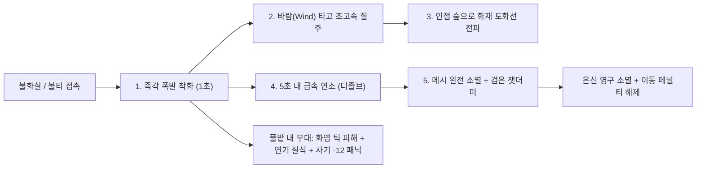
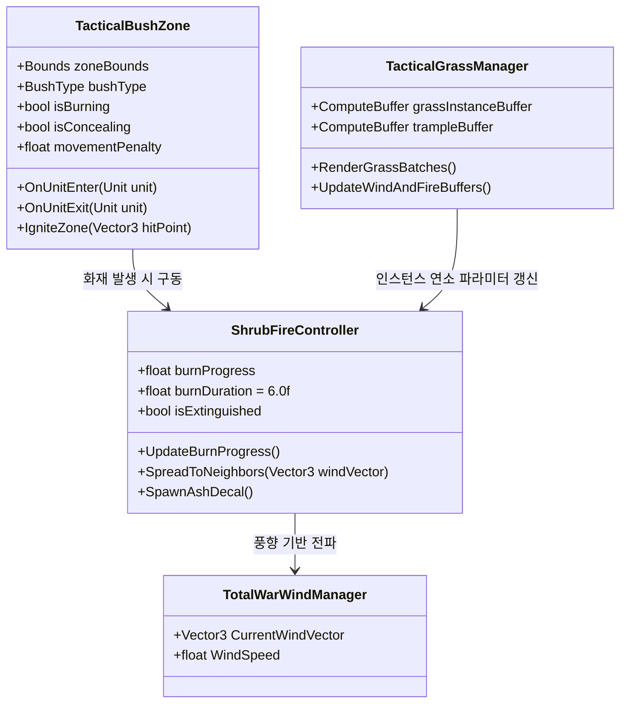

# 🌾 삼국지 토탈워 전장 풀·관목 시스템 및 연소·은신 상호작용 기술 기획서

본 문서는 **삼국지 토탈워(Total War: Three Kingdoms)** 원작의 하층 식생(Understory: 풀, 잔디, 관목, 농작물) 시스템을 역공학(REA) 분석하여, **1) 풀·관목 전용 대량 렌더링**, **2) 전술 은신 및 이동 페널티 기능**, **3) 초고속 연소(Flashover) 및 화염 고속도로(Wildfire Highway)**, **4) 부대 돌격에 의한 짓밟힘(Trample)** 파이프라인을 정의한 종합 기술 기획서입니다.

---

## 💡 1. 핵심 요약 & 시스템 목표 (Summary & Objective)

현재 수목(Trees) 시스템의 렌더링, 적설, 잎사귀 디졸브 및 화재 연소 라이프사이클이 완성 단계에 도달함에 따라, 다음 단계 과제로서 **전장의 바닥을 채우는 풀(Grass)과 관목(Shrubs)** 시스템을 구축합니다.

토탈워에서 풀과 관목은 단순한 배경 그래픽이 아니라, **"화공(火攻)의 도화선이자 매복의 성지"**입니다. 나무와 달리 극도로 빠른 연소 속도를 가지며, 바람을 타고 불길을 전파하고, 보병을 숨겨주거나 기병의 돌격을 둔화시키는 핵심 전술 매개체로 동작합니다.

```
+-----------------------------------------------------------------------------------+
|                        삼국지 토탈워 풀·관목 전장 생태계                          |
+-----------------------------------------------------------------------------------+
|  [평상시 전술 기능]                                                              |
|   - 키 큰 풀(코끼리풀, 갈대, 벼)에 보병 매복 시 완전 은신 (적 15m 접근 시 노출) |
|   - 빽빽한 관목/습지 통과 시 이동 속도 20~30% 감소 및 기병 돌격 보너스 감쇄      |
|                                                                                   |
|  [화재 발생 시 연계]                                                              |
|   - 불화살 접촉 시 1초 만에 폭발적 착화 (Flashover)                              |
|   - 바람(Wind)을 타고 나무와 나무 사이를 연결하는 화재 고속도로 (Wildfire)       |
|   - 5~8초 내 잎이 완전 전소되며 지면에 잿더미 데칼(Ash)만 남기고 메시 소멸       |
|   - 불타는 수풀 통과 부대 지속 화염 피해 + 짙은 연기로 시야 차단 + 사기 패닉     |
|                                                                                   |
|  [물리 인터랙션]                                                                  |
|   - 기병/보병 방진 통과 시 풀이 바닥으로 눕는 짓밟힘(Trample) 연출               |
|   - 대규모 부대가 불타는 풀을 통과할 경우 불길을 밟아 꺼뜨리는 진화(Smother)     |
+-----------------------------------------------------------------------------------+
```

---

## 🌿 2. 토탈워 원작 식생(풀/관목) 분류 및 데이터 로드맵

삼국지 토탈워 원본의 풀 시스템은 **"독립 3D 관목(Shrubs)"**과 **"지표면 잔디 다발(Terrain Detail Grass)"**의 이원화 구조로 되어 있습니다.

### 2.1 독립 3D 관목 및 대형 초본 (3D Mesh Shrubs)
전장에 군락 단위로 배치되며, 나무처럼 독립 3D 메시로 렌더링되는 중·대형 식생입니다.

| 식생 명칭 | 삼탈워 에셋 키 | 크기 및 형태 | 전술적 역할 및 물리 특성 |
| :--- | :--- | :--- | :--- |
| **코끼리풀 (Elephant Grass)** | `Shrub_ElephantGrass_A` | 높이 1.8~2.5m 대형 억새 | **최고급 은신 수풀**: 보병 서서 매복 가능, 화재 시 거대한 불기둥 형성 |
| **검고사리 (Sword Fern)** | `Shrub_Fern_Sword_A` | 높이 0.8~1.2m 양치식물 | 숲속 하층 식생, 포복 보병 은신, 건조 시 빠른 연소 |
| **왕고사리 (Royal Fern)** | `Fern_Royal_A` | 높이 1.0~1.5m 대형 고사리 | 습지/음지 은신 수풀, 통과 시 경미한 이동 속도 저하 |
| **은방울꽃 (Convallaria)** | `Convallaria_Shrub_A` | 높이 0.4~0.7m 야생초 | 평원 군락, 시각적 풍성함 제공, 낮은 이동 저항 |
| **철쭉 (Rhododendron)** | `Shrub_Rhododendron_A` | 높이 1.2~1.8m 목본 관목 | 단단한 가지로 기병 돌격 둔화, 중등도 연소 속도 |
| **차나무 (Tea Shrub)** | `Shrub_Tea_A` | 높이 1.0~1.4m 차 밭 관목 | 규칙적 배치 가능, 농경지 전술 지형 형성 |
| **벼 / 기장 (Rice & Millet)** | `Shrub_Rice_A`, `Shrub_Millet_A` | 높이 1.0~1.6m 농작물 | 황금빛 곡식 밭, 불화살 명중 시 광역 화재 발생 |
| **연꽃 (Lotus)** | `Shrub_Lotus_A` | 수면/습지 부유 식생 | 습지 기동 극단적 둔화, 수중 화재 면역 |

### 2.2 지표면 잔디 및 잡초 다발 (Terrain Detail Grass & Clumps)
바닥을 융단처럼 덮는 초경량 크로스 쿼드(Cross-Quads) 메시로, GPU 인스턴싱을 통해 수만 개 단위로 렌더링됩니다.

- **잔디 다발 (Grassclump 시리즈)**:
  - `shrub_grassclump_tall` (A~D): 바람에 크게 흔들리는 키 큰 잔디 다발
  - `shrub_grassclump_thick` (A~C): 빽빽한 야생 잔디
  - `shrub_grassclump_dry` (A~D): 황색으로 바싹 마른 잔디 (화재 전파 속도 최고)
  - `seedheads` (A~C): 강아지풀/이삭 형태의 가을 들풀
- **지표 바닥 잡초 (Flat Shrubs)**:
  - `tree_shrub_flat` (A~E): 지면에 납작하게 깔리는 바닥 잡초

---

## ⚔️ 3. 풀·관목 3대 전술 게임플레이 기능 (Tactical Gameplay)

```
[유닛 이동] ───> [키 큰 풀밭/관목 진입]
                     │
                     ├──> 1. [은신 판정]: 적 15m 밖에서 완전 투명화 (Stealth Buff)
                     ├──> 2. [기동 페널티]: 이동 속도 -25%, 피로도 증가, 돌격 보너스 상쇄
                     └──> 3. [사격 차폐]: 저각 직사 화살 피격 확률 -20% 감소
```

### 3.1 수풀 은신 및 기습 매복 (Stealth & Ambush)
- **발동 조건**: 유닛의 발자국 좌표가 풀 군락 영역(`TacticalBushZone`) 내부에 위치할 때.
- **은신 메커니즘**:
  - 유닛 상태에 `IsConcealed = true` 플래그 부여.
  - 적군 시야(Fog of War) 및 타겟팅 레이캐스트에서 완전히 배제되어 미니맵과 화면에서 사라짐.
- **은신 해제(Reveal) 조건**:
  - 적 부대가 15m 이내로 근접 접근 시 (발각).
  - 은신 중인 부대가 사격(Shoot) 또는 백병전 공격을 개시할 때.
  - **풀밭에 불이 붙어 연소될 때 (강제 노출)**.

### 3.2 이동 속도 저하 및 기병 돌격 보너스 감쇄 (Movement & Charge Resistance)
- **이동 속도 페널티**:
  - 보병: 이동 속도 15~20% 감소, 초당 피로도(Fatigue) 소모 1.5배 증가.
  - 기병: 이동 속도 25~35% 대폭 감소.
- **돌격 보너스(Charge Bonus) 상쇄**:
  - 빽빽한 관목(철쭉, 코끼리풀) 속으로 돌격하는 기병은 충격 가속도가 죽어 돌격 보너스의 40%가 강제 차감됨.

### 3.3 직사 사격 궤적 차폐 (Missile Trajectory Occlusion)
- 고사리밭이나 코끼리풀 군락 뒤에 웅크린 보병 방진은 궁병의 저각 직사 화살에 대해 **20%의 탄도 차폐(Cover) 보너스**를 받아 생존율이 증가합니다 (곡사 투석/화살비에는 영향 없음).

---

## 🔥 4. 풀·관목 초고속 화재 연소 및 화염 고속도로 (Wildfire Highway)

나무와 풀의 화재는 물리적 특성과 연소 메커니즘이 완전히 다릅니다.

```
[연소 특성 비교]
구분             나무 (Trees)                    풀 / 관목 (Grass & Shrubs)
---------------------------------------------------------------------------------
착화 시간        3~5초 (게이지 누적 필요)         0.5~1초 (접촉 즉시 발화 Flashover)
전소 시간        30~45초                         5~8초 (극초고속 전소)
화재 전파 속도   느림 (나무 간격 넓음)           매우 빠름 (지면을 타고 폭풍 질주)
연소 후 잔해     앙상한 숯 기둥(Trunk) 보존      메시 완전 소멸 + 지면 잿더미 데칼(Ash)
```



### 4.1 초고속 발화 및 급속 연소 (Flash Combustion)
- **착화 (0 ~ 1초)**:
  - 불화살 명중 또는 인접 화염원 접촉 시 지연 없이 즉각 발화.
  - 마른 잔디(`shrub_grassclump_dry`)의 경우 전파 확률 95%, 0.5초 만에 화염 방출.
- **격렬 연소 및 디졸브 (1 ~ 5초)**:
  - 풀의 잎사귀가 불길에 휩싸이며 아래에서 위로 급속히 타오름.
  - 버텍스 셰이더의 `_BurnProgress`가 5초 만에 0.0에서 1.0으로 도달.
  - 풀 줄기가 열기에 오그라들며(Shrinking Vertex Offset) 지면으로 주저앉음.
- **소멸 및 잿더미 환원 (5 ~ 8초)**:
  - 3D 풀 메시가 완전히 알파 디졸브되어 사라짐.
  - 풀이 서 있던 자리에 검게 탄 지면 잿더미 데칼(Ash Decal)이 바닥에 프로젝션됨.

### 4.2 화재 고속도로 (Wildfire Highway) - 풍향 연동 연쇄 전파
- 풀밭은 나무와 나무 사이, 진지와 진지 사이를 잇는 **거대한 도화선**입니다.
- **바람 벡터 연동 공식**:
  ```
  전파 거리 = 기본 4.5m + 바람세기 * dot(이웃풀방향, 바람방향) * 4.0m
  ```
- 순풍이 불 때 풀밭에 불을 지르면 **초당 8~12m의 속도로 불길이 들판을 가로질러 폭풍처럼 질주**하여, 멀리 떨어진 숲과 적 방진을 순식간에 화염 지옥으로 몰아넣습니다.

### 4.3 질식 연기와 사기 충격 (Smoke & Morale Panic)
- 불타는 풀밭에서는 짙은 백황색 연기가 대량 발생하여 해당 지역의 **시야(Fog of War)를 100% 차단**합니다.
- 불타는 풀밭에 갇히거나 통과하는 부대:
  - 초당 최대 체력의 3% 화염 틱 피해.
  - **[들불 패닉: 사기 -12]** 디버프 부여로 순식간에 패주 유도.

---

## 👣 5. 물리 상호작용: 짓밟힘(Trample)과 화재 진화(Smothering)

### 5.1 부대 진군에 의한 풀 눕힘 (Trample & Bending)
- 보병 및 기병 방진이 풀밭을 지나갈 때, 유닛들의 충돌체 또는 이동 벡터에 반응하여 풀잎이 진행 방향으로 납작하게 눕는 연출입니다.
- **구현 방식**:
  - 버텍스 셰이더에서 유닛 위치 목록(또는 이동 궤적 텍스처)을 읽어 버텍스 높이를 지면으로 꺾음(Push Down).
  - 유닛이 지나간 뒤 2~4초에 걸쳐 천천히 원래 각도로 복원(Spring Elasticity).

### 5.2 부대 돌격에 의한 화재 진화 (Fire Smothering)
- **토탈워 특유의 물리 반전**:
  - 막 불이 붙기 시작한 작은 풀밭이나 잔디 다발을 **수백 명의 밀집 보병이나 중기병 방진이 밟고 지나갈 경우**, 산소 차단 및 짓밟힘 판정으로 **풀 화재가 밟혀 꺼지는(Smothered)** 상호작용.
  - 반대로 불이 최대로 타오른 상태(Full Blaze)일 때는 밟고 지나가는 부대가 치명타를 입음.

---

## 🎨 6. 대량 렌더링 및 셰이더 파이프라인 (Rendering Pipeline)

전장에 수만 포기가 깔리는 풀의 특성상 일반 GameObject 방식은 드로우콜 폭발을 일으키므로, **GPU 인스턴싱 파이프라인**을 구축합니다.

```
+-----------------------------------------------------------------------------------+
|                        풀·관목 전용 GPU 인스턴싱 렌더링 파이프라인                |
+-----------------------------------------------------------------------------------+
|  1. 지형 밀도 맵(Terrain Density Mask) 또는 배치 그리드에서 풀 위치 추출          |
|  2. Graphics.RenderMeshIndirect / DrawMeshInstancedIndirect 사용                   |
|  3. 카메라 거리 기반 페이드아웃: 0~40m(선명) -> 40~70m(알파 디더링) -> 70m+(컬링)|
|  4. TotalWarFoliageWind.shader 내 풀 전용 파라미터 분기:                          |
|     - _IsGrass: 크로스 쿼드 전용 바람 흔들림 (밑동 고정, 상단 물결 노이즈)       |
|     - _BurnProgress: 0.0 -> 1.0 (급속 흑화 + 오그라듦 + 알파 디졸브 소멸)        |
|     - _TrampleBend: 부대 발자국에 의한 지면 눕힘 벡터 적용                         |
+-----------------------------------------------------------------------------------+
```

---

## ⚙️ 7. 시스템 아키텍처 및 스크립트 설계



---

## 📅 8. 단계별 개발 로드맵 (Development Roadmap)

### 📌 1단계: 에셋 추출 및 프리팹 구축 (Asset Extraction)
- 삼탈워 원본에서 잔디 다발(`Grassclump` tall/thick/dry) 및 바닥 잡초(`Flat Shrubs`) 추가 추출.
- 기존 15종 3D 관목(코끼리풀, 고사리, 철쭉, 차나무 등)과 함께 `Bush/Shrub Prefab Palette` 완성.

### 📌 2단계: 풀·관목 전용 셰이더 및 디졸브 연소 구현 (Shader & VFX)
- `TotalWarFoliageWind.shader`에 풀 전용 키워드(`_IS_SHRUB_GRASS`) 및 급속 오그라듦/디졸브 로직 추가.
- 풀 전용 급속 화염/불티/연기 경량 VFX 프리팹 및 지면 잿더미 데칼(Ash Decal) 제작.

### 📌 3단계: 초고속 연소 및 화재 고속도로 시스템 구축 (Fire Simulation)
- `ShrubFireController.cs` 구현: 1초 착화, 6초 전소, 풍향 연동 4~8m 고속 전파.
- 숲(`TacticalForestZone.cs`)과 연동하여 들판에서 숲으로 불길이 옮겨붙는 체인 리액션 검증.

### 📌 4단계: 은신(Stealth) 및 이동 페널티 전술 시스템 바인딩 (Tactics)
- `TacticalBushZone.cs` 구현: 유닛 진입 시 은신 부여, 이동속도 감쇄.
- 화재 시 은신 강제 해제, 내부 유닛 지속 화염 피해 및 사기(-12) 패닉 디버프 연동.

### 📌 5단계: GPU 인스턴싱 대량 배치 및 짓밟힘(Trample) 연동 (Optimization & Polish)
- 대량의 잔디 다발을 위한 인스턴싱 렌더러 구축 및 카메라 거리 페이드아웃 적용.
- 유닛 진군 시 풀이 눕는 짓밟힘(Trample) 및 초기 화재 짓밟아 끄기(Smothering) 완성.
