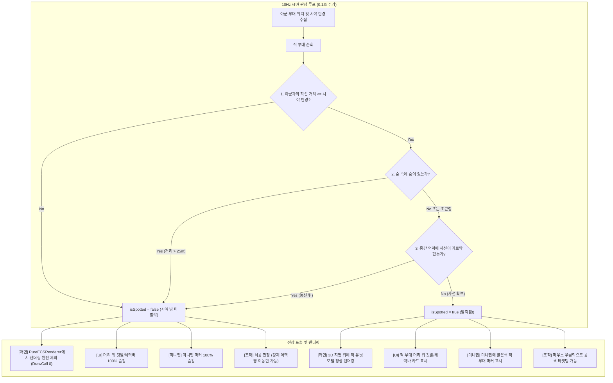

# 👁️ 삼국지 토탈워 방식 시야 & 적군 탐지 시스템 (Line of Sight & Concealment) 기획서

> **문서 상태**: 사용자 요구사항 100% 반영 완료 (삼국지 토탈워 전술 전투 방식 확정)  
> **관련 모듈**: `VisionDetectionManager.cs`, `Squad.cs`, `PureECSRenderer.cs`, `MinimapManager.cs`, `SquadIconUI.cs`, `TerrainHeightManager.cs`  
> **목표 성능**: 10,000기 이상 유닛 격돌 시 **250 ~ 300 FPS** 유지 (Zero DrawCall 인스턴싱 컬링)

---

## 💡 1. 핵심 요약 & 기획 의도 (Summary & Vision)

사용자 피드백을 반영하여, 스타크래프트식의 인위적인 검은 구름 안개(Black Shroud)를 전면 배제하고, **《토탈워: 삼국(Total War: Three Kingdoms)》 오리지널의 정통 전술 시야 & 적군 은폐(Concealment & Detection) 시스템**을 구축합니다.

```mermaid
flowchart TD
    A["전장 지형 (Terrain, 언덕, 강, 숲)"] -->|항상 100% 선명하게 보임| B["플레이어 화면 & 미니맵"]
    C["적 부대 / 적 유닛"] --> D{아군 유닛의 시야(LoS) 내 포착 여부}
    D -- "포착 안 됨 (사거리 밖 / 언덕 너머 / 숲 속 은폐)" --> E["100% 투명 은폐 (화면/UI/미니맵 미표시, 타겟팅 불가)"]
    D -- "포착됨 (Spotted! 아군 시야선 확보)" --> F["화면에 즉시 출현 + 부대 깃발/체력바 + 미니맵 적색 마커 표시"]
```

### 🎯 핵심 특징 (삼국지 토탈워 스타일)
1. **지형은 항상 100% 선명하게 보임**:
   - 맵 전체의 언덕, 평야, 숲, 바위 등 3D 지형은 시작부터 끝까지 아름답고 시원하게 조망 가능.
   - 어두운 암흑 안개로 지형을 가리지 않음.
2. **적 부대/유닛의 완전 은폐 (Concealment)**:
   - 아군의 시야선(Line of Sight)이 닿지 않는 곳에 있는 적 부대는 **병사 모델, 머리 위 깃발/체력바, 미니맵 마커가 전면 은폐(Invisible)**.
   - 플레이어는 적이 어디에 배치되어 있는지 정찰하기 전까지 알 수 없음.
3. **언덕 능선 너머 사각지대 (Ridge LoS Block)**:
   - 언덕 너머 저지대에 배치된 적은 평지에서는 보이지 않으며, 아군이 **언덕 정상(고지대)에 오르거나 능선을 넘어가야만 적군이 갑자기 시야에 포착**됨.
4. **숲(Forest) 속 은폐 & 매복 ([TacticalForestZone.cs](file:///c:/unityProject/MiniTotalWar2D/Assets/Scripts/TacticalForestZone.cs) 연동)**:
   - 전장에 배치된 전술 숲 구역 내부로 들어간 부대는 `isHiddenInForest = true`가 되어, 아군이 **25m 이내로 초근접하기 전까지 완전히 은폐**됨.
   - 단, 부대가 전력질주(구보 질주) 중일 때는 소음과 먼지로 인해 45m로 피탐지 거리가 확장됨.
   - 숲을 가로지르는 사선은 언덕처럼 차폐되어 숲 너머의 적 부대 또한 시야에서 차단됨.
5. **사선 차폐 시 적/아군 원거리 곡사 사격 완전 차단 (No Sight, No Fire)**:
   - 언덕 능선이나 지형 장애물, 숲 지대로 차폐되어 시야(Line of Sight)가 확보되지 않은 상태라면, **적 원거리 부대(궁병 등)도 아군을 타겟팅하여 곡사(HighArc)로 공격할 수 없습니다.**
   - "보이지 않는 목표는 쏠 수 없다"는 원칙을 적용하여, 적 AI 역시 아군을 시야에 포착하기 위해 능선 위로 전진하거나 정찰 부대를 보내 시야를 확보해야만 비로소 곡사 공격을 시작합니다.
6. **적 부대 이동 경로선(Path Line) 완전 은폐**:
   - 적 부대가 이동할 때 지면에 실시간으로 그려지는 웨이포인트 궤적선(`pathLineRenderer`)은 플레이어에게 100% 숨겨지며, 오직 **[F12] 전체 시야(맵핵) 디버그 모드가 켜져 있을 때만** 디버깅용으로 화면에 표시됩니다.
7. **디버그 모드 F12 키 일원화**:
   - 기존의 Performance HUD와 연동하여 **[F12]** 키 하나로 성능 HUD 표시 및 "전체 시야 맵핵 디버그 모드(Full Vision Debug)"를 1:1 동기화 통합 제어합니다.
8. **발각 알림 (Spotted Alert)**:
   - 시야 밖에서 숨어 있던 적 부대가 아군 시야에 처음 포착되는 순간, 부대 머리 위 깃발이 번쩍이며 "적군 발견!" 전술 상황 연출.

---

## 🧠 2. 6단계 아키텍처 분석 (6-Step Problem Solving Framework)

### 1단계: 맥락 (Context)
- 현재 프로젝트는 전장의 모든 적 유닛과 부대 깃발, 미니맵 마커가 항상 훤히 다 보여서, 고지대 정찰이나 언덕 너머 매복 같은 토탈워 고유의 전술적 긴장감이 발생하지 않음.
- 지형 고도 시스템(`TerrainHeightManager`)에 이미 초고속 지형 사선 검사(`CheckLineOfSightFast`) 알고리즘이 탑재되어 있어, 언덕 차폐 연산에 즉시 활용 가능.

### 2단계: 목적 (Objective)
- 지형을 어둡게 가리지 않고 자연스러운 3D 전장을 유지하면서, 적군에 대한 정보만 철저하게 아군 시야에 종속시키는 삼국지 토탈워식 정찰·매복 시스템 완벽 구현.
- 10,000기 이상 유닛이 교전하는 환경에서도 프레임 저하 없이 0.1초 주기(10Hz)로 부대 단위 시야를 갱신.

### 3단계: 현안문제 (Key Issues & Challenges)
1. **유닛별 1:1 시야 검사 시 연산 폭발 방지**:
   - 아군 유닛 5,000기 x 적군 유닛 5,000기 = 25,000,000회 연산 -> 프레임 급락.
   - **해결책**: 토탈워 공식대로 **부대 중심점(Squad Center) 및 바운딩 반경(Radius)**을 기준으로 부대 대 부대(Squad-to-Squad) 시야 검사를 1차로 수행.
     - 1차: O(아군 부대 수 x 적 부대 수) (약 10 x 10 = 100회 연산으로 0.01ms 내 완료).
     - 2차: 독립 자유 유닛만 Spatial Grid를 통해 주변 아군과 국소 검사.
2. **Pure ECS 적 엔티티의 초고속 은폐 컬링**:
   - 발각되지 않은 적 부대 소속 엔티티는 `PureECSRenderer`에서 `Matrix4x4[]` 버퍼 적재를 즉시 `continue`로 건너뜀.
   - 결과적으로 **화면에 보이지 않는 적 유닛은 GPU 렌더링 비용이 0(Zero Cost)**이 되어 FPS가 더욱 향상됨.
3. **미니맵 및 UI 동기화 누수 차단**:
   - 화면에서만 감추고 미니맵이나 머리 위 UI 카드를 끄지 않으면 위치가 탄로남.
   - `MinimapSquadMarker`와 `SquadIconUI`의 활성화 조건을 `squad.isSpotted` 플래그로 100% 동기화.
4. **적 이동 경로선(Path Line) 정보 누출 차단**:
   - 부대가 이동할 때 지면에 그려지는 웨이포인트 경로선(`SquadPathLine`)을 적 부대에 대해서는 기본적으로 끄고, [F3] 맵핵 모드에서만 선택적으로 표시.

---

## 🌳 3. 아키텍처 트리 맵 (Architecture Tree Map)

```text
VisionSystem (삼국지 토탈워식 시야 시스템)
├── 1. 시야 감지 관리자 (VisionDetectionManager.cs, Singleton)
│   ├── 10Hz 비동기 갱신 루프 (UpdateVisionLoop)
│   ├── 아군 시야원 수집 (Player Squads & Free Units)
│   ├── 적 부대 거리 판정 (Distance Check)
│   ├── 지형 능선 사선 차폐 검사 (TerrainHeightManager.CheckLineOfSightFast)
│   └── 숲/수풀 은폐 여부 검사 (Forest Concealment Check)
├── 2. 부대 상태 플래그 및 이벤트 (Squad.cs 확장)
│   ├── public bool isSpotted = true; (플레이어 관점에서의 노출 여부)
│   ├── public bool isHiddenInForest = false; (숲 매복 상태)
│   ├── public float visionRange; (병과별 시야 거리)
│   └── OnSpottedEvent() (최초 발각 시 시각 효과/알림)
├── 3. 렌더링, 경로선 및 UI 가시성 차단 (Zero-Cost Visibility)
│   ├── PureECSRenderer: !squad.isSpotted인 적 엔티티 렌더링 제외 (DrawCall 0)
│   ├── Unit.cs (GameObject): !isSpotted인 경우 렌더러 일괄 비활성화
│   ├── SquadPathLine: 적 부대의 이동 경로선(LineRenderer) 100% 숨김 ([F3] 디버그 모드에서만 표출)
│   ├── SquadIconUI: !isSpotted인 적 부대 머리 위 깃발/체력바 숨김
│   └── MinimapSquadMarker: !isSpotted인 적 마커 미니맵에서 숨김
├── 4. 원거리 사격 및 타겟팅 통제 (Squad.cs / AI / ECS System)
│   ├── 언덕 능선 차폐 시 적 원거리 부대의 곡사(HighArc) 사격 원천 차단 (No Sight, No Fire)
│   ├── 시야 미확보 시 사격 중지 및 언덕 위 시야 확보를 위한 전술 전진 유도
│   └── 플레이어 아군 궁병 역시 언덕 뒤 차폐된 적에게 곡사 공격 불가 (상호 공평 규칙)
└── 5. 디버그 및 조작 연동 (PlayerController.cs / FPSCounterHUD.cs)
    ├── 은폐된 적 부대 마우스 클릭 타겟팅 차단
    └── [F3] 키: Performance HUD와 일원화된 전체 시야 맵핵 디버그 토글 (적 이동 경로선 포함)
```

---

## 🔀 4. 데이터 파이프라인 흐름도 (Mermaid Data Flow)



---

## ⚙️ 5. 주요 설정 변수 및 병과별 시야 거리 (Inspector Fields)

| 병과 / 요소 | 기본 시야 거리 (Vision Range) | 특성 및 전술적 역할 |
| :--- | :--- | :--- |
| **보병 (Sword / Spear)** | `90m` | 표준 전선 시야. 언덕 아래에 있으면 능선 너머를 볼 수 없음 |
| **궁병 (Archer / Gunner)** | `130m` | 장거리 관측 시야. 고지대에 배치 시 최대 `170m`까지 시야 확장 |
| **기병 (Cavalry)** | `160m` | 최고 속도 수색 시야. 전장 외곽 및 측면 정찰에 필수적 |
| **숲 매복 감지 거리** | `25m` | 숲 속에 은폐한 적은 초근접(25m)해야만 비로소 발각됨 |
| **고지대 시야 보너스** | `+30% ~ +50%` | 언덕 정상에 위치할 경우 시야가 대폭 증가하여 전장 조망 |

---

## 🛠️ 6. 핵심 알고리즘 및 코드 설계

### 1. 지형 능선 차폐 검사 (`VisionDetectionManager`)
```csharp
// 아군 부대와 적 부대 사이의 언덕 차폐 여부 검사
Vector3 friendEye = friendSquad.GetVisualCenter() + Vector3.up * 1.8f;
Vector3 enemyPos = enemySquad.GetVisualCenter() + Vector3.up * 1.8f;

// TerrainHeightManager의 초고속 LoS 레이마칭 활용
bool isBlockedByTerrain = TerrainHeightManager.CheckLineOfSightFast(friendEye, enemyPos, stepSize: 4.0f, heightTolerance: 0.5f);

if (isBlockedByTerrain)
{
    // 언덕 능선에 가로막혀 적 부대를 볼 수 없음!
    return false;
}
```

### 2. 적 엔티티 초고속 렌더링 컬링 (`PureECSRenderer.cs`)
```csharp
// 적 엔티티 순회 시 소속 부대가 발각(isSpotted)되지 않았다면 즉시 건너뜀!
if (tag.Faction == 2) // 적군
{
    Squad enemySquad = SquadManager.GetSquadById(tag.SquadId);
    if (enemySquad != null && !enemySquad.isSpotted)
    {
        // ⚔️ 시야에 없는 적군은 GPU 행렬 버퍼에 전혀 담지 않음 (성능 대폭 향상!)
        continue;
    }
}
```

### 3. 미니맵 및 머리 위 UI 연동
```csharp
// MinimapSquadMarker.cs
if (targetSquad.isPlayer)
{
    markerImage.enabled = true;
}
else
{
    // 적 부대는 아군에게 발각(isSpotted)되었을 때만 미니맵에 표시!
    markerImage.enabled = targetSquad.isSpotted;
}
```

---

## 📅 7. 단계별 개발 로드맵

1. **1단계 (시야 관리자 및 상태 플래그 구축)**:
   - `VisionDetectionManager.cs` 생성.
   - `Squad.cs`에 `isSpotted`, `visionRange` 필드 추가.
   - 아군 부대와 적 부대 간의 거리 및 언덕 차폐(`CheckLineOfSightFast`) 판정 엔진 구현.
2. **2단계 (적군 렌더링 & UI 가시성 차단)**:
   - `PureECSRenderer`에서 `!isSpotted` 적 엔티티 렌더링 제외.
   - `SquadIconUI` (머리 위 카드) 및 `MinimapSquadMarker` 숨김 연동.
   - `PlayerController`에서 은폐된 적 클릭 방지.
3. **3단계 (고지대 시야 보너스 & 사선 차폐 시 곡사 사격 차단)**:
   - 고지대에 위치한 부대의 시야 반경 동적 확장 (+30% ~ +50%).
   - 숲 속 유닛 근접 감지(25m) 규칙 적용.
   - **사선 차폐 시 적/아군 곡사(HighArc) 사격 원천 금지**: 언덕 뒤 보이지 않는 적에 대한 사격 타겟팅 차단 및 적 AI의 전술 전진 유도.
4. **4단계 (F3 통합 디버그 토글 및 연출)**:
   - `[F3]` 키로 Performance HUD와 함께 "전체 시야 맵핵 모드(Full Vision Debug)" 실시간 On/Off 연동.
   - 은폐되어 있던 적 부대 최초 발각 시 시각적 알림 연출.
