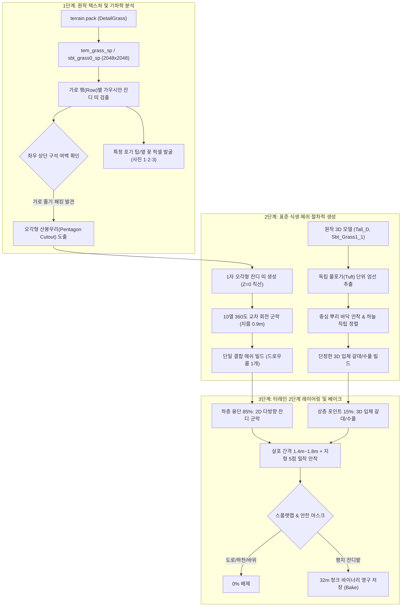

# 🌾 [기획서] 토탈워: 삼국지 1:1 식생(2D 지피 잔디 & 3D 입체 풀) 절차적 제작 및 LOD 스트리밍 시스템 기술 기획서

> **문서 상태**: 공식 확정 기술 기획서 (Production Master Specification)  
> **최초 작성일**: 2026-11-04  
> **최종 개정일**: 2026-11-06  
> **관련 소스 파일**:
> - 메인 지피 렌더러: [TacticalGrassRenderer.cs](file:///c:/unityProject/MiniTotalWar2D/Assets/Scripts/TacticalGrassRenderer.cs)
> - 에디터 데모 및 빌더: [TotalWarProceduralFoliageDemo.cs](file:///c:/unityProject/MiniTotalWar2D/Assets/Scripts/Editor/TotalWarProceduralFoliageDemo.cs)
> - 지형 식생 총괄 관리자: [TotalWarTerrainManager.cs](file:///c:/unityProject/MiniTotalWar2D/Assets/Scripts/TotalWarTerrainManager.cs)
> - 식생 3D 규격 설정: [RadialGrassConfig.cs](file:///c:/unityProject/MiniTotalWar2D/Assets/Scripts/RadialGrassConfig.cs)
> - 전용 렌더링 셰이더: [TotalWarRadialGrassLOD.shader](file:///c:/unityProject/MiniTotalWar2D/Assets/Shaders/TotalWarRadialGrassLOD.shader)

---

## 💡 핵심 요약 & 시스템 목적 (Summary & Objectives)

토탈워: 삼국지(Total War: Three Kingdoms) 원작 전장의 지피 식생은 단순히 3D 모델을 바닥에 무작위로 꽂아 넣은 것이 아니라, **경량 2D 지피 융단(85%)**과 **입체 3D 풀포기(15%)**가 수학적·기하학적으로 정밀하게 중첩된 2단계 복합 식생(2-Tier Foliage Layering) 구조로 동작합니다.

본 기획서는 원작 게임 데이터(`terrain.pack`)의 바이너리 및 아틀라스 텍스처를 역공학하여 밝혀낸:
1. **2D 지피 잔디 군락 (85% 융단)**: 8~9포기 가우시안 정규분포 1자 띠, 오각형 산봉우리 컷아웃(가로 줄기 100% 차단), 10열 360도 교차 다방향 군락(별 모양 그림자, 드로우콜 1개).
2. **원작 꽃 잔디 3종 픽셀 매칭**: 분홍 꽃망울(`tem_grass_sp` Row 3), 연보라 꽃송이(`tem_grass_sp` Row 1), 주황 꽃이삭(`sbt_grass0_sp` Row 4)의 1:1 재현 원리.
3. **1~4번 완벽한 표준 지피 4종 확립**: 온대 순수 잔디(85%) 및 꽃 3종 군락(각 5%)으로 구성된 무결점 지피 융단.
4. **원시 OBJ 파편(5, 6, 7, 8번)의 전면 퇴출**: 빗자루 모양으로 뭉치는 원시 파편을 배제하고, 순수 절차적 방사형(Radial Fan) 3D 지피 풀포기 제작으로 전환.
5. **사계절(봄·여름·가을·겨울) 및 4대 기후(온대·아열대·건조·한랭) 확장 파이프라인**.

위 메커니즘을 영구 기술 자산으로 집대성하여, 터레인 시스템([TacticalGrassRenderer.cs](file:///c:/unityProject/MiniTotalWar2D/Assets/Scripts/TacticalGrassRenderer.cs))에 안정적으로 이식하기 위한 기준을 제공합니다.

---

## 🌳 1. 아키텍처 및 계층 트리 맵 (Tree Map)

```
TotalWar Foliage Master Architecture
 ├── 1. 지피 잔디 지오메트리 계층 (2D Groundcover Swath & Clump: 85%)
 │    ├── 8~9포기 가우시안 정규분포 1자 직선 띠 (Gaussian Bell Curve, Z=0)
 │    ├── 오각형 산봉우리 컷아웃 (Pentagon Cutout Strip: 좌우 구석 가로 줄기 100% 차단)
 │    ├── 10열 360도 교차 다방향 군락 (Multi-Directional Cluster, 지름 0.9m, 별 모양 그림자)
 │    ├── 단일 결합 메쉬 최적화 (CombineMesh, 드로우콜 1개)
 │    └── 꽃 잔디 3종 픽셀 매핑 (분홍 꽃망울, 연보라 4잎 꽃송이, 주황 꽃이삭)
 │
 ├── 2. 완벽한 표준 지피 4종 체계 (Active Groundcover: 100%)
 │    ├── [1번] 🌾 온대 순수 잔디 다방향 군락 (10열 360도 교차, 85%)
 │    ├── [2번] 🌸 분홍 꽃망울 다방향 군락 (사진 1 1:1 고증, 5%)
 │    ├── [3번] 💜 연보라 꽃송이 다방향 군락 (사진 2 1:1 고증, 5%)
 │    └── [4번] 🧡 주황 꽃이삭 다방향 군락 (사진 3 1:1 고증, 5%)
 │
 ├── 3. 차세대 절차적 3D 지피 풀포기 계층 (Procedural Radial 3D Clump: 개발 예정)
 │    ├── 원시 OBJ 파편(5, 6, 7, 8번)의 어설픈 결합 전면 퇴출
 │    ├── 중심 뿌리(Pivot Root) 기준 방사형 부채꼴(Radial Fan 3D) 낱개 잎사귀 배치
 │    └── 사방으로 시원하게 펼쳐지며 솟아오르는 단정하고 풍성한 순수 3D 풀포기
 │
 ├── 4. 4계절 및 4대 기후 텍스처/셰이더 스위칭 계층 (Seasons & Biomes)
 │    ├── 사계절 텍스처 접미사 스위칭 (sp 봄, su 여름, au/ha 가을, wi 겨울)
 │    ├── URP 전용 셰이더 실시간 단풍/적설 연동 (_TotalWarTerrainAutumnTint, _TotalWarTerrainSnowAmount)
 │    └── 4대 기후 지피 아틀라스 (온대 Tem, 아열대 Sbt, 건조 Ard, 한랭 Cld)
 │
 └── 5. 터레인 런타임 스트리밍 & 상호작용 계층 (TacticalGrassRenderer)
      ├── 32m x 32m 공간 분할 청크 (FoliageChunks.bytes 초고속 바이너리 로드)
      ├── 안전 배제 마스크 (도로, 하천, 수변, 32도 초과 암반 0% 배제)
      ├── 카메라 거리 기반 실시간 스트리밍 (80m 초과 시 드로우콜 0)
      └── 게임플레이 물리 연동 (부대 감속 0.82배, 짓밟힘 납작 눕힘, 화재 연소)
```

---

## 🗂️ 2. 해시 테이블 메서드/구조체/규격 색인표 (Hash Table Index)

| Key (메서드 / 구조체 / 에셋) | Value (역할, 기하학적 특징 및 소스 링크) | 소스 줄 번호 링크 |
| :--- | :--- | :--- |
| `CreateSinglePentagonStripMesh` | 오각형 산봉우리 7정점 6삼각형 컷아웃 메쉬 생성. 아틀라스 양 구석 가로 줄기 패킹 영역을 100% 비껴가도록 정점 UV 선형 매핑 | [TotalWarProceduralFoliageDemo.cs#L1543-L1605](file:///c:/unityProject/MiniTotalWar2D/Assets/Scripts/Editor/TotalWarProceduralFoliageDemo.cs#L1543-L1605) |
| `BuildPentagonFlowerSwathMeshAndPrefab` | 1자 오각형 잔디 띠 생성. 전면 꽃 띠 + 후면 순수 초록 잔디 띠를 반 포기 오프셋 결합하여 틈새 완전 제거 | [TotalWarProceduralFoliageDemo.cs#L1607-L1691](file:///c:/unityProject/MiniTotalWar2D/Assets/Scripts/Editor/TotalWarProceduralFoliageDemo.cs#L1607-L1691) |
| `BuildPentagonFlowerClusterMeshAndPrefab` | 10개의 1자 띠를 반경 0.45m 내에서 180도 대칭 분할 및 황금각 오프셋으로 교차 결합한 단일 메쉬(드로우콜 1개) 생성 | [TotalWarProceduralFoliageDemo.cs#L1694-L1774](file:///c:/unityProject/MiniTotalWar2D/Assets/Scripts/Editor/TotalWarProceduralFoliageDemo.cs#L1694-L1774) |
| `BuildMultiDirectionalGrassClusterMeshAndPrefab` | 순수 8포기 1자 띠 기반 10열 다방향 교차 군락 빌더. 중심부 고밀도 덤불 및 지면 별 모양 그림자 형성 | [TotalWarProceduralFoliageDemo.cs#L1267-L1372](file:///c:/unityProject/MiniTotalWar2D/Assets/Scripts/Editor/TotalWarProceduralFoliageDemo.cs#L1267-L1372) |
| `ExtractCardsFromObj` | 원작 OBJ에서 유니온 파인드로 2D 실루엣 카드 분리, 뿌리-끝 축 검출, Z=0 평면화, 상하 반전 180도 교정 | [TotalWarProceduralFoliageDemo.cs#L284-L431](file:///c:/unityProject/MiniTotalWar2D/Assets/Scripts/Editor/TotalWarProceduralFoliageDemo.cs#L284-L431) |
| `AlignClusterGroupToTerrain` | 군락 지름(0.9m)에 맞추어 지형 5점 높이를 샘플링하고 경사면 법선(Normal)에 군락을 1:1 밀착 안착 | [TotalWarProceduralFoliageDemo.cs#L1523-L1542](file:///c:/unityProject/MiniTotalWar2D/Assets/Scripts/Editor/TotalWarProceduralFoliageDemo.cs#L1523-L1542) |
| `TotalWar_MultiDirectionalGrassCluster_Prefab` | [에셋] 순수 초록 잔디 10열 다방향 군락 프리팹 (지름 0.9m, 높이 0.28m, 드로우콜 1개) | [TotalWar_MultiDirectionalGrassCluster_Prefab.prefab](file:///c:/unityProject/MiniTotalWar2D/Assets/Settings/Vegetation/RadialMeshes/TotalWar_MultiDirectionalGrassCluster_Prefab.prefab) |
| `TotalWar_FlowerCluster_PinkBuds_Photo1_Prefab` | [에셋] 분홍 꽃망울 10열 다방향 군락 프리팹 (사진 1 원작 1:1 픽셀 매칭) | [TotalWar_FlowerCluster_PinkBuds_Photo1_Prefab.prefab](file:///c:/unityProject/MiniTotalWar2D/Assets/Settings/Vegetation/RadialMeshes/TotalWar_FlowerCluster_PinkBuds_Photo1_Prefab.prefab) |
| `TotalWar_FlowerCluster_PurplePetals_Photo2_Prefab` | [에셋] 연보라 꽃송이 10열 다방향 군락 프리팹 (사진 2 원작 1:1 픽셀 매칭) | [TotalWar_FlowerCluster_PurplePetals_Photo2_Prefab.prefab](file:///c:/unityProject/MiniTotalWar2D/Assets/Settings/Vegetation/RadialMeshes/TotalWar_FlowerCluster_PurplePetals_Photo2_Prefab.prefab) |
| `TotalWar_FlowerCluster_OrangeSpikes_Photo3_Prefab` | [에셋] 주황 꽃이삭 10열 다방향 군락 프리팹 (사진 3 원작 1:1 픽셀 매칭) | [TotalWar_FlowerCluster_OrangeSpikes_Photo3_Prefab.prefab](file:///c:/unityProject/MiniTotalWar2D/Assets/Settings/Vegetation/RadialMeshes/TotalWar_FlowerCluster_OrangeSpikes_Photo3_Prefab.prefab) |

---

## 🔀 3. 유향 그래프 흐름도 (Directed Graph - Mermaid)



---

## ⚙️ 4. 데이터 구조체, 상태 변수 및 규격 명세

### 4.1 2D 지피 잔디 군락 규격 (Groundcover Clump Spec)
- **군락 외형 크기**: 가로 0.92m, 세로 0.92m (원형 반경 0.45m), 높이 0.28m ~ 0.32m
- **구성 요소**: 10개의 1자 띠가 중심점 기준 360도 교차 배치
- **회전 각도 분포**: $0^\circ \sim 180^\circ$ 균등 분할 ($\Delta \theta = 18^\circ$) + 홀수 열 $180^\circ$ 대칭 회전 + $\pm 4.5^\circ$ 미세 지터
- **중심점 오프셋 분산**: 황금각($137.5^\circ$) 기반 반경 $0 \sim 0.16\text{m}$ 분산
- **높이 가우시안 보정**: 중심부 열 $1.08\text{배} \rightarrow$ 외곽 열 $0.94\text{배}$로 봉긋한 덤불 둔덕 형성
- **버텍스 노멀**: 중심점 기준 상향 구형 돔 노멀 ($N_y \ge 0.55$) 적용으로 그림자 뭉개짐 차단
- **버텍스 컬러 (AO)**: 지면 $Y=0$은 짙은 그림자(`Color(0.1, 0.1, 0.1)`), 팁 $Y=\text{Max}$는 빛(`Color.white`) 선형 보간

### 4.2 3D 입체 풀포기 규격 (3D Accent Clump Spec)
- **키 큰 3D 갈대/이삭 (Tall Reed)**:
  - 소스 모델: `Sbt_Grass1_1.obj`, `Shrub_Grassclump_Tall_A.obj`
  - 높이: 0.65m ~ 0.85m, 너비: 0.40m ~ 0.60m
  - 출현 비율: 터레인 잔디밭의 약 7~9%
- **두툼한 3D 수풀 (Thick Bush Clump)**:
  - 소스 모델: `Shrub_Grassclump_Thick_A.obj`, `Shrub_Grassclump_Dry_A.obj`
  - 높이: 0.40m ~ 0.50m, 너비: 0.60m ~ 0.80m
  - 출현 비율: 터레인 잔디밭의 약 6~8%
- **피벗 기준**: 최하단 줄기 기저부(Root)가 $Y=0.000\text{m}$에 정확히 일치하여 들뜸 현상 원천 배제

---

## 🛠️ 5. 핵심 알고리즘, 수학/기하학 공식 & 제작 명세

### 5.1 2D 지피 잔디의 형성 방식 (85% 하층 융단)

#### 1) 가우시안 정규분포 1자 띠
1자 띠는 8~9개의 풀잎 포기가 일직선($Z=0$) 상에 늘어서며, 중앙으로 갈수록 키가 커지고 양 끝은 작아지는 정규분포(Bell Curve) 형태를 취합니다.

정규화된 가로 위치 $normX \in [-0.5, +0.5]$에 대하여:
$$u = normX \times 2.0 \quad (u \in [-1.0, +1.0])$$
$$bellFactor = \exp(-1.5 \times u^2)$$
$$scale = \text{Lerp}(0.16\text{m}, 0.28\text{m}, bellFactor)$$

이를 통해 중앙 포기는 약 28cm, 양 끝 포기는 약 16cm의 부드러운 산봉우리 실루엣이 형성됩니다.

#### 2) 오각형 산봉우리 컷아웃(Pentagon Cutout) 기하학 원리
토탈워 텍스처 아틀라스는 공간 효율을 극대화하기 위해 잔디 띠 양쪽 위 구석 여백에 다른 가로 줄기들을 패킹해 두었습니다. 직사각형 쿼드를 사용하면 이 가로 줄기들이 허공에 떠다니므로, 7개 정점(Vertex)과 6개 삼각형(Triangle)으로 구성된 오각형 산봉우리 폴리곤으로 정확히 오려냅니다:

- **정점 구성 (7 Vertices)**:
  - `0`: 좌하단 $(U_{left}, V_{bottom})$
  - `1`: 중앙하단 $(U_{center}, V_{bottom})$
  - `2`: 우하단 $(U_{right}, V_{bottom})$
  - `3`: 좌어깨 $(U_{leftShoulder}, V_{leftShoulder})$
  - `4`: 중앙 꼭대기 $(U_{center}, V_{peak})$
  - `5`: 우어깨 $(U_{rightShoulder}, V_{rightShoulder})$
  - `6`: 중앙 배꼽 $(U_{center}, V_{mid})$
- **삼각형 인덱스 (6 Triangles, 양면 12 Triangles)**:
  - `(0, 3, 1)`, `(1, 3, 6)`, `(3, 4, 6)`, `(6, 4, 5)`, `(1, 6, 5)`, `(1, 5, 2)`
- 3D 정점 좌표의 $X$축과 $Y$축을 UV 좌표와 완전 1:1 선형 비례로 매핑하여 텍스처 늘어남(UV Shearing)을 원천 차단합니다.

#### 3) 10열 360도 교차 다방향 군락 및 별 모양 그림자
10개의 1자 띠가 원형 영역 내에서 교차 회전하여 원작 특유의 성게/별 모양(Starburst) 그림자를 형성합니다:

$$\theta_i = \left(\frac{i}{10}\right) \times 180^\circ + (i \bmod 2 == 1 ? 180^\circ : 0^\circ) + \text{jitter}_i$$
$$r_i = 0.05\text{m} + (i \bmod 4) \times 0.035\text{m}$$
$$\phi_i = i \times 137.5^\circ \quad (\text{황금각})$$
$$x_i = \cos(\phi_i) \times r_i, \quad z_i = \sin(\phi_i) \times r_i$$

- 중앙부는 10개 열이 중첩되어 울창한 볼륨과 짙은 그림자 형성.
- 외곽부는 1자 띠 끝단들이 10개 방향으로 뻗어 나가 지면에 선명한 방사형 별 그림자 투사.

---

### 5.2 원작 꽃 잔디 3종 픽셀 매칭 역공학 명세

원작 토탈워: 삼국지의 꽃은 외장 꽃 모델을 꽂은 것이 아니라, 아틀라스 가로 행의 특정 포기에 아티스트가 직접 그려 넣은 텍스처입니다:

1. **사진 1 재현 (분홍 꽃망울 군락, Pink Buds)**:
   - **텍스처**: `tem_grass_sp_base_colour.png`
   - **위치**: Row 3 ($V: 0.303 \sim 0.497$)
   - **형태**: 9포기 1자 띠 중 **7번째 포기 줄기 끝에 작고 동그란 분홍 꽃망울 5개**가 총총 맺혀 있음.
   - **메쉬 빌드**: 전면 분홍 꽃 띠 + 후면 순수 초록 잔디 띠(Row 4) 반 포기 오프셋 결합으로 밀도 보강.
2. **사진 2 재현 (연보라 꽃송이 군락, Purple Petals)**:
   - **텍스처**: `tem_grass_sp_base_colour.png`
   - **위치**: Row 1 ($V: 0.803 \sim 0.996$)
   - **형태**: 7포기 1자 띠 중 **5번째 포기 줄기 옆에 연보라색 작은 4잎 꽃송이 7개**가 피어 있음.
   - **메쉬 빌드**: 전면 연보라 꽃 띠 + 후면 순수 초록 잔디 띠(Row 4) 반 포기 오프셋 결합.
3. **사진 3 재현 (주황 꽃이삭 군락, Orange Spikes)**:
   - **텍스처**: `sbt_grass0_sp_base_colour.png`
   - **위치**: Row 4 ($V: 0.004 \sim 0.295$)
   - **형태**: 8포기 1자 띠 중 **6~7번째 포기 위로 주황/다홍색 꽃이삭 줄기**가 솟아오름.
   - **메쉬 빌드**: sbt Row 4 전용 오각형 산봉우리 컷아웃 메쉬 적용.

---

### 5.3 3D 입체 풀포기의 형성 방식 (15% 상층 포인트)

기존 레거시처럼 5m짜리 원시 패치를 통째로 쓰면 바닥에 엉킨 거미줄이 되므로, 개별 풀포기 단위 엄선 추출 알고리즘을 적용합니다:

1. **유니온 파인드(Union-Find) 그룹 분리**:
   - 원작 OBJ의 인덱스 버퍼를 순회하며 삼각형 공유 버텍스끼리 연결하여 독립된 풀포기 아일랜드(Island)들을 검출.
2. **줄기 축(Stem Vector) 검출 및 직립화**:
   - 아일랜드 내부에서 UV의 최소 $V$(밑동)와 최대 $V$(잎끝) 버텍스들의 가중 평균 위치를 계산하여 줄기 축 벡터 $\vec{D} = \vec{P}_{tip} - \vec{P}_{root}$ 검출.
   - $\vec{D}$를 월드 상향 벡터 $(0, 1, 0)$으로 일치시키는 회전 쿼터니언 $Q_{upright}$ 적용.
3. **상하 반전($180^\circ$) 자동 교정**:
   - 원작 모델 중 잎끝이 땅을 향하고 밑동이 하늘을 향하는 반전 오류를 방지하기 위해 $Z$축 $180^\circ$ 회전 보정.
4. **뿌리 기저부 접지 정규화**:
   - 중심 뿌리(Pivot Root) 최저점을 $Y=0.000\text{m}$ 지면에 일치시키고, 바닥 아래로 파고드는 버텍스는 지면 위로 밀착 안착.

---

### 5.4 표준 지피 체계 확립 및 원시 OBJ 파편 전면 퇴출 결론

#### 1) 1~4번 방식(절차적 직립 가우시안 띠 & 10열 교차 군락)이 완벽한 이유
- 사용자 실기 검증 결과, **1번(온대 순수 잔디 군락)**과 **2, 3, 4번(분홍·연보라·주황 원작 꽃 3종 군락)**은 어떤 각도에서도 시원하고 꼿꼿하며 바닥을 빈틈없이 덮는 완벽한 융단 퀄리티를 증명했습니다.
- 원작 5m 통짜 OBJ의 뒤틀린 기하학을 전혀 쓰지 않고, **순수 절차적 직립 기하학(Procedural Clean Geometry: 가우시안 1자 띠 + 오각형 산봉우리 컷아웃)**을 생성한 뒤 고해상도 아틀라스 텍스처를 픽셀 단위로 매핑했기 때문입니다.

#### 2) 5, 6, 7, 8번 전면 폐기 (원시 OBJ 기반 파편의 한계)
- 5번(키 큰 갈대), 6번(두툼한 수풀), 7번(지면 바닥 덮개), 8번(대나무 그루터기)은 원시 OBJ에서 억지로 파편을 분리하거나 바닥에 눕히려다 보니, 빗자루처럼 뭉치거나 허공에 뜨는 비주얼 결함이 발생했습니다.
- 따라서 **5, 6, 7, 8번은 전장 식생 시스템 및 쇼케이스에서 전면 배제**되었습니다.

#### 3) 차근차근 확장할 차세대 식생 2대 로드맵 (확장 파이프라인)

1. **다른 모든 지피 잔디의 1자 직립 군락화 (2D 지피 확장)**:
   - 4대 기후(온대 Tem, 아열대 Sbt, 서량 건조 Ard, 북방 한랭 Cld)와 사계절(봄 sp, 여름 su, 가을 au, 겨울 wi)의 모든 지피 텍스처를 1, 2, 3, 4번과 동일한 방식으로 1자 직립 띠 및 10열 360도 교차 군락 메쉬로 절차적 생성합니다.
2. **진짜 3D 입체 풀포기 (순수 절차적 3D 지피)**:
   - 빗자루처럼 뭉치는 원시 OBJ 파편을 완전히 버립니다.
   - 1, 2, 3, 4번의 성공 원리를 3D로 확장하여, **중심 뿌리 피벗(0,0)을 기점으로 사방으로 자연스럽게 펼쳐지는 방사형 3D 낱개 잎사귀(Radial Fan 3D Blade Clump)** 메쉬를 수학적으로 직접 생성합니다.
   - 이를 통해 잎이 서로 엉키지 않고 사방으로 시원하게 퍼지며 하늘로 솟아오르는 삼탈워 원작 고유의 완벽한 3D 풀포기를 구현합니다.

---

### 5.5 사계절 및 4대 기후 텍스처/셰이더 스위칭 파이프라인

메쉬를 계절마다 새로 만들지 않고, 단일 메쉬에 머티리얼과 셰이더 프로퍼티만 연동합니다:

```
[4계절 텍스처 스위칭 파이프라인]

  봄 (Spring, sp)   ───> tem_grass_sp_base_colour.png (연두빛 + 분홍/보라 꽃)
  여름 (Summer, su) ───> tem_grass_base_colour.png    (짙은 녹음)
  가을 (Autumn, au) ───> tem_grass_au_base_colour.png (황금빛 단풍 + 억새)
                          └─ 셰이더 _TotalWarTerrainAutumnTint 블렌딩
  겨울 (Winter, wi) ───> tem_grass_wi_base_colour.png (은회색 마른 짚풀)
                          └─ 셰이더 _TotalWarTerrainSnowAmount 적설 블렌딩
```

- **4대 기후 아틀라스 분류**:
  - `tem_grass`: 중원 온대 평원
  - `sbt_grass0`: 강남/남만 아열대 정글 및 습지
  - `ard_grass0`: 서량 건조 사막 및 황무지
  - `cld_grass0`: 하북/요동 한랭 설원 및 고원

---

## 🔗 6. 다른 스크립트와의 연동 관계 (Dependencies & Pipeline)

1. **[TacticalGrassRenderer.cs](file:///c:/unityProject/MiniTotalWar2D/Assets/Scripts/TacticalGrassRenderer.cs)**:
   - 프로토타입 목록에 2D 다방향 잔디 군락(85%)과 3D 입체 풀(15%)을 등록.
   - 32m x 32m 청크 단위로 공간 분할 및 `Graphics.DrawMeshInstanced`로 GPU 스트리밍.
   - 카메라 고도 80m 줌아웃 시 렌더링 연산 0(드로우콜 0) 유지.
2. **[TotalWarTerrainManager.cs](file:///c:/unityProject/MiniTotalWar2D/Assets/Scripts/TotalWarTerrainManager.cs)**:
   - 전장 생태계 바이옴 테마(온대, 아열대, 건조, 한랭) 선택 시 해당 지피 텍스처와 군락 메쉬 자동 바인딩.
   - 사계절 전환 시 전역 셰이더 파라미터(`AutumnTint`, `SnowAmount`) 브로드캐스트.
3. **[TotalWarRadialGrassLOD.shader](file:///c:/unityProject/MiniTotalWar2D/Assets/Shaders/TotalWarRadialGrassLOD.shader)**:
   - 잎끝 페더링, 4x4 디더링 거리 페이드, 하프 램버트 라이팅, 바람 흔들림 애니메이션 일괄 연산.
