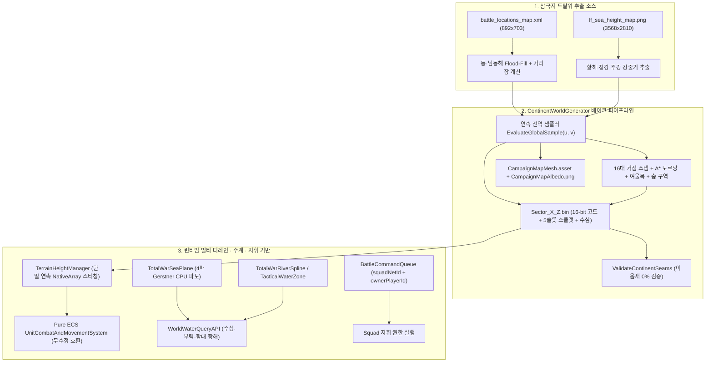

# 🗺️ 대륙 오픈월드 기반 · 멀티 터레인 수계 API · 삼국지 대륙 자동 생성기 기술 문서

## 💡 핵심 요약 & 역할 (Summary & Role)

- **핵심 목적**: [대륙_오픈월드_캠페인_및_지휘계통_멀티플레이_기획서.md](file:///c:/unityProject/MiniTotalWar2D/Docs/기획서/대륙_오픈월드_캠페인_및_지휘계통_멀티플레이_기획서.md)의 **Phase 1(멀티 터레인 · 절대 좌표 · 수계 부력 · 지휘 권한 기반)** 과 **Phase 2(삼국지 토탈워 `114.2km x 89.6km` 풀 스케일 온디맨드 대륙 자동 생성기)** 를 구현한 공용 오픈월드 기반 계층입니다.
- **가상 온디맨드 (On-the-Fly) 아키텍처**: `39,025`개(`223 x 175`) 섹터를 디스크에 수 테라바이트씩 미리 굽지 않고, 약 5~6MB의 초경량 마스터 캐시([WorldSourceCacheData](file:///c:/unityProject/MiniTotalWar2D/Assets/Scripts/World/ContinentWorldData.cs#L81))만 저장한 뒤 **전투 중인 3x3 구역만 런타임에 밀리초 단위로 즉석 합성**하는 착시 구조로 동작합니다.
- **실험 씬 무손상 보존 원칙**: 기존 [Game2.unity](file:///c:/unityProject/MiniTotalWar2D/Assets/Scenes/Game2.unity) 단일 터레인 전장 및 Pure ECS / GameObject 듀얼 전투 루프와 100% 하위 호환됩니다.

---

## 🌳 1. 아키텍처 트리 맵 (Tree Map)

```text
MiniTotalWar.OpenWorld (Phase 1 + Phase 2 On-the-Fly 114km 풀 스케일)
 ├── 1. 대륙 절대 좌표 & 원점 시프트 (WorldCoord.cs)
 │    ├── WorldCoord (SectorX/Z + LocalX/Z <-> double2 <-> Floating Origin 로컬 변환)
 │    ├── FloatingOriginManager (1,024m 임계 초과 시 512m 섹터 단위 원점 재정렬)
 │    └── BattleTransitionContext (교전 좌표, 방위, 계절/바람, 오프맵 포격, 증원 DTO)
 │
 ├── 2. 멀티 터레인 · 통합 수계 부력 API
 │    ├── TerrainHeightManager.cs (다중 Terrain 단일 연속 NativeArray 스티칭 -> Burst 무수정 호환)
 │    ├── TotalWarSeaPlane.cs (4파 Gerstner CPU 파도/법선 SampleWaveHeightAndNormal + 카메라 추적)
 │    ├── TotalWarRiverSpline.cs & TacticalWaterZone.cs (O(1) AABB/XZ 수계 샘플링 공용화)
 │    └── WorldWaterQueryAPI.cs (바다·강·늪지 통합 수심/유속/파도 법선/군함 항해 판정)
 │
 ├── 3. A안 지휘 권한 & 네트워크 ID 기반
 │    ├── Squad.cs / BattleRosterContext.cs / BattleManager.cs (squadNetId, ownerPlayerId, authorityMode)
 │    └── BattleCommand.cs / BattleCommandQueue.cs (AssignSquadOwner, SetAuthorityMode 및 권한 검증)
 │
 └── 4. 삼국지 대륙 단일 진실 원천(SSOT) & 런타임 즉석 합성 엔진
      ├── ContinentWorldData.cs (WorldMetaData, WorldSourceCacheData MTWC 포맷, MasterNetworkData, SectorBinaryData)
      ├── ContinentSectorSynthesizer.cs (런타임 공용: 메트릭 노이즈 + 정밀 도로 스플라인 + 즉석 섹터/숲 합성)
      ├── ContinentWorldGenerator.cs (892x703 Flood-Fill + 1784x1405 수계 + A* 도로망 + 640m 캠페인 3D 지도)
      └── ContinentWorldGeneratorWindow.cs (114.2km 풀 스케일 프리셋, 미리보기, 무결성 검증 UI)
```

---

## 🗂️ 2. 해시 테이블 메서드/구조체 색인표 (Hash Table Index)

| Key (메서드 / 구조체 / 클래스) | Value (역할 및 주요 의존성) | 소스 줄 번호 링크 |
| :--- | :--- | :--- |
| `WorldCoord` | 섹터(512m) + 로컬 좌표 기반 대륙 절대 좌표 구조체 및 방위각/거리 연산 | [WorldCoord.cs](file:///c:/unityProject/MiniTotalWar2D/Assets/Scripts/World/WorldCoord.cs#L34-L170) |
| `FloatingOriginManager` | 전선 이동 시 로컬 좌표를 512m 단위로 재정렬하고 `OnOriginShifted` 전파 | [WorldCoord.cs](file:///c:/unityProject/MiniTotalWar2D/Assets/Scripts/World/WorldCoord.cs#L179-L296) |
| `BattleTransitionContext` | 캠페인 지도와 오픈월드 전투 씬 간 교전 좌표·환경·포격·증원 전달 DTO | [WorldCoord.cs](file:///c:/unityProject/MiniTotalWar2D/Assets/Scripts/World/WorldCoord.cs#L340-L364) |
| `TerrainHeightData.SampleHeight` | 사각 다중 타일 해상도(`resolutionX`, `resolutionZ`) 지원 Burst-호환 높이 보간 | [TerrainHeightManager.cs](file:///c:/unityProject/MiniTotalWar2D/Assets/Scripts/TerrainHeightManager.cs#L33-L63) |
| `TerrainHeightManager.InitializeFromTerrains` | 다중 `Terrain` 타일을 단일 연속 `NativeArray<float>`로 스티칭 적재 | [TerrainHeightManager.cs](file:///c:/unityProject/MiniTotalWar2D/Assets/Scripts/TerrainHeightManager.cs#L277-L365) |
| `TotalWarSeaPlane.SampleWaveHeightAndNormal` | 셰이더 4파 Gerstner 파도와 1:1 일치하는 CPU 파도 높이 및 표면 법선 계산 | [TotalWarSeaPlane.cs](file:///c:/unityProject/MiniTotalWar2D/Assets/Scripts/TotalWarSeaPlane.cs#L143-L220) |
| `WorldWaterQueryAPI.SampleWaterAt` | 강 · 전술 수계 존 · 바다를 통합 조회해 수심 · 유속 · 군함 항해 가능 여부 반환 | [WorldWaterQueryAPI.cs](file:///c:/unityProject/MiniTotalWar2D/Assets/Scripts/World/WorldWaterQueryAPI.cs#L45-L150) |
| `TotalWarRiverSpline.TrySampleRiverAt` | Y 높이와 무관하게 XZ 평면에서 강 수면 · U자 수심 · 유속 방향 O(1) 조회 | [TotalWarRiverSpline.cs](file:///c:/unityProject/MiniTotalWar2D/Assets/Scripts/TotalWarRiverSpline.cs#L172-L240) |
| `Squad.CanBeCommandedBy` | 총사령관(`0`) 및 배정 장군(`1~15`) 명령 권한 검사 | [Squad.cs](file:///c:/unityProject/MiniTotalWar2D/Assets/Scripts/Squad.cs#L50-L54) |
| `BattleCommandQueue.IssueAssignSquadOwnerCommand` | 특정 부대 지휘권을 장군 플레이어 또는 AI에게 위임·회수 명령 발행 | [BattleCommandQueue.cs](file:///c:/unityProject/MiniTotalWar2D/Assets/Scripts/BattleCommandQueue.cs#L657-L686) |
| `WorldSourceCacheData` & `SaveSourceCache` | `MTWC` 포맷 초경량 대륙 참조 캐시 (XML 해안/산맥 + `1784x1405` 수계 + 도로 마스크) | [ContinentWorldData.cs](file:///c:/unityProject/MiniTotalWar2D/Assets/Scripts/World/ContinentWorldData.cs#L81-L390) |
| `ContinentSectorSynthesizer.EvaluateClimateAtUV` / `EvaluateBlendedClimateColor` | 도메인 워프 기반 곡선 5대 기후대 판정 및 부드러운 경계 색상 보간 | [ContinentSectorSynthesizer.cs](file:///c:/unityProject/MiniTotalWar2D/Assets/Scripts/World/ContinentSectorSynthesizer.cs#L184-L215) |
| `ContinentSectorSynthesizer.LoadOrSynthesizeSector` | 커스텀 `Sector_X_Z.bin` 우선 로드 또는 런타임 즉석 합성(`SynthesizeSector`) | [ContinentSectorSynthesizer.cs](file:///c:/unityProject/MiniTotalWar2D/Assets/Scripts/World/ContinentSectorSynthesizer.cs#L220-L360) |
| `ContinentSectorSynthesizer.ExtractSectorForests` | 섹터별 결정론적 시드로 전술 숲 구역 (`MasterForestData`) 즉석 추출 | [ContinentSectorSynthesizer.cs](file:///c:/unityProject/MiniTotalWar2D/Assets/Scripts/World/ContinentSectorSynthesizer.cs#L370-L430) |
| `ContinentWorldGenerator.GenerateContinent` | `WorldSourceCache.bin`, `MasterNetworks.json`, Hillshade 적용 `CampaignMapMesh` 일괄 생성 | [ContinentWorldGenerator.cs](file:///c:/unityProject/MiniTotalWar2D/Assets/Scripts/Editor/ContinentWorldGenerator.cs#L151-L228) |
| `ContinentWorldGenerator.ValidateContinentSeams` | 사전 파일 및 온디맨드 합성 섹터 간 경계 1픽셀 일치 여부 전수 검증 | [ContinentWorldGenerator.cs](file:///c:/unityProject/MiniTotalWar2D/Assets/Scripts/Editor/ContinentWorldGenerator.cs#L250-L315) |
| `ContinentWorldGeneratorWindow` | `TotalWar/🗺️ 대륙 오픈월드 자동 생성기` 풀 스케일 프리셋 · 미리보기 · 3대 씬 생성 버튼 UI | [ContinentWorldGeneratorWindow.cs](file:///c:/unityProject/MiniTotalWar2D/Assets/Scripts/Editor/ContinentWorldGeneratorWindow.cs#L11-L195) |

---

## 🔀 3. 유향 그래프 흐름도 (Directed Graph - Mermaid)



---

## ⚙️ 4. 주요 상태 변수, 데이터 구조체 & 인스펙터 옵션

### 4.1 `ContinentGenerationSettings` (대륙 생성 파라미터)
| 필드명 | 타입 | 기본값 | 상세 역할 |
| :--- | :--- | :--- | :--- |
| `continentId` | `string` | `"ThreeKingdoms_China"` | `Assets/WorldData/` 하위 생성 폴더 이름 |
| `sectorCountX` / `sectorCountZ` | `int` | `223` / `175` | 토탈워 원작(`114.2km x 89.6km`) 동일 체급의 가상 섹터 격자 (`39,025`개) |
| `sectorSizeMeters` | `float` | `512f` | 단일 섹터 가로·세로 미터 규격 |
| `useOnDemandSynthesis` | `bool` | `true` | 전투 중인 3x3 구역만 런타임 즉석 합성(On-the-Fly) 활성화 여부 |
| `campaignMapWidthMeters` | `float` | `640f` | 대륙 실제 크기와 무관하게 캠페인 3D 지도 테이블 가로폭 고정(m) |
| `heightmapResolution` | `int` | `129` | 섹터당 높이맵 해상도 (`129x129`, 경계 1픽셀 공유) |
| `alphamapResolution` | `int` | `128` | 5슬롯 스플랫 · 수심 · 기후 마스크 해상도 |
| `seaLevelY` / `maxTerrainHeight` | `float` | `20f` / `140f` | 전역 해수면 Y(m) 및 대륙 최대 고도(m) |
| `seed` | `int` | `190` | 절차적 세부 기복 및 숲 배치 시드 (반동탁 연합 190년) |

### 4.2 지휘 권한 및 수계·원점 주요 컴포넌트 필드
| 스크립트 / 필드 | 타입 | 기본값 | 상세 역할 |
| :--- | :--- | :--- | :--- |
| `Squad.squadNetId` | `uint` | `0` | 캠페인·멀티 공용 결정론적 부대 ID (스폰 시 자동 할당) |
| `Squad.ownerPlayerId` | `byte` | `0` | 소유 플레이어 ID (`0`: 총사령관, `1~15`: 휘하 장군, `255`: AI) |
| `Squad.authorityMode` | `SquadAuthorityMode` | `PlayerDirect` | 직접 지휘 / AI 부관 위임 전환 상태 |
| `BattleCommandQueue.enforceAuthorityCheck` | `bool` | `false` | `false`일 때 기존 싱글플레이 동작 보존, `true` 시 A안 권한 검증 |
| `TotalWarSeaPlane.followTargetCamera` | `bool` | `false` | 오픈월드에서 대양 평면이 카메라 XZ를 `cameraSnapStep`(32m) 간격으로 추적 |
| `FloatingOriginManager.shiftThresholdMeters` | `float` | `1024f` | 원점 시프트 발동 거리(m) |

---

## 🛠️ 5. 핵심 알고리즘, 수학 공식 & 조작법

1. **Y축 좌표계 정합 및 경계 이음새(Seam) 0% 보장 공식**:
   - XML(`battle_locations_map.xml`)은 `y=0`이 북쪽이므로 `fz = (1 - v) * (H - 1)`로 역변환하고, `Texture2D.LoadImage()`로 로드한 `lf_sea_height_map.png`는 `py=0`이 남쪽이므로 `sy = v * (H - 1)`로 직접 매핑합니다.
   - 모든 섹터 `(sx, sz)`의 격자점 `(ix, iz)`는 섹터 로컬 보간이 아닌 전역 정규화 좌표 `u = (sx * sectorSize + ix / (res - 1) * sectorSize) / TotalWidth`, `v = (sz * sectorSize + iz / (res - 1) * sectorSize) / TotalDepth`로 평가되어 동쪽·북쪽 맞닿은 경계 1픽셀이 비트 단위로 동일해집니다.

2. **CPU-GPU 1:1 Gerstner 파도 부력 공식 (`TotalWarSeaPlane.SampleWaveHeightAndNormal`)**:
   - 각 파동 `k = 2π / wavelength`, 파속 `c = sqrt(9.8 / k) * speedMult`, 위상 `f = k * (dot(dir, posXZ) - c * waveTime)`로 4파(파장 `22.0m`, `14.5m`, `8.7m`, `5.3m`)의 수직 변위 `y = (steepness / k) * sin(f) * (effAmp * 2.0)`와 접선 외적 법선을 합산합니다.

3. **에디터 사용 방법**:
   - 상단 메뉴 **`TotalWar > 🗺️ 대륙 오픈월드 자동 생성기 (Continent Generator)`** 선택
   - 대륙 규모 프리셋 선택(기본 권장: 삼국지 표준 `18x14` 섹터) -> **[🔍 미리보기]** 확인 -> **[🗺️ 대륙 오픈월드 일괄 생성]** 클릭 -> **[🧪 경계 이음새 0% 무결성 검증]** 실행.

---

## 🔗 6. 다른 스크립트와의 연동 관계 (Dependencies & Pipeline)

- [UnitCombatAndMovementSystem.cs](file:///c:/unityProject/MiniTotalWar2D/Assets/Scripts/ECS/Systems/UnitCombatAndMovementSystem.cs) & [UnitJobSimulationManager.cs](file:///c:/unityProject/MiniTotalWar2D/Assets/Scripts/UnitJobSimulationManager.cs): `TerrainHeightData` 구조체가 관리 참조 없이 Blittable 값을 유지하므로 3x3 멀티 타일 스티칭 후에도 무수정으로 지형 높이 · 법선 · 사선을 샘플링합니다.
- [TotalWarWater.shader](file:///c:/unityProject/MiniTotalWar2D/Assets/Shaders/TotalWarWater.shader): `TotalWarSeaPlane.SampleWaveHeightAndNormal`이 셰이더 `_TotalWarWindVector`, `_GerstnerAmp`, `_WaveChoppiness`를 공유해 시각 파도와 군함·부대 물 깊이 판정이 일치합니다.
- 향후 Phase 3(`OpenWorldBattle.unity` 심리스 스트리밍), Phase 4(`CampaignMap.unity`), Phase 5(타 지역 포격 · 역사적 적 AI), Phase 6(A안 Listen Server 멀티플레이)가 본 계층의 `Sector_X_Z.bin`, `WorldCoord`, `BattleTransitionContext`, `WorldWaterQueryAPI`, `SquadNetId`를 직접 사용합니다.
