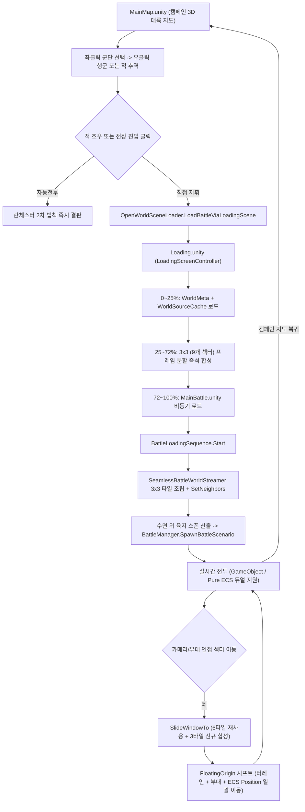

# 🎬 오픈월드 3대 씬 (MainMap · Loading · MainBattle) 및 3x3 심리스 스트리밍 가이드 문서

## 💡 핵심 요약 & 역할 (Summary & Role)

- **핵심 목적**: [Game2.unity](file:///c:/unityProject/MiniTotalWar2D/Assets/Scenes/Game2.unity) 실험용 씬을 일절 수정하지 않고 그대로 보존한 채, `114.2km x 89.6km` 중국 대륙 전체를 누비는 **캠페인 전략 지도 (`MainMap`)**, **비동기 지형 합성 로딩 (`Loading`)**, **3x3 심리스 오픈월드 전장 (`MainBattle`)** 의 3대 씬 순환 루프 및 에디터 원클릭 빌더를 구현했습니다.
- **무한 오픈월드 착시 구조**: 평소에는 `640m` 축소 3D 전략 지도에서 군단을 움직이다가, 교전이 발생한 좌표(`WorldCoord`)에서만 `3x3` 섹터(`1.54km x 1.54km`)를 즉석 합성해 3D 전장으로 진입하며, 전투 중 맵 끝으로 행군하면 인접 섹터가 실시간으로 연속 스트리밍됩니다.

---

## 🌳 1. 아키텍처 트리 맵 (Tree Map)

```text
오픈월드 3대 씬 순환 및 스트리밍 시스템
 ├── 1. 씬 중개 & SSOT 캐시 (OpenWorldSceneLoader.cs)
 │    ├── EnsureContinentLoaded (WorldMeta, WorldSourceCache, MasterNetworks 1회 로드)
 │    ├── PreSynthesizedSectors (Loading 씬에서 사전 합성한 3x3 섹터 버퍼)
 │    └── LoadBattleViaLoadingScene / LoadMainMapViaLoadingScene
 │
 ├── 2. Loading 씬 (LoadingScreenController.cs)
 │    ├── 1단계 (0~25%): 대륙 SSOT 데이터 및 참조 캐시 로드
 │    ├── 2단계 (25~72%): 진입 좌표 중심 3x3 섹터 프레임 분할 즉석 합성
 │    └── 3단계 (72~100%): SceneManager.LoadSceneAsync 비동기 씬 전개 + 전술 팁 표시
 │
 ├── 3. MainMap 씬 (MainMapController.cs)
 │    ├── 3D 캠페인 지형(CampaignMapMesh + MeshCollider + 대양 평면)
 │    ├── 전략 거점 마커(16대 거점·관문·여울목) & 아군/적군 군단 행군·추격
 │    └── 교전 팝업: [직접 지휘 (Loading -> MainBattle)] / [자동전투 (란체스터 결판)] / [후퇴]
 │
 ├── 4. MainBattle 씬 — Phase 3 심리스 전장 (BattleLoadingSequence.cs + SeamlessBattleWorldStreamer.cs)
 │    ├── 3x3 풀링 터레인 격자 (URP Terrain Lit + Layer 8 Ground + Neighbor 이음새 0%)
 │    ├── 슬라이딩 윈도우: 카메라/부대 섹터 이동 시 겹치는 6타일 재사용 + 외곽 3타일 재합성
 │    ├── Floating Origin 연동: 터레인 · 숲 · 바다 · 카메라 · Squad · Pure ECS 엔티티 일괄 시프트
 │    ├── BattleManager (deferAutoSpawnToExternalLoader + ConfigureEncounterSpawn)
 │    └── 전장 숲 구역 자동 배치 (TacticalForestZone.ApplyThemePreset)
 │
 └── 5. 에디터 원클릭 씬 빌더 (OpenWorldSceneBuilder.cs)
      ├── TotalWar > 오픈월드 3대 씬 일괄 생성 (MainMap · Loading · MainBattle)
      └── Prefabs(7종) · TerrainThemes(5종) · Ground/Unit LayerMask · Build Settings 자동 등록
```

---

## 🗂️ 2. 해시 테이블 메서드/구조체 색인표 (Hash Table Index)

| Key (클래스 / 메서드) | Value (역할 및 주요 의존성) | 소스 줄 번호 링크 |
| :--- | :--- | :--- |
| `OpenWorldSceneLoader` | 3대 씬 이름 상수, 대륙 SSOT 캐시 및 사전 합성 섹터 버퍼 중개 | [OpenWorldSceneLoader.cs](file:///c:/unityProject/MiniTotalWar2D/Assets/Scripts/World/OpenWorldSceneLoader.cs#L11-L105) |
| `OpenWorldSceneLoader.LoadBattleViaLoadingScene` | 교전 컨텍스트(`BattleTransitionContext`) 전달 후 `Loading` 경유 전장 진입 | [OpenWorldSceneLoader.cs](file:///c:/unityProject/MiniTotalWar2D/Assets/Scripts/World/OpenWorldSceneLoader.cs#L70-L89) |
| `LoadingScreenController` | 진행률 바·상태 텍스트·랜덤 전술 팁 갱신 및 9섹터 분할 합성 후 비동기 씬 전환 | [LoadingScreenController.cs](file:///c:/unityProject/MiniTotalWar2D/Assets/Scripts/World/LoadingScreenController.cs#L12-L135) |
| `MainMapController` | 3D 캠페인 대륙 지도 조작, 군단 이동, 적 조우 시 직접 지휘/자동전투 분기 처리 | [MainMapController.cs](file:///c:/unityProject/MiniTotalWar2D/Assets/Scripts/World/MainMapController.cs#L14-L600) |
| `MainMapController.WorldCoordToMapPos` | `WorldCoord` 절대 대륙 좌표 ↔ `640m` 캠페인 3D 메쉬 레이캐스트 좌표 양방향 변환 | [MainMapController.cs](file:///c:/unityProject/MiniTotalWar2D/Assets/Scripts/World/MainMapController.cs#L468-L496) |
| `SeamlessBattleWorldStreamer` | `3x3` 터레인 풀링, 5기후 5슬롯 스플랫/테마 바인딩, 연속 슬라이딩 스트리밍 | [SeamlessBattleWorldStreamer.cs](file:///c:/unityProject/MiniTotalWar2D/Assets/Scripts/World/SeamlessBattleWorldStreamer.cs#L14-L590) |
| `SeamlessBattleWorldStreamer.InitializeAtWorldCoord` | 중심 대륙 좌표 기준 9개 섹터 조립 + `TerrainHeightManager.InitializeFromTerrains` | [SeamlessBattleWorldStreamer.cs](file:///c:/unityProject/MiniTotalWar2D/Assets/Scripts/World/SeamlessBattleWorldStreamer.cs#L87-L115) |
| `SeamlessBattleWorldStreamer.SlideWindowTo` | 전선 이동 방향 6개 타일 재사용 + 반대편 3개 타일 재합성 및 이웃 재연결 | [SeamlessBattleWorldStreamer.cs](file:///c:/unityProject/MiniTotalWar2D/Assets/Scripts/World/SeamlessBattleWorldStreamer.cs#L140-L220) |
| `SeamlessBattleWorldStreamer.HandleOriginShifted` | `FloatingOriginManager` 재정렬 시 터레인·숲·바다·카메라·GameObject·Pure ECS 시프트 | [SeamlessBattleWorldStreamer.cs](file:///c:/unityProject/MiniTotalWar2D/Assets/Scripts/World/SeamlessBattleWorldStreamer.cs#L500-L580) |
| `BattleLoadingSequence` | `MainBattle` 진입 시 스트리머·해수면·바람·수면 위 양군 스폰·카메라 순차 초기화 | [BattleLoadingSequence.cs](file:///c:/unityProject/MiniTotalWar2D/Assets/Scripts/World/BattleLoadingSequence.cs#L10-L120) |
| `BattleManager.ConfigureEncounterSpawn` | 외부 부트스트래퍼가 교전 좌표·방위를 주입하고 배치 구역 라인을 동기화 | [BattleManager.cs](file:///c:/unityProject/MiniTotalWar2D/Assets/Scripts/BattleManager.cs#L223-L237) |
| `CameraController.SetRuntimeBounds` / `ShiftPosition` | 오픈월드 자유 카메라 경계 해제 및 원점 시프트 연동 평행 이동 | [CameraController.cs](file:///c:/unityProject/MiniTotalWar2D/Assets/Scripts/CameraController.cs#L451-L472) |
| `OpenWorldSceneBuilder.BuildAllOpenWorldScenes` | `Game2.unity` 무수정 보존 하에 3대 씬 생성 · 에셋 바인딩 · Build Settings 등록 | [OpenWorldSceneBuilder.cs](file:///c:/unityProject/MiniTotalWar2D/Assets/Scripts/Editor/OpenWorldSceneBuilder.cs#L35-L70) |

---

## 🔀 3. 3대 씬 순환 & 3x3 심리스 스트리밍 흐름도 (Mermaid)



---

## ⚙️ 4. 주요 상태 변수, 데이터 구조체 & 인스펙터 옵션

### 4.1 `SeamlessBattleWorldStreamer` 인스펙터 옵션
| 필드명 | 타입 | 기본값 | 상세 역할 |
| :--- | :--- | :--- | :--- |
| `continentId` | `string` | `"ThreeKingdoms_China"` | 로드할 `Assets/WorldData/` 하위 대륙 ID |
| `climateThemes` | `TotalWarTerrainTheme[]` | 길이 5 | `[0]Temperate, [1]Nanman, [2]Arid, [3]Subtropical, [4]Cold` 순 테마 배열 |
| `shoreGravelLayer` | `TerrainLayer` | `Pebbles_A` | 5슬롯 스플랫 중 5번째(`[4] 수변 자갈/모래`) 레이어 |
| `enableContinuousStreaming` | `bool` | `true` | 활성 시 0.25초마다 주시 대상 섹터 이탈 여부를 검사해 `3x3` 창 자동 슬라이딩 |
| `spawnTacticalForestZones` | `bool` | `true` | 섹터별 `ExtractSectorForests` 결과에 따라 `TacticalForestZone` 은신·수목 자동 배치 |

### 4.2 `MainMapController` 인스펙터 & 세션 옵션
| 필드명 | 타입 | 기본값 | 상세 역할 |
| :--- | :--- | :--- | :--- |
| `campaignMapMesh` / `campaignMapMaterial` | `Mesh` / `Material` | 자동 바인딩 | `CampaignMapMesh.asset` 및 `CampaignMapMaterial.mat` |
| `panSpeed` / `zoomSpeed` | `float` | `160f` / `240f` | WASD 팬 속도(Shift 2.2배) 및 휠 줌 속도 |
| `encounterRadiusMapMeters` | `float` | `14f` | 아군-적군 군단 교전 판정 반경(캠페인 테이블 기준 m) |

---

## 🛠️ 5. 핵심 알고리즘, 원점 재정렬 로직 & 사용법

1. **캠페인 ↔ 오픈월드 좌표 1:1 매핑**:
   - 캠페인 테이블 폭 `mapWidthMeters` (`640m`)와 대륙 실제 폭 `TotalWidthMeters` (`114,176m`)의 정규화 비율 `(u, v)`를 통해, `MainMap`의 클릭 좌표가 정확한 `WorldCoord(sectorX, sectorZ, localX, localZ)`로 변환되어 `MainBattle`의 산맥·강줄기·기후·해안선이 그대로 3D로 확대됩니다.
2. **슬라이딩 윈도우 6+3 재사용 알고리즘**:
   - 중심 섹터가 `(+1, 0)` 이동 시 기존 `3x3` 격자에서 겹치는 6개 `Terrain` 인스턴스는 위치·`TerrainData` 변경 없이 슬롯 참조만 쉬프트하고, 새로 노출된 동쪽 3개 타일에 대해서만 `SynthesizeSector()` + `SetHeights()` + `SetAlphamaps()`를 수행합니다.
3. **에디터 빌드 및 실행 절차**:
   - 1단계: `TotalWar > 🗺️ 대륙 오픈월드 자동 생성기` 창에서 **[🗺️ 대륙 오픈월드 일괄 생성]** 실행 (다듬어진 곡선 기후·Hillshade 텍스처 적용).
   - 2단계: 같은 창 하단 또는 상단 메뉴 **`TotalWar > 🎬 오픈월드 3대 씬 일괄 생성 (MainMap · Loading · MainBattle)`** 클릭 -> 3개 씬 파일 생성 및 `Build Settings` 자동 등록 완료.
   - 3단계: `Assets/Scenes/MainMap.unity`에서 Play 버튼을 눌러 `MainMap -> 적 교전/전장 진입 -> Loading -> MainBattle` 전체 흐름과 맵 끝 무한 스트리밍, 복귀 버튼 동작 확인.

---

## 🔗 6. 다른 스크립트와의 연동 관계 (Dependencies & Pipeline)

- [TerrainHeightManager.cs](file:///c:/unityProject/MiniTotalWar2D/Assets/Scripts/TerrainHeightManager.cs): `FinalizeTileGridBinding()`가 `InitializeFromTerrains()`를 호출해 3x3 다중 타일을 Burst 호환 단일 연속 높이맵으로 유지합니다.
- [TotalWarSeaPlane.cs](file:///c:/unityProject/MiniTotalWar2D/Assets/Scripts/TotalWarSeaPlane.cs): `followTargetCamera = true` 및 `ConfigureForWorldBounds()`를 통해 대양 평면이 3x3 전장 이동에 맞춰 자동으로 따라옵니다.
- [BattleManager.cs](file:///c:/unityProject/MiniTotalWar2D/Assets/Scripts/BattleManager.cs) & [PlayerController.cs](file:///c:/unityProject/MiniTotalWar2D/Assets/Scripts/PlayerController.cs): `deferAutoSpawnToExternalLoader = true`로 지형 조립 이후에 부대가 스폰되며, 런타임 생성 터레인이 `Ground` 레이어(`8`)를 부여받아 기존 마우스 드래그 진형 배치·전투 조작이 그대로 동작합니다.
